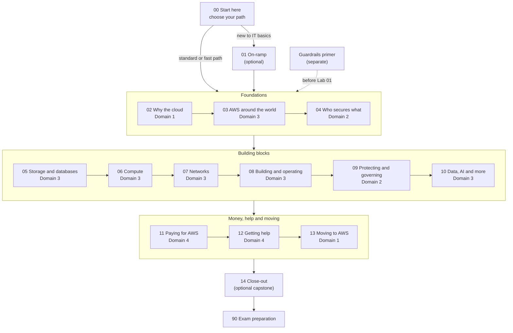

# This guide teaches you to understand AWS and use it safely; the exam follows from that

## Before anything else: two notices

**Your account, your responsibility.** This guide is provided as is, without warranty. We work hard to keep it correct and current, but AWS changes often, and its services, prices, and free offers may differ from what is written here. The labs run in your own AWS account. You are responsible for that account, for its security, and for any charges it incurs, including charges from resources you forget to delete. Automate the Cloud Inc. is not liable for any costs, losses, or security incidents that result from following, or failing to follow, this material. Technical guidance here is general information, not advice about your specific systems.

**Trademarks.** Automate the Cloud is not affiliated with, endorsed by, or sponsored by Amazon Web Services. AWS, Amazon Web Services, and AWS Certified Cloud Practitioner are trademarks of Amazon.com, Inc. or its affiliates. They are used here only to identify the exam this guide prepares you for.

## Who this guide is for

This is Automate the Cloud's study guide for the AWS Certified Cloud Practitioner exam, version CLF-C02. **AWS** (Amazon Web Services) is a company that rents computing power, storage and many other services over the internet. The exam checks that you understand what AWS offers, what it costs, and who keeps it secure.

The guide is written for an adult studying alone, possibly new to IT, who wants to understand AWS and use it safely, not only hold a certificate. We plan for about 5 hours a week. Reading works on a phone; the labs need a laptop or desktop.

AWS says the exam suits people without an IT background ([exam page](https://aws.amazon.com/certification/certified-cloud-practitioner/), checked 2026-10-23), so this guide explains every term the first time it appears.

**If you only want to memorize answers to pass, this guide isn't built for you.** It asks you to explain, predict and compare, and to build things in your own account. That takes longer than memorizing, but it lasts, and it prepares you for questions you haven't seen, which is every question on the real exam. No honest guide can promise you a pass, and we don't.

## What you'll be able to do

By the end, you can work alongside technical and business teams on cloud projects. You can:

- explain what moving to AWS changes for an organization and its costs;
- choose an AWS service for a stated need, and defend the choice against the likely alternatives;
- say whether AWS or the customer is responsible for a security task, for the service in use;
- run an AWS account safely, with protected sign-ins, only the access each person needs, cost alerts, labels on everything you create, and cleanup;
- estimate costs, read a bill, and know where to get help.

The exam tests the knowledge behind these; the hands-on work goes beyond it.

## How the guide is organized

Besides this start module, the guide has 14 modules, a separate guardrails primer and an exam-preparation section. A **module** is a group of pages built around one realistic task: it opens with a scenario and ends with you doing it.

Each module has short lessons, hands-on **labs** in your own AWS account, **simulations** (exercises on paper or on our site, for things that would cost money or carry risk in a real account), and a **mastery check** at the end. You pass a check at 80%. If you miss something, the check points you to the section to reread, and then you take a second check with new questions. Two modules differ: each on-ramp lesson opens with a short test-out instead, and Module 14 is a close-out lab with an optional review.

The guide is kept to what the exam tests. Each module from 02 to 13 ends with a **Beyond the exam** page: a short list of the topics it left out, each with the AWS page to read. Later, higher-level courses in this series will cover that material.

### The modules, by exam domain

The exam has four **domains** (subject areas), each with a weight: the share of the scored questions it gets. The modules below are grouped by the domain they mainly teach; [the exam at a glance](03-the-exam-at-a-glance.md#what-the-exam-tests-and-where-this-guide-covers-it) maps every task to its modules. The study order is the module number, not this grouping.

| # | Module | What you do by the end | Hours |
|---|---|---|---|
| 00 | Start here | Choose your path and plan your study | 2 |
| 01 | [On-ramp: IT foundations](../01-on-ramp/00-brief.md) (optional) | Explain servers, networks, data, APIs and everyday security | 1.5 |
| — | [Guardrails primer](https://github.com/AutomateTheCloud/atc-study-aws_account_guardrails/blob/main/primer/00-read-this-first.md) (separate) | Set up a safe AWS account before your first lab | 3–4 |
| | **Domain 1: Cloud Concepts, 24% of the exam** | | **5** |
| 02 | [Why organizations use the cloud](../02-why-the-cloud/00-brief.md) | Advise a bakery whether to move to the cloud | 3 |
| 13 | [Moving to AWS](../13-moving-to-aws/00-brief.md) | Build the case for moving ten applications | 2 |
| | **Domain 2: Security and Compliance, 30%** | | **7** |
| 04 | [Who secures what](../04-shared-responsibility-and-access/00-brief.md) | Give a teammate exactly the access they need, and prove it | 3 |
| 09 | [Protecting, governing and proving compliance](../09-protecting-and-governing/00-brief.md) | Answer an auditor and choose layered protections | 4 |
| | **Domain 3: Cloud Technology and Services, 34%** | | **11.5** |
| 03 | [AWS around the world](../03-aws-around-the-world/00-brief.md) | Choose Regions and a plan for surviving failure | 1.5 |
| 05 | [Storing data: storage and databases](../05-storing-data/00-brief.md) | Place files, backups and archives; pick databases | 3 |
| 06 | [Running applications: compute](../06-running-applications/00-brief.md) | Choose compute for three different workloads | 2.5 |
| 07 | [Connecting it: networks and the edge](../07-connecting-it/00-brief.md) | Design a simple, safe network | 1.5 |
| 08 | [Building and operating](../08-building-and-operating/00-brief.md) | Rebuild a setup the same way twice, and get alerts | 1.5 |
| 10 | [Data, AI and the rest of the catalog](../10-data-ai-and-more/00-brief.md) | Match six business requests to services | 1.5 |
| | **Domain 4: Billing, Pricing, and Support, 12%** | | **4.5** |
| 11 | [Paying for AWS](../11-paying-for-aws/00-brief.md) | Explain a bill, cut it, and estimate a new feature | 2.5 |
| 12 | [Getting help](../12-getting-help/00-brief.md) | Recommend a Support plan and route five issues | 2 |
| | **All domains** | | |
| 14 | [Close-out (optional capstone)](../14-capstone/00-brief.md) | Close out your lab account safely; optionally, review a workload against all six pillars | 1, plus 3 optional |
| 90 | [Exam preparation](../90-exam-prep/01-how-to-use-exam-prep.md) | Three mixed practice sets and two full practice exams | 5 |

Each module's hours are the time its brief states, for its lessons, core labs, simulations and mastery check. Optional labs are extra. Exam preparation is three mixed sets of about 45 minutes and two practice exams of 90 minutes. All hours are estimates until tested with learners.

Domain 3 gets the most hours because it lists the most services, but each of its eight tasks draws only about two questions. Domain 2 carries the most questions for each task.

### Labs: core and optional

The exam doesn't ask you to build anything, so only nine labs are part of the main path. They make the central ideas concrete and keep your account safe:

- **Core labs:** [Lab 01](../02-why-the-cloud/06-lab-01-first-resource.md) (a first storage bucket), [02](../03-aws-around-the-world/05-lab-02-see-the-global-infrastructure.md) (Regions and Availability Zones), [03](../04-shared-responsibility-and-access/06-lab-03-a-group-and-a-policy.md) (a group and a policy), [05](../05-storing-data/07-lab-05-versions-and-lifecycle.md) (versions and lifecycle), [08](../06-running-applications/06-lab-08-launch-and-terminate-an-instance.md) (a virtual server), [12](../09-protecting-and-governing/07-lab-12-answer-the-auditor.md) (evidence for an auditor), [15](../11-paying-for-aws/05-lab-15-pricing-calculator.md) (the Pricing Calculator), [17](../12-getting-help/05-lab-17-support-center-tour.md) (the Support Center) and [19](../14-capstone/03-lab-19-close-out.md) (closing out the account).
- **Optional labs:** 04, 06, 07, 09, 10, 11, 13, 14, 16 and 18. Each title starts "Optional lab", and each module's brief says when to do it. Optional labs 04 to 16 add about 6 hours; the capstone review with Optional lab 18 adds about 3 more.

*Notice that every path joins the same sequence after Start here, and that the domains are spread through it: you meet all four before the exam preparation. The guardrails primer must be done before the first lab, which is in module 02.*

**Long description.** A top-to-bottom map. 00 Start here leads to the optional 01 On-ramp, for learners new to IT basics, or straight to Foundations; the on-ramp also leads there. A dashed arrow, "before Lab 01", joins the separate guardrails primer to Foundations. Foundations holds 02 Why the cloud (Domain 1), 03 AWS around the world (Domain 3) and 04 Who secures what (Domain 2). It leads to Building blocks: 05 Storage and databases, 06 Compute, 07 Networks and 08 Building and operating (all Domain 3), 09 Protecting and governing (Domain 2) and 10 Data, AI and more (Domain 3). Then come Money, help and moving: 11 Paying for AWS and 12 Getting help (Domain 4) and 13 Moving to AWS (Domain 1). Last are 14 Close-out (optional capstone) and 90 Exam preparation.

## Three paths, one destination

Material that helps a newcomer slows down someone who already knows it, so the guide offers three paths:

| Path | Who it's for | What changes | Estimated time |
|---|---|---|---|
| **On-ramp** | You are weak on IT basics: servers, networks, data, APIs | Module 01 first. You can skip any on-ramp page by passing its short check | About 37.5 hours, or 8–9 weeks |
| **Standard** (the main path) | Most learners | Modules 02 to 14 in order, with the core labs, then exam preparation | About 36 hours, or about 8 weeks |
| **Fast** | You already work in IT or with AWS | Take each module's mastery check first. Pass it and you skip the lessons, but you still do the core labs and the exam preparation | About 17 hours, or about 4 weeks, plus the lessons of any module whose check you don't pass |

The main path's 36 hours add up as: Start here, 2; modules 02 to 13, 28; Lab 19, 1; exam preparation, 5. The fast path counts Start here, a first mastery check per module (about 4 hours), the nine core labs (about 6 hours) and exam preparation. Hours leave out the guardrails primer (3 to 4 hours on every path) and the optional labs; weeks include the primer, at about 5 hours a week. No path skips practice or feedback, because that is where the learning happens.

*Notice that the on-ramp adds only about an hour and a half, while the fast path saves about half. The table above has the same data.*

**Choosing your path.** A short diagnostic quiz, [Diagnostic: choose your path](06-diagnostic.md) (17 questions, about 20 minutes), ends this module. If you would rather skip the quiz, ask yourself: could you explain to a friend what a server, an IP address and a database are? If not, start with the on-ramp. Do you work in IT or with AWS every week? Then try the fast path, and switch to the standard path for any module whose check you don't pass.

> **Your turn:** Write down which path you'll start on, and one sentence on why. You can change your mind after the first module.

## What you need

- **Time:** about 5 hours a week. The [next page](02-how-to-study-with-this-guide.md) helps you plan when.
- **A device:** a laptop or desktop for the labs. Reading works on a phone.
- **For the labs, an AWS account of your own,** opened when you reach the primer, not before, because AWS's **Free plan** lasts up to 6 months. You need an email address and a payment card; AWS held USD $1 on the card for 3 to 5 days. On the Free plan you expect to pay $0: usage comes out of free credits ($100, plus up to $100 more for short activities), and the plan can't bill you unless you upgrade. All as of 2026-10-23; check [AWS Free Tier](https://aws.amazon.com/free/).
- **For the exam, if you take it:** USD 100 per attempt (as of 2026-10-23). [The exam at a glance](03-the-exam-at-a-glance.md) has the details.

## Summary

- The guide is for people who want to understand AWS and use it safely; the exam follows.
- It has 14 modules, each built around a task and grouped by the exam domain it teaches, and a guardrails primer before the first lab.
- Nine labs are core; the rest, and each module's Beyond the exam page, are optional.
- Choose the on-ramp, standard or fast path (about 37.5, 36 or 17 hours); none skips practice.
- You need about 5 hours a week, a computer, and later a Free plan AWS account.

**Next:** [How to study with this guide](02-how-to-study-with-this-guide.md).

## Where to check the current details

- [AWS Certified Cloud Practitioner exam page](https://aws.amazon.com/certification/certified-cloud-practitioner/), AWS (checked 2026-10-23)
- [AWS Certified Cloud Practitioner (CLF-C02) exam guide](https://docs.aws.amazon.com/aws-certification/latest/cloud-practitioner-02/cloud-practitioner-02.html), AWS (checked 2026-10-23)
- [AWS Free Tier](https://aws.amazon.com/free/), AWS (checked 2026-10-23)

---

"Welcome" by Automate the Cloud Inc., licensed under CC BY-NC 4.0 with the Additional Permission for Internal Training from Automate the Cloud Inc.
License: https://creativecommons.org/licenses/by-nc/4.0/
Permission: https://automatethe.cloud/licenses/atc-internal-training-permission.txt
