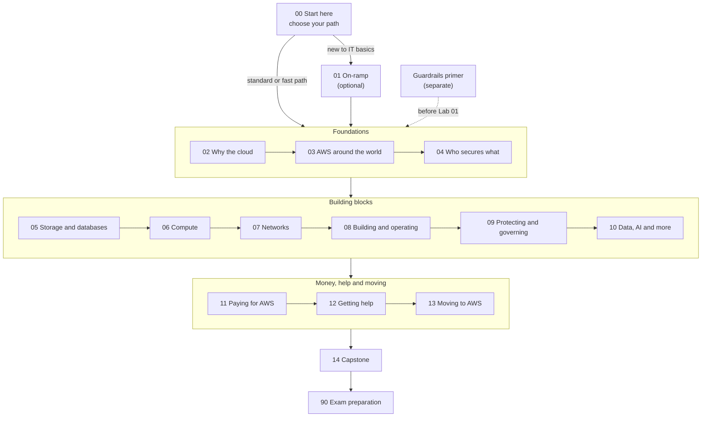

# This guide teaches you to understand AWS and use it safely; the exam follows from that

## Before anything else: two notices

**Your account, your responsibility.** This guide is provided as is, without warranty. We work hard to keep it correct and current, but AWS changes often, and its services, prices, and free offers may differ from what is written here. The labs run in your own AWS account. You are responsible for that account, for its security, and for any charges it incurs, including charges from resources you forget to delete. Automate the Cloud Inc. is not liable for any costs, losses, or security incidents that result from following, or failing to follow, this material. Technical guidance here is general information, not advice about your specific systems.

**Trademarks.** Automate the Cloud is not affiliated with, endorsed by, or sponsored by Amazon Web Services. AWS, Amazon Web Services, and AWS Certified Cloud Practitioner are trademarks of Amazon.com, Inc. or its affiliates. They are used here only to identify the exam this guide prepares you for.

## Who this guide is for

This is Automate the Cloud's study guide for the AWS Certified Cloud Practitioner exam, version CLF-C02. **AWS** (Amazon Web Services) is a company that rents computing power, storage and many other services over the internet. The exam checks that you understand what AWS offers, what it costs, and who keeps it secure.

The guide is written for an adult studying alone, possibly new to IT, who wants to understand AWS and use it safely, not only hold a certificate. We plan for about 5 hours a week. Reading works on a phone; the labs need a laptop or desktop.

AWS says the exam suits people without an IT background ([exam page](https://aws.amazon.com/certification/certified-cloud-practitioner/), checked 2026-10-23), so this guide explains every term the first time it appears.

**If you only want to memorize answers to pass, this guide isn't built for you.** It asks you to explain, predict and compare, and to build things in your own account. That takes longer than memorizing, but it lasts, and it prepares you for questions you haven't seen, which is every question on the real exam. No honest guide can promise you a pass, and we don't.

## What you'll be able to do

By the end, you can work alongside technical and business teams on cloud projects. You can:

- explain what moving to AWS changes for an organization and its costs;
- choose an AWS service for a stated need, and defend the choice against the likely alternatives;
- say whether AWS or the customer is responsible for a security task, for the service in use;
- run an AWS account safely, with protected sign-ins, only the access each person needs, cost alerts, labels on everything you create, and cleanup;
- estimate costs, read a bill, and know where to get help.

The exam tests the knowledge behind these; the hands-on work goes beyond it.

## How the guide is organized

Besides this start module, the guide has 14 modules, a separate guardrails primer and an exam-preparation section. A **module** is a group of pages built around one realistic task: it opens with a scenario and ends with you doing it.

Each module has short lessons, hands-on **labs** in your own AWS account, **simulations** (exercises that run on our site or on paper, for things that would cost money or carry risk in a real account), and a **mastery check** at the end. You pass a check at 80%. If you miss something, the check points you to the section to reread, and then you take a second check with new questions. Two modules differ: each on-ramp lesson opens with a short test-out instead, and the capstone is scored with a rubric.

| # | Module | What you do by the end | Hours |
|---|---|---|---|
| 00 | Start here | Choose your path and plan your study | 1 |
| 01 | On-ramp: IT foundations (optional) | Explain servers, networks, data, APIs and everyday security | 5 |
| — | [Guardrails primer](https://github.com/AutomateTheCloud/atc-study-aws_account_guardrails/blob/main/primer/00-read-this-first.md) (separate) | Set up a safe AWS account before your first lab | 3–4 |
| 02 | [Why organizations use the cloud](../02-why-the-cloud/00-brief.md) | Advise a bakery whether to move to the cloud | 4 |
| 03 | [AWS around the world](../03-aws-around-the-world/00-brief.md) | Choose Regions and a plan for surviving failure | 3 |
| 04 | [Who secures what](../04-shared-responsibility-and-access/00-brief.md) | Give a teammate exactly the access they need, and prove it | 5 |
| 05 | Storing data: storage and databases | Place files, backups and archives; pick databases | 4.5 |
| 06 | Running applications: compute | Choose compute for three different workloads | 3.5 |
| 07 | Connecting it: networks and the edge | Design a simple, safe network | 3.5 |
| 08 | Building and operating | Rebuild a setup the same way twice, and get alerts | 3.5 |
| 09 | Protecting, governing and proving compliance | Answer an auditor and choose layered protections | 5.5 |
| 10 | Data, AI and the rest of the catalog | Match six business requests to services | 2.5 |
| 11 | Paying for AWS | Explain a bill, cut it, and estimate a new feature | 4 |
| 12 | Getting help | Recommend a Support plan and route five issues | 3 |
| 13 | Moving to AWS | Build the case for moving ten applications | 3.5 |
| 14 | Capstone: a Well-Architected review | Review your own lab workload and cost the fixes | 3 |
| 90 | Exam preparation | Mixed practice and full practice exams | 8 |

Hours are estimates until tested with learners. Modules without a link are still being written.

*Notice that every path joins the same sequence after Start here, and that the guardrails primer must be done before the first lab, which is in module 02.*

**Long description.** A top-to-bottom map. 00 Start here leads to the optional 01 On-ramp, for learners new to IT basics, or straight to Foundations (modules 02 to 04); the on-ramp also leads there. A dashed arrow, "before Lab 01", joins the separate guardrails primer to Foundations. Foundations leads to Building blocks (05 to 10), then Money, help and moving (11 to 13), then 14 Capstone and 90 Exam preparation.

## Three paths, one destination

Material that helps a newcomer slows down someone who already knows it, so the guide offers three paths:

| Path | Who it's for | What changes | Estimated time |
|---|---|---|---|
| **On-ramp** | You are weak on IT basics: servers, networks, data, APIs | Module 01 first. You can skip any on-ramp page by passing its short check | About 62 hours, or 13–14 weeks |
| **Standard** | Most learners | Modules 02 to 14 in order | About 57 hours, or 12–13 weeks |
| **Fast** | You already work in IT or with AWS | Take each module's mastery check first. Pass it and you skip the lessons, but you still do the hardest lab, the review and the mixed practice | About 25 hours, or about 6 weeks |

Hours leave out the guardrails primer (3 to 4 hours on every path); weeks include it, at about 5 hours a week. No path skips practice or feedback, because that is where the learning happens.

*Notice that the on-ramp adds only about 5 hours, while the fast path saves more than half. The table above has the same data.*

**Choosing your path.** A short diagnostic quiz, [Diagnostic: choose your path](06-diagnostic.md) (17 questions, about 20 minutes), ends this module. If you would rather skip the quiz, ask yourself: could you explain to a friend what a server, an IP address and a database are? If not, start with the on-ramp. Do you work in IT or with AWS every week? Then try the fast path, and switch to the standard path for any module whose check you don't pass.

> **Your turn:** Write down which path you'll start on, and one sentence on why. You can change your mind after the first module.

## What you need

- **Time:** about 5 hours a week. The [next page](02-how-to-study-with-this-guide.md) helps you plan when.
- **A device:** a laptop or desktop for the labs. Reading works on a phone.
- **For the labs, an AWS account of your own,** opened when you reach the primer, not before, because AWS's **Free plan** lasts up to 6 months. You need an email address and a payment card; AWS held USD $1 on the card for 3 to 5 days. On the Free plan you expect to pay $0: usage comes out of free credits ($100, plus up to $100 more for short activities), and the plan can't bill you unless you upgrade. All as of 2026-10-23; check [AWS Free Tier](https://aws.amazon.com/free/).
- **For the exam, if you take it:** USD 100 per attempt (as of 2026-10-23). [The exam at a glance](03-the-exam-at-a-glance.md) has the details.

## Summary

- The guide is for people who want to understand AWS and use it safely; the exam follows.
- It has 14 modules, each built around a task, and a guardrails primer before the first lab.
- Choose the on-ramp, standard or fast path; none skips practice.
- You need about 5 hours a week, a computer, and later a Free plan AWS account.

**Next:** [How to study with this guide](02-how-to-study-with-this-guide.md).

## Where to check the current details

- [AWS Certified Cloud Practitioner exam page](https://aws.amazon.com/certification/certified-cloud-practitioner/), AWS (checked 2026-10-23)
- [AWS Certified Cloud Practitioner (CLF-C02) exam guide](https://docs.aws.amazon.com/aws-certification/latest/cloud-practitioner-02/cloud-practitioner-02.html), AWS (checked 2026-10-23)
- [AWS Free Tier](https://aws.amazon.com/free/), AWS (checked 2026-10-23)

---

"Welcome" by Automate the Cloud Inc., licensed under CC BY-NC 4.0 with the Additional Permission for Internal Training from Automate the Cloud Inc.
License: https://creativecommons.org/licenses/by-nc/4.0/
Permission: https://automatethe.cloud/licenses/atc-internal-training-permission.txt
