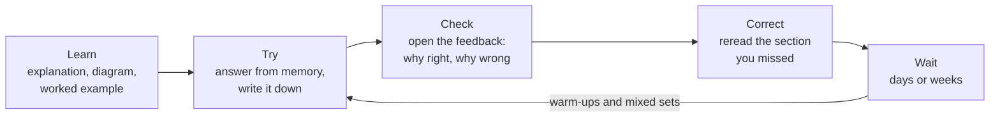

# You learn by pulling ideas out of memory, spread over time, not by reading them again

Reading a page twice feels like learning, but answering questions from memory, with feedback, works better. Spreading that practice over days and weeks makes it last. Every page in this guide is built around those two ideas. By the end of this page you can explain why, and you have a written study plan.

**For:** an adult studying alone, possibly new to IT. **Time:** about 25 minutes, plus 10 to write your plan. Reading works on a phone.

**Before you start:** read [Welcome](01-welcome.md) first, if you haven't, so you know which path you are on.

## What you'll learn

By the end of this page, you can:

- explain why answering questions from memory beats rereading, and why effective study feels harder (objective 00.02a);
- write a study plan that says when, where and for how long you will study (objective 00.02b).

Guess before you read on. The answers are below.

1. Your exam is in six weeks. Which helps more: reading a chapter three times, or reading it once and then answering questions on it from memory?
2. After a study session, you feel you understood everything easily. Is that a good sign?

## Rereading feels productive; answering from memory works better

When you reread, the page feels familiar, and familiarity feels like knowing. But recognizing something when it is in front of you is not the same as producing it when it isn't, which is what the exam and real work ask of you.

**Retrieval** means pulling an idea out of your own memory: answering a question, explaining a term aloud, or sketching a diagram without looking. Each successful retrieval makes the memory easier to reach next time. This is one of the most reliable findings in learning research. In real classrooms the benefit of quizzing is moderate rather than dramatic, and it is larger when learners get **feedback**: an explanation of why the answer is right and why the others are wrong.

Rereading isn't useless. It just loses to retrieval when you spend the same time on each.

## Spread your practice out, and expect to forget a little

**Spacing** means coming back to a topic after a gap of days or weeks, instead of studying it many times in one sitting. Spaced practice is remembered longer. When you return after a gap, you will have forgotten some of it, and the effort of recalling it is part of what makes it stick. If you aren't sure how long to wait, a gap that is a bit too long costs much less than one that is too short.

The guide does the spacing for you. Each lesson starts with a warm-up on earlier modules, and mixed practice sets come after modules 05, 09 and 13.

## Mix similar topics once you know each one

**Interleaving** means mixing practice on topics that are easy to confuse, instead of practicing one topic at a time. The exam often asks you to choose between services that sound alike. Mixed practice trains you to spot the difference that decides between them.

Mixing works best after a short, separate introduction to each topic. That is why each lesson first teaches its topic on its own, and later practice mixes it with others.

## Effective study feels harder, and that's normal

The methods that work tend to feel worse while you use them. In one well-known study, students in classes that made them work actively learned more, but felt they had learned less than students who listened to a polished lecture. Students also often rate spacing as worse than cramming, even when it helped them more.

So don't judge a session by how smooth it felt. Judge it by what you can do afterwards, without the page in front of you.

> **Your turn:** A friend says: "I read the chapter twice and it all made sense, so I know it." In two or three sentences, explain what they are mistaking for knowledge, and suggest a better test.

Model answer

They are mistaking familiarity for knowledge: the ideas felt easy because the page was in front of them. A better test is to close the book and explain the main points, or answer questions, from memory. Whatever they can't produce is what they need to study next.

## Memorizing a question bank isn't learning the subject

Drilling the same set of practice questions until you recognize them raises your score on those questions, not your understanding. The real exam uses questions you haven't seen. This guide's practice uses new scenarios, and its practice exams count only questions you haven't answered before.

Never use "real exam questions" shared online. [The exam at a glance](03-the-exam-at-a-glance.md) explains why that can cost you your certification.

## Each page is built around a loop: try, check, correct, return

Every lesson repeats one cycle, which the diagram shows.

*Notice that the loop returns to "Try", not to "Learn". After the first time, you meet a topic again as a question, not as a page to reread.*

**Long description.** Five steps from left to right. Learn (explanation, diagram, worked example) leads to Try (answer from memory, write it down), then to Check (open the feedback: why right, why wrong), then to Correct (reread the section you missed), then to Wait (days or weeks). An arrow labeled "warm-ups and mixed sets" goes from Wait back to Try.

Here is how each part of a lesson fits that loop:

| Part of the page | What you do | Why it's there |
|---|---|---|
| **Warm-up** | Answer two or three questions on earlier topics | Spaced retrieval of what you learned before |
| **What you'll learn** and a few guesses | Read the goals, then guess answers before you study | Guessing first helps you notice those answers when they appear |
| **Big-picture diagram** | See how the parts fit before the details | A labeled diagram beside the words helps most for systems with many parts |
| **Worked example** | Follow an expert's thinking, step by step | Showing the reasoning helps beginners more than discovering it alone |
| **Your turn** and **Check** | Answer, write it down, then open the feedback | Retrieval with feedback that explains every option |
| **Summary** and **Practice** | Recall the whole lesson | One more retrieval before you leave the topic |
| **Labs** | Build, find and delete real things in your own account | Doing the task, not only reading about it |
| **Mastery check** | Score 80% to move on; otherwise reread and take a second check | A gap gets found and fixed before you build on it |

**Use the feedback blocks properly.** Answer first, in writing or aloud, then open the block. Opening it first turns retrieval back into rereading. A wrong answer followed by feedback still teaches you; a skipped question teaches nothing.

## Write your study plan

People who decide in advance *when* and *where* they will do something are more likely to do it. In large online courses, though, plan-making helped only in the first week or two. So a plan gets you started; reviewing it each week keeps it working.

Fill this in now, on paper or in a note:

| Question | Your answer |
|---|---|
| Which days and times will you study? (About 5 hours a week, in sessions of 30 to 90 minutes) | |
| Where will you study, and on what device? | |
| When is your first session, and what will you do in it? | |
| If you miss a session, when will you make it up? | |
| When will you look at this plan again? (We suggest the end of each module) | |
| Where will you keep notes on questions you got wrong? | |

**What to expect, honestly:**

- The standard path takes about 12 weeks at 5 hours a week. That is an estimate until we test the guide with learners.
- You will get warm-up questions wrong, especially at first. That is the method working, not a sign you are failing.
- Progress will sometimes feel slow. Look back at your notes on wrong answers every few weeks: the list of things you couldn't answer before, and now can, is your evidence.
- Liking a session isn't proof you learned from it, and struggling isn't proof you didn't.

## Summary

- **Answering from memory, with feedback**, beats rereading the same material.
- **Spacing** your practice over days and weeks makes it last; forgetting a little between sessions is part of it.
- **Mixing** similar topics, after learning each one, trains you to tell them apart.
- **Effective study feels harder.** Familiar is not the same as known.
- **Each page** follows the loop: learn, try, check, correct, return later.
- **A written plan** helps you start; review it at the end of each module.

## Practice

1. **Which study session is likely to help most for an exam in six weeks?**

   A. Reading the module three times on one evening
   B. Highlighting the key terms, then rereading the highlights
   C. Answering the module's questions from memory, checking the feedback, and repeating them a week later
   D. Watching a video summary of the module twice

   

Feedback

   **C is right.** It combines retrieval, feedback and spacing.

   - **A is wrong.** Three readings in one sitting is rereading without spacing; it builds familiarity more than recall.
   - **B is wrong.** Highlighting and rereading feel productive, but they lose to retrieval for the same time spent.
   - **D is wrong.** Watching twice is still taking in, not producing. Follow it with questions.

   

2. **Why does the guide put a warm-up on earlier modules at the start of each lesson?**

   

Feedback

   **Model answer:** It makes you retrieve earlier topics after a gap, which is spaced practice. Each time you recall a topic after some forgetting, it lasts longer, and the warm-up shows you what you need to review.

   

3. **You open a feedback block before answering, read the answer, and think "yes, I knew that." What went wrong, and what should you do instead?**

   

Feedback

   **Model answer:** Seeing the answer made it feel familiar, so you can't tell whether you could have produced it. Answer first, in writing or aloud, then open the block and compare.

   

**Next:** [The exam at a glance](03-the-exam-at-a-glance.md).

## Where this comes from

These are the research reviews behind this page, by author and year, for readers who want to go further:

- Retrieval and feedback: Roediger and Karpicke (2006); Rowland (2014); Yang and others (2021).
- Spacing: Cepeda and others (2008); Carpenter, Pan and Butler (2022).
- Interleaving: Brunmair and Richter (2019).
- Guessing before you study (prequestions): Pan and Carpenter (2023).
- Feeling of learning: Deslauriers and others (2019); Kornell and Bjork (2008).
- Study plans: Gollwitzer and Sheeran (2006); Kizilcec and others (2020).
- Drilling a fixed set of questions: Koretz (2005).

---

"How to study with this guide" by Automate the Cloud Inc., licensed under CC BY-NC 4.0 with the Additional Permission for Internal Training from Automate the Cloud Inc.
License: https://creativecommons.org/licenses/by-nc/4.0/
Permission: https://automatethe.cloud/licenses/atc-internal-training-permission.txt
