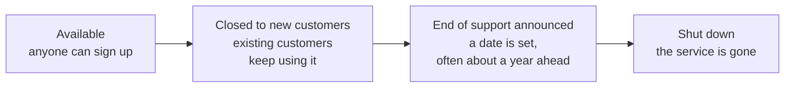

# AWS is a moving target, so this guide dates its facts and teaches both old and new names

AWS renames services, closes some, changes its plans and redesigns its console all the time, and its own pages don't always keep up. This guide dates every fact that changes and gives you both the exam's name and today's name. By the end of this page you can recognize out-of-date material and know where to check.

**For:** an adult studying alone, possibly new to IT. **Time:** about 20 minutes. Reading works on a phone.

**Before you start:** don't worry if most service names below mean nothing yet; the modules teach them. Here, notice the pattern.

## What you'll learn

By the end of this page, you can spot study material that is out of date, and say where to check the current fact (objective 00.04a).

Guess first; the answer is below. A video course from 2024 says AWS has five Support plans, including "Developer" and "Enterprise On-Ramp". Is it still right?

## AWS changes faster than its own pages

AWS releases changes continuously. The timeline shows a selection from about fourteen months.

*Notice that changes arrive steadily, some announced months ahead. Material written a year ago can be wrong on several.*

**Long description.** A vertical timeline, earliest at the top. Already happened: 2025-11-07 Snowball, Migration Hub and Application Discovery Service close to new customers; 2025-12-02 new Support plans; 2026-04-30 Audit Manager closes to new accounts; 2026-05-20 Inspector Classic shuts down; 2026-07-30 Kendra closes to new customers; 2026-09-16 a new sign-up experience; by 2026-09-27 the exam guide is revised. A line marks today, 2026-10-24. Still to come: 2026-10-29 WorkSpaces Secure Browser closes to new customers; 2026-12-31 Snowball support ends and the Italian and German exams retire; 2027-01-01 the old Support plans end.

AWS's pages also disagree with each other while they catch up. Two examples we met while writing this guide:

- **How long the free offer lasts.** Some AWS pages said 6 months and others 12. When we opened a real account, both appeared: the Free plan lasts up to 6 months, ending sooner if its credits run out, while the account's Credits page showed the credits expiring after 12 months, which matters only after an upgrade. Module 11 explains the two clocks (as of 2026-10-23).
- **How many checks AWS Trusted Advisor runs.** Three AWS pages gave three different totals for this account-checking tool, so module 12 teaches its check categories instead of a number.

## AWS uses three words for a service on its way out

AWS publishes a central list of services and features that are being retired ([AWS lifecycle changes](https://docs.aws.amazon.com/general/latest/gr/service-lifecycle.html)). It uses three stages, and so does this guide:

*Notice that a service can stay "closed to new customers" for a long time: still in the exam guide, but not available to a new account.*

**Long description.** Four stages from left to right. Available: anyone can sign up. Closed to new customers: existing customers keep using it. End of support announced: a date is set, often about a year ahead. Shut down: the service is gone.

**What this means for you:** a service closed to new customers is still taught while the exam lists it, but never used in a lab. A shut-down service appears only so you can reject it as a wrong answer.

## This guide gives you the exam's name and today's name

The exam guide sometimes lags behind AWS's renames. AWS revised the CLF-C02 exam guide in 2026 without changing the exam code, and we can't confirm from which date the live exam's questions use the new wording ([exam guide](https://docs.aws.amazon.com/aws-certification/latest/cloud-practitioner-02/cloud-practitioner-02.html), compared with archived copies, 2026-10-23). So you need to recognize both names.

At the first mention in each module, the guide gives the exam's name, then today's, for example "Amazon AppStream 2.0 (now Amazon WorkSpaces Applications)". After that, questions use the exam's name, and labs use today's name, as the console does.

## Renames and retirements you will meet in older material

Checked on 2026-10-23. Module numbers say where the guide teaches each.

| Older material says | Today (as of 2026-10-23) | Source |
|---|---|---|
| Support plans: Basic, Developer, Business, Enterprise On-Ramp, Enterprise | Basic, Business Support+, Enterprise and Unified Operations, since 2025-12-02. Developer and Business take no new customers. All three old paid plans end on 2027-01-01 (module 12) | [Support plans end of support](https://docs.aws.amazon.com/awssupport/latest/user/support-plans-eos.html) |
| The Free Tier: 12 months free | New accounts get credits ($100, plus up to $100 more for short activities) and choose a Free plan or a Paid plan. The Free plan lasts up to 6 months, or until the credits run out (module 11; [primer](https://github.com/AutomateTheCloud/atc-study-aws_account_guardrails/blob/main/primer/00-read-this-first.md)) | [AWS Free Tier](https://aws.amazon.com/free/) |
| Changing your Support plan needs the root user | No longer on AWS's list of tasks only the root user can do (module 04) | [AWS account root user](https://docs.aws.amazon.com/IAM/latest/UserGuide/id_root-user.html) |
| AWS Single Sign-On | AWS IAM Identity Center, renamed 2022-07-26 (module 04) | [What is IAM Identity Center?](https://docs.aws.amazon.com/singlesignon/latest/userguide/what-is.html) |
| Amazon SageMaker, for building machine-learning models | Amazon SageMaker AI, renamed 2024-12-03 (module 10) | [What is SageMaker AI?](https://docs.aws.amazon.com/sagemaker/latest/dg/whatis.html) |
| Amazon QuickSight | Amazon Quick Sight, part of Amazon Quick (module 10) | [Quick Sight docs](https://docs.aws.amazon.com/quicksight/latest/user/welcome.html) |
| Amazon AppStream 2.0 (still the exam's name) | Amazon WorkSpaces Applications (module 10) | [AppStream 2.0 docs](https://docs.aws.amazon.com/appstream2/latest/developerguide/what-is-appstream.html) |
| Amazon WorkSpaces Web | Amazon WorkSpaces Secure Browser, closed to new customers from 2026-10-29 (module 10) | [What is Secure Browser?](https://docs.aws.amazon.com/workspaces-web/latest/adminguide/what-is-workspaces-secure-browser.html) |
| Amazon Connect, the contact center (still the exam's name) | Amazon Connect Customer; "Amazon Connect" now names a family of products (module 10) | [What is Amazon Connect?](https://docs.aws.amazon.com/connect/latest/adminguide/what-is-amazon-connect.html) |
| AWS Application Migration Service (still the exam's name) | AWS Transform MGN (module 13) | [Product page](https://aws.amazon.com/application-migration-service/) |
| AWS Security Hub, one product | Two: Security Hub CSPM (the original) and a new, unified Security Hub (module 09) | [Security Hub docs](https://docs.aws.amazon.com/securityhub/latest/userguide/what-is-securityhub.html) |
| AWS Snowball as the answer for moving large amounts of data | Closed to new customers since 2025-11-07; support ends 2026-12-31; removed from the exam guide (modules 05 and 13) | [AWS Snowball](https://aws.amazon.com/snowball/) |
| AWS OpsWorks, AWS CodeStar, AWS Snowmobile, AWS Cloud9 | Shut down in 2024. AWS Cloud9 is closed to new customers | [Full shutdown list](https://docs.aws.amazon.com/general/latest/gr/full_shutdown_services.html); [Cloud9 docs](https://docs.aws.amazon.com/cloud9/latest/user-guide/welcome.html) |
| The TCO Calculator | Gone; its address leads to the AWS Pricing Calculator (modules 11 and 13) | [AWS Pricing Calculator](https://calculator.aws/) |
| Two types of Savings Plans | Four: Compute, Database, EC2 Instance and SageMaker AI (module 11) | [Savings Plans types](https://docs.aws.amazon.com/savingsplans/latest/userguide/plan-types.html) |

> **Your turn:** A practice question asks which Support plan a small company should choose, and its four answer choices are Basic, Developer, Business and Enterprise On-Ramp. Using the table, say what is wrong with the question, and what you would check.

Model answer

Three of the four choices are retiring plans: Developer and Business take no new customers, and all three end on 2027-01-01. The question was written for the old lineup. The current plans are Basic, Business Support+, Enterprise and Unified Operations. Check AWS's Support plans page for what each current plan includes, and treat the question as out of date. Module 12 teaches the current plans.

## Where to check

When a fact in any study material, including this guide, might have changed, check these:

| To check | Look at |
|---|---|
| A service's current name | The title of its AWS documentation page ("What is …?") |
| Whether a service is closing or closed | [AWS lifecycle changes](https://docs.aws.amazon.com/general/latest/gr/service-lifecycle.html), and the service's own documentation |
| What the exam covers | The [CLF-C02 exam guide](https://docs.aws.amazon.com/aws-certification/latest/cloud-practitioner-02/cloud-practitioner-02.html) |
| Free plan and credits | [AWS Free Tier](https://aws.amazon.com/free/) |
| Support plans | [Compare AWS Support plans](https://aws.amazon.com/premiumsupport/plans/) |

If a screen or price differs from this guide, trust the live AWS page.

## Summary

- **AWS changes continuously**, and its pages sometimes disagree.
- **Three stages** mark a service on its way out: closed to new customers, end of support, shut down.
- **Learn both names**: the exam's, then today's.
- **Older material is often wrong** on Support plans, the Free Tier and service names.
- **Check the live AWS page** for anything dated.

## Practice

1. **A service is "closed to new customers". Which is true?**

   A. Nobody can use it any more.
   B. Customers who already use it can keep using it, but a new account can't sign up.
   C. It is about to be renamed.
   D. It costs more for new customers.

   

Feedback

   **B is right.** Closed to new customers means existing customers keep using it; new ones can't start.

   - **A is wrong.** That describes a shut-down service.
   - **C is wrong.** A rename is a different change; the service stays open.
   - **D is wrong.** Closing has nothing to do with price; new customers simply can't sign up.

   

2. **Why does this guide give both the exam's name and today's name for some services?**

   

Feedback

   **Model answer:** The exam guide doesn't always use AWS's current names, and we can't confirm which wording live exam questions use. The console shows today's name. Knowing both lets you answer the exam and work in a real account.

   

**Next:** [Before your first lab](05-before-your-first-lab.md).

---

"AWS changes fast" by Automate the Cloud Inc., licensed under CC BY-NC 4.0 with the Additional Permission for Internal Training from Automate the Cloud Inc.
License: https://creativecommons.org/licenses/by-nc/4.0/
Permission: https://automatethe.cloud/licenses/atc-internal-training-permission.txt
