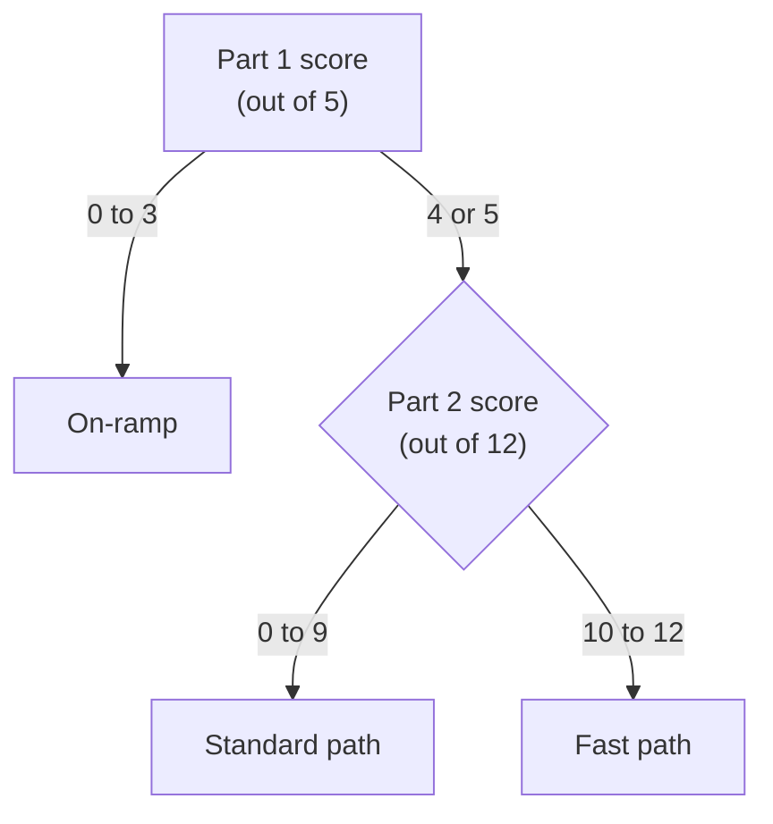

# Seventeen questions point you to the path through the guide that fits what you already know

This short quiz finds where to start. Part 1 checks the IT basics that the AWS modules take for granted; Part 2 asks one question from each AWS module. Your two scores pick the on-ramp, the standard path or the fast path from [Welcome](01-welcome.md#three-paths-one-destination).

**Exam guide:** [Domain 1, Cloud Concepts](https://docs.aws.amazon.com/aws-certification/latest/cloud-practitioner-02/cloud-practitioner-02-domain1.html) (24% of the exam): tasks [1.3](https://docs.aws.amazon.com/aws-certification/latest/cloud-practitioner-02/cloud-practitioner-02-domain1.html#cloud-practitioner-02-task1.3) and [1.4](https://docs.aws.amazon.com/aws-certification/latest/cloud-practitioner-02/cloud-practitioner-02-domain1.html#cloud-practitioner-02-task1.4); [Domain 2, Security and Compliance](https://docs.aws.amazon.com/aws-certification/latest/cloud-practitioner-02/cloud-practitioner-02-domain2.html) (30% of the exam): tasks [2.2](https://docs.aws.amazon.com/aws-certification/latest/cloud-practitioner-02/cloud-practitioner-02-domain2.html#cloud-practitioner-02-task2.2) and [2.3](https://docs.aws.amazon.com/aws-certification/latest/cloud-practitioner-02/cloud-practitioner-02-domain2.html#cloud-practitioner-02-task2.3); [Domain 3, Cloud Technology and Services](https://docs.aws.amazon.com/aws-certification/latest/cloud-practitioner-02/cloud-practitioner-02-domain3.html) (34% of the exam): tasks [3.2](https://docs.aws.amazon.com/aws-certification/latest/cloud-practitioner-02/cloud-practitioner-02-domain3.html#cloud-practitioner-02-task3.2), [3.3](https://docs.aws.amazon.com/aws-certification/latest/cloud-practitioner-02/cloud-practitioner-02-domain3.html#cloud-practitioner-02-task3.3), [3.4](https://docs.aws.amazon.com/aws-certification/latest/cloud-practitioner-02/cloud-practitioner-02-domain3.html#cloud-practitioner-02-task3.4), [3.5](https://docs.aws.amazon.com/aws-certification/latest/cloud-practitioner-02/cloud-practitioner-02-domain3.html#cloud-practitioner-02-task3.5) and [3.7](https://docs.aws.amazon.com/aws-certification/latest/cloud-practitioner-02/cloud-practitioner-02-domain3.html#cloud-practitioner-02-task3.7); [Domain 4, Billing, Pricing, and Support](https://docs.aws.amazon.com/aws-certification/latest/cloud-practitioner-02/cloud-practitioner-02-domain4.html) (12% of the exam): tasks [4.1](https://docs.aws.amazon.com/aws-certification/latest/cloud-practitioner-02/cloud-practitioner-02-domain4.html#cloud-practitioner-02-task4.1) and [4.3](https://docs.aws.amazon.com/aws-certification/latest/cloud-practitioner-02/cloud-practitioner-02-domain4.html#cloud-practitioner-02-task4.3).

**For:** an adult studying alone, possibly new to IT, who has read [Welcome](01-welcome.md) and wants to know where to begin. **Time:** about 20 minutes, with no time limit. Reading works on a phone.

## How to take the diagnostic

Answer every question before you open any answer.

- **No notes, no searching, no AWS account.** The quiz measures what you know today, so looking things up only sends you down the wrong path.
- **Mark every guess,** for example with a question mark on paper. A lucky guess counts as wrong when you score, because recognizing a word isn't the same as knowing it.
- **Expect to miss things in Part 2.** It covers what the whole guide teaches. A low Part 2 score is normal, and it isn't a bad result: it just means the lessons are for you.
- **Score each part separately.** Each question is worth one point. A "(Select TWO.)" question scores only if both of your choices are right.

The answers explain why each choice is right or wrong, and say where the guide teaches the idea. Read them for the questions you got right, too.

## Part 1: IT basics

These five questions come from the optional on-ramp, Module 01.

**1.** A small firm rents a virtual server from a cloud provider: 2 processor cores (vCPUs) and 8 GiB of memory. Its monthly report now needs about 12 GiB of data in memory at once. While the report runs, the server slows to a crawl, the processor is 30% busy and the disk is half empty. What should the firm change, and why can the change take minutes rather than weeks?

- A. More storage; the provider attaches a bigger disk while the server keeps running
- B. More memory; the provider restarts it with a bigger share of hardware already running
- C. More processor cores; the provider adds virtual cores without any restart
- D. More memory; the provider buys a new physical server for each customer who resizes

<details><summary>Answer</summary>

**B is right.** Memory is the part that runs out first, the **bottleneck**: the report needs 12 GiB in memory and the server has 8. A virtual server is software on a physical server that is already running, so the provider can start it again with a bigger share of memory, on the same machine or another one, in minutes.

- **A is wrong.** The disk is half empty, so storage isn't what runs out. Adding to a part that isn't full changes nothing, however quickly it can be done.
- **C is wrong.** The processor is only 30% busy. More cores wouldn't give the report anywhere to hold its data.
- **D is wrong.** More memory is the right change, but the reason isn't. Providers fill machines they already run with many virtual servers; nobody waits for a new machine to be bought.

**Taught in:** [Computers and servers](../01-on-ramp/01-computers-and-servers.md) and [Data centers and virtualization](../01-on-ramp/04-data-centers-and-virtualization.md).

</details>

**2.** Customers type `cakes.example` into their browsers and get a message that the site can't be found. A technician confirms that the shop's web server is running, and that it answers requests sent from the internet straight to its IP address, `203.0.113.25`, on port 443. Which step of the journey has most likely failed?

- A. Securing the line: the server's certificate has expired
- B. Answering: the server's processor is too busy to reply
- C. Looking up the name: DNS isn't giving out the server's address
- D. Traveling: a firewall on the way blocks traffic to port 443

<details><summary>Answer</summary>

**C is right.** Before a browser can send anything, DNS must turn the name into an IP address. The server works when it is reached by its address, so the step that fails is the one that comes before the address is known: the name lookup.

- **A is wrong.** An expired certificate stops the connection after the server has been found, and the browser warns about the certificate. It doesn't say the site can't be found.
- **B is wrong.** The technician's requests get answers, so the server is answering.
- **D is wrong.** Requests from the internet to port 443 get through, so no firewall is blocking that port.

**Taught in:** [Networks, IP addresses, DNS and HTTPS](../01-on-ramp/02-networks-ip-dns-https.md).

</details>

**3.** A gift shop's program saves each sale in two steps: first the order, then its payment. One day the power fails between the two steps. If the sales were kept in a spreadsheet file, part of the file might be saved and part not. But the shop keeps its sales in a database, and its program makes the two steps one transaction. What does the database keep from that sale?

- A. Neither step: a transaction is saved whole or not at all
- B. The order but not the payment, because the order was sent first
- C. Both steps, because the database holds them in memory until the power returns
- D. A damaged copy of both steps, which staff must repair by hand

<details><summary>Answer</summary>

**A is right.** A **transaction** groups changes so that either all of them are saved or none are, even if the power fails halfway. The shop never ends up with an order that has no payment, or a payment with no order.

- **B is wrong.** That half-saved result is exactly what a transaction prevents.
- **C is wrong.** Memory empties when the power stops. What the database had confirmed is in storage; an unfinished transaction is not.
- **D is wrong.** A half-written file is a problem of files. The database engine is in charge of its data and doesn't leave half a change behind.

**Taught in:** [Files vs databases](../01-on-ramp/03-files-vs-databases.md).

</details>

**4.** A delivery company's API sends back this JSON about one van:

```json
{"van": "V2", "stops": [{"shop": "North", "boxes": 12}, {"shop": "Harbor", "boxes": 5}], "driver": {"name": "Kim", "start": "06:30"}}
```

Which statement is correct?

- A. The van makes three stops: North, Harbor and Kim
- B. The van makes two stops, and 12 boxes go to Harbor
- C. `driver` is a list of two drivers, Kim and 06:30
- D. The van makes two stops, and 5 boxes go to Harbor

<details><summary>Answer</summary>

**D is right.** Read the shape first. `stops` has square brackets, so it is a list, and it holds two objects. In the second object, `"shop": "Harbor"` sits beside `"boxes": 5`.

- **A is wrong.** Kim is inside `driver`, a separate object, not inside the `stops` list.
- **B is wrong.** There are two stops, but 12 boxes belong with North, in the first object.
- **C is wrong.** `driver` has curly brackets, so it is one object with two name-value pairs: the driver's name and start time.

**Taught in:** [APIs, the command line and JSON](../01-on-ramp/05-apis-command-line-and-json.md).

</details>

**5.** A bookkeeper used the same password for a hobby forum and for her firm's accounting app. The forum is broken into, and its list of email addresses and passwords is published. Which two habits would have stopped an attacker from signing in to the accounting app with that password? (Select TWO.)

- A. HTTPS on the accounting app's website
- B. A different password for every account
- C. Encryption of the accounting app's stored data
- D. A longer version of the same shared password
- E. MFA on the accounting app

<details><summary>Answer</summary>

**B and E are right.** With a different password for each account, the leaked one opens only the forum. With MFA, the attacker also needs a second proof, such as the bookkeeper's passkey or phone, which the leak didn't contain.

- **A is wrong.** HTTPS protects data while it travels. The attacker would sign in over HTTPS like anyone else.
- **C is wrong.** Encryption at rest protects stored data from someone who takes the disk. It doesn't stop someone who signs in with a valid password.
- **D is wrong.** Length stops guessing, not theft. The leak hands over the whole password, however long it is.

**Taught in:** [Everyday security](../01-on-ramp/06-everyday-security.md).

</details>

## Part 2: one question from each AWS module

These twelve questions follow the guide's modules in order, from Module 02 to Module 13. If you have never used AWS, answer what you can, mark your guesses, and move on.

**6.** A pumpkin farm's booking website needs 1 server for ten months of the year and 4 servers in September and October. If the farm owns its servers, it must keep 4 all year, at $100 per server-month for everything owning costs. Renting cloud servers costs $150 per server-month, paid only for the servers it runs. All the numbers are made up. If the farm rents exactly what it needs each month, which is cheaper over a year?

- A. Owning, by about $2,400, because renting 4 servers all year costs more than owning them
- B. Renting, by about $2,100, because it pays for 18 server-months instead of 48
- C. Neither, because both options must pay for the four-server peak
- D. Owning, because its price per server-month is lower

<details><summary>Answer</summary>

**B is right.** Owning means paying for 4 servers every month: 48 server-months at $100, or $4,800. Renting what it needs means 10 months of 1 server plus 2 months of 4: 18 server-months at $150, or $2,700. Renting costs $2,100 less, because the farm stops paying for servers that would sit idle for ten months.

- **A is wrong.** Renting 4 servers all year would cost $7,200, but the farm rents only what it needs. Keeping peak capacity running all year is how the cloud ends up costing more.
- **C is wrong.** Only owning pays for the peak all year. Renting pays for the peak only in the two months that need it.
- **D is wrong.** The rate per server-month is lower for owning, but owning pays for many more server-months. The total is what counts.

**Taught in:** [What a data center really costs](../02-why-the-cloud/04-what-a-data-center-really-costs.md), Module 02.

</details>

**7.** An online shop's contract says its customers' data must stay inside the European Union (EU). Most of its customers are in Sweden. In this made-up case, Europe (Stockholm) doesn't offer one service the shop depends on. Europe (Frankfurt), Europe (Ireland) and Europe (London) all offer it; the shop's tests show Frankfurt answers Swedish customers fastest of the three, and its estimate for London is the cheapest. Which Region should the shop choose?

- A. Europe (Stockholm), because it is the Region nearest to the shop's customers
- B. Europe (London), because it offers the service at the lowest price of the three
- C. Europe (Frankfurt), because it is the fastest EU Region that offers the service
- D. Europe (Ireland), because any EU Region that offers the service will do equally well

<details><summary>Answer</summary>

**C is right.** Choose a Region in order: rules first, then services, then closeness to users and price. The contract removes London, which is in the United Kingdom, outside the EU. The missing service removes Stockholm. Of the two Regions left, Frankfurt is faster for the shop's customers.

- **A is wrong.** Closeness comes after rules and services. A Region without a service the shop depends on can't run the shop, however close it is.
- **B is wrong.** Price only ranks Regions that are still allowed. London is outside the EU, so it breaks the contract. Check the country, not only the word "Europe" in the Region's name.
- **D is wrong.** Ireland meets the contract and has the service, but the shop's own tests show Frankfurt answers its customers faster. Among the allowed Regions, closeness to users decides.

**Taught in:** [Choosing a Region](../03-aws-around-the-world/02-choosing-a-region.md), Module 03.

</details>

**8.** An IAM user, Priya, is in a user group whose policy allows `s3:GetObject` and `s3:PutObject` on the bucket `menu-photos`, which means reading and uploading its files. A policy attached to Priya herself denies `s3:PutObject` on that bucket. The bucket's own policy also allows Priya to upload. What can Priya do in the bucket?

- A. Read and upload files, because the group's policy and the bucket's policy both allow uploading
- B. Nothing, because one deny on the bucket blocks every action on it
- C. Read files only, because the explicit deny on uploading overrides both allows
- D. Upload files only, because a policy attached to the user replaces the group's policy

<details><summary>Answer</summary>

**C is right.** AWS evaluates all the policies that apply together. An explicit deny always wins, so uploading is denied however many policies allow it. Reading is allowed by the group's policy and denied by nothing, so it works.

- **A is wrong.** Allows never outweigh an explicit deny.
- **B is wrong.** The deny names one action, `s3:PutObject`. Other actions are decided on their own.
- **D is wrong.** Policies add up; one doesn't replace another. And uploading is the action that is denied.

**Taught in:** [Policies and least privilege](../04-shared-responsibility-and-access/04-policies-and-least-privilege.md), Module 04.

</details>

**9.** A research lab's analysis tool runs inside its PostgreSQL database server, and the tool's vendor requires it to have access to that server's operating system. Which way of running the database fits, and what does the lab take on?

- A. PostgreSQL on Amazon EC2; the lab patches the server and database and runs its own backups
- B. Amazon RDS for PostgreSQL; AWS patches the operating system, and the lab installs the tool on it
- C. Amazon Aurora PostgreSQL; a Multi-AZ deployment gives the lab access to the operating system
- D. Amazon RDS for PostgreSQL with a read replica; the lab installs the tool on the replica's server

<details><summary>Answer</summary>

**A is right.** AWS recommends a managed database for most needs, but access to the server's operating system is one of the reasons to run your own. On EC2 the lab gets that access, and with it the work that RDS would have done: patching the operating system and the database software, backups, replication and failover.

- **B is wrong.** On RDS, AWS runs the operating system, and customers don't get access to it. That is what makes it managed.
- **C is wrong.** Aurora is part of the RDS family, so AWS runs its operating system too. A Multi-AZ deployment adds a standby; it doesn't open the operating system to you.
- **D is wrong.** A read replica is a managed RDS database as well, with no operating system access. It takes extra reads; it doesn't change who runs the server.

**Taught in:** [Managed or self-managed databases](../05-storing-data/05-managed-or-self-managed-databases.md), Module 05.

</details>

**10.** A team wants as little as possible to manage. Which pairing of workload and compute service is the best fit?

- A. A data import that runs for about two hours once a night: AWS Lambda
- B. A web API, packaged as a container image, that answers requests all day: Amazon ECS on AWS Fargate
- C. A tool that needs changes to the operating system of the server it runs on: AWS Fargate
- D. Resizing each uploaded photo, about two seconds of work each: an EC2 instance that runs all day

<details><summary>Answer</summary>

**B is right.** The API is already in a container and keeps running, so Amazon ECS on AWS Fargate runs it with no servers for the team to manage.

- **A is wrong.** A Lambda function runs for at most 15 minutes each time it is started; two hours is far too long.
- **C is wrong.** Fargate runs the servers for you, so it gives you no access to their operating system. Work that needs that control belongs on Amazon EC2.
- **D is wrong.** A server running all day for a few seconds of work per photo means paying for idle time and managing a server. Short work started by an event fits Lambda.

**Taught in:** [Containers and serverless](../06-running-applications/03-containers-and-serverless.md), Module 06.

</details>

**11.** A shop's web servers sit in a public subnet and its database in a private subnet of the same VPC. Which two settings keep people on the internet from reaching the database directly? (Select TWO.)

- A. The private subnet's route table has no route to an internet gateway
- B. The web servers in the public subnet have their own public IPv4 addresses
- C. An internet gateway is attached to the VPC and used by the public subnet
- D. The database's security group accepts its port only from the web servers' group
- E. The database's storage is encrypted at rest with a key from AWS KMS

<details><summary>Answer</summary>

**A and D are right.** A subnet is public only if its route table sends traffic to an internet gateway, so with no such route the database's subnet has no path to or from the internet. The security group is a second, independent layer: it accepts the database port only from resources in the web servers' security group.

- **B is wrong.** Public addresses let customers reach the web servers. They do nothing to keep anyone away from the database.
- **C is wrong.** The internet gateway is what lets internet traffic into the public subnet. Attaching it makes nothing private.
- **E is wrong.** Encryption at rest protects the stored data. It doesn't decide who can connect to the database.

**Taught in:** [Your own network](../07-connecting-it/01-your-own-network.md) and [Filtering traffic](../07-connecting-it/02-filtering-traffic.md), Module 07.

</details>

**12.** A café's online ordering runs on an AWS Lambda function. The owner wants an email whenever the function reports more than five errors in five minutes. Which two pieces together do this? (Select TWO.)

- A. An AWS CloudTrail trail that records each error the function raises
- B. AWS X-Ray tracing on the function, set to email failed requests
- C. An Amazon CloudWatch alarm on the function's `Errors` metric
- D. An Amazon SES identity verified for the café's email domain
- E. An Amazon SNS topic with the owner's email subscribed and confirmed

<details><summary>Answer</summary>

**C and E are right.** Lambda sends its error count to CloudWatch as a metric. A CloudWatch alarm watches that metric against the threshold, and when it goes into the alarm state it notifies an SNS topic. The topic emails every subscriber who has confirmed the subscription.

- **A is wrong.** CloudTrail records who did what in the account, such as who changed the function. It doesn't record the function's errors or send alerts.
- **B is wrong.** X-Ray traces single requests to find the slow or failing part. It doesn't send email to anyone.
- **D is wrong.** SES sends a business's own email to customers. An alarm's email is an SNS notification, and needs no SES.

**Taught in:** [Watching workloads](../08-building-and-operating/03-watching-workloads.md), Module 08.

</details>

**13.** An auditor asks a bakery chain to show what its payment server's security group allowed on each day of the last three months, and to flag any day on which it allowed SSH from anywhere on the internet. A year ago, the chain turned on recording of its resources' settings and of the activity in its account. Which service answers both parts of the question?

- A. AWS Config
- B. AWS CloudTrail
- C. Amazon CloudWatch
- D. AWS Artifact

<details><summary>Answer</summary>

**A is right.** AWS Config records how each resource was set over time, and its rules mark resources that break a requirement, such as SSH open to everyone, as noncompliant.

- **B is wrong.** CloudTrail records the actions that changed the security group: who, when and from where. It doesn't keep the group's settings day by day or judge them against a rule.
- **C is wrong.** CloudWatch measures how things run and keeps logs. It doesn't record a security group's settings.
- **D is wrong.** AWS Artifact provides AWS's own audit reports, about the controls AWS runs. It says nothing about the chain's security groups.

**Taught in:** [Who did what](../09-protecting-and-governing/01-who-did-what.md), Module 09.

</details>

**14.** A city council receives thousands of scanned letters from residents. It wants the text of each letter pulled out, and then each letter tagged with the places and organizations it mentions, so that it reaches the right department. The council has no machine learning staff. Which two services, used one after the other, do this? (Select TWO.)

- A. Amazon Rekognition
- B. Amazon Textract
- C. Amazon Translate
- D. Amazon Comprehend
- E. Amazon Polly

<details><summary>Answer</summary>

**B and D are right.** Ask what goes in and what must come out. A scanned letter goes into Textract, which returns its text. The text goes into Comprehend, which returns what it mentions, such as places and organizations (its "entities"). Both are ready-made, so the council needs no machine learning skills.

- **A is wrong.** Rekognition describes images and video, such as objects and faces. Reading documents is Textract's job.
- **C is wrong.** Translate changes text from one language into another. The letters need reading and tagging, not translating.
- **E is wrong.** Polly turns text into speech. Nothing here needs to be spoken.

**Taught in:** [AI and machine learning](../10-data-ai-and-more/02-ai-and-ml.md), Module 10.

</details>

**15.** Which pairing of workload and Amazon EC2 purchasing option is the best fit?

- A. A web tier that runs all year at the same size: Spot Instances
- B. A two-week trial whose running hours can't be predicted: a three-year Reserved Instance
- C. Overnight test runs that simply start again if a server is taken away: Spot Instances
- D. A database that runs all year, to get a lower rate: an On-Demand Capacity Reservation

<details><summary>Answer</summary>

**C is right.** Spot Instances give the deepest discount, but AWS can take a server back with two minutes' warning. Work that can stop and start again loses only time.

- **A is wrong.** A web tier that must always be up shouldn't depend on servers that can be taken away. Steady, all-year use fits a Savings Plan or a Reserved Instance.
- **B is wrong.** A three-year commitment is paid whether or not it's used, so it suits steady use for years, not a two-week trial. On-Demand fits the trial.
- **D is wrong.** A Capacity Reservation guarantees that capacity will be there, at the On-Demand rate. It gives no discount of its own.

**Taught in:** [Purchasing options](../11-paying-for-aws/02-purchasing-options.md), Module 11.

</details>

**16.** Which pairing of question and AWS tool is right?

- A. "Is AWS planning maintenance on the hardware under our instances?": AWS Trusted Advisor
- B. "Is Amazon S3 having trouble in our Region right now?": AWS Support Center
- C. "Who deleted our photo bucket last night?": the AWS Health Dashboard
- D. "Do any of our security groups leave a port open to everyone?": AWS Trusted Advisor

<details><summary>Answer</summary>

**D is right.** Trusted Advisor checks the setup of your own account against AWS's best practices, and security groups with ports open to everyone are one of its checks.

- **A is wrong.** Planned maintenance is an event on AWS's side, which AWS Health reports in the "Your account health" view. Trusted Advisor looks only at what you built.
- **B is wrong.** Whether a service is having trouble is also an AWS Health question. Support Center is where you ask a person for help with your own account.
- **C is wrong.** AWS Health reports AWS's events, not your users' actions. Who deleted something is a question for AWS CloudTrail.

**Taught in:** [Tools that watch your account](../12-getting-help/02-tools-that-watch-your-account.md), Module 12.

</details>

**17.** A museum group is planning its move to AWS. Its marketing director insists that visitors' email addresses be encrypted, and readable only by the newsletter team. In the AWS Cloud Adoption Framework (AWS CAF), which perspective does this concern belong to?

- A. Business
- B. Security
- C. People
- D. Platform

<details><summary>Answer</summary>

**B is right.** Map a concern by what is at stake, not by who raises it. Protecting data and deciding who may read it are in the Security perspective.

- **A is wrong.** A marketing director raised it, but the Business perspective is about which work is worth doing and the value it brings, not about protecting data.
- **C is wrong.** The People perspective covers skills, roles and how the organization changes.
- **D is wrong.** The Platform perspective covers building the cloud environment and the systems on it, not who may read the data.

**Taught in:** [The Cloud Adoption Framework](../13-moving-to-aws/01-the-cloud-adoption-framework.md), Module 13.

</details>

## Score yourself, then choose your path

Write down two scores: **Part 1** (questions 1 to 5, out of 5) and **Part 2** (questions 6 to 17, out of 12). Count every guess as wrong. Part 1 decides whether you need the on-ramp first; Part 2 decides between the standard path and the fast path.



*Notice that Part 2 only matters once Part 1 is solid. The fast path assumes the IT basics; without them, its pretests would mislead you.*

**Long description.** A decision flowchart. Start with the Part 1 score, out of 5. From 0 to 3: the on-ramp. From 4 or 5: look at the Part 2 score, out of 12. From 0 to 9: the standard path. From 10 to 12: the fast path.

| Part 1 (of 5) | Part 2 (of 12) | Your path | Start here |
|---|---|---|---|
| 0 to 3 | Any | **On-ramp** | [Module 01: On-ramp](../01-on-ramp/00-brief.md). Each lesson opens with a test-out, so you skip what you already know |
| 4 or 5 | 0 to 9 | **Standard** | [Module 02: Why organizations use the cloud](../02-why-the-cloud/00-brief.md), then every module in order |
| 4 or 5 | 10 to 12 | **Fast** | The fast path's instructions in [Welcome](01-welcome.md#three-paths-one-destination): take each module's mastery check first, as a pretest |

**If Part 1 was 4,** take the test-out of the on-ramp lesson your missed question names under "Taught in", and read that lesson if the test-out shows a gap. Then go on with your path.

**On the fast path,** each module's mastery check decides for that module. Pass it and you skip the lessons, but you still do the module's core lab, if it has one, and the mixed practice. Below 80%, work through that module's lessons as the standard path does. Ten of twelve here is a reason to try the fast path, not proof that you can skip anything.

**The diagnostic is a starting point, not a verdict.** Paths join the same modules, and you can switch at any time. If the on-ramp feels slow, its test-outs let you move faster; if the fast path's checks keep sending you back, the standard path will save you time.

> **Your turn:** Write down your two scores, the path they point to, and the first page you will open. If you disagree with the result, write one sentence on why, and look at it again after your first module.

Whichever path you take, you set up a safe AWS account with the [guardrails primer](https://github.com/AutomateTheCloud/atc-study-aws_account_guardrails/blob/main/primer/00-read-this-first.md) before Lab 01, the first lab, in Module 02. [Before your first lab](05-before-your-first-lab.md) says what to have ready.

---

"Diagnostic: choose your path" by Automate the Cloud Inc., licensed under CC BY-NC 4.0 with the Additional Permission for Internal Training from Automate the Cloud Inc.
License: https://creativecommons.org/licenses/by-nc/4.0/
Permission: https://automatethe.cloud/licenses/atc-internal-training-permission.txt
