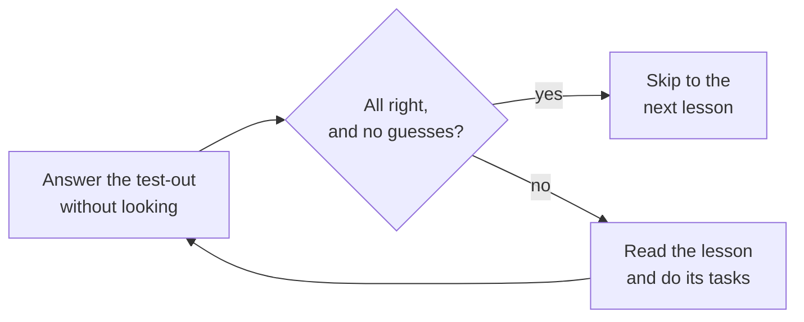

# Module 01: Explain how one online order travels from a customer's phone to the bakery's records, and how it stays safe

This optional module teaches the IT basics that the AWS modules use without explaining: servers, networks, data, data centers, APIs and everyday security. Each lesson starts with a short test, so you can skip what you already know.

**For:** an adult studying alone, new to IT, who wants to understand AWS and use it safely. You chose the on-ramp path in [Welcome](../00-start-here/01-welcome.md). **Time:** about 5 hours if you read every lesson, over several sessions; less for each lesson you test out of. You need no AWS account and no computer skills beyond everyday use.

## The scenario: the owner wants to understand the back room

A small bakery takes orders for pickup through its own website. The site runs on three servers that the bakery owns, in a small room behind the shop. The owner is thinking about moving to the cloud, which Module 02 takes up, but first says: **"I don't really know what those machines do. When a customer orders a cake on their phone, what actually happens, and how is it kept safe?"**

By the end you can answer in plain words: the phone that sends the order, the database that keeps it, the data center that houses the servers, the APIs programs use, and the protections around it all. The bakery is made up for teaching; Modules 02 to 14 use the same one.

## You'll be able to

Tags: the kind of knowledge (C concept, P procedure) and what you do with it (Un understand, Ap apply).

| Objective | Lesson |
|---|---|
| **01.01a** Explain what a server is and what its processor, memory, storage, network connection and operating system do [C·Un] | 01.01 |
| **01.02a** Explain how a request travels from a browser to a website: networks, IP addresses and ports, DNS, HTTPS [C·Un] | 01.02 |
| **01.03a** Explain how a database differs from a file, and which one fits a kind of data [C·Un] | 01.03 |
| **01.04a** Explain what a data center is and how virtualization turns one physical server into many [C·Un] | 01.04 |
| **01.05a** Explain what an API and the command line are for [C·Un] | 01.05 |
| **01.05b** Read a short JSON document [P·Ap] | 01.05 |
| **01.06a** Explain how passwords, MFA, encryption and least privilege each protect an account or its data [C·Un] | 01.06 |

## What this covers on the exam

No exam task directly: the [CLF-C02 exam guide](https://docs.aws.amazon.com/aws-certification/latest/cloud-practitioner-02/cloud-practitioner-02.html) doesn't test these basics on their own, and AWS says the exam suits people without an IT background ([exam page](https://aws.amazon.com/certification/certified-cloud-practitioner/), checked 2026-10-24). But the exam's questions and the AWS modules use these words constantly.

## How to use the test-outs

Every lesson opens with "Test out: do you already know this?", a few questions with an answer key.

*Notice the loop. The test-out is also how you check yourself after reading.*

**Long description.** A loop of three steps. Answer the test-out without looking anything up. If every answer was right and none was a guess, skip to the next lesson. If not, read the lesson and do its tasks, then answer the test-out again.

Count a lucky guess as wrong: recognizing a word isn't the same as being able to explain it. There is no separate end-of-module check; the test-outs are the check.

## How the module is laid out

**Lessons** (about 25 to 35 minutes each):

1. [Computers and servers](01-computers-and-servers.md)
2. [Networks, IP addresses, DNS and HTTPS](02-networks-ip-dns-https.md)
3. [Files vs databases](03-files-vs-databases.md)
4. [Data centers and virtualization](04-data-centers-and-virtualization.md)
5. [APIs, the command line and JSON](05-apis-command-line-and-json.md)
6. [Everyday security: passwords, MFA, encryption and least privilege](06-everyday-security.md)

Lessons 01.01 to 01.03 follow the order from the phone to the records; 01.04 to 01.06 show where servers live, how programs talk to them, and how it is all protected.

**Hands-on:** none, and you don't need an AWS account yet. You open one later, in the [guardrails primer](https://github.com/AutomateTheCloud/atc-study-aws_account_guardrails/blob/main/primer/00-read-this-first.md), before Lab 01 in Module 02.

## Where it leads

Each lesson ends with the AWS lessons where its ideas return. The main ones:

| On-ramp lesson | Returns in |
|---|---|
| 01.01 Computers and servers | Module 02 (renting servers), Module 06 (choosing a server's size) |
| 01.02 Networks, IP addresses, DNS and HTTPS | Module 03 (the edge), Module 06 (firewall rules for servers), Module 07 (networks), Module 09 (certificates) |
| 01.03 Files vs databases | Module 05 (storage and databases) |
| 01.04 Data centers and virtualization | Module 02 (what a data center costs), Module 03 (Regions and Availability Zones), Module 04 (who secures what), Module 06 (virtual servers and containers) |
| 01.05 APIs, the command line and JSON | Module 04 (policies written in JSON), Module 08 (four ways to use AWS) |
| 01.06 Everyday security | The guardrails primer, Module 04 (identities, MFA, least privilege), Module 09 (encryption) |

**Next:** [Computers and servers](01-computers-and-servers.md).

---

"Module 01: On-ramp: IT foundations (optional)" by Automate the Cloud Inc., licensed under CC BY-NC 4.0 with the Additional Permission for Internal Training from Automate the Cloud Inc.
License: https://creativecommons.org/licenses/by-nc/4.0/
Permission: https://automatethe.cloud/licenses/atc-internal-training-permission.txt
