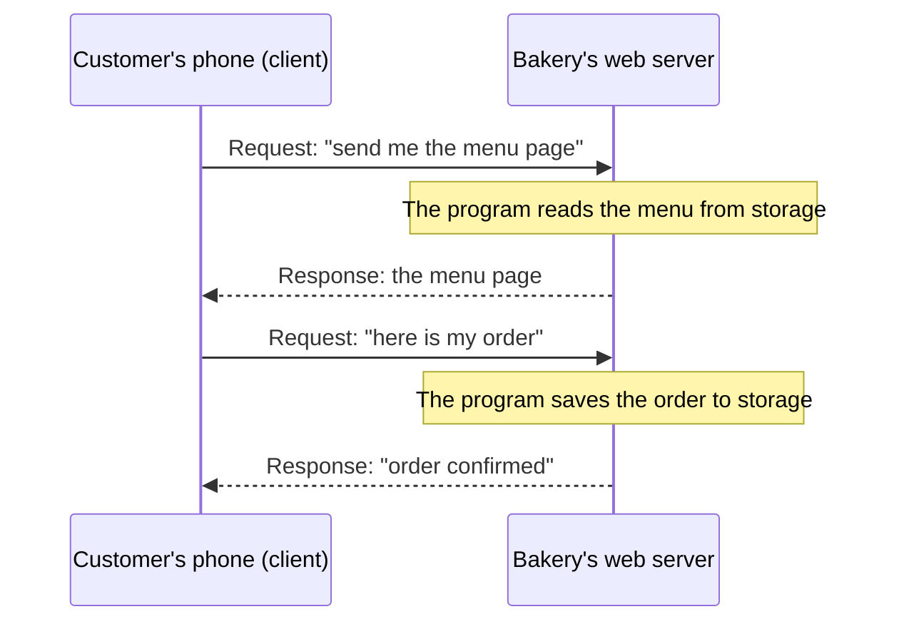

# A server is an ordinary computer with one job: it waits for requests and answers them

Every computer, from a phone to the machines that run AWS, has the same parts: a processor, memory, storage and a network connection. A **server** is a computer used in a particular way: it runs all the time and answers requests from other computers. By the end of this lesson you can explain what each part does and what makes a computer a server.

**For:** an adult studying alone, new to IT, who wants to understand AWS and use it safely. **Time:** about 30 minutes. Reading works on a phone.

**Before you start:** you need nothing earlier. The [module brief](00-brief.md) explains the on-ramp and the bakery whose website this lesson uses.

## Test out: do you already know this?

Answer these without looking anything up. If you get all four right, and you didn't guess, skip to [Networks, IP addresses, DNS and HTTPS](02-networks-ip-dns-https.md).

1. In one sentence each: what does a computer's processor do, and what does its memory do?
2. A server restarts after a power cut. Which is gone: what was in its memory, or what was in its storage?
3. Could an ordinary laptop work as a server? Why or why not?
4. Name two jobs an operating system does.

Answer key

1. The **processor** carries out a program's instructions, one after another, very fast. **Memory** holds the programs and data the processor is working on right now.
2. **What was in memory is gone.** Memory needs power to hold data; storage keeps data with the power off.
3. **Yes.** A server is a role, not a special kind of machine. Any computer that runs a program which waits for requests and answers them is acting as a server. Machines built as servers are made to do this all day, every day.
4. Any two of these: it starts and stops programs; it shares the processor and memory between them; it reads and writes files in storage; it talks to the network; it controls who may sign in and what they may use.

## Warm-up: what you already know

Answer from everyday experience. Guessing is fine.

1. You write a long message on your phone, and the battery dies before you save it. When the phone restarts, is the message still there? What about the photos you took last week?
2. You open a weather app. Where does today's forecast come from?

Feedback

1. The unsaved message is usually gone; the photos are still there. The message was only in **memory**; the photos were saved to **storage**.
2. From another computer, somewhere else, that the app asked over the internet. That computer is a **server**, and your phone is its **client**.

## What you'll learn

By the end of this lesson, you can explain what a server is and what its processor, memory, storage, network connection and operating system each do (objective 01.01a).

Try this before you read on. Guess if you're unsure; the answer is in the lesson.

- In December, the bakery's servers slow down. Would adding more storage help?

## The big picture: four parts, then the software on top

The diagram shows one of the bakery's servers. The physical parts are at the bottom. The operating system runs on them, and the bakery's programs run on the operating system.

![A server drawn as a box. At the bottom, four hardware parts side by side: processor (does the work), memory (holds the work in progress, emptied when the power goes off), storage (keeps files and data with the power off) and network connection (sends and receives data). Above them, the operating system, such as Linux or Windows, shares the parts out. At the top, applications: the bakery's website program and its order records program. On the right, outside the box, customers' phones and laptops send requests to the network connection and receive answers.](../../images/01-01-inside-a-server.svg)

*Notice that the bakery's programs never touch the hardware directly. They ask the operating system, and it uses the four parts for them.*

**Long description.** A box labeled "One of the bakery's servers", in three layers. Bottom layer, hardware, four parts side by side: processor, "does the work"; memory, "holds the work in progress; emptied when the power goes off"; storage, "keeps files and data with the power off"; network connection, "sends and receives data". Middle layer: the operating system, such as Linux or Windows, "shares the parts out to the programs". Top layer, applications: "the bakery's website" and "order records". Outside the box on the right, customers' phones and laptops: two arrows meet the network connection, "requests" coming in and "answers" going out.

## Key terms (skip if you know them)

- **Hardware:** the physical parts of a computer. **Software:** the programs that run on it, written as **code** in a programming language such as Python.
- **Processor** (also **CPU**, central processing unit): the part that carries out instructions. A **core** is one processing unit inside it.
- **Memory** (also **RAM**): fast, short-term space for the programs and data in use right now. It is emptied when the power goes off.
- **Storage:** long-term space for files and data, on a disk or an **SSD** (solid-state drive). It keeps its contents with the power off.
- **Operating system:** the main program that runs the computer and shares its parts between other programs. **Application:** a program that does a job for people, such as a website or a spreadsheet.
- **Client** and **server:** a client sends a **request**; a server sends back a **response**.

"Memory" is an everyday word with a narrower meaning here. People often say a phone "has 128 GB of memory" when they mean storage. In computing, memory is only the fast, short-term part that empties when the power goes off.

## Every computer has a processor, memory, storage and a network connection

These four parts do different jobs, and when you rent a server from AWS you choose how much of each you get.

- **The processor does the work.** It fetches a program's instructions and carries them out, one after another, very fast. A processor with several cores can work on several things at once ([What is a CPU?](https://aws.amazon.com/what-is/cpu/), checked 2026-10-24).
- **Memory holds the work in progress:** the open programs and the data they are using. The processor reaches it very quickly, but it needs constant power, so a restart empties it ([What is flash memory?](https://aws.amazon.com/what-is/flash-memory/), checked 2026-10-24).
- **Storage keeps things.** It is bigger and slower than memory, and it keeps data with the power off. Programs, photos and the operating system itself live here. Its speed is counted two ways: **IOPS** (reads and writes per second) and **throughput** (how much data per second) ([Amazon EBS volume types](https://docs.aws.amazon.com/ebs/latest/userguide/ebs-volume-types.html), checked 2026-10-24).
- **The network connection talks to other computers.** Lesson 01.02 follows what travels through it.

*Notice the three orders that were being filled in when the power went off. Only work that was saved to storage survives.*

**Long description.** Two panels side by side. Left, "While the server runs": memory holds the website program and three orders being filled in; storage holds the saved order records, the cake photos and the operating system. Right, "After a restart": memory is empty; storage still holds the saved order records, the cake photos and the operating system. A note: programs save to storage so that a restart doesn't lose the work.

> **Analogy: the bakery's kitchen.**
>
> - **Maps to:** the baker is the processor, doing the work step by step. The worktable is memory: small, close at hand, and cleared at the end of the day. The storeroom is storage: big, a walk away, and still full in the morning. The order counter is the network connection.
> - **Where this breaks down:** a processor only follows instructions, exactly, with no judgment. And memory isn't cleared at a set time: it empties the instant the power stops.
>
> **Literally:** a processor runs instructions, memory holds the data in use and empties without power, and storage keeps data with the power off.

**Sizes are counted in bytes.** A **byte** is about one letter of text. A megabyte (MB) is a million bytes, a **gigabyte** (GB) a billion and a terabyte (TB) a trillion; a phone photo is a few MB. AWS often writes **GiB** (gibibyte), a unit based on powers of two: 1,073,741,824 bytes, about 7% more than a GB. You see it in server sizes such as "2 vCPUs and 8 GiB of memory" ([Amazon EC2 instance types](https://aws.amazon.com/ec2/instance-types/), checked 2026-10-24).

> **Your turn:** On the bakery's back-room servers, the website program keeps the order a customer is still filling in, and saves the order when they pay. Which part holds the unfinished order, and which part holds the paid one? What happens to each if the server loses power?

Model answer

The unfinished order is in **memory**, because the program is working on it right now; a power cut loses it. The paid order is saved to **storage**, so it survives. That is why programs save anything that matters to storage as soon as they can.

## The operating system runs everything else

The **operating system** is the first program a computer starts, and it runs until the computer stops. It starts and stops the other programs, shares the processor and memory between them, reads and writes files in storage, sends and receives data on the network, and decides who may sign in and what they may use. Most servers run **Linux**, which is **open source** (its code is published for anyone to use and change), or **Windows Server**; when you rent a server from AWS you choose one of these, among others ([Amazon EC2 FAQs](https://aws.amazon.com/ec2/faqs/), checked 2026-10-24).

The applications sit on top: the bakery's website, and the program that keeps the order records (lesson 01.03 calls it a database).

Operating system makers publish updates that fix flaws, often security flaws, and someone has to install them. Lesson [04.01](../04-shared-responsibility-and-access/01-security-of-vs-in-the-cloud.md) calls these updates **patches** and asks, for every AWS service, who installs them.

> **Check:** Which of these is an operating system's job, not an application's?
>
> A. Building the bakery's menu page\
> B. Sharing the processor and memory between the programs that are running\
> C. Working out the price of an order

Feedback

**B is right.** Sharing out the hardware is the operating system's core job.

- **A is wrong.** Building pages is what the bakery's website application does.
- **C is wrong.** Pricing is business logic, inside an application.

## A server is a job, not a special kind of box

A **server** is any computer that runs a program which waits for requests and answers them. The computer that sends the request is the **client**. Your browser is a client when it asks a website for a page; the computer that sends the page back is a **web server** ([Web server vs application server](https://aws.amazon.com/compare/the-difference-between-web-server-and-application-server/), checked 2026-10-24).

*Notice that the client always speaks first. The server only answers; that is what makes it a server.*

**Long description.** A sequence between two parties: the customer's phone (the client) and the bakery's web server. First, the phone sends a request for the menu page; the server's program reads the menu from storage; the server sends back the page. Second, the phone sends a request containing an order; the server's program saves the order to storage; the server replies "order confirmed".

> **Misconception:** "A server is a different kind of machine." It's the same kind of machine as your laptop, with the same four parts. What differs is how it is built and kept, because it runs all day, every day, for many users at once. It's tempting because servers live out of sight, in locked rooms and data centers.

*Notice the bottom row: the four parts are the same. Everything that differs comes from running all the time for many people.*

**Long description.** Two columns. Laptop: one person uses it; screen and keyboard built in; sleeps or is switched off often; one power supply and one disk; on a desk. Server: many clients use it at once over the network; usually no screen or keyboard, managed over the network; runs all the time; often two power supplies and several disks, so one failed part doesn't stop it; mounted in a **rack**, a tall metal frame holding many servers, in a server room or data center. Bottom row, for both: a processor, memory, storage and a network connection.

Lesson [01.04](04-data-centers-and-virtualization.md) visits a data center, and shows how one physical server becomes several **virtual servers**, which is what you rent from AWS. In Module 06, "serverless" services still run on servers; you just don't manage them.

> **Your turn:** A friend leaves an old laptop switched on at home, running a program that lets family members download shared photos from it. Is the laptop a server? Explain in two sentences, using the words client and request.

Model answer

Yes. The family members' phones are clients that send requests for photos, and the laptop's program answers them, which is a server's job. With one power supply and one disk it is less reliable than a machine built as a server, but it is still a server.

## Worked example: why the bakery's servers slow down in December

The bakery's website runs on three servers in a small room behind the shop. Each one can handle about 20 orders an hour, and in December customers try to place about 120 an hour (these are the made-up facts from Module 02). The owner asks: "Should I buy bigger disks?"

An expert answers by asking which part runs out first. That part is the **bottleneck**. The technician's readings during the rush (also made up) are: processors busy 100% of the time, memory 95% full, storage 30% full.

1. **Match each part to the work.** Every order in progress needs processor time and a place in memory. Saved orders take storage, but each one is small.
2. **Read the numbers, and decide.** The processors and memory are full; storage is mostly empty. Bigger disks add space nobody is short of. The fix is more processor and memory: bigger servers, or more servers.
3. **Notice the cost.** In January the busiest hour has about 10 orders, so extra servers bought for December would sit idle most of the year. Module 02 starts there: renting servers only for the busy weeks.

> **Check:** Answer the prequestion. Would adding more storage fix the December slowdown?
>
> A. Yes: more storage holds more orders\
> B. No: the processors and memory are full, so they are the bottleneck\
> C. Yes: storage is the slowest part, so it is always the bottleneck

Feedback

**B is right.** Adding to a part that isn't full changes nothing.

- **A is wrong.** Storage is only 30% full; it has room for many more orders.
- **C is wrong.** Storage is slower than memory, but whether it is the bottleneck depends on the work. Here the readings show it isn't.

## Where you meet this again

| Idea from this lesson | Where it returns |
|---|---|
| Server, data center | [02.01 What cloud computing is](../02-why-the-cloud/01-what-cloud-computing-is.md): renting servers instead of owning them |
| Operating system, patches | [04.01 Security of the cloud vs security in the cloud](../04-shared-responsibility-and-access/01-security-of-vs-in-the-cloud.md): who patches the operating system |
| Storage that survives a restart | [05.01 Block, file and object storage](../05-storing-data/01-block-file-object.md): disks that are kept and disks that aren't |
| Processor, memory, GiB, bottleneck | [06.01 Amazon EC2: instances, images and instance types](../06-running-applications/01-ec2.md): choosing a server's size |

## Summary

- **A server is an ordinary computer with one job:** it waits for requests from clients and answers them. It is built to run all the time, usually in a rack.
- **Every computer has four parts.** The processor does the work; memory holds the work in progress and empties without power; storage keeps data with the power off; the network connection talks to other computers.
- **The operating system runs everything else.** It shares the hardware between the applications, and its updates (patches) need installing.
- **When a server is slow, find the bottleneck,** the part that runs out first, and add to that part only.

## Practice

1. **Match each part to its job:** processor, memory, storage, network connection. Jobs: (a) keeps the cake photos when the server is off; (b) carries out the website program's instructions; (c) receives a customer's order request; (d) holds the order the program is working on right now.

   

Feedback

   Processor (b), memory (d), storage (a), network connection (c). If you swapped memory and storage, remember the test: what survives a restart is in storage.

   

2. **In two sentences, explain to the bakery's owner why a power cut can lose an order a customer was still typing, but not the orders already confirmed.**

   

Feedback

   **Model answer:** The order being typed was only in the server's memory, which empties the moment the power stops. Confirmed orders had been saved to storage, which keeps its data with the power off.

   

3. **The bakery's server shows: processor 20% busy, memory 40% full, storage 99% full. Which part is the bottleneck, and what would you add?**

   

Feedback

   **Storage.** It is the part about to run out, so the bakery needs more storage, or to delete or move old files. Adding processors or memory wouldn't help.

   

**Next:** [Networks, IP addresses, DNS and HTTPS](02-networks-ip-dns-https.md), which follows a customer's request from their phone to the bakery's server.

## Where to check the current details

- [What is a CPU?](https://aws.amazon.com/what-is/cpu/), AWS (checked 2026-10-24)
- [What is flash memory?](https://aws.amazon.com/what-is/flash-memory/), AWS: volatile memory and persistent storage (checked 2026-10-24)
- [Web server vs application server](https://aws.amazon.com/compare/the-difference-between-web-server-and-application-server/), AWS: clients, servers, requests (checked 2026-10-24)
- [Amazon EC2 instance types](https://aws.amazon.com/ec2/instance-types/) and [Amazon EC2 FAQs](https://aws.amazon.com/ec2/faqs/), AWS (checked 2026-10-24)

---

"Computers and servers" by Automate the Cloud Inc., licensed under CC BY-NC 4.0 with the Additional Permission for Internal Training from Automate the Cloud Inc.
License: https://creativecommons.org/licenses/by-nc/4.0/
Permission: https://automatethe.cloud/licenses/atc-internal-training-permission.txt
