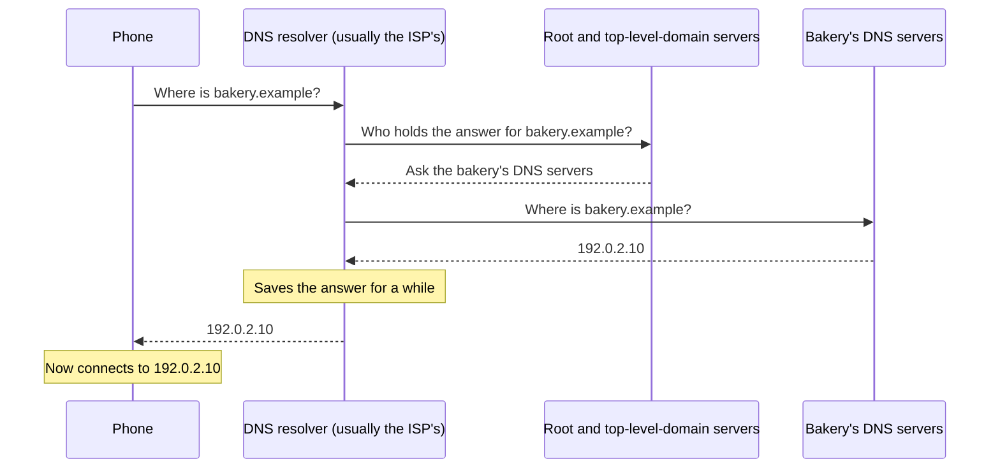

# A request finds a website in four steps: look up the name, travel to the address, secure the line, then ask

When you open a website, your device first asks the Domain Name System (DNS) to turn the site's name into an IP address. Its request then crosses many networks to that address, where HTTPS scrambles the conversation and proves the server is the real site. By the end you can follow a customer's order from their phone to the bakery's server, step by step.

**For:** an adult studying alone, new to IT, who wants to understand AWS and use it safely. **Time:** about 35 minutes. Reading works on a phone.

**Before you start:** this lesson builds on [Computers and servers](01-computers-and-servers.md) (clients, servers, requests and responses).

## Test out: do you already know this?

Answer these without looking anything up. If you get all four right, and you didn't guess, skip to [Files vs databases](03-files-vs-databases.md).

1. What is an IP address for, and what does a port number add to it?
2. You type `bakery.example` into a browser. What does DNS do, and what doesn't it do?
3. HTTPS adds two things to plain HTTP. What are they?
4. What is the difference between a private IP address and a public one?

Answer key

1. An **IP address** identifies a device on a network, so data can be delivered to it. A **port** number says which program on that device the data is for, such as 443 for a secure website.
2. DNS **turns the name into an IP address**, like looking up a contact's number. It doesn't hold the website or deliver the pages; the server at that address does.
3. **Encryption** (nobody on the path can read the conversation, or change it without being caught) and **proof of identity** (a certificate shows the server really holds that name).
4. A **private** address works only inside one network, such as a home or a company. A **public** address is unique on the internet, so packets can be sent to it from anywhere (a firewall decides whether they get in).

## Warm-up: what you already know

1. From lesson 01.01: in a conversation between a client and a server, which one speaks first?
2. From lesson 01.01: which part of a server sends and receives data?

Feedback

1. **The client.** It sends a request; the server sends back a response.
2. **The network connection.** This lesson follows what travels through it.

## What you'll learn

By the end, you can explain how a request travels from a browser to a website: the DNS lookup, the networks it crosses, the IP address and port it goes to, and what HTTPS adds (objective 01.02a).

Guess before you read on; the answers are in the lesson.

1. Does the name `bakery.example` say where in the world the bakery's server is?
2. A website shows a padlock next to its address. Does that prove the business behind it is honest?

## The big picture: four steps to one web page

![Four numbered steps from a customer's phone to the bakery's web server. Step 1, look up the name: the phone asks DNS "where is bakery.example?" and gets back the IP address 192.0.2.10. Step 2, travel: the request crosses the home network, the internet service provider and the internet, passed along by routers, to 192.0.2.10 port 443. Step 3, secure the line (highlighted): the server shows its certificate and the two sides agree on encryption. Step 4, ask and answer: the request "send me the order page" and the reply travel inside the encrypted connection.](../../images/01-02-big-picture.svg)

*Notice step 3. It happens before any page is sent, so even the first request travels scrambled.*

**Long description.** Four steps, left to right, between a customer's phone and the bakery's web server. Step 1, look up the name: the phone asks DNS "where is bakery.example?"; DNS answers with the IP address 192.0.2.10. Step 2, travel: the request leaves the phone and crosses the home network, the internet service provider and the internet, passed along by routers, to address 192.0.2.10, port 443. Step 3, highlighted, secure the line: the server sends its certificate, which proves it holds the name bakery.example, and the two sides agree how to encrypt. Step 4, ask and answer: the phone's request, "send me the order page", and the server's reply, the page, travel inside the encrypted connection. The addresses come from ranges reserved for examples.

## Key terms (skip if you know them)

- **Network:** computers connected so they can exchange data; the **internet** is a network of networks. A **router** passes data from one network toward another; an **internet service provider (ISP)** connects a home or business to the internet.
- **Packet:** a small, addressed piece of data. **Protocol:** a set of rules both ends follow.
- **IP address:** the number that identifies a device on a network. **Port:** a number that says which program on the device the data is for.
- **DNS** (Domain Name System): the internet's address book, turning a **domain name** such as `bakery.example` into an IP address.
- **HTTPS:** HTTP, the protocol for web requests and responses, with encryption and proof of identity added.

The `.example` ending and the public addresses in this lesson, such as `192.0.2.10`, come from names and ranges reserved for examples, so they never point at a real site. The private addresses are explained below.

## A network connects computers; the internet connects networks

At home, your devices join one small network through a router, often the Wi-Fi box. It connects to your ISP, which connects to other networks, and so on across the internet ([What is computer networking?](https://aws.amazon.com/what-is/computer-networking/), checked 2026-10-24).

Data travels in **packets**. Each one carries the address it's going to, and each router reads that address and passes the packet on toward it ([What is routing?](https://aws.amazon.com/what-is/routing/)). The internet's two core protocols share the work: IP gets each packet to the right address, and TCP splits the data into packets, puts them back in order at the far end and has any that go missing sent again ([What is TCP/IP?](https://aws.amazon.com/what-is/tcp-ip/), both checked 2026-10-24). A third protocol, **UDP**, skips those checks: it sends packets without confirming they arrive, which is faster, so live video, calls and games often use it ([What is UDP?](https://aws.amazon.com/what-is/udp/), checked 2026-10-24). How much data a connection can carry each second is its **bandwidth**, counted in megabits or gigabits per second (Mbps, Gbps).

```mermaid
flowchart LR
  accTitle: A request crosses several networks to reach the bakery
  accDescr: The customer's phone sends packets to the home router, which passes them to the customer's internet service provider. The internet carries them across many networks to the bakery's internet service provider and the bakery's own network, where the web server receives them. Replies travel back the same kind of way. Routers between the networks read each packet's address and pass it on.
  subgraph HOME["Customer's home network"]
    P["Phone"] --> HR["Home router"]
  end
  HR -->|"packets"| ISP1["Customer's ISP"]
  ISP1 -->|"packets"| NET["The internet:<br/>many networks,<br/>joined by routers"]
  NET -->|"packets"| ISP2["Bakery's ISP"]
  subgraph BAK["Bakery's network"]
    BR["Bakery's router"] --> WS["Web server"]
  end
  ISP2 -->|"packets"| BR
```

*Notice that no single company carries the packets all the way. Each network passes them to the next.*

**Long description.** Left to right: inside the customer's home network, the phone connects to the home router. Packets go from the home router to the customer's ISP, then into the internet, made of many networks joined by routers, then to the bakery's ISP, then into the bakery's network, through the bakery's router to the web server. Replies travel back across networks in the same way.

> **Your turn:** A customer says, "The bakery's site is slow, so the bakery's server must be slow." Using the diagram, name two other places along the path that could cause the slowness.

Model answer

Any network along the way: the customer's own Wi-Fi or home router, the customer's ISP, a busy part of the internet, or the bakery's ISP and its own connection. The server is only the last stop. Module 03 shows how serving copies from places near the customer shortens the path.

## An IP address says which computer; a port says which program

Every device on a network has an **IP address**, so packets can be delivered to it. Two versions are in use ([IP addressing for your VPCs and subnets](https://docs.aws.amazon.com/vpc/latest/userguide/vpc-ip-addressing.html), checked 2026-10-24):

- **IPv4**, the most common: four numbers from 0 to 255, separated by dots, such as `192.0.2.10`. There are about 4.3 billion possible addresses (2 to the power 32), all already handed out ([What is IPv4?](https://aws.amazon.com/what-is/ipv4/), checked 2026-10-24).
- **IPv6**, the newer one: up to eight groups of letters and digits separated by colons, such as `2001:db8:85a3::8a2e:370:7334`. It has vastly more addresses.

Because IPv4 addresses ran short, networks reuse **private IP addresses**. Three ranges are set aside for private use: addresses starting `10.`, `172.16.` to `172.31.`, and `192.168.` ([VPC CIDR blocks](https://docs.aws.amazon.com/vpc/latest/userguide/vpc-cidr-blocks.html)). They work only inside one network, so millions of homes can all use `192.168.1.23` without a clash. A **public IP address** is unique on the whole internet, so packets from anywhere can be addressed to it; whether they are let in is up to firewalls, described below. A home router usually has one public address and shares it among all the private devices behind it.

An address gets packets to the right computer; a **port** gets them to the right program on it. Each program on the bakery's server listens on its own port:

*Notice that one address can lead to several programs. The port number picks which one answers.*

**Long description.** Top: two kinds of IP address. IPv4, 192.0.2.10: four numbers from 0 to 255 separated by dots; 32 bits; about 4.3 billion possible addresses, all now handed out. IPv6, 2001:db8:85a3::8a2e:370:7334: eight groups of up to four hexadecimal digits separated by colons, where :: stands for groups of zeros; 128 bits. Bottom: the address 192.0.2.10 leads to the bakery's web server, where three programs listen: port 443, HTTPS, the website (highlighted); port 80, plain HTTP; port 22, SSH, for staff signing in remotely.

Remember 443 (HTTPS), 80 (plain HTTP), 22 (SSH, remote sign-in to a Linux server), 3389 (RDP, remote desktop for a Windows server) and 5432 (PostgreSQL, the bakery's database in Module 07). A **firewall** is a filter that lets packets in or blocks them by address and port, and Modules 06 and 07 write firewall rules with these numbers. Rules name a range of addresses with a slash: `0.0.0.0/0` means every IPv4 address, and `/32` after an address means that one address alone; lesson 07.01 explains the notation.

> **Your turn:** Classify each address as private or public: (a) `10.0.1.25`, (b) `192.168.0.4`, (c) `198.51.100.7`, a home router's internet-facing address. Then say which one a customer on the internet could send packets to.

Model answer

(a) **Private**: it starts with `10.`. (b) **Private**: it starts with `192.168.`. (c) **Public**. Only (c) can be sent packets from the internet; the other two work only inside their own networks. Lesson 07.01 uses `10.` addresses for the bakery's private network on AWS.

## DNS turns names into addresses

People remember names; packets need numbers. The **Domain Name System (DNS)** connects the two, as your phone's contacts list turns "Grandma" into a number ([What is DNS?](https://aws.amazon.com/route53/what-is-dns/), checked 2026-10-24). When you type `bakery.example`:

*Notice that the phone asks only one question. The resolver does the legwork, and it saves the answer so that the next customer gets it at once.*

**Long description.** A sequence between four parties. The phone asks the DNS resolver, usually run by its ISP, "where is bakery.example?". The resolver asks the root and top-level-domain DNS servers who holds the answer; they point it to the bakery's DNS servers. The resolver asks those, and they reply 192.0.2.10. The resolver saves the answer for a while and passes it to the phone, which then connects to 192.0.2.10.

Saved copies make DNS fast, but they also mean a change of address takes a while to reach everyone. Lesson [07.03](../07-connecting-it/03-names-and-the-edge.md) calls that waiting time the TTL.

> **Misconception:** "The domain name is where the website lives." That's wrong. A name like `bakery.example` says nothing about where the server is; DNS only hands out its current address, which the owner can change at any time. It feels true because the name is all you ever see. Amazon Route 53, AWS's DNS service (lesson [03.04](../03-aws-around-the-world/04-the-edge.md)), works the same way: it answers "where is it?" and doesn't store or deliver the site.

> **Check:** Answer the first prequestion. The bakery moves its website from the back room to AWS. Customers keep typing `bakery.example`. What has to change?
>
> A. The domain name\
> B. The address that DNS gives out for the name\
> C. Nothing: DNS finds the server wherever it is

Feedback

**B is right.** The name stays; the DNS record is changed to the new server's address.

- **A is wrong.** Customers would have to learn a new name, which is what DNS avoids.
- **C is wrong.** DNS doesn't search for servers. It gives the answer it was told to give.

## HTTPS adds encryption and proof of identity to HTTP

Once the phone knows the address, it talks to the web server in **HTTP**, the web's request-and-response protocol. A request names a web address, or **URL**, such as `https://bakery.example/order`, and a **method**: GET asks for something, POST or PUT sends something to store, DELETE removes it ([RFC 9110, HTTP Semantics](https://www.rfc-editor.org/rfc/rfc9110), checked 2026-10-24). The response carries the page and a **status code**, such as 200 (OK) or 404 (not found) ([HTTP vs HTTPS](https://aws.amazon.com/compare/the-difference-between-https-and-http/), checked 2026-10-24). AWS's price lists count requests by kinds like these, such as S3's GET and PUT requests in Module 05.

Plain HTTP sends everything as readable text: anyone with access to a network on the way could read a customer's name, address and order, or change them. **HTTPS** runs HTTP inside **TLS** (Transport Layer Security), which adds two things:

1. **Encryption.** The two ends agree on a secret key and scramble everything with it, so anyone in between sees only nonsense ([lesson 01.06](06-everyday-security.md) explains encryption).
2. **Proof of identity.** The server shows a **certificate**, which proves it holds the name the customer typed. A **certificate authority** issues one only after checking that the requester owns or controls the name ([Validate domain ownership](https://docs.aws.amazon.com/acm/latest/userguide/domain-ownership-validation.html), checked 2026-10-24). Otherwise an attacker could pose as the bakery and receive the encrypted orders.

HTTPS normally uses port 443; plain HTTP uses port 80. Many browsers show a padlock for an HTTPS connection; Chrome replaced its padlock in 2023 with a neutral settings icon, because people took it to mean "this site is trustworthy" ([An update on the lock icon](https://blog.chromium.org/2023/05/an-update-on-lock-icon.html), Chromium Blog, checked 2026-10-24).

*Notice what the watcher can still see with HTTPS: that a conversation is happening, between which addresses, and usually the site's name. Encryption hides the content, not the fact of the connection.*

**Long description.** Two panels. Each shows a customer's phone, the bakery's server, and a watcher on a network in between. Left, plain HTTP, port 80: the watcher reads the order as text, "Name: Ana. Address: 12 Mill Lane. Order: one birthday cake", and could change it; nothing proves the server is the real bakery; the browser warns that the connection is not secure. Right, highlighted, HTTPS, port 443, with a padlock on the connection: the watcher sees scrambled characters only; the server presented a certificate for bakery.example; the browser marks the connection as secure. In both panels the watcher can see which two addresses are talking. The customer and the order are made up.

> **Misconception:** "The padlock means the site is safe to trust." That's not right. It means the connection is encrypted and the server holds a certificate for the name in the address bar. A fraudster can get a certificate for a look-alike name, such as `bakery-example-deals.example`, and show a padlock too; nearly all phishing sites use HTTPS. It's tempting because browsers have long presented the padlock as "secure". Check the name, not only the padlock.

> **Check:** Answer the second prequestion. Which statement about a site with a padlock is correct?
>
> A. The business has been checked and is honest\
> B. Nobody on the path can read the conversation, and the server holds a certificate for that name\
> C. The data is also encrypted when the server stores it

Feedback

**B is right.**

- **A is wrong.** A certificate authority checks control of the name, not the honesty of the business.
- **C is wrong.** HTTPS protects data while it travels. Protecting stored data is a separate job, which lesson 01.06 and Module 09 cover.

## Worked example: one cake order, step by step

A customer named Ana orders a birthday cake on her phone at home. Here is how an expert follows it.

| Step | What happens | What could go wrong |
|---|---|---|
| 1. Look up | The phone asks its ISP's resolver for `bakery.example` and gets `192.0.2.10` | A wrong DNS record sends Ana nowhere, or to the wrong place |
| 2. Travel | Packets leave her phone's private address `192.168.1.23`, go out through her router's public address and arrive at `192.0.2.10`, port 443 | A slow or broken network; a firewall that blocks port 443 |
| 3. Secure | The server sends its certificate for `bakery.example`; the phone checks it, and both agree on a key | An expired certificate: the browser warns instead of showing the page |
| 4. Ask | Inside the encrypted connection, the phone sends the order with POST; the server saves it and replies with status 200 | The server is down or overloaded (lesson 01.01) |

The expert's thinking: each step needs the one before, so a symptom points to a step. "Site can't be found", for example, points to step 1.

> **Your turn:** Ana's browser shows an error saying the server's certificate has expired. Which steps worked, which failed, and why should Ana not click past the warning?

Model answer

Steps 1 and 2 worked: her phone found the address and reached the server. Step 3 failed: the certificate is out of date, so the browser can't confirm the server's identity. Clicking past it means sending her name, address and order to a server whose identity is unproven. The bakery must renew the certificate; lesson 09.02 shows how AWS Certificate Manager renews them automatically.

## Where you meet this again

| Idea from this lesson | Where it returns |
|---|---|
| DNS, domain names | [03.04 The edge](../03-aws-around-the-world/04-the-edge.md) and [07.03 Names and the edge](../07-connecting-it/03-names-and-the-edge.md): Amazon Route 53 |
| HTTP and HTTPS | [06.02 Auto Scaling and load balancers](../06-running-applications/02-auto-scaling-and-load-balancers.md): a load balancer for web traffic |
| Private and public IP addresses | [07.01 Your own network](../07-connecting-it/01-your-own-network.md): the bakery's network on AWS |
| Ports, firewalls, `0.0.0.0/0` | [06.01 Amazon EC2: instances, images and instance types](../06-running-applications/01-ec2.md): never leaving SSH or RDP open; [07.02 Filtering traffic](../07-connecting-it/02-filtering-traffic.md): firewall rules by port |
| TLS and certificates | [09.02 Encryption](../09-protecting-and-governing/02-encryption.md): AWS Certificate Manager |

Protecting data while it travels is one of the security habits the AWS Well-Architected Framework expects of every system; Module 02 introduces the framework.

## Summary

- **A request finds a website in four steps:** look up the name, travel to the address, secure the line, then ask.
- **The internet connects networks.** Data travels as addressed packets that routers pass along.
- **An IP address picks the computer; a port picks the program,** and a firewall decides which packets get in. Private addresses work inside one network; public ones across the internet. IPv4 has run out; IPv6 has plenty.
- **DNS turns names into addresses.** It doesn't hold the site, and its saved answers mean changes take time to reach everyone.
- **HTTPS is HTTP plus encryption and proof of identity.** The padlock proves the connection and the name, not the honesty of the business.

## Practice

1. **Put these in the order they happen when you open a website:** (a) the server sends the page; (b) the phone asks DNS for the address; (c) the server shows its certificate; (d) packets travel to the server's IP address.

   

Feedback

   **b, d, c, a.** The name must become an address before anything can travel, and the line is secured before any page is sent.

   

2. **A firewall rule lets in port 22 from `0.0.0.0/0`. What does that allow, and why is it risky?**

   

Feedback

   It lets anyone on the internet, from any IPv4 address, reach the server's remote sign-in (SSH). Attackers scan for open port 22 and try passwords and keys. A safer rule allows port 22 only from your own address, written with `/32`.

   

3. **A friend says: "My site doesn't need HTTPS, because it only shows a menu; nobody types anything in." Give one reason HTTPS still matters.**

   

Feedback

   **Model answer:** Without HTTPS, anyone on the path could change the page on its way, for example swapping the phone number or adding a fake link, and visitors have no proof the page came from the real site.

   

4. **(From lesson 01.01.) Customers' pages load slowly, the certificate is fine, and the bakery's server shows its processor 100% busy. Which of the four steps is slow, and what is the bottleneck?**

   

Feedback

   **Step 4, ask and answer.** The request arrives, but the server's processor is the bottleneck, so the answer is slow. A bigger or extra server would help; a faster network wouldn't.

   

**Next:** [Files vs databases](03-files-vs-databases.md), which follows the order to where the bakery keeps it.

## Where to check the current details

- [What is computer networking?](https://aws.amazon.com/what-is/computer-networking/), [What is routing?](https://aws.amazon.com/what-is/routing/), [What is TCP/IP?](https://aws.amazon.com/what-is/tcp-ip/) and [What is UDP?](https://aws.amazon.com/what-is/udp/), AWS (checked 2026-10-24)
- [Security group rules for different use cases](https://docs.aws.amazon.com/AWSEC2/latest/UserGuide/security-group-rules-reference.html), Amazon EC2 User Guide: common ports (checked 2026-10-24)
- [What is IPv4?](https://aws.amazon.com/what-is/ipv4/), and [IP addressing for your VPCs and subnets](https://docs.aws.amazon.com/vpc/latest/userguide/vpc-ip-addressing.html) and [VPC CIDR blocks](https://docs.aws.amazon.com/vpc/latest/userguide/vpc-cidr-blocks.html) in the Amazon VPC User Guide (checked 2026-10-24)
- [What is DNS?](https://aws.amazon.com/route53/what-is-dns/), AWS (checked 2026-10-24)
- [HTTP vs HTTPS](https://aws.amazon.com/compare/the-difference-between-https-and-http/), AWS, and [Validate domain ownership](https://docs.aws.amazon.com/acm/latest/userguide/domain-ownership-validation.html) in the AWS Certificate Manager User Guide (checked 2026-10-24)

---

"Networks, IP addresses, DNS and HTTPS" by Automate the Cloud Inc., licensed under CC BY-NC 4.0 with the Additional Permission for Internal Training from Automate the Cloud Inc.
License: https://creativecommons.org/licenses/by-nc/4.0/
Permission: https://automatethe.cloud/licenses/atc-internal-training-permission.txt
