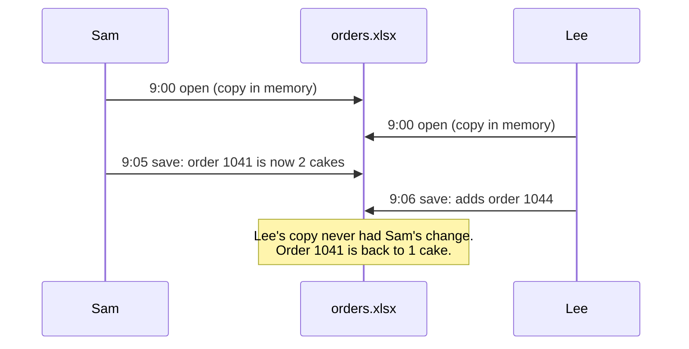
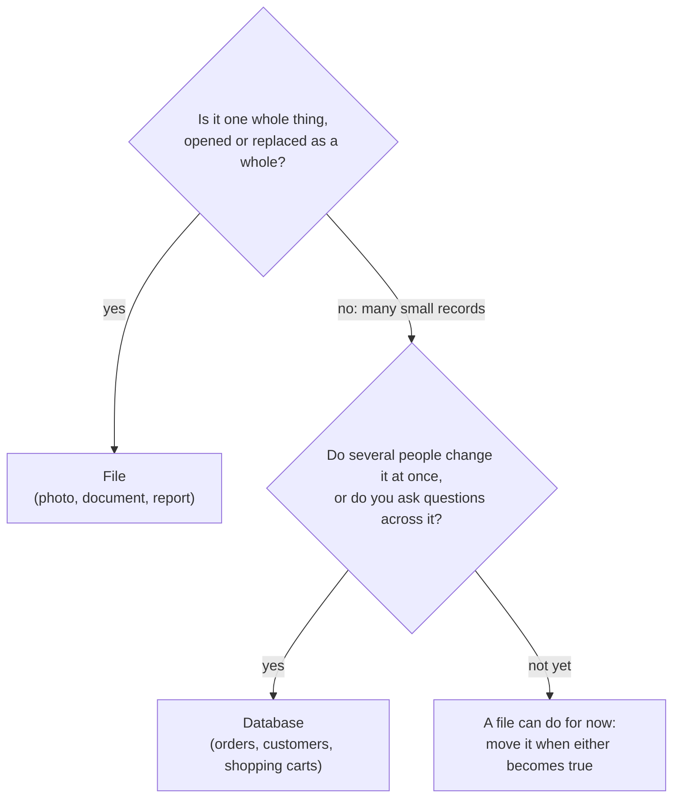

# Keep whole things in files; keep records that many people search and change in a database

A file is a named piece of data, such as a photo or a document, that a program opens and saves as a whole. A database is a store of many small records, run by a program that keeps them in order, lets many people change them at once without losing anyone's work, and answers questions about them. By the end of this lesson you can explain how the two differ and say which one fits a kind of data.

**For:** an adult studying alone, new to IT, who wants to understand AWS and use it safely. **Time:** about 30 minutes. Reading works on a phone.

**Before you start:** this lesson builds on [Computers and servers](01-computers-and-servers.md) (storage, applications, the operating system) and [Networks, IP addresses, DNS and HTTPS](02-networks-ip-dns-https.md) (ports, requests). If you skipped them, the key terms below give you enough to follow.

## Test out: do you already know this?

Answer these without looking anything up. If you get all four right, and you didn't guess, skip to [Data centers and virtualization](04-data-centers-and-virtualization.md).

1. The bakery keeps all its orders in one spreadsheet file that three staff edit. Name two things that can go wrong.
2. In a database table, what is a row, and what is a column?
3. What is a query?
4. Should the bakery keep its cake photos in files or in a database? And its order records? Say why in a few words.

<details><summary>Answer key</summary>

1. Any two: two people save over each other's changes, and one person's work is lost; finding all orders for one day means reading the whole file; nothing stops someone typing a wrong date or a duplicate order; a crash in the middle of saving can leave the file damaged.
2. A **row** is one record, such as one order. A **column** is one fact that every record has, such as the pickup date.
3. A **question sent to a database**, such as "which orders are for pickup on December 24?", which the database answers with the matching records.
4. **Photos in files:** each is one whole thing, opened and shown as a whole. **Orders in a database:** they are many small records that many people search and change at once.

</details>

## Warm-up: what you already know

1. From lesson 01.01: which part of a server keeps the order records when the power is off?
2. From lesson 01.02: an order travels to the bakery's server over HTTPS. Once the server saves it, does HTTPS still protect it?

<details><summary>Feedback</summary>

1. **Storage.** Memory empties without power.
2. **No.** HTTPS protects data while it travels. Protecting data once it is stored is a separate job, which lesson 01.06 introduces.

</details>

## What you'll learn

By the end, you can explain how a database differs from a file, and say which one fits a kind of data and why (objective 01.03a).

Try these before you read on. Guess if you're unsure; the answers are in the lesson.

1. Is a spreadsheet a database?
2. Two staff change the orders at the same moment: one edits an order, the other adds a new one. With a database, whose change is lost?

## The big picture: the same orders, kept two ways


*Notice who does the searching. With files, your program opens each one. With a database, you ask one question and the database finds the answer.*

**Long description.** Two panels with the same question at the top: "Which orders are for pickup on December 24?". Left, files: a folder named orders holds three files, order-1041.txt, order-1042.txt and order-1043.txt, each holding one order as text. Arrows show a program opening and reading every file, one after another, to find the matches. Right, highlighted, a database: one table named orders, with the columns order_id, cake, pickup_date and customer_id, and one row for each of the three orders. One arrow carries the question to the database engine as a query; one arrow returns the two rows whose pickup_date is December 24. The orders are made up.

## Key terms (skip if you know them)

- **File:** a named piece of data kept in storage, such as `birthday-cake.jpg`. A **folder** (or directory) holds files and other folders. A **file path** is a file's full location, such as `photos/cakes/birthday-cake.jpg`.
- **File format:** how a file's contents are laid out, usually shown by the ending of its name: `.jpg` (a photo), `.pdf` (a document), `.csv` (a table as plain text).
- **Database:** an organized store of records, run by a program called the **database engine** (such as PostgreSQL or MySQL), which keeps the data and answers questions about it.
- **Table, row, column:** a table holds one kind of record; each row is one record; each column is one fact about every record.
- **Primary key:** a column whose value is different for every row, such as an order number.
- **Query:** a question sent to a database; **SQL** is the standard language for writing them.

"Table" is an everyday word with a stricter meaning here. A table on paper can hold anything in any cell; a database table has fixed columns, each with a type (a date column accepts only dates), and the engine enforces them.

## A file is a named piece of data that a program opens as a whole

The operating system keeps files in a **file system**: a tree of folders and files, each with a name and a path ([What is cloud file storage?](https://aws.amazon.com/what-is/cloud-file-storage/), checked 2026-10-24). A program asks for a file by its path, works on it in memory, and saves it back.

Files are the right home for **whole things**: a photo, a menu PDF, a video, a report. You show the birthday-cake photo or replace it as a whole; nobody edits half of it.

> **Your turn:** Write a sensible path for the photo of the bakery's lemon cake, and name its likely format.

<details><summary>Model answer</summary>

Something like `photos/cakes/lemon-cake.jpg`. The `.jpg` ending says it's a photo in the JPEG format. The folders group similar files, so people and programs can find them.

</details>

## Files struggle when many people change many small records

The bakery started with all its orders in one spreadsheet file, `orders.xlsx`, which three staff open and change. That works for a few orders a day and breaks as the shop grows:

- **Changes get lost.** Each person opens their own copy of the file into memory, and whoever saves last replaces the whole file, wiping out everyone else's changes: a **lost update**.
- **Questions are slow.** To find "all orders for December 24", a program must read the whole file.
- **Nothing checks the data.** Someone can type "tomorow" in the date column, or give two orders the same number.
- **A crash can damage the file.** If the power goes off halfway through a save, part of the file may be new and part old.



*Notice that nobody did anything wrong, and nobody is warned. The file can only be saved whole, so the last save wins.*

**Long description.** A sequence between Sam, the file orders.xlsx and Lee. At 9:00 Sam opens the file and gets a copy in memory; at 9:00 Lee does the same. At 9:05 Sam saves, with order 1041 changed to two cakes. At 9:06 Lee saves, with a new order 1044 added. Because Lee's copy was opened before Sam's change, Lee's save puts order 1041 back to one cake. Sam's change is lost without any warning.

> **Check:** Which problem does the diagram show?
>
> A. The file was in the wrong format\
> B. Two people saved whole copies, and the last save replaced the other's change\
> C. The file was too big to open

<details><summary>Feedback</summary>

**B is right.** That's a lost update.

- **A is wrong.** Any file format has this problem when people save whole copies.
- **C is wrong.** The file opened fine for both people; size had nothing to do with it.

</details>

## A database keeps records in tables and answers questions about them

A **database** fixes these problems by putting one program, the **database engine**, in charge of the data. The engine is an application (lesson 01.01) on a server. It keeps its data in files on that server's storage, but nobody else opens them: programs send it requests over the network, often on a port such as 5432 for PostgreSQL (lesson 01.02).

Most business data lives in **relational databases**, which organize data into **tables**: each **row** is one record, each **column** one fact about it, and each row has a **primary key** no other row shares. A column in one table can hold another table's key, which links the two ([What is a relational database?](https://aws.amazon.com/rds/what-is-a-relational-database/), checked 2026-10-24):


*Notice that Ana's phone number is written once, in the customers table. Both of her orders point to it by her customer_id, so a change to her number is made in one place.*

**Long description.** Two tables side by side. The customers table: columns customer_id (the primary key, highlighted), name and phone; rows: 7, Ana, 555-0107; 8, Ben, 555-0108. The orders table: columns order_id (its primary key), cake, pickup_date and customer_id; rows: 1041, birthday cake, 2026-12-24, 7; 1042, lemon cake, 2026-12-23, 8; 1043, fruit cake, 2026-12-24, 7. Arrows run from the customer_id value 7 in orders 1041 and 1043 to Ana's row in the customers table. The people and numbers are made up.

You ask a relational database questions in **SQL**. This query asks for every order to be picked up on December 24:

```sql
SELECT order_id, cake, customer_id
FROM orders
WHERE pickup_date = '2026-12-24';
```

The engine answers with orders 1041 and 1043.

The engine also solves the shared-file problems:

- **Many people at once.** Each change touches only the rows it names, not the whole file, and the engine applies changes one at a time, so nobody's change silently wipes out someone else's. Sam's and Lee's changes both survive.
- **Rules.** The pickup date column accepts only dates, and no two orders can share an order number.
- **All or nothing.** A **transaction** groups changes, such as "save the order and record the payment": either all are saved or none are, even if the power fails halfway. Once confirmed, it stays saved.

> **Misconception:** "A spreadsheet is a database." It isn't. A spreadsheet has rows and columns, so it looks like a table, but it's a file. Online spreadsheets do merge several people's edits, but they don't enforce column types and unique keys, make changes all-or-nothing, or answer programs' queries the way a database engine does. The mix-up is easy because the screen looks the same. What makes a database is the program in charge of the data.

> **Your turn:** Answer the second prequestion. Sam changes order 1041 and Lee adds order 1044 at the same moment, but now the orders are in a database. What happens to each change, and why?

<details><summary>Model answer</summary>

**Both changes are kept.** Sam's change updates one row and Lee's adds a different row, and the engine applies each one to the stored data, not to a private copy. Nobody saves a whole file over anyone else's.

</details>

## Not every database uses tables

Relational databases fit records that link together, like customers and orders. Other kinds store data in other shapes:

- A **key-value database** stores each item under a unique key and fetches it by that key, very fast ([What is a key-value database?](https://aws.amazon.com/nosql/key-value/), checked 2026-10-24). The bakery's website keeps each shopper's cart this way, under a cart ID.
- A **document database** stores each record as a self-contained document, usually in JSON, a text format that lesson [01.05](05-apis-command-line-and-json.md) teaches you to read. Different documents can have different fields.

Lesson [05.06](../05-storing-data/06-choosing-a-database.md) compares the kinds and the AWS services for each. Every kind still has an engine in charge, which is what makes it a database.

## Choose by the shape of the data and how it is used

| | Files | Database |
|---|---|---|
| **Holds** | Whole things: photos, documents, videos, reports | Many small records: orders, customers, shopping carts |
| **Changed by** | Opening and saving the whole file | Changing single records, many people at once |
| **Found by** | Its path | A query or a key |
| **Rules on the data** | None; the file holds whatever was saved | The engine enforces types, unique keys and all-or-nothing changes |
| **Bakery example** | Cake photos, the menu PDF, the nightly sales report | Orders, customers, shopping carts |

**What's the same:** both keep data in storage so it survives a restart. **What differs:** who is in charge (each program, or one engine) and the size of the pieces you change (whole files, or single records). **The principle:** if you open and replace it as a whole, use a file; if many people search and change small pieces of it, use a database.



*Notice the last branch. A small list kept by one person can start as a file; the database becomes necessary when sharing or questions arrive.*

**Long description.** A decision flowchart. First question: is it one whole thing, opened or replaced as a whole? Yes: a file, such as a photo, document or report. No, it is many small records: second question, do several people change it at once, or do you ask questions across it? Yes: a database, such as orders, customers or shopping carts. Not yet: a file can do for now; move it to a database when either becomes true.

## Worked example: where the bakery keeps each kind of data

The bakery is moving to AWS, and the owner asks where each kind of data should go. An expert asks the two questions from the flowchart for each one.

| Data | Whole thing or records? | Shared or searched? | Choice | Where it goes in Module 05 |
|---|---|---|---|---|
| Cake photos | Whole things | Shown to everyone, never edited in part | Files | Objects in an Amazon S3 bucket ([05.01](../05-storing-data/01-block-file-object.md)) |
| Orders and customers | Records that link | Changed by staff and the website at once; searched by date | Relational database | Amazon RDS ([05.05](../05-storing-data/05-managed-or-self-managed-databases.md)) |
| Shopping carts | Records, each found by one key | Changed constantly, always fetched by cart ID | Key-value database | Amazon DynamoDB ([05.06](../05-storing-data/06-choosing-a-database.md)) |
| Nightly sales report | A whole thing | Read, not edited | File, made by a query on the orders | An object in S3 |

The expert's thinking: the last row shows the two working together. A nightly query adds up the orders in the database, and the result is saved as a file the owner opens in the morning. S3 keeps whole things like these as **objects** in a bucket rather than in a folder tree; lesson 05.01 explains the difference.

> **Your turn:** The bakery also keeps a list of allergy warnings, one per cake, which the website shows next to each cake and which staff update when a recipe changes. File or database? Use the two questions.

<details><summary>Model answer</summary>

**A database.** It is many small records (one warning per cake), and they are changed by staff while the website reads them, so sharing and searching both apply. A table with one row per cake, keyed by the cake, fits well, and it can sit in the same relational database as the orders.

</details>

## Where you meet this again

| Idea from this lesson | Where it returns |
|---|---|
| Files, folders and paths | [05.01 Block, file and object storage](../05-storing-data/01-block-file-object.md): three ways to store data |
| Photos as whole files | [05.02 S3 in practice](../05-storing-data/02-s3-in-practice.md): the bakery's photo bucket |
| Database engine, tables, keeping it running | [05.05 Managed or self-managed databases](../05-storing-data/05-managed-or-self-managed-databases.md): Amazon RDS |
| Kinds of database | [05.06 Choosing a database](../05-storing-data/06-choosing-a-database.md) and [Lab 06: a DynamoDB table for shopping carts](../05-storing-data/08-lab-06-a-dynamodb-table.md) |

## Summary

- **Keep whole things in files,** found by their path and opened and saved as a whole.
- **Shared files break as use grows:** lost updates, slow questions, no rules on the data, damage from a crash.
- **A database puts one engine in charge.** It keeps records in tables with a primary key, answers SQL queries, lets many people change records at once, and makes transactions all-or-nothing. A spreadsheet is a file, not a database.
- **Not every database uses tables:** key-value and document databases store other shapes.
- **Choose by shape and use:** whole things in files; many small, shared, searched records in a database.

## Practice

1. **File or database?** (a) A video of a cake being decorated; (b) the list of who has booked each baking class, which staff and customers change online; (c) the signed lease for the shop.

   <details><summary>Feedback</summary>

   (a) **File**: one whole thing, played as a whole. (b) **Database**: many small records, changed by several people at once. (c) **File**: one whole document, read, not edited in parts.

   </details>

2. **In the bakery's orders table, which column should be the primary key: cake, pickup_date or order_id? Why?**

   <details><summary>Feedback</summary>

   **order_id.** It is different for every order. Many orders share a cake or a pickup date, so those can't pick out one order exactly.

   </details>

3. **A teammate says: "Our spreadsheet has rows and columns, so it is a database." In two sentences, explain what's missing.**

   <details><summary>Feedback</summary>

   **Model answer:** A spreadsheet is a file, with no engine in charge of the data: nothing enforces column types or unique keys, and changes aren't all-or-nothing. A database engine changes single records for many people at once, checks the data and makes transactions all-or-nothing.

   </details>

4. **(From lesson 01.02.) The website sends orders to the database engine on port 5432. What does the port number tell the server?**

   <details><summary>Feedback</summary>

   **Which program the data is for:** here, the PostgreSQL database engine, rather than the web server on port 443.

   </details>

**Next:** [Data centers and virtualization](04-data-centers-and-virtualization.md), which shows where servers like the bakery's live, and how one machine becomes many.

## Where to check the current details

- [What is cloud file storage?](https://aws.amazon.com/what-is/cloud-file-storage/), AWS: files, folders and file systems (checked 2026-10-24)
- [What is a relational database?](https://aws.amazon.com/rds/what-is-a-relational-database/), AWS: tables, keys, SQL and transactions (checked 2026-10-24)
- [What is a key-value database?](https://aws.amazon.com/nosql/key-value/), AWS (checked 2026-10-24)

---

"Files vs databases" by Automate the Cloud Inc., licensed under CC BY-NC 4.0 with the Additional Permission for Internal Training from Automate the Cloud Inc.
License: https://creativecommons.org/licenses/by-nc/4.0/
Permission: https://automatethe.cloud/licenses/atc-internal-training-permission.txt
