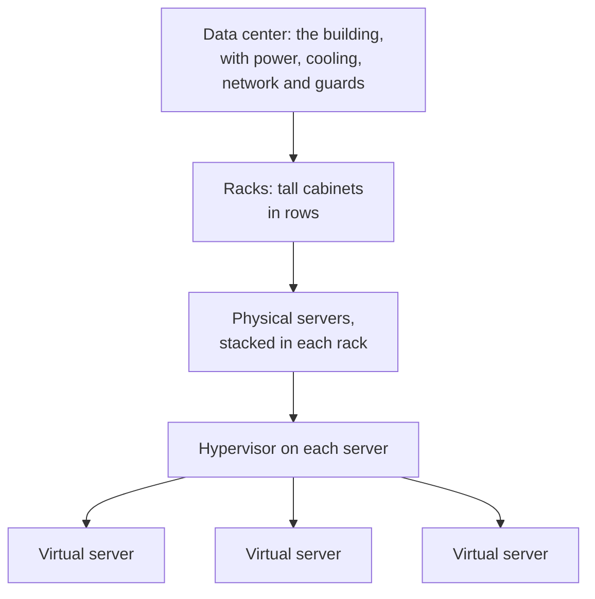
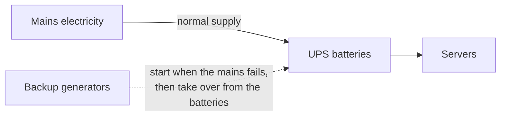

# A data center is a building that keeps servers running; virtualization splits each server into several virtual ones

A cloud provider's computers are real machines in real buildings called data centers. Software called a hypervisor splits each machine into several **virtual servers**, so many customers can share it safely. By the end of this lesson you can explain how one physical server becomes the virtual servers you rent in the cloud.

**For:** an adult studying alone, new to IT, who wants to understand AWS and use it safely. **Time:** about 25 minutes. Reading works on a phone.

**Before you start:** this lesson uses the words server, operating system and rack from [Computers and servers](01-computers-and-servers.md). If you skipped it: a server is a computer that runs all the time and answers requests from other computers, and an operating system (such as Windows or Linux) runs a computer and lets programs use its parts.

## Test out: do you already know this?

Answer these without looking anything up. If you get all four right, and you didn't guess, skip to [APIs, the command line and JSON](05-apis-command-line-and-json.md).

1. Name three things a data center provides for its servers besides the building itself.
2. What does a hypervisor do?
3. Your virtual server runs on a physical server that also runs other customers' virtual servers. What stops them from seeing your work?
4. What does a virtual machine carry that a container doesn't?

Answer key

1. Any three of: power (with batteries and generators for backup), cooling, network connections, and physical security such as guards and locked doors.
2. It splits one physical server into several virtual machines, gives each its share of the processor, memory and disk, and keeps them apart.
3. The hypervisor isolates each virtual machine from the others.
4. Its own operating system. Containers on one machine share an operating system.

## Warm-up: what you already know

1. Your phone and a laptop both run an operating system. What does an operating system do?
2. In an apartment building, each household has its own locked front door, but all share one roof, one water supply and one electricity connection. What do they gain by sharing, and what must the building make sure of?

Feedback

1. It runs the device and lets programs use its processor, memory, storage and network (lesson 01.01).
2. They share the cost of expensive things; the building must keep each home private. Virtualization works the same way.

## What you'll learn

By the end of this lesson, you can explain what a data center provides, how virtualization turns one physical server into several virtual servers, and why that makes renting servers by the minute possible (objective 01.04a).

Guess before you read on:

1. When you rent a "server" from a cloud provider, do you get a whole physical computer?
2. Why would a provider want one physical server to run many customers' work?

## The big picture: from building to virtual server

Each level sits inside the one above it.

*Notice where the rented part is: the bottom row. Everything above it is the provider's.*

**Long description.** Top to bottom: a data center building, with power, cooling, network connections and guards, holds racks, tall cabinets in rows. Each rack holds physical servers. Each physical server runs a hypervisor, which runs several virtual servers. What you rent in the cloud is a virtual server.

## Key terms (skip if you know them)

- **Data center:** a building that holds servers, storage and network equipment, with the power and cooling they need.
- **Rack:** the tall metal frame that holds many servers, one above another (lesson 01.01).
- **Physical server:** a real computer you could touch. In virtualization it's called the **host**.
- **Virtual machine (VM):** a computer made of software, running on a host, with its own operating system. Cloud providers call it a **virtual server**; Amazon EC2 calls it an **instance**.
- **Hypervisor:** the software on a host that creates virtual machines and keeps them apart.

"Virtual" in everyday speech can mean "almost" or "not real". A virtual server is real computing: real processors run its programs. What's virtual is the boundary: software, not a metal case, decides where one server ends and the next begins.

## A data center keeps servers powered, cool, connected and guarded

AWS lists what a data center supplies around its servers: power systems with an **uninterruptible power supply (UPS)**, a bank of batteries that takes over the instant the mains supply fails; backup generators; ventilation and cooling; fire suppression; network cables and equipment; and building security ([What is a data center?](https://aws.amazon.com/what-is/data-center/), checked 2026-10-24).

*Notice the two backups in a row: the batteries cover the seconds the generators need to start.*

**Long description.** Mains electricity feeds the servers through the UPS batteries. A dashed arrow shows backup generators starting when the mains fails and taking over from the batteries. The servers keep running throughout.

This pattern is **redundancy**: having more than one of something so that one failure doesn't stop the whole. Data centers use it for power, cooling and network connections. Module 03 shows AWS going further, grouping data centers into separate **Availability Zones** so that a system can survive even a whole building's failure.

The bakery's three servers have none of this: they sit in a room behind the shop, with no generator.

> **Your turn:** A storm cuts the bakery's electricity for an hour. A data center loses mains power for the same hour. Using the words from this section, explain why one website goes down and the other stays up.

Model answer

The bakery's room has no redundancy for power: when the mains supply fails, nothing takes over, so its servers stop. The data center's UPS batteries take over at once, and its backup generators then keep the servers running until the mains returns.

## Virtualization splits one physical server into several virtual servers

**Virtualization** is software that imitates hardware, so that several virtual machines run on one physical machine ([What is virtualization?](https://aws.amazon.com/what-is/virtualization/), checked 2026-10-24). The layers stack like this:

*Notice the third virtual server: another customer's, on the same physical machine. The hypervisor keeps it apart from the bakery's two.*

**Long description.** Bottom to top: the physical server, or host, with processors, memory, disks and a network card, in a rack. On it, highlighted, the hypervisor, which gives each virtual server its share and keeps them apart. A dashed line: on a cloud server such as Amazon EC2, the customer runs what is above it and the provider runs everything below. Above the line, three virtual servers, each with a guest operating system and an application: Linux with the bakery's website, Linux with the bakery's order database, and, drawn dashed, Windows with another customer's app.

Three ideas from the picture:

- **Each VM has its own operating system,** the **guest operating system**, which can differ from its neighbors': Linux beside Windows. Each VM can be restarted without touching the others.
- **The hypervisor shares out the hardware.** It gives each VM its slice of processor, memory and disk, and stops one VM from reaching into another's.
- **Neighbors can be strangers.** On Amazon EC2, by default, instances from several AWS accounts may share one physical server, which AWS calls **shared tenancy**; you can pay for hardware used by your account alone ([Dedicated Instances](https://docs.aws.amazon.com/AWSEC2/latest/UserGuide/dedicated-instance.html), checked 2026-10-24). AWS designed its hypervisor for strong isolation between them ([Security design of the AWS Nitro System](https://docs.aws.amazon.com/whitepapers/latest/security-design-of-aws-nitro-system/security-design-of-aws-nitro-system.html)).

> **Analogy: an apartment building.**
>
> - **Maps to:** the building is the physical server; each apartment is a VM; the building manager is the hypervisor, who shares out water and power and keeps every door locked to the other tenants. Each household furnishes its own apartment, as each VM runs its own operating system.
> - **Where this breaks down:** apartments have fixed walls. A VM's share can be resized, and the VM can be moved to a different physical server, which no apartment can.
>
> **Literally:** a hypervisor divides one computer's processors, memory and disk among several virtual machines and isolates them from each other.

> **Misconception:** "Shared hardware means other customers can see my data." They can't. The hypervisor keeps each VM's memory and disk apart, and on AWS that layer is AWS's responsibility: the [Shared Responsibility Model](https://aws.amazon.com/compliance/shared-responsibility-model/) puts "the host operating system and virtualization layer" on AWS's side. It's tempting because "shared" sounds like a shared folder, open to all.

> **Check:** Which is true of three virtual machines on one host?
>
> A. They must all run the same operating system\
> B. Each has its own guest operating system and its own share of the hardware\
> C. Restarting one restarts the others

Feedback

**B is right.** The hypervisor gives each VM a separate share, and each runs its own operating system.

- **A is wrong.** Guests can run different operating systems on one host.
- **C is wrong.** Each VM can be restarted on its own.

## Virtualization is what lets a provider rent servers by the minute

Without virtualization, a physical server typically uses only a small share of its processing power, and sits idle the rest of the time ([What is virtualization?](https://aws.amazon.com/what-is/virtualization/)). Virtualization fills that spare capacity with more VMs, so fewer machines need less space, power and cooling. Lesson 02.02 shows the bakery's version of the problem: servers bought for the December rush would sit idle in January.

For a cloud provider, it does more than save power:

- **Speed.** Starting a VM is software work on a machine that's already running, so a new server is ready in minutes, not the weeks it takes to buy hardware: the "on demand" of lesson 02.01.
- **Copies from a template.** A VM can be started from an **image**: a saved template of an operating system and software, so ten VMs from one image start identical. EC2 calls its images AMIs (lesson 06.01).
- **Paying for what you use.** When you delete a VM (EC2 calls this terminating it), its slice goes back into the provider's pool for someone else: "pay as you go".
- **Moving between hosts.** Because a VM is software, it doesn't belong to one machine. When you stop an EC2 instance and start it again, AWS usually starts it on a different physical host ([How EC2 instance stop and start works](https://docs.aws.amazon.com/AWSEC2/latest/UserGuide/how-ec2-instance-stop-start-works.html), checked 2026-10-24). That's why a disk built into the old host, which EC2 calls instance store, is wiped by a stop, while a network disk (Amazon EBS) follows the instance. Lesson 05.01 returns to this.

Virtualization isn't only for servers. Providers also virtualize storage and networks, managing them in software ([What is virtualization?](https://aws.amazon.com/what-is/virtualization/)). The private network you build in Module 07, a virtual private cloud, is one.

> **Your turn:** Answer the second prequestion in two sentences: why would a provider want one physical server to run many customers' VMs?

Model answer

One physical server running one customer's work would sit mostly idle, and the provider would still pay for its space, power and cooling. Filling it with many customers' VMs uses the capacity it already paid for, and lets it hand out new servers in minutes from machines that are already running.

## Virtual machines and containers share a server in different ways

You'll meet a second way to share a server in Module 06. A **container** packages an application with the code libraries and files it depends on, and the containers on a machine share that machine's operating system instead of each bringing a whole one of their own ([What is containerization?](https://aws.amazon.com/what-is/containerization/), checked 2026-10-24).

*Notice the missing layer on the right: containers carry no whole operating system of their own, which makes each one smaller.*

**Long description.** Two panels. Virtual machines: two apps, each with its own operating system, on a hypervisor, on a physical server; each one behaves like a whole computer, and Amazon EC2 rents these. Containers: two apps, each with its libraries and no operating system of its own, on one shared operating system, on a physical server; each one is an app and what it depends on, which makes it lighter; lesson 06.03 covers containers on AWS.

| | Virtual machine | Container |
|---|---|---|
| **What it holds** | An operating system and applications | One application and its libraries |
| **Its own operating system?** | Yes, a whole one | No: shares the machine's, carrying at most a few of its files |
| **Feels like** | A whole computer | One packaged program |
| **On AWS** | Amazon EC2 instances (lesson 06.01) | Amazon ECS, Amazon EKS, AWS Fargate (lesson 06.03) |

**What's the same:** both let many workloads share one physical server, kept apart by software. **What differs:** a VM carries a whole operating system; a container doesn't. The two often stack: containers frequently run inside VMs. **Docker** is a widely used tool for building and running containers.

**Serverless** services such as AWS Lambda, also in lesson 06.03, take one more step: the provider runs the servers, VMs and operating systems entirely out of your sight, and you hand it only your code.

## Worked example: follow the bakery's website down to the building

Suppose the bakery moves its website to one Amazon EC2 instance. An expert asks "what is this, and who runs it?" at each layer:

1. **The website software:** an application; the bakery installs and updates it.
2. **The instance's Linux:** the guest operating system; on EC2 the bakery patches it ([Shared Responsibility Model](https://aws.amazon.com/compliance/shared-responsibility-model/)).
3. **The hypervisor and the physical server:** AWS's, shared by default with other accounts, and possibly a different host after each stop and start.
4. **The rack and the building:** AWS's power, cooling, network and guards.

The dashed line in the stack diagram is where the bakery's work ends. Lesson 04.01 shows the line moving up for services where AWS runs more.

## Where you meet this again

| Idea from this lesson | Where it returns |
|---|---|
| Data centers, power, cooling | [02.01 What cloud computing is](../02-why-the-cloud/01-what-cloud-computing-is.md); [02.04 What a data center really costs](../02-why-the-cloud/04-what-a-data-center-really-costs.md) |
| Redundancy; groups of data centers | [03.01 Regions, Availability Zones and data centers](../03-aws-around-the-world/01-regions-availability-zones-data-centers.md) |
| Host and guest operating systems | [04.01 Security of the cloud vs security in the cloud](../04-shared-responsibility-and-access/01-security-of-vs-in-the-cloud.md) |
| A disk on the host vs a network disk | [05.01 Block, file and object storage](../05-storing-data/01-block-file-object.md) |
| Virtual servers, images, shared and dedicated hardware | [06.01 Amazon EC2: instances, images and instance types](../06-running-applications/01-ec2.md); Module 11 for dedicated hardware's price |
| Containers and serverless | [06.03 Containers and serverless](../06-running-applications/03-containers-and-serverless.md) |
| Virtual networks | [07.01 Your own network](../07-connecting-it/01-your-own-network.md) |

## Summary

- **A data center** keeps racks of servers powered, cooled, connected and guarded, with redundancy so one failure doesn't stop everything.
- **Virtualization** splits one host into several virtual machines; the hypervisor shares out the hardware and keeps them apart, and each runs its own guest operating system.
- **Shared hardware isn't shared data.** EC2 instances may share a host with other accounts' instances; the hypervisor isolates them, and that layer is AWS's job.
- **Virtualization makes the cloud possible:** servers in minutes, copies from images, paying only while you use them, VMs that move between hosts.
- **Containers** share the host's operating system; serverless hides the servers entirely.

## Practice

1. **What is the job of a UPS in a data center?**

   

Feedback

   It's a bank of batteries that powers the servers the instant the mains supply fails, until the backup generators take over. Without it, servers would lose power during the seconds the generators need to start.

   

2. **Which layer does a cloud customer manage on a virtual server such as an EC2 instance?**

   A. The hypervisor\
   B. The guest operating system\
   C. The physical server's disks\
   D. The data center's cooling

   

Feedback

   **B is right.** The guest operating system runs inside the customer's VM.

   - **A is wrong.** The hypervisor belongs to the provider.
   - **C is wrong.** The hardware is the provider's.
   - **D is wrong.** The building and its cooling are the provider's.

   

3. **A friend says: "A virtual server isn't a real computer, so it can't be as safe as my own." In two sentences, say what's right and wrong in that.**

   

Feedback

   **Model answer:** A virtual server runs on real hardware; what's virtual is the boundary between it and its neighbors, which the hypervisor enforces. Whether it's safe depends on that isolation, which the provider designs and is responsible for, and on how well you secure your own operating system and software, as you would on a machine of your own.

   

4. **You stop an EC2 instance and start it the next morning. Why might data on a disk inside the old physical host be gone?**

   

Feedback

   AWS usually starts it on a different physical host, and a disk built into the old host (instance store) is wiped. A network disk such as an EBS volume is reattached wherever it starts.

   

**Next:** [APIs, the command line and JSON](05-apis-command-line-and-json.md).

## Where to check the current details

- [What is a data center?](https://aws.amazon.com/what-is/data-center/), AWS (checked 2026-10-24)
- [What is virtualization?](https://aws.amazon.com/what-is/virtualization/), AWS (checked 2026-10-24)
- [Amazon EC2 Dedicated Instances](https://docs.aws.amazon.com/AWSEC2/latest/UserGuide/dedicated-instance.html) and [How EC2 instance stop and start works](https://docs.aws.amazon.com/AWSEC2/latest/UserGuide/how-ec2-instance-stop-start-works.html), Amazon EC2 User Guide (checked 2026-10-24)
- [The Security Design of the AWS Nitro System](https://docs.aws.amazon.com/whitepapers/latest/security-design-of-aws-nitro-system/security-design-of-aws-nitro-system.html), AWS whitepaper (checked 2026-10-24)
- [Shared Responsibility Model](https://aws.amazon.com/compliance/shared-responsibility-model/), AWS (checked 2026-10-24)

---

"Data centers and virtualization" by Automate the Cloud Inc., licensed under CC BY-NC 4.0 with the Additional Permission for Internal Training from Automate the Cloud Inc.
License: https://creativecommons.org/licenses/by-nc/4.0/
Permission: https://automatethe.cloud/licenses/atc-internal-training-permission.txt
