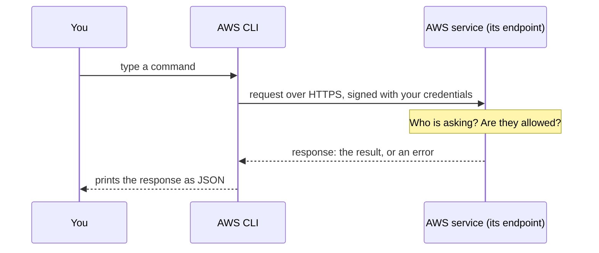
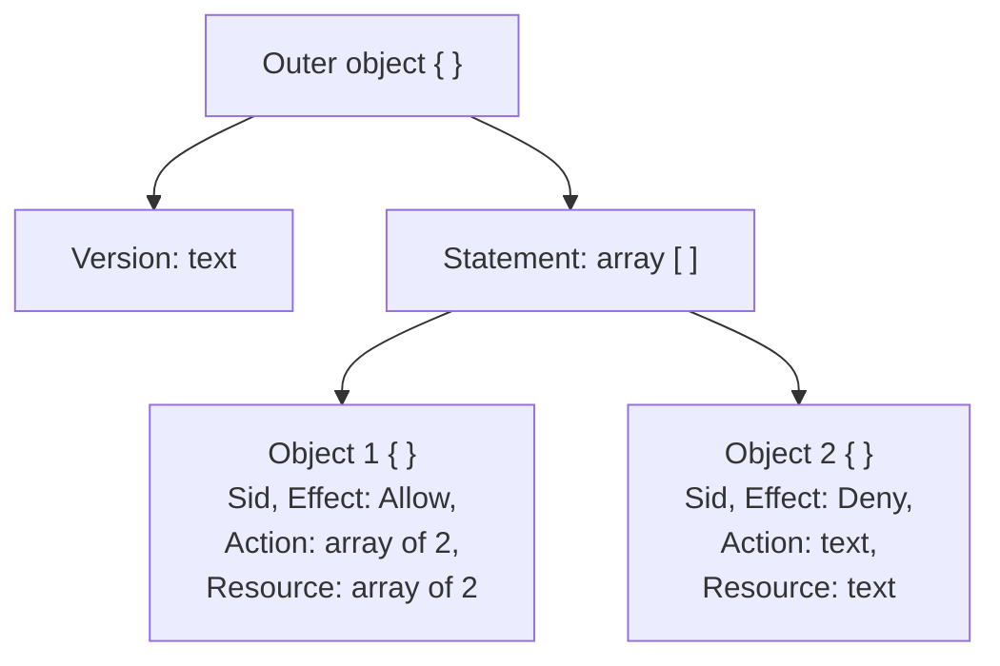

# Programs ask each other for things through APIs; you can type those requests at a command line, and the answers often come back as JSON

Every AWS service is run by requests: "create this", "list those", "delete that". An **API** is the set of requests a service accepts, the **command line** is a place to type them, and **JSON** is the text format many of the answers, and the permission documents, are written in. By the end you can say what happens when you run a command, and read a small JSON document line by line.

**For:** an adult studying alone, new to IT, who wants to understand AWS and use it safely. **Time:** about 30 minutes. Reading works on a phone; for the JSON reading, a bigger screen helps.

**Before you start:** this lesson uses the words server, request and HTTPS from [Computers and servers](01-computers-and-servers.md) and [Networks, IP addresses, DNS and HTTPS](02-networks-ip-dns-https.md). If you skipped them: a server answers requests from clients over a network, and HTTPS is the web's request protocol with encryption and proof of identity added.

## Test out: do you already know this?

Answer these without looking anything up. If you get all four right, and you didn't guess, skip to [Everyday security](06-everyday-security.md).

1. In one sentence, what is an API?
2. In `aws s3 ls --region us-east-1`, which part is an option?
3. In this JSON, how many statements are there, and what is the second one's `Effect`?

   ```json
   {"Statement": [{"Effect": "Allow", "Action": "s3:GetObject"}, {"Effect": "Deny", "Action": "s3:DeleteObject"}]}
   ```

4. What's wrong with `{"cupcakes": 14,}`?

<details><summary>Answer key</summary>

1. A defined set of requests one program can send another, and the answers it gives back.
2. `--region us-east-1`: a name starting with two dashes, then its value.
3. Two statements, because the square brackets hold two objects; the second one's `Effect` is `"Deny"`.
4. A comma after the last pair. JSON doesn't allow it.

</details>

## Warm-up: what you already know

1. In a restaurant, you don't walk into the kitchen. How does your order get to the cook, and how does your food come back?
2. A web address starts with `https://`. What does the "S" add (lesson 01.02)?

<details><summary>Feedback</summary>

1. You choose from the menu, your order goes to the kitchen on a slip in a fixed form, and the kitchen sends back a plate or "we're out of that". An API works the same way.
2. Encryption and proof of identity: nobody on the way can read what's sent or change it unnoticed, and a certificate proves the server is the real site. The AWS CLI and the console send their requests to AWS over HTTPS too.

</details>

## What you'll learn

By the end of this lesson, you can:

- explain what an API, a request and a response are, and what each part of a command does (objective 01.05a);
- read a small JSON document: find its names, values, lists and nested parts, and say in plain words what it contains (objective 01.05b).

Guess first: when you click a button in the AWS website, and when you type a command, do they reach AWS by different routes?

## The big picture: a command becomes a request, and the answer comes back as text



*Notice the middle step: the service checks every request, whoever sends it. Module 04 is about that check.*

**Long description.** A sequence of four messages between three participants: you, the AWS CLI and an AWS service at its endpoint. You type a command. The CLI sends a request over HTTPS, signed with your credentials. The service checks who is asking and whether they are allowed. It sends back a response, the result or an error, and the CLI prints it to you as JSON.

## Key terms (skip if you know them)

- **API** (application programming interface): a defined set of requests one program can send another, and the responses it returns.
- **Endpoint:** the address an API listens on, such as a web address for one service in one place. Later modules use "endpoint" for other places you connect to, such as a database's address (Module 05) or a private path into AWS (Module 07).
- **Command line:** a way to work with a computer by typing commands instead of clicking. The window you type in is a **terminal**; the program that reads your typing is a **shell**.
- **JSON** (JavaScript Object Notation): a text format for data, made of names and values in curly brackets.

"Interface" in everyday speech often means a screen you look at. An API has no screen: it's an agreement between programs about what may be asked and how.

## An API is a fixed menu of requests one program can make of another

An API lets two programs talk using agreed rules: the client sends a request, and the server sends back a response ([What is an API?](https://aws.amazon.com/what-is/api/), checked 2026-10-24). A weather app, for example, asks a weather service's API for tomorrow's forecast and gets back data, not a web page.

> **Analogy: ordering in a restaurant.**
>
> - **Maps to:** the menu is the API (only listed dishes can be ordered); the order slip is the request, in a fixed form; the plate, or "sorry, we're out", is the response. You never enter the kitchen.
> - **Where this breaks down:** a waiter can guess what you meant. An API can't: a misspelled request is simply refused with an error.
>
> **Literally:** an API defines which requests a program accepts, the exact form each must take, and what it sends back.

Every AWS service has an API. The AWS website you click in, called the console, the AWS CLI you type in, and programs you write all send requests to the same APIs (lesson 08.01). Two things happen to every request:

- **It's signed.** The CLI and AWS's code libraries add a signature made with your credentials, so AWS can check who is asking and that nobody changed the request on the way ([Signature Version 4](https://docs.aws.amazon.com/IAM/latest/UserGuide/reference_sigv.html), checked 2026-10-24).
- **It's checked.** The service decides whether that identity may do that action. If not, the response is an error such as `AccessDenied`, and nothing is done.

> **Your turn:** Answer the guess from "What you'll learn": a click in the console and a typed command. Do they reach AWS by different routes? Explain in two sentences.

<details><summary>Model answer</summary>

No: both become requests to the same AWS API, signed with your credentials and checked against the same permissions. The console just builds the request from your clicks, and the CLI builds it from your typing.

</details>

## The command line takes typed commands, and does exactly what they say

At a command line you type a line of text, press Enter, and the computer prints its answer. The shell reads your line, finds the program you named, runs it and shows its output, then waits for the next line ([What is a CLI?](https://aws.amazon.com/what-is/cli/), checked 2026-10-24). The shell shows a **prompt**, often `$`, when it's ready.

The **AWS CLI** (AWS Command Line Interface) is a free program that turns typed commands into AWS API requests ([What is the AWS CLI?](https://docs.aws.amazon.com/cli/latest/userguide/cli-chap-welcome.html), checked 2026-10-24). Its commands always have the same shape, in this order: the program `aws`, a **command** (usually a service), a **subcommand** (what to do), then any **arguments** and **options** ([Command structure](https://docs.aws.amazon.com/cli/latest/userguide/cli-usage-commandstructure.html)):


*Notice that you read it left to right, from the most general part to the most specific.*

**Long description.** The command `aws s3 mb s3://example-bakery-photos --region us-east-1` after a `$` prompt. Brackets name each part: `aws`, the program, the AWS CLI itself; `s3`, the command, which service, Amazon S3; `mb`, the subcommand, what to do, make a bucket; `s3://example-bakery-photos`, the argument, what to do it to, the new bucket's name; `--region us-east-1`, an option, a setting written as a name with two dashes and then its value. A footnote: `$` is the prompt, and you don't type it.

Four habits keep you out of trouble:

- **Type it exactly.** Commands are usually case-sensitive, and spaces separate the parts. `aws S3 ls` is not `aws s3 ls`.
- **A backslash at the end of a line** (`\`) means "the command continues on the next line". Labs use it to keep long commands readable.
- **Read before you press Enter.** A command acts at once, often with no "are you sure?" and no undo, so never run one you don't understand.
- **Never paste a password or secret key into a command,** a chat or a file. Lesson 01.06 says why.

You won't need to install anything for this guide's labs. **AWS CloudShell** opens a command line in your browser, already signed in as you. On the guardrails primer's [page 04](https://github.com/AutomateTheCloud/atc-study-aws_account_guardrails/blob/main/primer/04-command-line-without-access-keys.md) you'll run your first command there: `aws sts get-caller-identity`, which asks AWS "who am I?"

> **Check:** In `aws s3 ls`, what does `ls` do?
>
> A. It names the service
> B. It's the subcommand: list (here, list your buckets)
> C. It's an option
> D. It's the prompt

<details><summary>Feedback</summary>

**B is right.** After `aws` comes the command (`s3`, the service), then the subcommand, `ls`, meaning list.

- **A is wrong.** `s3` names the service.
- **C is wrong.** Options start with two dashes, such as `--region`.
- **D is wrong.** The prompt is what the shell shows before you type, such as `$`.

</details>

## JSON writes data as names and values that both people and programs can read

JSON is an open format for passing data between programs that people can read too ([What is JSON?](https://aws.amazon.com/documentdb/what-is-json/), checked 2026-10-24). It's the AWS CLI's default output format ([Setting the output format](https://docs.aws.amazon.com/cli/latest/userguide/cli-usage-output-format.html)), the format of AWS's permission documents (Module 04), and a common way to store records in databases (lesson 05.06). Here is a made-up bakery order:

![A JSON document for a bakery order, labeled: the whole thing is an object in curly braces; "order_id": "1042" is a name and value pair; 14 is a number; true is a true-or-false value; ["sprinkles", "lemon icing"] is an array; "customer" holds a nested object; null means no value.](../../images/01-05-json-anatomy.svg)

*Notice that every name is in double quotes, and a colon always separates a name from its value.*

**Long description.** The order, with notes: the whole document is one object in curly braces. `"order_id": "1042"` is a name and value pair, with commas between pairs; this value is text, in quotes. `"cupcakes": 14` is a number, without quotes. `"paid": true` is a true-or-false value. `"toppings": ["sprinkles", "lemon icing"]` is an array, a list in square brackets. `"customer"` holds a nested object with a name and a pickup day. `"note": null` means no value, and as the last pair it has no comma after it. Spaces and line breaks between parts don't matter.

The whole format comes down to a few rules ([RFC 8259, the JSON standard](https://www.rfc-editor.org/rfc/rfc8259)):

| You see | It is | Rule to remember |
|---|---|---|
| `{ … }` | A **JSON object**: a set of name-value pairs | Names are text in double quotes, then a colon, then the value |
| `,` | The separator between pairs, or between list items | None after the last one |
| `"…"` | Text (a string) | Double quotes only, never single |
| `14`, `true`, `null` | A number, true or false, no value | No quotes |
| `[ … ]` | An **array**: a list of values, in order | Items can be any value, even objects |

**Nesting** means putting an object or an array inside another, which is how JSON shows that things belong together: the customer's name and pickup day sit inside `"customer"`. Indenting the nested lines is only for people; programs ignore spaces. **YAML**, which you'll meet in lesson 08.02, writes the same kind of data without braces and quotes, and there the indentation does carry meaning.

> **Check:** Which of these is valid JSON?
>
> A. `{'cupcakes': 14}`
> B. `{"cupcakes": 14, "muffins": 4,}`
> C. `{"cupcakes": 14, "muffins": 4}`
> D. `{"cupcakes": 14 "muffins": 4}`

<details><summary>Feedback</summary>

**C is right.**

- **A is wrong.** JSON needs double quotes.
- **B is wrong.** No comma is allowed after the last pair.
- **D is wrong.** A comma must separate the two pairs.

</details>

## Worked example: reading a permission document, one layer at a time

In Module 04 you'll read and write documents like this one, called policies. You don't need to know what AWS does with it yet; read it as JSON.

```json
{
  "Version": "2012-10-17",
  "Statement": [
    {
      "Sid": "SeeAndReadMenuPhotos",
      "Effect": "Allow",
      "Action": ["s3:ListBucket", "s3:GetObject"],
      "Resource": [
        "arn:aws:s3:::bakery-menu-photos",
        "arn:aws:s3:::bakery-menu-photos/*"
      ]
    },
    {
      "Sid": "NeverDeleteMenuPhotos",
      "Effect": "Deny",
      "Action": "s3:DeleteObject",
      "Resource": "arn:aws:s3:::bakery-menu-photos/*"
    }
  ]
}
```

An experienced reader works from the outside in:



*Notice that the shape alone tells you there are two statements, before you read any of their words.*

**Long description.** A tree. The outer object has two names: `Version`, whose value is text, and `Statement`, whose value is an array. The array holds two objects. Object 1 has `Sid`, `Effect` Allow, an `Action` array of two actions and a `Resource` array of two resources. Object 2 has the same four names, with `Effect` Deny, one action as text and one resource as text.

1. **The outer braces** make one object. Its top-level names are `Version` and `Statement`.
2. **`Version`** has a text value, a date in quotes. Leave it as it is: it labels which version of the policy language the document uses.
3. **`Statement`** has a square bracket, so its value is a list. Count the objects inside: two, separated by the comma after the first object's closing brace.
4. **Statement 1, pair by pair:** its label (`Sid`) is `SeeAndReadMenuPhotos`; `Effect` is `Allow`; `Action` is a list of two actions; `Resource` is a list of two resources. In plain words: it allows listing and reading, for the bakery's menu-photo bucket and the files in it.
5. **Statement 2:** `Effect` is `Deny`; `Action` is one value, not a list, because there's only one; `Resource` is the files in the bucket. In plain words: it denies deleting those files.
6. **Check the punctuation last:** a comma between the two objects, none after the last, and every opening bracket closed.

The expert's habit: shape first, then words. Brackets tell you how many things there are; names and values then tell you what they say.

> **Your turn:** In the CloudShell exercise on primer page 04, `aws sts get-caller-identity` prints something like the JSON below. (a) How many name-value pairs are there? (b) Which value tells you the 12-digit account you're working in? (c) Is any value a list?
>
> ```json
> {
>     "UserId": "AIDAEXAMPLE1234567890",
>     "Account": "123456789012",
>     "Arn": "arn:aws:iam::123456789012:user/lab-admin"
> }
> ```

<details><summary>Model answer</summary>

(a) **Three:** `UserId`, `Account` and `Arn`. (b) **`Account`:** `"123456789012"`, an example number; the same number appears inside the `Arn`. (c) **No:** there are no square brackets, so every value is a single piece of text. The account number is in quotes, so it's text, not a number. Primer page 04 also has you check that the `Arn` ends in `user/` and your user's name, not `root`.

</details>

## Where you meet this again

| Idea from this lesson | Where it returns |
|---|---|
| Typing commands in CloudShell | [Primer page 04](https://github.com/AutomateTheCloud/atc-study-aws_account_guardrails/blob/main/primer/04-command-line-without-access-keys.md); [Lab 02](../03-aws-around-the-world/05-lab-02-see-the-global-infrastructure.md) and [Lab 10](../08-building-and-operating/05-lab-10-same-bucket-three-ways.md) |
| Every way in calls the same API | [08.01 Four ways in](../08-building-and-operating/01-four-ways-in.md) |
| Permission checks on every request | [04.03 Identities](../04-shared-responsibility-and-access/03-identities.md); [04.04 Policies and least privilege](../04-shared-responsibility-and-access/04-policies-and-least-privilege.md) |
| Reading and fixing JSON policies | [04.04 Policies and least privilege](../04-shared-responsibility-and-access/04-policies-and-least-privilege.md); [Lab 03](../04-shared-responsibility-and-access/06-lab-03-a-group-and-a-policy.md) and [Lab 04](../04-shared-responsibility-and-access/07-lab-04-finish-and-fix-a-policy.md) |
| JSON test events for code | [Lab 07](../06-running-applications/05-lab-07-a-lambda-function.md), a Lambda function |
| JSON documents in databases | [05.06 Choosing a database](../05-storing-data/06-choosing-a-database.md) |
| YAML and JSON templates | [08.02 IaC and automation](../08-building-and-operating/02-iac-and-automation.md) |
| APIs as a front door for your own code | [07.03 Names and the edge](../07-connecting-it/03-names-and-the-edge.md): Amazon API Gateway |

## Summary

- **An API** is a fixed menu of requests one program can make of another; every AWS service has one, and the console, the CLI and programs all use it. Every request is signed and checked.
- **The command line** runs exactly what you type. An AWS CLI command reads left to right: `aws`, the service, what to do, then arguments and options such as `--region us-east-1`. Read before you press Enter.
- **JSON** is names and values in curly-brace objects, with square-bracket arrays for lists, double quotes for text, commas between items and none after the last.
- **To read JSON,** go from the outside in: shape first (objects, arrays, how many), then each name and value in plain words.

## Practice

1. **What does an API response contain when a request isn't allowed?**

   <details><summary>Feedback</summary>

   An error, such as `AccessDenied`, instead of a result. The service checked the request and did nothing.

   </details>

2. **In `aws cloudformation validate-template --template-body file://lab10-bucket.yaml` (from Lab 10), name the service, the subcommand and the option.**

   <details><summary>Feedback</summary>

   Service: `cloudformation`. Subcommand: `validate-template`, meaning check this template. Option: `--template-body`, with the value `file://lab10-bucket.yaml`, the file to check.

   </details>

3. **Read this document. How many toppings are there, and on what day is the pickup?**

   ```json
   {"order_id": "1046", "toppings": ["raspberries", "cream", "mint"], "customer": {"name": "Ana", "pickup": "Friday"}}
   ```

   <details><summary>Feedback</summary>

   **Three toppings:** the array holds three text values. **Friday:** `pickup` sits inside the nested `customer` object.

   </details>

4. **A teammate's JSON is rejected. Find the mistake:**

   ```text
   {
     "toppings": ["sprinkles", "lemon icing"
   }
   ```

   <details><summary>Feedback</summary>

   The array is never closed: a `]` is missing after `"lemon icing"`. Every opening bracket needs its closing one.

   </details>

5. **Why is it risky to paste a command you found online straight into CloudShell?**

   <details><summary>Feedback</summary>

   CloudShell is signed in as you, so the command runs with your permissions, at once, often with no undo. A command you don't understand could delete resources or create costly ones. Read each part first, as in the command-anatomy picture.

   </details>

**Next:** [Everyday security](06-everyday-security.md).

## Where to check the current details

- [What is an API?](https://aws.amazon.com/what-is/api/) and [What is a CLI?](https://aws.amazon.com/what-is/cli/), AWS (checked 2026-10-24)
- [What is the AWS CLI?](https://docs.aws.amazon.com/cli/latest/userguide/cli-chap-welcome.html), [Command structure in the AWS CLI](https://docs.aws.amazon.com/cli/latest/userguide/cli-usage-commandstructure.html) and [Setting the output format](https://docs.aws.amazon.com/cli/latest/userguide/cli-usage-output-format.html), AWS CLI User Guide (checked 2026-10-24)
- [AWS Signature Version 4 for API requests](https://docs.aws.amazon.com/IAM/latest/UserGuide/reference_sigv.html), IAM User Guide (checked 2026-10-24)
- [What is JSON?](https://aws.amazon.com/documentdb/what-is-json/), AWS (checked 2026-10-24), and [RFC 8259](https://www.rfc-editor.org/rfc/rfc8259), the JSON standard

---

"APIs, the command line and JSON" by Automate the Cloud Inc., licensed under CC BY-NC 4.0 with the Additional Permission for Internal Training from Automate the Cloud Inc.
License: https://creativecommons.org/licenses/by-nc/4.0/
Permission: https://automatethe.cloud/licenses/atc-internal-training-permission.txt
