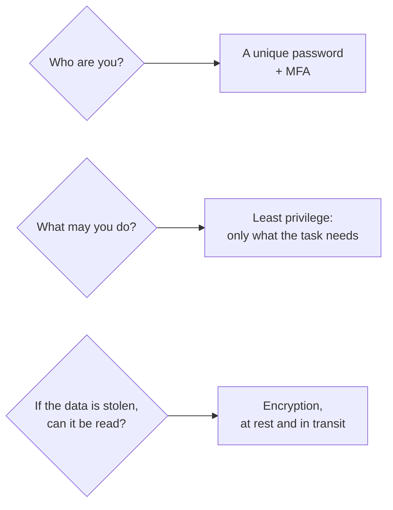

# Prove who you are with a unique password and a second factor, lock data with encryption, and give everyone only the access they need

These four everyday habits each guard against a different failure, so the guide asks for all of them from your first day on AWS.

**For:** an adult studying alone, new to IT, who wants to understand AWS and use it safely. **Time:** about 15 minutes. Reading works on a phone.

**Before you start:** this lesson builds on HTTPS from [Networks, IP addresses, DNS and HTTPS](02-networks-ip-dns-https.md).

## Test out: do you already know this?

Answer without looking anything up. If you get all three right, and didn't guess, you've finished the on-ramp: go to Module 02, [Why organizations use the cloud](../02-why-the-cloud/00-brief.md).

1. Why is using the same password on two websites dangerous, even if it's long?
2. Which second sign-in factor resists fake sign-in pages best: a six-digit code, or a passkey?
3. How does encryption at rest differ from encryption in transit?

Answer key

1. If one site leaks it, attackers try it on other sites and get into every account that shares it.
2. A passkey: it won't work on a fake site, while a code can be typed into one.
3. At rest protects stored data; in transit protects data crossing a network.

## Warm-up: what you already know

1. From lesson 01.02: what does HTTPS protect, and what doesn't it?

Feedback

1. It encrypts data while it travels and proves the server's identity, but doesn't protect data once it's stored.

## What you'll learn

By the end, you can explain what passwords, MFA, encryption and least privilege each protect against (objective 01.06a).

Guess before you read on: if a thief steals your laptop, which of the four habits protects the files on it?

## The big picture: three questions every system asks

*Notice that a strong password does nothing for stolen files, and encryption does nothing for a stolen password.*

**Long description.** Who are you? A unique password plus MFA. What may you do? Least privilege. If the data is stolen, can it be read? Encryption, at rest and in transit.

## Passwords: long, random and used nowhere else

Proving who you are is **authentication**. Websites get broken into and their lists of passwords leak, so attackers try each email and password on other sites. **Password reuse** turns one leak into a break-in everywhere you used that password.

Length matters most, but only for passwords picked at random: a made-up one follows patterns attackers try first. So let a **password manager**, an app protected by one strong main password and MFA, create, remember and fill in a long random password for each account. The guardrails primer's [page 03](https://github.com/AutomateTheCloud/atc-study-aws_account_guardrails/blob/main/primer/03-your-everyday-admin-identity.md) has you use one.

## MFA asks for a second kind of proof, and the best kind can't be phished

**Multi-factor authentication (MFA)** combines two kinds of proof: something you know (a password), have (a phone) or are (a fingerprint) ([What is MFA?](https://aws.amazon.com/what-is/mfa/), checked 2026-10-24). A stolen password alone is then not enough.

**Phishing** tricks you into giving away a password or code, often with a fake sign-in page. An **authenticator app** shows a changing six-digit code, which you can be tricked into typing on a fake page. A **passkey**, or a hardware **security key**, is tied to the real site's address, so a look-alike site gets nothing: it's **phishing-resistant**. AWS recommends passkeys and security keys wherever possible and an authenticator app next, and IAM no longer lets you turn on MFA by text message ([AWS MFA in IAM](https://docs.aws.amazon.com/IAM/latest/UserGuide/id_credentials_mfa.html), checked 2026-10-24). Register a backup factor too: AWS allows up to eight MFA devices on one user, and the primer's [page 02](https://github.com/AutomateTheCloud/atc-study-aws_account_guardrails/blob/main/primer/02-secure-the-root-user.md) sets up a pair.

> **Misconception:** "A strong password means I don't need MFA." That's not right: length stops guessing, not theft. A fake page or a leak takes the whole password, however long, and MFA is the layer that still holds. It's tempting because both feel like "a stronger lock", but they guard against different failures.

## Encryption makes stolen data unreadable without the key

**Encryption** scrambles data with an **encryption key**, a long secret number, so only someone with the right key can turn it back.

- **Encryption at rest** protects stored data: a disk, a database, a backup. A stolen laptop with an encrypted disk keeps its files secret, which answers the guess.
- **Encryption in transit** protects data crossing a network. HTTPS is the everyday example, and the AWS CLI and console use it by default ([Data protection in the AWS CLI](https://docs.aws.amazon.com/cli/latest/userguide/data-protection.html), checked 2026-10-24).

**The key is the whole secret:** anyone with it reads everything, and if it's lost nobody can ([AWS KMS cryptography essentials](https://docs.aws.amazon.com/kms/latest/developerguide/kms-cryptography.html), checked 2026-10-24). A **key pair** is a public key anyone may have and a private key only its owner keeps; SSH sign-in to a server works this way. A **VPN** (virtual private network) carries traffic in an encrypted tunnel: encrypted, but still over the internet (Module 07). And encryption doesn't stop someone who is *allowed* to read the data.

## Least privilege: only the access the job needs

**Least privilege** means granting only the permissions a task requires ([Security best practices in IAM](https://docs.aws.amazon.com/IAM/latest/UserGuide/best-practices.html), checked 2026-10-24), like a hotel key card that opens your room, not the office, and stops at checkout. A misused identity can then damage only what it could reach.

- **Don't do daily work with the master key.** An AWS account starts with a sign-in that can do everything, the root user; the primer has you lock it away.
- **Share access, never passwords.** A shared password can't be limited, and you can't tell who used it.
- **Prefer access that expires,** often a **token**, a short-lived pass issued after you sign in, as AWS recommends for people and programs.

> **Your turn:** the bakery's owner wants a weekend helper to update the cake photos on the website. Using all four habits, say how to set up the helper's access.

Model answer

Give the helper their own sign-in, not the owner's password, with a random password from a password manager and a passkey as MFA. Let it change the photos and nothing else. Encryption protects the data on the way and at rest, but only the limited sign-in stops a mistake reaching the rest of the business.

## Summary

- **Passwords:** long, random and unique, which a password manager makes easy. Reuse turns one leak into many break-ins.
- **MFA** adds a second kind of proof. Passkeys and security keys resist phishing; codes can be typed into a fake page. Keep a backup factor.
- **Encryption** makes stolen data unreadable without the key: at rest for stored data, in transit for data on the move. Protect the key.
- **Least privilege** gives each person or program only the access its task needs, preferably access that expires.

## Practice

1. **Which second factor does AWS recommend first?**

   A. A code by text message\
   B. An authenticator app\
   C. A passkey or security key\
   D. A security question

   

Feedback

   **C is right.** AWS recommends phishing-resistant MFA wherever possible.

   - **A is wrong.** IAM no longer lets you turn on text-message MFA.
   - **B is wrong.** It's a good backup, but its codes can be typed into a fake page.
   - **D is wrong.** It's something you know, like a password, so it isn't a second kind of proof.

   

2. **A website uses HTTPS. Does that protect the customer records stored on its server's disk?**

   A. Yes, HTTPS encrypts everything the site handles\
   B. No, HTTPS protects data in transit; stored records need encryption at rest\
   C. No, nothing can protect stored data

   

Feedback

   **B is right.** The two protect different moments.

   - **A is wrong.** HTTPS stops at the server.
   - **C is wrong.** Encryption at rest does.

   

3. **An email that looks like it's from AWS says your account is locked, and its link opens a convincing sign-in page. What protects you best?**

   A. A longer password\
   B. A passkey\
   C. An authenticator app code

   

Feedback

   **B is right.** A passkey works only on the real site's address.

   - **A is wrong.** A fake page collects a long password as easily as a short one.
   - **C is wrong.** You could type the code into the fake page.

   

**Next:** you've reached the end of the on-ramp. Continue with Module 02, [Why organizations use the cloud](../02-why-the-cloud/00-brief.md); the [guardrails primer](https://github.com/AutomateTheCloud/atc-study-aws_account_guardrails/blob/main/primer/00-read-this-first.md) comes before its first lab.

## Where to check the current details

- [AWS Multi-factor authentication in IAM](https://docs.aws.amazon.com/IAM/latest/UserGuide/id_credentials_mfa.html), IAM User Guide (checked 2026-10-24)
- [Security best practices in IAM](https://docs.aws.amazon.com/IAM/latest/UserGuide/best-practices.html), IAM User Guide (checked 2026-10-24)

---

"Everyday security: passwords, MFA, encryption and least privilege" by Automate the Cloud Inc., licensed under CC BY-NC 4.0 with the Additional Permission for Internal Training from Automate the Cloud Inc.
License: https://creativecommons.org/licenses/by-nc/4.0/
Permission: https://automatethe.cloud/licenses/atc-internal-training-permission.txt
