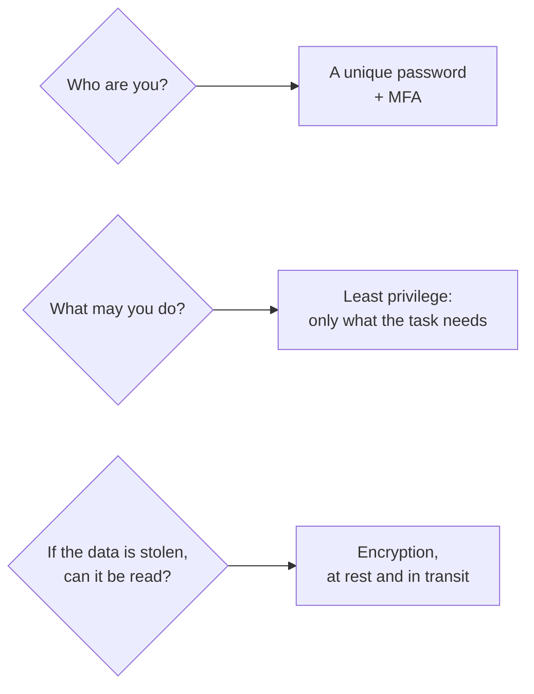
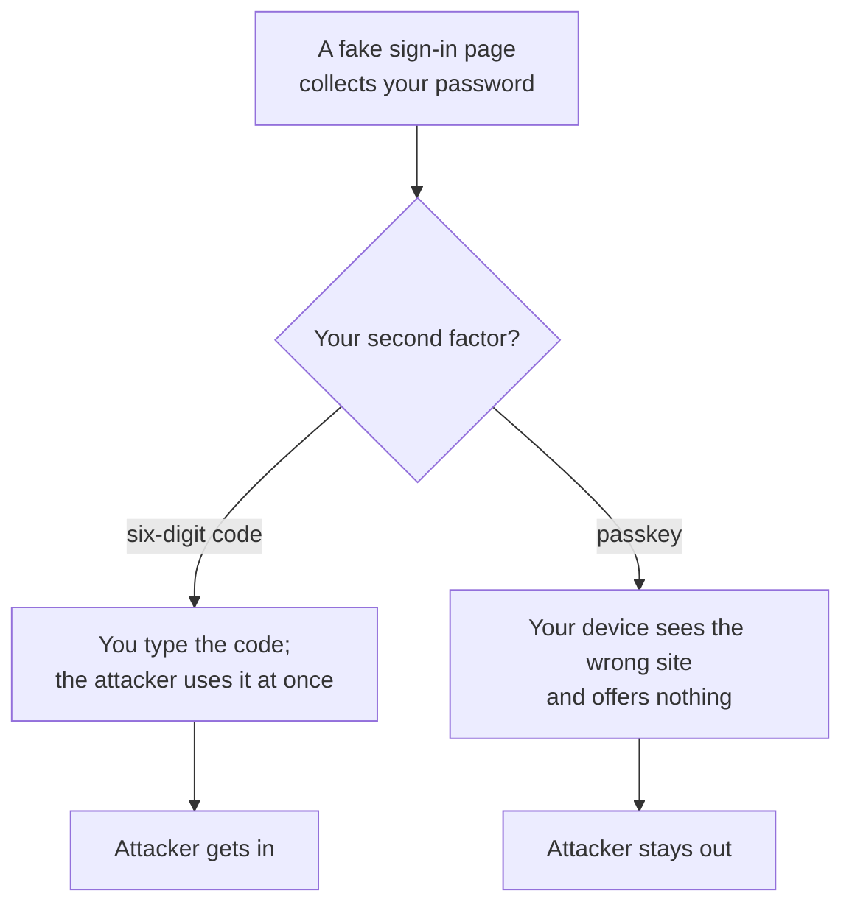
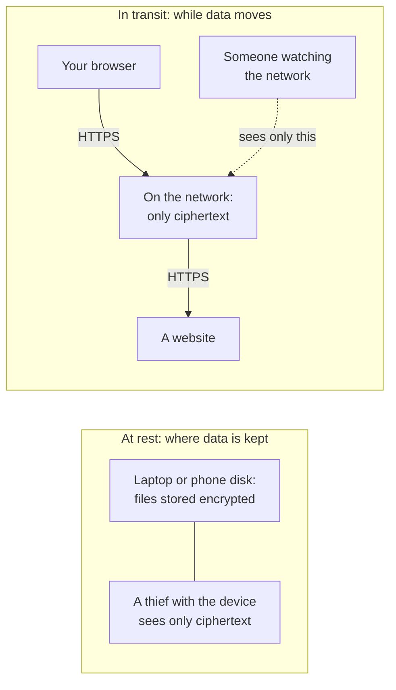

# Prove who you are with a unique password and a second factor, lock data with encryption, and give everyone only the access they need

Four everyday habits protect almost everything you'll do in the cloud: a unique password for every account, a second proof of identity, encryption so stolen data can't be read, and giving each person only the access their job needs.

**For:** an adult studying alone, new to IT, who wants to understand AWS and use it safely. **Time:** about 30 minutes. Reading works on a phone.

**Before you start:** this lesson builds on HTTPS from [Networks, IP addresses, DNS and HTTPS](02-networks-ip-dns-https.md). If you skipped it: HTTPS is the encrypted, identity-checked way your browser talks to websites, shown by `https://` and a padlock. That lesson left encryption itself for this one.

## Test out: do you already know this?

Answer these without looking anything up. If you get all four right, and you didn't guess, you've finished the on-ramp: go to Module 02, [Why organizations use the cloud](../02-why-the-cloud/00-brief.md).

1. Why is using the same password on two websites dangerous, even if it's a long one?
2. Which kind of second sign-in factor resists fake sign-in pages best: a six-digit code, or a passkey?
3. What is the difference between encryption at rest and encryption in transit?
4. In one sentence, what is least privilege?

Answer key

1. If one site leaks it, attackers try the same email and password on other sites, and get into every account that shares it.
2. A passkey. It's tied to the real site, so it won't work on a fake one, while a code can be typed into a fake page.
3. At rest protects stored data, such as files on a disk; in transit protects data while it travels across a network.
4. Giving each person or program only the permissions its task needs, and no more.

## Warm-up: what you already know

1. Your bank texts you a code when you sign in from a new phone. Why does it bother, when you've already typed your password?
2. A hotel gives you a key card. Which doors does it open, and for how long?

Feedback

1. A password can be stolen. The code proves you also have your phone, which a distant thief doesn't: multi-factor authentication.
2. Usually your room and shared areas, until you check out: least privilege, which ends this lesson.

## What you'll learn

By the end, you can explain what passwords, MFA, encryption and least privilege each protect against, and why the guide asks for all four from your first day on AWS (objective 01.06a).

Guess first: if a thief steals your laptop, which of the four habits protects the files on it?

## The big picture: three questions every system asks

*Notice that each habit answers a different question. A strong password does nothing for stolen files, and encryption does nothing for a stolen password.*

**Long description.** Three questions, each with its answer. Who are you? A unique password plus MFA. What may you do? Least privilege: only what the task needs. If the data is stolen, can it be read? Encryption, at rest and in transit.

## Key terms (skip if you know them)

- **Authentication:** proving who you are, for example by signing in.
- **Password manager:** an app that creates, stores and fills in your passwords, protected by one main password.
- **Phishing:** tricking someone into giving away a password or code, often with a fake sign-in page or message.
- **Multi-factor authentication (MFA):** signing in with a second kind of proof besides your password.
- **Encryption:** scrambling data so that only someone with the right **key** can turn it back.

"Key" has several meanings in this guide. Here it's a secret number used for encryption; in a database (lesson 01.03) it's the value that picks out one record; in S3 (Module 05) it's an object's name; and an "access key" (Module 04) is a kind of password for programs.

## A password protects you only if it's long, random and used nowhere else

Websites get broken into, and lists of stolen email addresses and passwords circulate; attackers try each pair on other sites. A leak you couldn't prevent then opens every account where you **reused** that password; AWS's own sign-in service for apps checks for passwords exposed this way ([Compromised-credentials detection](https://docs.aws.amazon.com/cognito/latest/developerguide/cognito-user-pool-settings-compromised-credentials.html), checked 2026-10-24).

**Length matters most.** Each extra character multiplies the number of passwords an attacker must try. The chart compares random passwords of lowercase letters only with random passwords drawn from all four character types (uppercase, lowercase, digits, symbols).

*Notice the two marked points: 16 random lowercase letters beat 10 random characters of every type. Adding length helps more than adding symbols.*

**Long description and data.** Possible random passwords, written as powers of ten. Arithmetic, not measurement: 26 possible characters for lowercase only, 94 for all four types.

| Length | Lowercase only | All four types |
|---|---|---|
| 8 | about 10^11.3 | about 10^15.8 |
| 10 | about 10^14.1 | about 10^19.7 |
| 12 | about 10^17.0 | about 10^23.7 |
| 16 | about 10^22.6 | about 10^31.6 |
| 20 | about 10^28.3 | about 10^39.5 |

These counts hold only for passwords picked **at random**. A password a person makes up, such as a pet's name and a year, follows patterns that attackers try first, however long it looks.

**So let a password manager do it.** It creates a long random password for each account, remembers it and fills it in, so uniqueness costs you nothing. You remember one strong main password and protect the manager with MFA. Many managers also fill a password only on its own site, which helps against fake pages. The guardrails primer assumes you have one: [page 03](https://github.com/AutomateTheCloud/atc-study-aws_account_guardrails/blob/main/primer/03-your-everyday-admin-identity.md) has you paste a new password from it of at least 16 characters, with all four character types, used nowhere else: length and variety together.

> **Your turn:** A friend says: "I use one very long password everywhere, so I'm safe." In two sentences, say what's right and what's wrong.

Model answer

Length is right: a long random password is hard to guess. But one leak from any site hands attackers the password to every account, so each account needs its own, which a password manager makes easy.

## MFA asks for a second kind of proof, and the best kind can't be phished

AWS describes three kinds of proof, called factors: something you **know** (a password or PIN), something you **have** (a phone, a security key), and something you **are** (a fingerprint or face) ([What is MFA?](https://aws.amazon.com/what-is/mfa/), checked 2026-10-24). MFA combines two different kinds, so a stolen password alone isn't enough.

The kinds you'll meet, from weakest to strongest against phishing:

| Second factor | How it works | Can a fake page steal it? |
|---|---|---|
| Code by text message (SMS) | A code is sent to your phone number | Yes. AWS IAM no longer lets you turn on SMS MFA (checked 2026-10-24) |
| **Authenticator app** | An app on your phone shows a six-digit code that keeps changing | Yes: you can be tricked into typing it on a fake page |
| **Passkey** or **security key** | Your device or a small hardware key proves who you are, unlocked by fingerprint, face, PIN or a touch of the key | No: it's **phishing-resistant** |

A passkey is tied to the real site's address: on a look-alike site your device has no passkey to offer, so there's nothing to hand over. AWS recommends passkeys and security keys wherever possible, and an authenticator app as the next choice ([AWS MFA in IAM](https://docs.aws.amazon.com/IAM/latest/UserGuide/id_credentials_mfa.html), checked 2026-10-24).

*Notice that the password is stolen in both branches. Only the kind of second factor decides the ending.*

**Long description.** A fake sign-in page collects your password. If your second factor is a six-digit code, you type it, the attacker uses it at once, and gets in. If it's a passkey, your device sees the wrong site and offers nothing, and the attacker stays out.

Register a **backup** factor too, so losing your phone doesn't lock you out; AWS lets you register up to eight MFA devices on one user, and any one of them signs you in. The primer's [page 02](https://github.com/AutomateTheCloud/atc-study-aws_account_guardrails/blob/main/primer/02-secure-the-root-user.md) sets up exactly that pair for your AWS account.

> **Misconception:** "A strong password means I don't need MFA." That's not right: length stops guessing, not theft. A fake page or a leak takes the whole password, however long, and MFA is the layer that still holds. It's tempting because both feel like "a stronger lock"; they guard against different failures.

> **Check:** You get an email that looks like it's from AWS, saying your account is locked. The link opens a sign-in page that looks right. What protects you best?
>
> A. A longer password\
> B. A passkey, because it won't work on a site that isn't the real one\
> C. An authenticator app code\
> D. Signing in quickly before the account is deleted

Feedback

**B is right.** A passkey only works on the real site's address.

- **A is wrong.** The fake page collects a long password as easily as a short one.
- **C is wrong.** You could type the code into the fake page, and the attacker could use it at once.
- **D is wrong.** Urgency is a phishing trick. Open the site yourself, from a bookmark, instead of following the link.

## Encryption scrambles data so that only someone with the key can read it

**Encryption** turns readable data, called **plaintext**, into scrambled data, called **ciphertext**, using an **encryption key**: a long secret number. Only someone with the right key can turn it back. You use it in two ways every day without noticing:

*Notice that the two protect different moments: one while data sits still, one while it moves.*

**Long description.** Two boxes. At rest, where data is kept: files stored encrypted on a laptop or phone disk, so a thief with the device sees only ciphertext. In transit, while data moves: your browser sends data to a website over HTTPS; on the network it is only ciphertext, which is all someone watching the network sees.

- **Encryption at rest** protects stored data: a disk, a database, a backup. Phones and laptops can encrypt their disks, so a stolen device keeps its files secret.
- **Encryption in transit** protects data crossing a network. HTTPS is the everyday example (lesson 01.02), and the AWS CLI and console use it by default for the requests they send to AWS (lesson 01.05; [Data protection in the AWS CLI](https://docs.aws.amazon.com/cli/latest/userguide/data-protection.html), checked 2026-10-24).

**The key is the whole secret.** Once data is encrypted, you have to protect the key ([AWS KMS cryptography essentials](https://docs.aws.amazon.com/kms/latest/developerguide/kms-cryptography.html), checked 2026-10-24). Anyone with the key reads everything; lose it and nobody can, including you. AWS runs a whole service for keys, which you'll meet in Module 09.

Some encryption uses a **key pair**: a public key that anyone may have, and a private key that only its owner keeps. Data locked with the public key opens only with the private key, and the private key can prove who its owner is. Certificates (lesson 01.02) and signing in to a server with SSH work this way. A **VPN** (virtual private network) carries a network's traffic across the internet in an encrypted tunnel: encrypted, but still over the internet (Module 07).

Encryption doesn't stop someone who is *allowed* to read the data from misusing it. Deciding who may use the key and the data is access control, the next section.

> **Your turn:** Answer the guess from "What you'll learn": a thief steals your laptop. Which habit protects the files, and which protects your email account if your password was saved in the browser?

Model answer

Encryption at rest protects the files: without your sign-in, the disk is ciphertext. For the email account, MFA does: even with the saved password, the thief lacks your passkey or phone. A unique password limits the damage to that one account.

## Least privilege: give each person only the keys their job needs

**Least privilege** means granting only the permissions a task requires ([Security best practices in IAM](https://docs.aws.amazon.com/IAM/latest/UserGuide/best-practices.html), checked 2026-10-24). If an identity is misused or makes a mistake, it can only damage what it could reach.

> **Analogy: a hotel key card.**
>
> - **Maps to:** your card opens your room, not the manager's office (only what you need), and stops working at checkout (only for as long as you need it). Staff cards open more, because their jobs need more.
> - **Where this breaks down:** a hotel decides your card for you. In AWS, you decide what each identity may do, and nothing is allowed until you say so.
>
> **Literally:** each person or program gets specific actions on specific things, and access that isn't needed any more is removed.

Three everyday versions you'll meet in AWS:

- **Don't do daily work with the master key.** Your AWS account starts with a sign-in that can do everything, the root user. The primer has you lock it away and work as a separate identity.
- **Share access, never passwords.** Give a helper their own sign-in with only the permission they need. A shared password can't be limited, and you can't tell who used it.
- **Prefer access that expires.** Like the hotel card, temporary access (often a **token**, a short-lived pass issued after you sign in) stops working by itself; AWS recommends it for people and programs ([Security best practices in IAM](https://docs.aws.amazon.com/IAM/latest/UserGuide/best-practices.html)).

> **Check:** The bakery's owner wants a weekend helper to update the cake photos on the website. Which is least privilege?
>
> A. Share the owner's password, since it's only for weekends\
> B. Give the helper their own sign-in that can change the photos and nothing else\
> C. Give the helper full access, and take it away later\
> D. Give the helper no sign-in, and email photos to the owner instead, forever

Feedback

**B is right.** Their own identity, limited to the task.

- **A is wrong.** A shared password gives the helper everything the owner can do, and you can't tell their actions apart.
- **C is wrong.** Full access is risk from today, and "later" is easy to forget.
- **D is wrong.** It's safe but doesn't do the job; least privilege means enough access, not none.

## Worked example: the bakery's new helper, all four habits at once

The owner is taking on a part-time helper who will look after online orders. Here is how a careful owner sets it up, and which threat each step answers:

| Step | Habit | Protects against |
|---|---|---|
| The helper gets their own sign-in, with a random password from a password manager | Unique password | A leak elsewhere opening this account |
| The sign-in requires a passkey, with an authenticator app as backup | MFA, phishing-resistant | A fake "your account is locked" email |
| The sign-in can view and update orders, not change prices or see payroll | Least privilege | A mistake, or a stolen sign-in, reaching everything |
| The shop laptop's disk is encrypted, and the order site uses HTTPS | Encryption at rest and in transit | A stolen laptop; someone watching the café's Wi-Fi |

The owner's habit: for each step, name the failure it covers. A failure with no step is a gap.

## Where you meet this again

| Idea from this lesson | Where it returns |
|---|---|
| Password manager, passkey, backup authenticator | Primer [page 02](https://github.com/AutomateTheCloud/atc-study-aws_account_guardrails/blob/main/primer/02-secure-the-root-user.md) and [page 03](https://github.com/AutomateTheCloud/atc-study-aws_account_guardrails/blob/main/primer/03-your-everyday-admin-identity.md), before your first lab |
| Who you are vs what you may do | [04.03 Identities](../04-shared-responsibility-and-access/03-identities.md) |
| Least privilege, written as policies | [04.04 Policies and least privilege](../04-shared-responsibility-and-access/04-policies-and-least-privilege.md); [Lab 03](../04-shared-responsibility-and-access/06-lab-03-a-group-and-a-policy.md) and [Lab 04](../04-shared-responsibility-and-access/07-lab-04-finish-and-fix-a-policy.md) |
| Passwords, MFA, keys for programs, expiring access | [04.05 Credentials and federation](../04-shared-responsibility-and-access/05-credentials-and-federation.md) |
| Encryption of stored files and in transit | [05.02 S3 in practice](../05-storing-data/02-s3-in-practice.md) |
| Key pairs for signing in to a server | [06.01 Amazon EC2: instances, images and instance types](../06-running-applications/01-ec2.md) |
| A filter as a second layer; VPNs | [07.02 Filtering traffic](../07-connecting-it/02-filtering-traffic.md); [07.04 Connecting networks and offices](../07-connecting-it/04-connecting-networks-and-offices.md) |
| Encryption keys and certificates | [09.02 Encryption](../09-protecting-and-governing/02-encryption.md) |

## Summary

- **Passwords:** long, random and unique for every account, which a password manager makes easy. Reuse turns one leak into many break-ins.
- **MFA** adds a second kind of proof. Passkeys and security keys resist phishing; codes can be stolen by a fake page. Keep a backup factor.
- **Encryption** makes stolen data unreadable without the key: at rest for stored data, in transit for data on the move. Whoever holds the key can read the data, so protect the key.
- **Least privilege** gives each person or program only the access its task needs, preferably access that expires. Give people their own limited sign-ins, never a shared password.

## Practice

1. **Why does a password manager make you safer, when all your passwords are in one place?**

   

Feedback

   It lets every account have its own long random password, so a leak from one site opens nothing else. You protect the one place with a strong main password and MFA, which is far easier than remembering dozens of strong passwords.

   

2. **Which second factor does AWS recommend first?**

   A. A code by text message\
   B. An authenticator app\
   C. A passkey or security key\
   D. A security question

   

Feedback

   **C is right.** AWS recommends phishing-resistant MFA, passkeys and security keys, wherever possible.

   - **A is wrong.** AWS IAM no longer lets you turn on SMS MFA, and texts can be intercepted or phished.
   - **B is wrong.** It's a good backup, but its codes can be typed into a fake page.
   - **D is wrong.** A security question is something you know, the same kind of factor as a password, so it isn't a second factor.

   

3. **A website uses HTTPS. Does that protect the customer records stored on its server's disk?**

   

Feedback

   **No.** HTTPS is encryption in transit: it protects data while it travels. Records on the disk need encryption at rest, a separate protection.

   

**Next:** you've reached the end of the on-ramp. Continue with Module 02, [Why organizations use the cloud](../02-why-the-cloud/00-brief.md); the [guardrails primer](https://github.com/AutomateTheCloud/atc-study-aws_account_guardrails/blob/main/primer/00-read-this-first.md) comes before its first lab.

## Where to check the current details

- [What is MFA?](https://aws.amazon.com/what-is/mfa/), AWS (checked 2026-10-24)
- [AWS Multi-factor authentication in IAM](https://docs.aws.amazon.com/IAM/latest/UserGuide/id_credentials_mfa.html) and [Security best practices in IAM](https://docs.aws.amazon.com/IAM/latest/UserGuide/best-practices.html), IAM User Guide (checked 2026-10-24)
- [Working with compromised-credentials detection](https://docs.aws.amazon.com/cognito/latest/developerguide/cognito-user-pool-settings-compromised-credentials.html), Amazon Cognito Developer Guide (checked 2026-10-24)
- [AWS KMS cryptography essentials](https://docs.aws.amazon.com/kms/latest/developerguide/kms-cryptography.html), AWS KMS Developer Guide (checked 2026-10-24)

---

"Everyday security: passwords, MFA, encryption and least privilege" by Automate the Cloud Inc., licensed under CC BY-NC 4.0 with the Additional Permission for Internal Training from Automate the Cloud Inc.
License: https://creativecommons.org/licenses/by-nc/4.0/
Permission: https://automatethe.cloud/licenses/atc-internal-training-permission.txt
