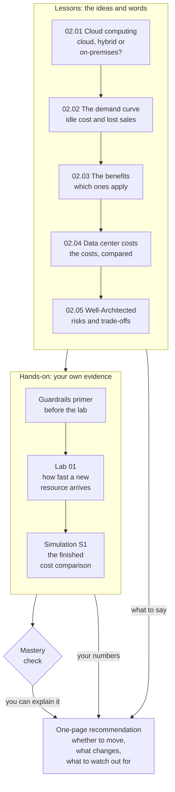

# Module 02: Advise a small bakery on whether to move to the cloud

This module teaches why organizations move computing to the cloud, in terms you can explain to someone who runs a business. By the end, you write a one-page recommendation for a bakery owner.

**For:** an adult studying alone, possibly new to IT, who wants to understand AWS and use it safely. This is the first module of the guide, so it assumes only everyday computer use. Every term is explained when it first appears. **Time:** about 4 hours, spread over several sessions.

## The scenario: a bakery's ordering site

A small bakery takes orders for pickup through its own website. The site crashes during the busy holiday weeks, when the most customers want to order. In January, almost nobody orders, and the equipment sits idle. The owner has heard that "the cloud" might fix this, and asks you: **should we move to the cloud, and what would change?**

These are the bakery's facts. They are made up for teaching, and later lessons use the same ones:

| Fact | Value (made up) |
|---|---|
| Where the site runs today | Three servers that the bakery owns, in a small room behind the shop |
| What one server can handle | About 20 orders an hour |
| Busiest hour in January | About 10 orders |
| Busiest hour in an ordinary month | 20 to 40 orders |
| Busiest hour in December | About 120 orders |
| Average order | About $20 |

A **server** is a computer that runs all the time and answers requests from other computers over a network. The bakery's website runs on servers.

At the end of the module, you write the owner a one-page recommendation. It says whether to move, what would change for the business and its costs, and what the owner should watch out for. Each lesson gives you material for it.

## You'll be able to

Each objective has two tags: the kind of knowledge (C = concept) and what you do with it (Ap = apply, An = analyze).

| Objective | Lesson |
|---|---|
| **02.01a** Classify a setup as cloud, hybrid or on-premises [C·Ap] | 02.01 |
| **02.02a** Explain idle cost and lost sales from a demand curve [C·Ap] | 02.02 |
| **02.03a** Name the benefit a scenario shows, and say why it isn't one of the others [C·An] | 02.03 |
| **02.04a** Compare on-premises and pay-as-you-go costs in plain numbers [C·Ap] | 02.04 |
| **02.05a** Match a concern to a Well-Architected pillar, and explain a trade-off [C·An] | 02.05 |

## What this covers on the exam

This module is the start of Domain 1, Cloud Concepts, of the AWS Certified Cloud Practitioner (CLF-C02) exam. The exam guide doesn't put a date on its version; we checked it on 2026-10-23.

- task [1.1](https://docs.aws.amazon.com/aws-certification/latest/cloud-practitioner-02/cloud-practitioner-02-domain1.html#cloud-practitioner-02-task1.1), the benefits of the AWS Cloud (lessons 02.01 to 02.03);
- task [1.4](https://docs.aws.amazon.com/aws-certification/latest/cloud-practitioner-02/cloud-practitioner-02-domain1.html#cloud-practitioner-02-task1.4), cloud economics (lessons 02.02 and 02.04);
- task [1.2](https://docs.aws.amazon.com/aws-certification/latest/cloud-practitioner-02/cloud-practitioner-02-domain1.html#cloud-practitioner-02-task1.2), the AWS Well-Architected Framework (lesson 02.05);
- task [3.1](https://docs.aws.amazon.com/aws-certification/latest/cloud-practitioner-02/cloud-practitioner-02-domain3.html#cloud-practitioner-02-task3.1), the deployment models part only (lesson 02.01).

Later modules come back to all four tasks. Lab 01 goes beyond the exam: the exam doesn't ask you to build anything, but doing it makes the ideas concrete.

## How the module is laid out

**Lessons** (about 35 minutes each):

1. [What cloud computing is](01-what-cloud-computing-is.md)
2. [Before and after: the demand curve](02-before-and-after-the-demand-curve.md)
3. [Telling the benefits apart](03-telling-the-benefits-apart.md)
4. [What a data center really costs](04-what-a-data-center-really-costs.md)
5. [The Well-Architected Framework](05-the-well-architected-framework.md)

**Hands-on:**

- [Lab 01: your first resource](06-lab-01-first-resource.md), a follow-along lab in your own AWS account. It costs nothing on the Free plan (as of 2026-10-23).
- [Simulation S1: the demand curve](07-sim-demand-curve.md), where you finish the bakery's cost comparison. It runs on this site, not in AWS.

**Before Lab 01:** work through the [guardrails primer](https://github.com/AutomateTheCloud/atc-study-aws_account_guardrails/blob/main/primer/00-read-this-first.md). Lab 01 relies on three of its pages in particular: [securing the root user](https://github.com/AutomateTheCloud/atc-study-aws_account_guardrails/blob/main/primer/02-secure-the-root-user.md), [your everyday admin identity](https://github.com/AutomateTheCloud/atc-study-aws_account_guardrails/blob/main/primer/03-your-everyday-admin-identity.md), and [money alarms](https://github.com/AutomateTheCloud/atc-study-aws_account_guardrails/blob/main/primer/05-money-alarms.md). The lessons themselves need no AWS account.

**Mastery check:** the module ends with a check. You pass at 80%. Each question you miss points you to the section to reread, and then you take a second, parallel check. If you pass the first time, you get optional "going deeper" material.

The map shows how the parts fit together and what each gives you for the recommendation.

*Notice that every part feeds the recommendation: the lessons give you the ideas and words, the lab and the simulation give you numbers of your own, and the check shows you can explain them. If the check finds a gap, it points you back to the section to reread.*

**Long description.** A map from top to bottom. A box of five lessons, in order: 02.01 cloud computing (cloud, hybrid or on-premises?); 02.02 the demand curve (idle cost and lost sales); 02.03 the benefits (which ones apply); 02.04 data center costs (the costs, compared); 02.05 Well-Architected (risks and trade-offs). It leads to a hands-on box: the guardrails primer, done before the lab; Lab 01 (how fast a new resource arrives); and Simulation S1 (the finished cost comparison). The hands-on box leads to the mastery check. Three arrows reach the one-page recommendation (whether to move, what changes, what to watch out for): "what to say" from the lessons, "your numbers" from the hands-on work, and "you can explain it" from the check.

## Coming back

This is the first module, so there is nothing earlier to review. The warm-up questions at the start of each lesson draw on everyday experience, the guardrails primer, and the lessons before them in this module.

From module 03 on, every lesson's warm-up brings back topics from this module. The cost ideas (fixed and variable expense) and the Well-Architected pillars return in every module after this one.

---

"Module 02: Why organizations use the cloud" by Automate the Cloud Inc., licensed under CC BY-NC 4.0 with the Additional Permission for Internal Training from Automate the Cloud Inc.
License: https://creativecommons.org/licenses/by-nc/4.0/
Permission: https://automatethe.cloud/licenses/atc-internal-training-permission.txt
