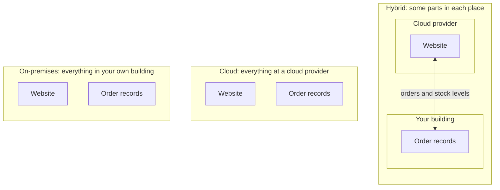

# Cloud computing is IT you rent on demand, over the internet, and pay for as you use it

Cloud computing means using a provider's computers over the internet, when you need them, and paying only for what you use. Where each part of a system runs, at a provider, in your own building or both, is its deployment model: cloud, on-premises or hybrid.

**Exam guide:** [Domain 1, Cloud Concepts](https://docs.aws.amazon.com/aws-certification/latest/cloud-practitioner-02/cloud-practitioner-02-domain1.html) (24% of the exam): task [1.1](https://docs.aws.amazon.com/aws-certification/latest/cloud-practitioner-02/cloud-practitioner-02-domain1.html#cloud-practitioner-02-task1.1); [Domain 3, Cloud Technology and Services](https://docs.aws.amazon.com/aws-certification/latest/cloud-practitioner-02/cloud-practitioner-02-domain3.html) (34% of the exam): task [3.1](https://docs.aws.amazon.com/aws-certification/latest/cloud-practitioner-02/cloud-practitioner-02-domain3.html#cloud-practitioner-02-task3.1).

**For:** an adult studying alone, possibly new to IT, who wants to understand AWS and use it safely. **Time:** about 20 minutes. Reading works on a phone.

**Before you start:** this is the first lesson of the guide, so you need nothing earlier. The [module brief](00-brief.md) introduces the bakery this lesson uses.

## Warm-up: what you already know

Answer from everyday experience. Guessing is fine.

1. You need a car for one weekend trip. Would you buy one or rent one? What changes if you need a car every day for years?
2. You sign in on a new phone and your old photos are already there. Where were they kept?

Feedback

1. Most people rent for a weekend: you pay only for the days you use, and someone else handles repairs. For daily use over years, owning can make sense. That choice, between owning and renting, is what this module is about.
2. On a company's computers, reached over the internet. You already use cloud computing every time this happens.

## What you'll learn

By the end of this lesson, you can say which three features make something cloud computing, and classify a setup as a cloud, hybrid or on-premises deployment (objective 02.01a).

Try this before you read on: a company runs its website on AWS and keeps its payroll system on servers in its own office, and the two are connected. Which deployment model is this?

## The big picture: where do your systems run?

The deployment model answers one question: where does each part of the system run? The diagram shows AWS's three answers, using the bakery's two main parts.

*Notice that the three models differ only in where each part runs. In the hybrid model, a network connection joins the two places.*

**Long description.** Three boxes side by side. "On-premises" holds the website and the order records, both in your own building. "Cloud" holds the same two parts at a cloud provider. "Hybrid" holds two smaller boxes: "Your building" with the order records, and "Cloud provider" with the website, joined by a two-way arrow labeled "orders and stock levels".

## Three features together make something cloud computing

A **server** is a computer that runs all the time and answers requests from other computers over a network; a **data center** is a building full of servers, with the power, cooling and network they need. Servers provide **IT resources**: **compute** (processing power to run programs), **storage** (space for files and data) and **databases** (organized records that programs search and update). A **cloud provider**, such as Amazon Web Services (AWS), owns data centers and rents these resources to others.

AWS defines cloud computing by three features that work together ([What is cloud computing?](https://aws.amazon.com/what-is-cloud-computing/)):

1. **On demand.** You ask for a resource when you need it and get it within minutes, instead of ordering from a supplier and waiting for delivery.
2. **Over the internet.** You reach and set up the resources through the internet. They sit in the provider's data centers, not in your building.
3. **Pay as you go.** You pay for what you use, for as long as you use it. When you delete a resource, you stop paying for it. AWS's pricing page notes there are no termination fees ([AWS Pricing](https://aws.amazon.com/pricing/)).

Before the cloud, an organization bought its own servers and ran them **on-premises**, in a building it owns or controls. It decided how many to buy months ahead, waited for delivery, provided space, power and cooling, repaired and replaced the equipment, and paid for all of it whether the servers were busy or idle. The bakery works this way today, with three servers in a room behind the shop. AWS's advantage **Stop spending money running and maintaining data centers** points at that list: in the cloud, the provider does the buying, housing and repairing ([six advantages](https://docs.aws.amazon.com/whitepapers/latest/aws-overview/six-advantages-of-cloud-computing.html)).

> **Your turn:** In one or two sentences each, explain why these two cases are *not* cloud computing, using the three features.
>
> a) A company orders a server from a supplier. It arrives in three weeks, and the company pays for it in full on delivery. Staff reach it over the internet.
>
> b) A company rents a server in a provider's building for a fixed price every month, on a three-year contract. It can't add or remove servers during the contract.

Model answer

a) It fails **on demand** (three weeks to arrive) and **pay as you go** (paid in full up front, used or not). Reaching it over the internet isn't enough on its own.

b) It's in someone else's building and reached over a network, but it fails **on demand** (no adding servers when you need them) and **pay as you go** (a fixed price for three years, whatever you use). It's renting, but not cloud computing in AWS's sense.

## The three deployment models are cloud, hybrid and on-premises

A **deployment model** says where the parts of a system run. AWS and the CLF-C02 exam guide use three ([Types of cloud computing](https://docs.aws.amazon.com/whitepapers/latest/aws-overview/types-of-cloud-computing.html)):

- **Cloud deployment:** every part runs in the cloud, either built there or moved there.
- **Hybrid deployment:** some parts run in the cloud and some don't, and the parts are connected. The usual case joins the cloud to equipment the organization already runs on-premises.
- **On-premises deployment:** every part runs on equipment in the organization's own buildings. AWS sometimes calls this the **private cloud** when the organization uses software to share out its own servers flexibly. AWS notes it lacks many of the cloud's benefits, though some organizations want resources dedicated to them.

| | Cloud | Hybrid | On-premises |
|---|---|---|---|
| Where the parts run | All at a cloud provider | Some at a provider, some in your buildings, connected | All in your buildings |
| Who owns the equipment | The provider | Both | You |
| More capacity in minutes? | Yes | For the cloud parts | No: you buy and install it |
| Pay as you go? | Yes | For the cloud parts | No: you pay whether it's used or not |

To classify a setup, list its parts and ask where each one runs. All at a provider is cloud; all in your buildings is on-premises; some in each place, connected, is hybrid. Speed, software and the devices people use don't decide the model.

Hybrid is often a deliberate choice, not a halfway failure. AWS describes it as extending existing on-premises systems into the cloud while keeping them connected ([What is hybrid cloud?](https://aws.amazon.com/what-is/hybrid-cloud/)). Organizations keep parts on-premises when a system needs a very fast link to equipment in the building, when data must stay in a particular place, or while they move in stages. The bakery could move its ordering website to the cloud and keep its till system in the shop: that would be hybrid.

### "Public, private and community" are not AWS's deployment models

You may have read that the deployment models are public, private, community and hybrid. That's a different vocabulary, not the one AWS or the CLF-C02 exam guide uses: theirs are cloud, hybrid and on-premises. It's tempting because the other list appears in many courses and sounds official. A related trap is treating a private cloud as a way of moving to the cloud: in AWS's description it's your own on-premises equipment, so choosing it means *not* moving to a provider.

> **Your turn:** Classify each setup, and give your reason in one sentence.
>
> a) A school runs its student-records database on AWS and its website at another cloud provider.\
> b) A bank keeps customer accounts on its own servers but runs a new mobile app on AWS that reads balances from those servers.\
> c) A shop buys a server, puts it in its back office, and runs its website on it.

Model answer

a) **Cloud.** Both parts run at cloud providers; using two providers doesn't make it hybrid.

b) **Hybrid.** The accounts are on-premises, the app is in the cloud, and data flows between them.

c) **On-premises.** The only part runs in the shop's own building, on equipment the shop bought.

## Summary

- **Cloud computing** is renting IT resources from a provider: on demand, over the internet, and paid for as you go. All three features matter.
- **On-premises**, you buy, house and repair your own servers and pay for them whether they're used or not.
- **The three deployment models** are cloud, hybrid and on-premises. Ask where each part runs. "Public, private, community" is a different vocabulary, and AWS counts a private cloud as on-premises.

## Practice

1. **A logistics company keeps its warehouse-control system on servers in its warehouses and runs its customer tracking website on AWS. The website shows data from the warehouse systems. Which deployment model is this?**

   A. Cloud\
   B. Hybrid\
   C. On-premises\
   D. Community

   

Feedback

   **B is right.** Some parts run on-premises, some in the cloud, and data flows between them.

   - **A is wrong.** The warehouse systems don't run at a cloud provider.
   - **C is wrong.** The website runs on AWS.
   - **D is wrong.** "Community" belongs to a different vocabulary, not AWS's.

   

2. **Which statement about on-premises IT is correct?**

   A. You pay for the equipment whether it is busy or idle.\
   B. You can add servers within minutes when demand rises.\
   C. The cloud provider repairs and replaces the equipment.\
   D. You pay only for what you use.

   

Feedback

   **A is right.** You buy the equipment and pay for its space and power, used or not.

   - **B is wrong.** You order, wait for and install new servers; capacity in minutes is a cloud feature.
   - **C is wrong.** On-premises, you repair and replace your own equipment.
   - **D is wrong.** Paying only for what you use is pay as you go, a cloud feature.

   

3. **A hospital runs its patient-records system on servers in its own building, with software that gives each department a share of those servers within minutes. Which deployment model is this?**

   A. Cloud, because departments get resources within minutes\
   B. Hybrid, because it uses sharing software\
   C. On-premises, which AWS sometimes calls private cloud\
   D. Community, because the departments share the servers

   

Feedback

   **C is right.** Every part runs in the hospital's own building, and the hospital still buys, houses and pays for all the equipment.

   - **A is wrong.** Speed alone doesn't make it cloud; nothing runs at a provider.
   - **B is wrong.** Hybrid needs some parts at a cloud provider.
   - **D is wrong.** "Community" isn't one of AWS's deployment models, and sharing doesn't change where the servers run.

   

**Next:** [Before and after: the demand curve](02-before-and-after-the-demand-curve.md) shows why the bakery's site crashes in December and sits idle in January.

## Where to check the current details

- [What is cloud computing?](https://aws.amazon.com/what-is-cloud-computing/), AWS (checked 2026-10-23)
- [Types of cloud computing](https://docs.aws.amazon.com/whitepapers/latest/aws-overview/types-of-cloud-computing.html), Overview of Amazon Web Services whitepaper (checked 2026-10-23)
- [Six advantages of cloud computing](https://docs.aws.amazon.com/whitepapers/latest/aws-overview/six-advantages-of-cloud-computing.html), Overview of Amazon Web Services whitepaper (checked 2026-10-23)

---

"What cloud computing is" by Automate the Cloud Inc., licensed under CC BY-NC 4.0 with the Additional Permission for Internal Training from Automate the Cloud Inc.
License: https://creativecommons.org/licenses/by-nc/4.0/
Permission: https://automatethe.cloud/licenses/atc-internal-training-permission.txt
