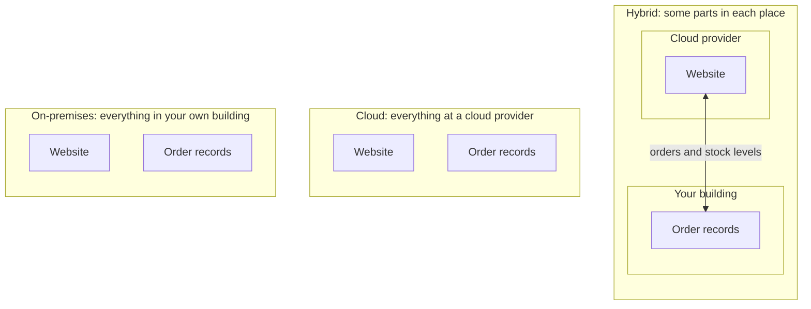
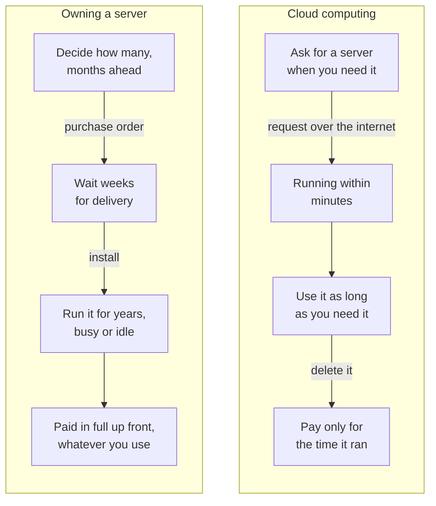
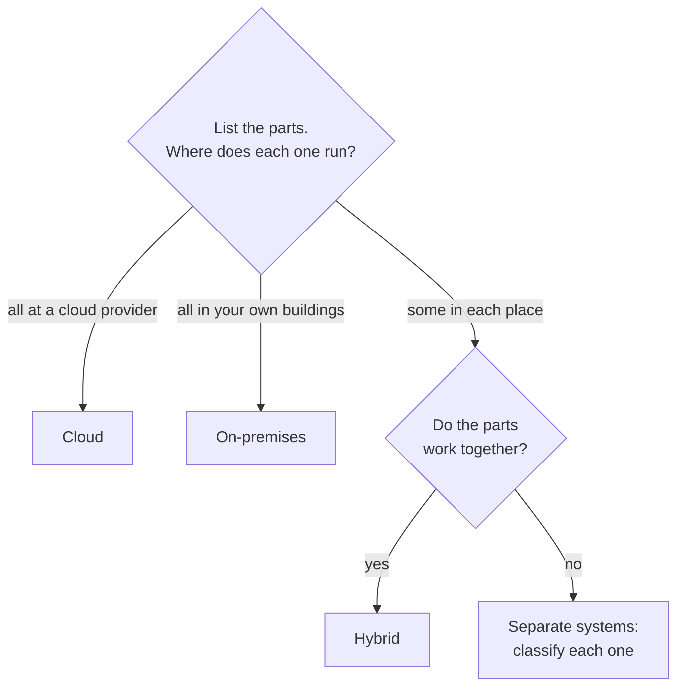

# Cloud computing is IT you rent on demand, over the internet, and pay for as you use it

Cloud computing means using someone else's computers, over the internet, when you need them, and paying only for what you use. Where your systems run (all in the cloud, all in your own building, or a mix) is called the deployment model. By the end of this lesson you can look at a setup and name its deployment model.

**For:** an adult studying alone, possibly new to IT, who wants to understand AWS and use it safely. **Time:** about 35 minutes. Reading works on a phone.

**Before you start:** this is the first lesson of the guide, so you need nothing earlier. If words like "server" or "network" are new to you, the key terms below explain them. The bakery scenario in the [module brief](00-brief.md) is the example this lesson uses.

## Warm-up: what you already know

Answer from everyday experience. Guessing is fine.

1. You need a car for one weekend trip. Would you buy one or rent one? What changes if you need a car every day for years?
2. A shopping website gets slow or shows errors during a big one-day sale. Why might that happen?
3. You sign in on a new phone and your old photos are already there. Where were they kept?

Feedback

1. Most people rent for one weekend: you pay only for the days you use, and someone else handles repairs. For daily use over years, owning can make sense. This choice, between owning and renting, is what this module is about.
2. Too many people used the site at once, and the computers behind it couldn't keep up. Lesson 02.02 shows why.
3. On a company's computers, reached over the internet. You already use cloud computing every time this happens.

## What you'll learn

By the end of this lesson, you can:

- say which three features make something cloud computing;
- classify a setup as a cloud, hybrid or on-premises deployment, and explain why (objective 02.01a).

Try these before you read on. The answers are in the lesson.

1. A company runs its website on AWS and keeps its payroll system on servers in its own office. The two are connected. Which deployment model is this?
2. A company buys servers, puts them in its own building, and uses software to share them out to its teams. Is that cloud computing?

## The big picture: where do your systems run?

The deployment model answers one question: where do the parts of your system run? The diagram shows the three answers AWS uses, with the bakery's two main parts: its website and its order records.

*Notice that the three models differ only in where each part runs. In the hybrid model, a network connection joins the two places, and data flows across it in both directions.*

**Long description.** Three boxes side by side. The first, "On-premises", contains the website and the order records, both in your own building. The second, "Cloud", contains the same two parts, both at a cloud provider. The third, "Hybrid", contains two smaller boxes: "Your building" holds the order records, and "Cloud provider" holds the website. A two-way arrow between them is labeled "orders and stock levels".

## Key terms (skip if you know them)

- **Server:** a computer that runs all the time and answers requests from other computers over a network. A website runs on one or more servers.
- **Data center:** a building full of servers, with the power, cooling and network connections they need.
- **IT resources:** the things computers provide. The main ones are **compute** (processing power to run programs), **storage** (space to keep files and data) and **databases** (organized collections of records that programs can search and update).
- **Cloud provider:** a company that owns data centers and rents IT resources to others over the internet. Amazon Web Services (AWS) is one.
- **On-premises:** in a building that you own or control. "Premises" means a building and its land.
- **Deployment model:** where the parts of a system run: in the cloud, on-premises, or a mix called hybrid.

"Cloud" is an everyday word that means something different here. A cloud in the sky is vague and has no fixed place. Cloud computing is concrete: real servers, in real buildings, owned and run by a provider. You don't see them, but they exist.

## Three features together make something cloud computing

AWS defines cloud computing by three features that work together ([What is cloud computing?](https://aws.amazon.com/what-is-cloud-computing/)):

1. **On demand.** You ask for a resource when you need it, and you get it within minutes. There is no order to place with a supplier, no delivery to wait for, and no one to install it.
2. **Over the internet.** You reach the resources, and set them up, through the internet. They sit in the provider's data centers, not in your building.
3. **Pay as you go.** You pay for what you use, for as long as you use it. When you stop using a resource and delete it, you stop paying for it. AWS's pricing page notes that there are no termination fees ([AWS Pricing](https://aws.amazon.com/pricing/)).

All three matter, as the exercise at the end of this section shows. The diagram compares getting one server each way.

*Notice where the waiting and the paying happen. Owning puts both at the start, before you know what you need. In the cloud, there is almost no wait, and the paying follows the use.*

**Long description.** Two columns of four steps, top to bottom. Owning a server: decide how many, months ahead; a purchase order leads to waiting weeks for delivery; installing leads to running it for years, busy or idle; it was paid in full up front, whatever you use. Cloud computing: ask for a server when you need it; a request over the internet has it running within minutes; use it as long as you need it; deleting it means you pay only for the time it ran.

What can you rent this way? AWS lists compute, storage, databases, applications and other IT resources ([Overview of AWS: six advantages](https://docs.aws.amazon.com/whitepapers/latest/aws-overview/six-advantages-of-cloud-computing.html)). Later modules cover each kind. For now, think of them as the building blocks the bakery's website needs: compute to run the site, storage for photos of the cakes, and a database for the orders.

> **Analogy: electricity from the grid.** AWS itself compares pay-as-you-go pricing to paying for water and electricity ([AWS Pricing](https://aws.amazon.com/pricing/)).
>
> - **Maps to:** you don't build a power station; you connect and use what you need. You pay for what you use. Someone else runs the large, shared equipment.
> - **Where this breaks down:** electricity is the same everywhere, but cloud resources come in many types and sizes that you must choose between. And a forgotten cloud resource can cost far more than a forgotten lamp: it keeps running and costing money until you delete it.
>
> **Literally:** you rent specific IT resources from a provider, by the hour, second or amount used, and you are responsible for choosing them and removing them.

> **Your turn:** In one or two sentences each, explain why these two cases are *not* cloud computing, using the three features.
>
> a) A company orders a server from a supplier. It arrives in three weeks, and the company pays for it in full on delivery. Staff reach it over the internet.
>
> b) A company rents a server in a provider's building for a fixed price every month, on a three-year contract. It can't add or remove servers during the contract.

Model answer

a) It fails **on demand** (three weeks to arrive) and **pay as you go** (paid in full up front, whether it's used or not). Reaching it over the internet isn't enough on its own.

b) It is reached over a network and is in someone else's building, but it fails **on demand** (no adding servers when you need them) and **pay as you go** (a fixed price for three years, whatever you use). This is renting, but not cloud computing in AWS's sense.

## Before the cloud, organizations owned and ran their own equipment

Before the cloud, an organization that needed a website or a database bought servers, put them in a building it controlled, and ran them itself. That is **on-premises** IT, and many organizations still work this way. The organization:

- decides how many servers to buy, months or years ahead;
- orders them and waits for delivery;
- provides space, power, cooling and network connections;
- installs, repairs and replaces the equipment;
- pays for all of it whether the servers are busy or idle.

The bakery today is on-premises: three servers in a room behind the shop. Lesson 02.02 shows what that costs it in idle equipment and lost orders. Lesson 02.04 looks at everything that goes into the cost of running your own equipment.

AWS's name for the fifth advantage of the cloud, **Stop spending money running and maintaining data centers**, points at this list ([six advantages](https://docs.aws.amazon.com/whitepapers/latest/aws-overview/six-advantages-of-cloud-computing.html)). In the cloud, the provider does the buying, housing and repairing, and you spend your time on your own business.

## The three deployment models are cloud, hybrid and on-premises

AWS and the CLF-C02 exam guide name three deployment models ([Types of cloud computing](https://docs.aws.amazon.com/whitepapers/latest/aws-overview/types-of-cloud-computing.html)). For the AWS Certified Cloud Practitioner (CLF-C02) exam, these are the words to know (task [3.1](https://docs.aws.amazon.com/aws-certification/latest/cloud-practitioner-02/cloud-practitioner-02-domain3.html#cloud-practitioner-02-task3.1)).

- **Cloud deployment:** every part of the system runs in the cloud. The system was either built there or moved there from somewhere else.
- **Hybrid deployment:** some parts run in the cloud and some don't, and the parts are connected. The most common case joins the cloud to equipment the organization already runs on-premises.
- **On-premises deployment:** every part runs on equipment in the organization's own buildings. AWS sometimes calls this the **private cloud** when the organization uses software to share its own servers out flexibly. AWS notes that it lacks many of the cloud's benefits, though some organizations want it because the resources are dedicated to them.

| | Cloud | Hybrid | On-premises |
|---|---|---|---|
| Where the parts run | All at a cloud provider | Some at a provider, some in your buildings, connected | All in your buildings |
| Who owns the equipment | The provider | Both | You |
| Get more capacity in minutes? | Yes | For the cloud parts | No: you buy and install it |
| Pay as you go? | Yes | For the cloud parts | No: you pay for equipment whether it's used or not |

**What's the same:** in all three, the organization still decides what its system does and is responsible for its own data. **What differs:** where the parts run, and so who buys and runs the equipment. **To classify a setup, ask one question for each part: where does it run?** The flowchart shows the method.

*Notice that only one thing decides the answer: where the parts run. Speed, software and devices don't appear in the flowchart.*

**Long description.** A decision flowchart. Start: list the parts and ask where each one runs. If all run at a cloud provider, the answer is cloud. If all run in your own buildings, it is on-premises. If some run in each place, ask whether the parts work together: if yes, it is hybrid; if no, they are separate systems, and you classify each one on its own.

### "Public, private and community" are not AWS's deployment models

You may have read that the cloud deployment models are public, private, community and hybrid. That is a different vocabulary, and it isn't the one AWS or the CLF-C02 exam guide uses. The exam guide's examples are cloud, hybrid and on-premises.

The other vocabulary is tempting because it appears in many courses and practice questions, and because it sounds official. If you learn it instead, you meet unfamiliar words on the exam.

A related mistake is to treat "private cloud" as a way of moving to the cloud while keeping full control. In AWS's description, a private cloud is your own on-premises equipment, run with sharing software. Choosing it means *not* moving to a cloud provider, and giving up most of the benefits this module describes.

> **Check:** A hospital runs its patient-records system on servers in its own building. It uses software that lets each department get a share of those servers within minutes. Which deployment model is this?
>
> A. Cloud, because departments get resources within minutes\
> B. Hybrid, because it uses sharing software\
> C. On-premises, which AWS sometimes calls private cloud

Feedback

**C is right.** Every part runs in the hospital's own building. Sharing software makes the servers easier to divide up, but the hospital still buys, houses and pays for all the equipment.

- **A is wrong.** Speed alone doesn't make it cloud. Nothing runs at a cloud provider, and the hospital doesn't pay as it goes.
- **B is wrong.** Hybrid means some parts run at a cloud provider and some don't. Here nothing runs at a provider.

## Worked example: classifying three setups

Here is how someone who knows this well thinks through a classification. The method is the same each time: list the parts, say where each runs, then decide.

**Setup 1.** A design studio stores all its files with a cloud provider and runs its project-tracking website at the same provider. Its staff work from laptops at home.

- *Parts:* file storage, project-tracking website.
- *Where each runs:* both at the cloud provider.
- *Distraction to ignore:* the laptops. Every model has people using laptops. Laptops are how people reach the system; they aren't where the system runs.
- **Answer: cloud.**

**Setup 2.** The bakery moves its ordering website to AWS but keeps its till system (the cash register and its records) on a computer in the shop. Each night, the website sends the day's orders to the till system.

- *Parts:* ordering website, till system.
- *Where each runs:* the website at AWS, the till system in the shop.
- *Are they connected?* Yes: orders flow from one to the other.
- **Answer: hybrid.**

**Setup 3.** A factory runs its machine-control software on servers on the factory floor. Nothing connects to a cloud provider.

- *Parts:* machine-control software and its servers.
- *Where each runs:* in the factory, which the company controls.
- **Answer: on-premises.**

Notice what the expert ignored: how modern the equipment is, how fast staff get resources, and what devices people use. Only where the parts run decides the model.

> **Your turn:** Classify each setup, and give your reason in one sentence.
>
> a) A school runs its student-records database on AWS and its website at another cloud provider.
> b) A bank keeps its customer accounts on its own servers, but runs a new mobile-banking app on AWS. The app reads account balances from the bank's servers.
> c) A shop buys a new server, puts it in its back office, and puts its website on it.
> d) A charity uses an email service that it signs in to through a web browser. It runs no servers of its own.

Model answer

a) **Cloud.** Both parts run at cloud providers. Using two providers doesn't make it hybrid; hybrid means some parts are *not* in the cloud.

b) **Hybrid.** The accounts are on-premises, the app is in the cloud, and data flows between them.

c) **On-premises.** The only part runs in the shop's own building, and the shop bought the equipment up front.

d) **Cloud.** The charity's only system runs at the email provider. The going-deeper box below gives this kind of service a name: software as a service.

## Hybrid is often a deliberate choice, not a halfway failure

AWS describes hybrid as a way to extend existing on-premises systems into the cloud while keeping the two connected ([Types of cloud computing](https://docs.aws.amazon.com/whitepapers/latest/aws-overview/types-of-cloud-computing.html); [What is hybrid cloud?](https://aws.amazon.com/what-is/hybrid-cloud/)).

Common reasons to keep some parts on-premises include:

- a system needs a very fast connection to equipment in the building, such as machines in a factory;
- data must stay in a particular place;
- the organization is moving to the cloud in stages, one system at a time.

AWS even offers ways to run its own equipment inside a customer's building; module 03 introduces one, AWS Outposts.

For the bakery, a hybrid setup is a real option. It could move the ordering website to the cloud, where busy holidays hurt it most, and keep the till system in the shop.

## In real work: the deployment model is a business decision

At work, you choose a deployment model for each system from what it needs: how much its demand changes, where its data must live, and what it costs to run.

The AWS Well-Architected Framework, AWS's guidance for building well in the cloud, makes the cost side explicit. Its cost optimization pillar includes the design principle "[Stop spending money on undifferentiated heavy lifting](https://docs.aws.amazon.com/wellarchitected/latest/framework/cost-dp.html)". "Undifferentiated" means work that every organization must do the same way and that doesn't set it apart from competitors, such as racking servers. Customers don't buy from the bakery because of how it cools its servers. Lesson 02.05 introduces the Framework properly.

## Going deeper (optional): IaaS, PaaS and SaaS

Another way to sort cloud services is by how much the provider runs for you. AWS calls these the traditional groupings ([What is cloud computing?](https://aws.amazon.com/what-is-cloud-computing/)):

| Grouping | What you get | What you still manage | Example from this lesson |
|---|---|---|---|
| **Infrastructure as a service (IaaS)** | Basic building blocks: computers, storage, networking | The most: operating systems, software, data | The bakery renting servers to run its own website software |
| **Platform as a service (PaaS)** | A place to run your application, with the hardware and operating system handled | Your application and its data | The bakery uploading its website code and letting the provider run it |
| **Software as a service (SaaS)** | A finished application, run entirely by the provider | How you use it, and your data in it | The charity's web-based email |

These groupings describe *what kind of service* you use; the deployment model describes *where your system runs*. Module 04 uses this idea to explain who secures what.

## Summary

- **Cloud computing** is renting IT resources from a provider: on demand, over the internet, and paid for as you go. All three features matter.
- **Before the cloud**, organizations bought, housed and ran their own servers on-premises, and paid for them whether they were used or not.
- **The three deployment models** are cloud, hybrid and on-premises. To classify a setup, ask where each part runs. "Public, private, community" is a different vocabulary, not AWS's.
- **Hybrid** is often a deliberate choice: some systems stay on-premises for speed, data location, or a staged move.
- **In real work**, the choice follows each system's needs, and the Well-Architected Framework's cost optimization pillar warns against spending effort on work that doesn't set you apart.

**For your recommendation:** note which of the bakery's parts could move, and whether the result would be cloud or hybrid.

## Practice

1. **Which three features, together, make something cloud computing in AWS's definition?**

   

Feedback

   On demand, over the internet, and pay as you go. Missing any one of them, you have something else: for example, a server you reach over the internet but bought up front.

   

2. **A logistics company keeps its warehouse-control system on servers in its warehouses and runs its customer tracking website on AWS. The website shows data from the warehouse systems. Which deployment model is this?**

   A. Cloud\
   B. Hybrid\
   C. On-premises\
   D. Community

   

Feedback

   **B is right.** Some parts run on-premises (warehouse control), some in the cloud (the website), and data flows between them.

   - **A is wrong.** The warehouse systems don't run at a cloud provider.
   - **C is wrong.** The website runs on AWS, not in the company's buildings.
   - **D is wrong.** "Community" belongs to a different vocabulary. AWS's deployment models are cloud, hybrid and on-premises.

   

3. **A company says: "We built a private cloud, so we've moved to the cloud." What would you tell them, in two sentences?**

   

Feedback

   **Model answer:** In AWS's terms, a private cloud is your own on-premises equipment run with sharing software, so it is an on-premises deployment. You still buy, house and pay for all the equipment, and you miss most of the cloud's benefits, such as paying only for what you use.

   

4. **Which statement about on-premises IT is correct?**

   A. You pay for the equipment whether it is busy or idle.\
   B. You can add servers within minutes when demand rises.\
   C. The cloud provider repairs and replaces the equipment.\
   D. You pay only for what you use.

   

Feedback

   **A is right.** You buy the equipment and pay for its space and power whether it's used or not.

   - **B is wrong.** You must order, wait for and install new servers. Getting capacity within minutes is a cloud feature.
   - **C is wrong.** On-premises, you repair and replace your own equipment.
   - **D is wrong.** Paying only for what you use is pay-as-you-go, a cloud feature.

   

5. **Explain to the bakery owner, in your own words and without technical terms, what "moving the website to the cloud" would mean.**

   

Feedback

   **Model answer:** Instead of running the website on the three computers in the back room, you would rent computers from a company like AWS, over the internet. You could get more within minutes when it's busy, pay only for what you use, and stop buying and repairing that equipment yourself. Check that your answer mentions renting, getting capacity quickly, and paying for use.

   

**Next:** [Before and after: the demand curve](02-before-and-after-the-demand-curve.md) shows why the bakery's site crashes in December and sits idle in January.

## Where to check the current details

- [What is cloud computing?](https://aws.amazon.com/what-is-cloud-computing/), AWS (checked 2026-10-23)
- [Types of cloud computing](https://docs.aws.amazon.com/whitepapers/latest/aws-overview/types-of-cloud-computing.html), Overview of Amazon Web Services whitepaper (checked 2026-10-23)
- [Six advantages of cloud computing](https://docs.aws.amazon.com/whitepapers/latest/aws-overview/six-advantages-of-cloud-computing.html), Overview of Amazon Web Services whitepaper (checked 2026-10-23)
- [What is hybrid cloud?](https://aws.amazon.com/what-is/hybrid-cloud/), AWS (checked 2026-10-23)
- [AWS Pricing](https://aws.amazon.com/pricing/), AWS (checked 2026-10-23)
- [AWS Certified Cloud Practitioner (CLF-C02) exam guide](https://docs.aws.amazon.com/aws-certification/latest/cloud-practitioner-02/cloud-practitioner-02.html) (checked 2026-10-23)

---

"What cloud computing is" by Automate the Cloud Inc., licensed under CC BY-NC 4.0 with the Additional Permission for Internal Training from Automate the Cloud Inc.
License: https://creativecommons.org/licenses/by-nc/4.0/
Permission: https://automatethe.cloud/licenses/atc-internal-training-permission.txt
