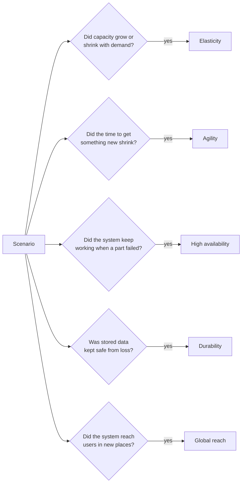
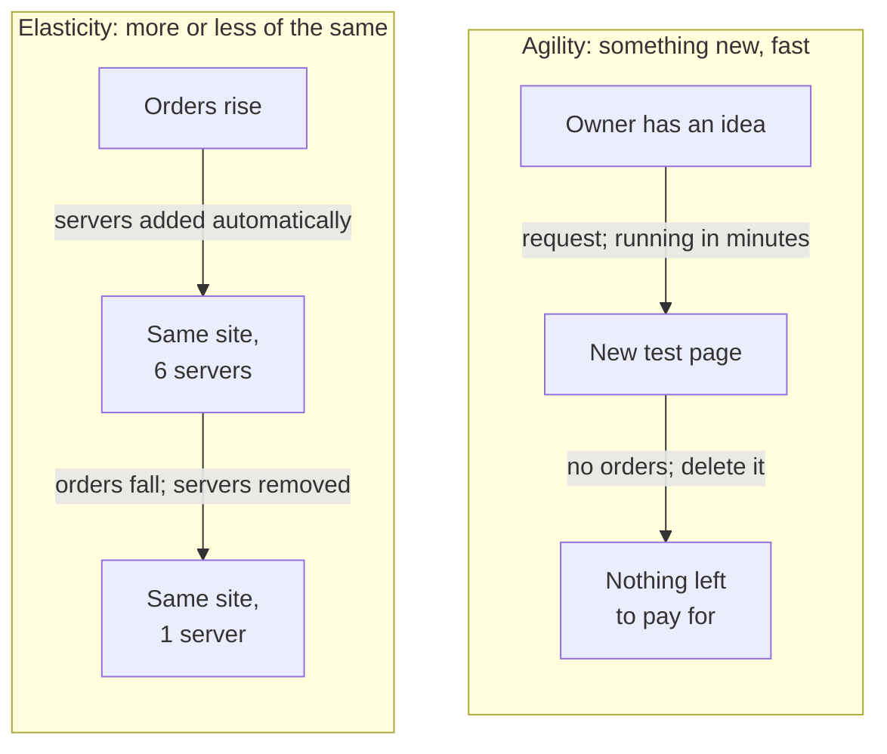
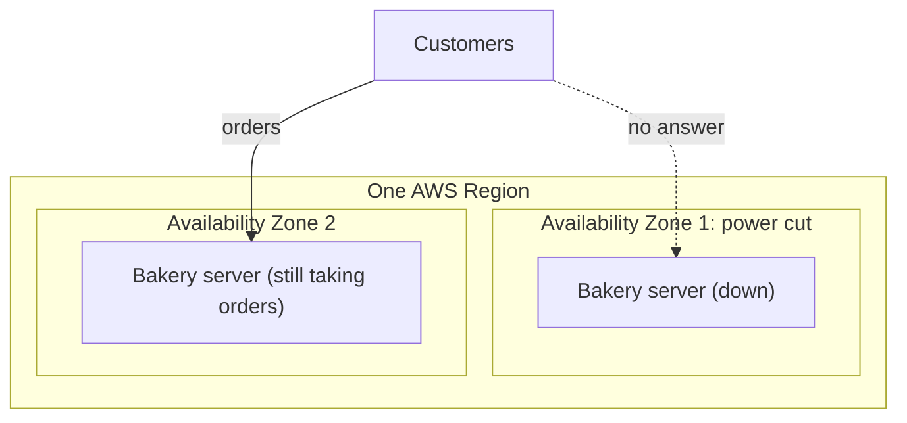
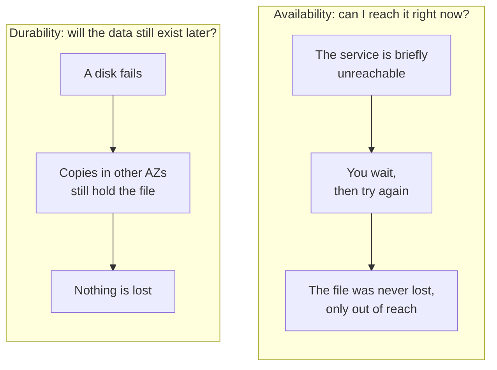
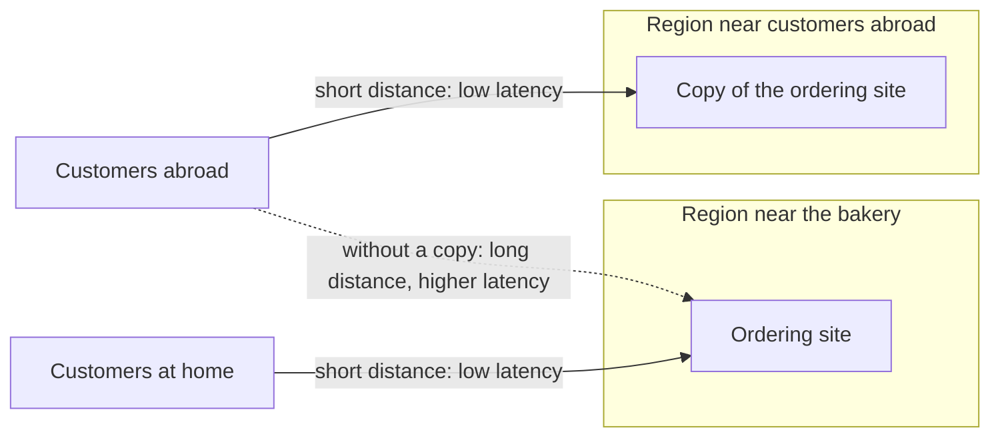

# Each cloud benefit answers a different question: what changed?

Elasticity, agility, high availability, durability and global reach are all cloud benefits, and exam questions often offer several of them as answers. Each describes a different change: in capacity, speed, surviving failure, keeping data, or location. By the end of this lesson you can name the benefit a scenario shows, and say why it isn't one of the others.

**For:** an adult studying alone, possibly new to IT, who wants to understand AWS and use it safely. **Time:** about 35 minutes. Reading works on a phone.

**Before you start:** read [What cloud computing is](01-what-cloud-computing-is.md) and [Before and after: the demand curve](02-before-and-after-the-demand-curve.md) first. This lesson uses the bakery from the [module brief](00-brief.md).

## Warm-up: from earlier lessons

1. On the bakery's demand curve, what does the gap *below* the line of owned servers represent?
2. In one sentence: why doesn't "trade fixed expense for variable expense" mean "the cloud always costs less"?
3. If you have worked through the guardrails primer: every lab ends by deleting what it created. Which idea from lesson 02.02 explains why?

Feedback

1. **Idle capacity:** servers the bakery pays for but doesn't use.
2. Paying by use saves money only if use varies and you remove capacity you don't need. Keeping peak capacity running all year can cost more than owning.
3. Pay as you go: anything you leave running keeps costing money (or credits). If you haven't done the primer yet, [page 07, habits for every lab](https://github.com/AutomateTheCloud/atc-study-aws_account_guardrails/blob/main/primer/07-habits-for-every-lab.md), covers it before Lab 01.

## What you'll learn

By the end of this lesson, you can:

- explain elasticity, agility, high availability, durability and global reach in plain words;
- name the benefit a scenario shows, and say why each of the others doesn't fit (objective 02.03a).

Try these before you read on. Guessing is fine.

1. A website adds servers automatically when visitors increase, and removes them when visitors leave. Is that agility or elasticity?
2. A storage service is designed so that stored files are almost never lost. Does that mean you can always reach your files?

## The big picture: one question for each benefit

The fastest way to tell the benefits apart is to ask what changed in the scenario. The diagram shows the five questions and the benefit each one points to.

*Notice that each question is about a different thing: capacity, time, failure, data, and place. A scenario can show more than one benefit, but an exam question usually asks for the one it shows best.*

**Long description.** A box labeled "Scenario" on the left has five arrows to five questions. "Did capacity grow or shrink with demand?" leads, on yes, to Elasticity. "Did the time to get something new shrink?" leads to Agility. "Did the system keep working when a part failed?" leads to High availability. "Was stored data kept safe from loss?" leads to Durability. "Did the system reach users in new places?" leads to Global reach.

## Key terms (skip if you know them)

- **Elasticity:** capacity that grows when demand rises and shrinks when it falls.
- **Agility:** the ability to get new resources, and try new ideas, quickly and cheaply.
- **High availability:** a system keeps working, with little or no downtime, even when some of its parts fail.
- **Durability:** stored data is kept safe from loss over time.
- **Global reach:** the ability to run your system in many parts of the world, close to your users.
- **Region:** an area of the world where AWS runs a group of data centers, such as US East (N. Virginia).
- **Availability Zone (AZ):** one or more data centers inside a Region, with their own power and network, kept separate from the other AZs in that Region.
- **Latency:** the delay between a user's request and the response. It grows with distance.

Two of these are everyday words with a narrower meaning here. In everyday speech, "available" means "free to use" and "durable" means "hard-wearing". Here, **availability** means "working and reachable right now", and **durability** means "the data will still exist later".

## Elasticity: capacity grows and shrinks with demand

**Elasticity** means capacity follows demand, in both directions. AWS describes it as not having to buy for your peak in advance: you get the resources you need now and grow or shrink them as needs change ([What is cloud computing?](https://aws.amazon.com/what-is-cloud-computing/)).

This is the second chart in lesson 02.02: the servers rented follow the servers needed, month by month.

On AWS, elasticity is usually automatic. A feature called **auto scaling** watches demand and adds or removes servers by rules you set. The CLF-C02 exam guide links elasticity to auto scaling (task [3.3](https://docs.aws.amazon.com/aws-certification/latest/cloud-practitioner-02/cloud-practitioner-02-domain3.html#cloud-practitioner-02-task3.3)). The exam guide's service list names AWS Auto Scaling; the service that adds and removes servers is Amazon EC2 Auto Scaling. Module 06 covers both.

### "Scalability is manual, elasticity is automatic" is a myth

You may have read that scalability means adding capacity by hand and elasticity means adding it automatically. That isn't right. No AWS source we checked defines the terms that way, although the idea appears in some study material and practice questions.

The useful difference is about direction and fit, not about hands or automation:

- **Scalability**, in plain words, means a system *can* grow to handle more. We found no formal AWS definition of it.
- **Elasticity** means capacity *follows* demand, up *and* down, so you don't pay for capacity you no longer need. On AWS this is normally done with auto scaling.

The myth is tempting because elasticity on AWS usually *is* automatic, so the two ideas get merged. For the exam: when a scenario describes capacity rising and falling with demand, the answer is **elasticity**.

> **Your turn:** A company's website grew from 1,000 to 100,000 users over two years. Each time, an engineer added servers by hand, and none were ever removed. Is this a good example of elasticity? Explain in two sentences.

Model answer

No. The system scaled (it grew to handle more), but capacity never shrank when it could have, so it doesn't show capacity *following* demand in both directions. A good example of elasticity would add servers at busy times and remove them at quiet times, usually automatically.

## Agility: getting something new takes minutes, not weeks

**Agility** is about speed and the freedom to experiment. In the cloud, a new resource is a request away, so the time to get it drops from weeks to minutes. Because trying something costs little and you can delete it afterwards, teams can test ideas they couldn't justify before ([six advantages: Increase speed and agility](https://docs.aws.amazon.com/whitepapers/latest/aws-overview/six-advantages-of-cloud-computing.html); [What is cloud computing?](https://aws.amazon.com/what-is-cloud-computing/)).

For the bakery: the owner wants to try a page for ordering custom birthday cakes. In the cloud, a developer could set up a test version in an afternoon, with no server to buy, and delete it next week if nobody orders.

[Lab 01](06-lab-01-first-resource.md) lets you measure agility yourself: you create a resource in AWS and time how long it takes.

### Elasticity and agility both sound like "fast"

Both benefits involve speed, which is why they are easy to confuse. The difference is *what* happens quickly:

*Notice what starts each story. Elasticity starts with demand and changes the amount of the same thing. Agility starts with a person's idea and creates something new.*

**Long description.** Two panels side by side. Elasticity: orders rise, servers are added automatically, and the same site runs on 6 servers; orders fall, servers are removed, and the same site runs on 1 server. Agility: the owner has an idea; a request has a new test page running in minutes; with no orders, it is deleted, and nothing is left to pay for.

| | Elasticity | Agility |
|---|---|---|
| What changes | The *amount* of the same thing (more or fewer servers for the same website) | You get something *new* (a new resource, a new test, a new feature) |
| What drives it | Demand rising or falling | A person's idea or decision |
| Bakery example | Six servers in December, one in January | A test cake-ordering page set up in an afternoon |

**The principle:** if the scenario is about *more or less of the same in response to demand*, it's elasticity. If it's about *how fast you can get something new or try an idea*, it's agility.

> **Check:** A research team needs a powerful computer for a one-week experiment. In the cloud, they have it running within ten minutes and delete it when the experiment ends. Which benefit does this show best?
>
> A. Elasticity\
> B. Agility\
> C. Durability

Feedback

**B is right.** The team got a new resource quickly to try something, then removed it. The point is speed and low-cost experimenting.

- **A is wrong.** Nothing grew or shrank in response to changing demand. The team made a one-off decision.
- **C is wrong.** Durability is about stored data not being lost; the scenario doesn't mention keeping data.

## High availability: the system keeps working when a part fails

**High availability** means a system keeps running, with little downtime, even when hardware fails, software crashes, or a building loses power. AWS describes it as a system's ability to run continuously, and notes that it is usually measured as a percentage of time the system is working ([What is high availability?](https://aws.amazon.com/what-is/high-availability/)).

The percentages are often called "nines". Each extra nine allows a tenth of the downtime. Over a year (8,760 hours):

*Notice how fast the bars shrink: going from three nines to five nines takes a year's downtime from a working day to a few minutes. The table gives the same values.*

| Availability | Downtime a year, about |
|---|---|
| 99.9% ("three nines") | 8.8 hours |
| 99.99% ("four nines") | 53 minutes |
| 99.999% ("five nines") | 5 minutes |

The main way to get high availability is to avoid having just one of anything. On AWS, you run copies of your system in more than one **Availability Zone**, so if one AZ fails, the others keep serving your users ([AWS Regions and Availability Zones](https://docs.aws.amazon.com/global-infrastructure/latest/regions/aws-regions-availability-zones.html)). As of 2026-10-23, AWS says each Region has at least three AZs. Module 03 explains Regions and AZs properly.

For the bakery: all three servers are in one room, so a power cut there stops the site, however many servers there are. In the cloud, it could run servers in two AZs.

*Notice that the failure stays inside one AZ. Because a second copy runs in a separate AZ, customers can still order.*

**Long description.** A Region box contains two Availability Zone boxes. In Availability Zone 1, labeled "power cut", the bakery's server is down; a dashed arrow from customers to it is labeled "no answer". In Availability Zone 2, the bakery's other server is still taking orders; a solid arrow from customers to it is labeled "orders".

High availability is about *failure*, not *load*. A site that crashes because of too many visitors needs elasticity. Module 03 also separates high availability from disaster recovery.

> **Your turn:** The bakery's site crashes in December because of too many orders. A friend says, "You need high availability." Explain in two sentences why that's not quite the right word, and what is.

Model answer

The site crashes because demand is above capacity, not because a part failed, so the main fix is elasticity: adding capacity when orders rise. High availability would protect the site when a server or a data center fails, which is a different problem (though the bakery may want both).

## Durability: stored data isn't lost

**Durability** is about data, not about the system being up. A durable storage service keeps your data safe from loss: from failed disks, failed servers, even a failed data center.

Amazon Simple Storage Service (Amazon S3), AWS's main storage service for files, is the classic example. As of 2026-10-23, AWS says S3 is designed for 99.999999999% durability, often called "eleven nines". For most of its storage options, S3 keeps copies of your data across at least three AZs ([S3 storage classes](https://docs.aws.amazon.com/AmazonS3/latest/userguide/storage-class-intro.html); [S3 FAQs](https://aws.amazon.com/s3/faqs/)).

### Durability isn't availability

You may have read that durability and availability are the same thing. That isn't right, and S3 shows why. The default storage option, S3 Standard, is designed for eleven nines of *durability* but 99.99% *availability* (as of 2026-10-23). The two numbers measure different things:

*Notice that the two panels describe different failures. Durability is about losing data for good; availability is about not reaching it for a while.*

**Long description.** Two panels side by side. Durability: a disk fails; copies in other AZs still hold the file; nothing is lost. Availability: the service is briefly unreachable; you wait, then try again; the file was never lost, only out of reach.

| | Durability | Availability |
|---|---|---|
| The question it answers | Will my data still exist later? | Can I reach my data, or my system, right now? |
| A failure it describes | Data is lost for good | The service is briefly unreachable, but nothing is lost |
| S3 Standard's design, as of 2026-10-23 | 99.999999999% | 99.99% |

The confusion is tempting because both are about things "being there" and both are written as nines. *Still exist later* is durability; *reach it now* is availability.

One more limit: durability protects against the storage failing, not against *you*. If you delete a file, a durable service deletes it reliably. Module 05 covers the features that protect against mistakes, such as keeping earlier versions.

## Global reach: run close to users anywhere, in minutes

**Global reach** means you can run your system in many parts of the world. AWS calls this **Go global in minutes**, one of its six advantages: you can deploy in several Regions with a few clicks, putting your system closer to users so they get lower latency ([six advantages](https://docs.aws.amazon.com/whitepapers/latest/aws-overview/six-advantages-of-cloud-computing.html)). The exam guide lists "speed of deployment" and "global reach" as benefits of AWS's global infrastructure (task [1.1](https://docs.aws.amazon.com/aws-certification/latest/cloud-practitioner-02/cloud-practitioner-02-domain1.html#cloud-practitioner-02-task1.1)).

When we checked on 2026-10-23, AWS's global infrastructure page listed 39 Regions and 124 Availability Zones, with more announced ([AWS Global Infrastructure](https://aws.amazon.com/about-aws/global-infrastructure/)). These numbers grow often. Don't memorize them; check the page when you need a current figure.

For the bakery: if it started shipping cakes abroad, it could run a copy of its site in a Region near those customers, the same day.

*Notice that global reach is about distance. The copy abroad shortens the trip for those customers; the dashed line is the long trip they would make without it.*

**Long description.** Two Region boxes. The Region near the bakery holds the ordering site; customers at home reach it over a short distance, with low latency. The Region near customers abroad holds a copy of the site; customers abroad reach it over a short distance, with low latency. A dashed arrow shows that without the copy, customers abroad would reach the home site over a long distance, with higher latency.

### Global reach and agility both happen "in minutes"

A scenario about opening a site abroad quickly shows both benefits. If it stresses **where** (closer to users, lower delay for them), it's **global reach**. If it stresses **how fast or how cheaply** you got something new, wherever it is, it's **agility**. Module 03 covers other reasons to use several Regions, such as recovering from disasters and keeping data inside a country.

## All five side by side

| Benefit | Bakery example | Often confused with | How to tell them apart |
|---|---|---|---|
| **Elasticity** | Six servers in December, one in January | Agility; "scalability" | More or less of the same thing, driven by demand |
| **Agility** | A test cake-ordering page in an afternoon | Elasticity; global reach | Speed of getting something new, wherever it is |
| **High availability** | Servers in two AZs, so a power cut doesn't stop orders | Durability; elasticity | The system stays up through a failure; not about load or data loss |
| **Durability** | Order records stored where a failed disk loses nothing | High availability | "Still exists later", not "reachable now" |
| **Global reach** | A copy of the site near customers abroad | Agility | About *where*, not *how fast* |

## Worked example: naming the benefit and ruling out the rest

**Scenario.** A news website normally has 5,000 visitors an hour. When a major news event happens, visitors jump to 200,000 an hour. AWS adds servers within minutes, and removes them when interest drops the next day. Which benefit does this show?

Here is how an experienced reader works through it:

1. **Find what changed.** The number of servers went up, then down. That is a change in *capacity*.
2. **Find what drove it.** Visitors rose, then fell. Capacity followed *demand*, in both directions.
3. **Name the match.** Capacity following demand up and down is **elasticity**.
4. **Rule out the others, one at a time:**
   - *Agility?* The servers came quickly, but nothing new was created to try an idea. The speed served the demand, so speed isn't the point.
   - *High availability?* Nothing failed. If the site stayed up, it was because capacity grew, not because it survived a broken part.
   - *Durability?* No stored data was at risk.
   - *Global reach?* No new location was involved.
5. **Check the trap words.** "Within minutes" can pull you toward agility, but the minutes bought *more* of the same, in response to demand.

**Answer: elasticity.**

## Mixed practice: name the benefit

For each scenario, name the benefit it shows best, and say in one line why the strongest alternative doesn't fit.

1. A start-up tests three versions of a new sign-up page in one afternoon, then deletes the two that didn't work.
2. A video-game company starts running game servers in a Region in Asia so players there see less delay.
3. A clinic's booking system runs in two Availability Zones. One AZ loses power, and patients can still book appointments.
4. A photo-archive company stores customer photos in a service designed so that files survive even when disks fail.
5. A ticket website adds servers automatically when sales for a popular concert open, and removes them an hour later.
6. An online shop opens a website for customers in South America in two days, instead of the year it would take to build a data center there. Which **two** benefits does this show?

Model answers

1. **Agility.** New things were created quickly to try ideas, then deleted. Not elasticity: nothing changed in response to demand.
2. **Global reach.** The point is *where*: closer to players, with lower delay. Not agility: speed isn't the focus.
3. **High availability.** The system kept working when a part failed. Not durability: the scenario is about booking working right now, not about stored data being lost.
4. **Durability.** Stored data is kept safe from loss. Not high availability: the scenario says nothing about reaching the photos at every moment.
5. **Elasticity.** Capacity rose and fell with demand, automatically. Not agility: it's more of the same website, driven by demand, not something new.
6. **Global reach and agility.** Global reach because the shop now serves a new part of the world; agility because it took days instead of a year. If a question asks for one, look at what it stresses: the new location, or the speed.

## In real work: the benefits map to the Well-Architected pillars

At work, people ask what a system needs, and each benefit answers a different need. The AWS Well-Architected Framework, which lesson 02.05 introduces, groups these needs into pillars ([the pillars of the framework](https://docs.aws.amazon.com/wellarchitected/latest/framework/the-pillars-of-the-framework.html)):

- **High availability and durability** belong to the **reliability** pillar: the system does its job correctly and consistently, and recovers from failure.
- **Elasticity** serves both **performance efficiency** (enough capacity as demand changes) and **cost optimization** (no paying for capacity you don't need).
- **Global reach** and **agility** appear in the **performance efficiency** pillar's design principles "[Go global in minutes](https://docs.aws.amazon.com/wellarchitected/latest/framework/perf-dp.html)" and "[Experiment more often](https://docs.aws.amazon.com/wellarchitected/latest/framework/perf-dp.html)".

The benefits are possibilities, not defaults. AWS provides the AZs, the auto scaling and the Regions; you must design your system to use them. A website on one server in one AZ isn't highly available just because it is in the cloud. Module 04 explains this split: AWS is responsible for the cloud itself, and you are responsible for how you use it.

## Summary

- **Ask what changed** in a scenario: capacity, time, failure, data, or place.
- **Elasticity:** capacity grows and shrinks with demand, usually by auto scaling. "Scalability is manual, elasticity automatic" is a myth.
- **Agility:** getting something new, and trying ideas, takes minutes instead of weeks.
- **High availability:** the system keeps working when a part fails, mainly by running in more than one Availability Zone.
- **Durability:** stored data isn't lost. It isn't the same as availability: S3 Standard is designed for eleven nines of durability but 99.99% availability (as of 2026-10-23).
- **Global reach:** run close to users anywhere, in minutes. Region and AZ counts change; check AWS's page.

**For your recommendation:** note which benefits the bakery needs most. December needs elasticity; a single back room means no high availability today.

## Practice

1. **A streaming service runs in two Availability Zones so that viewers can keep watching if one AZ fails. Which benefit does this show best?**

   A. High availability\
   B. Durability\
   C. Elasticity\
   D. Agility

   

Feedback

   **A is right.** The service keeps working when a part (a whole AZ) fails.

   - **B is wrong.** Durability is about stored data not being lost; here the point is that viewing keeps working.
   - **C is wrong.** Nothing changed in response to demand.
   - **D is wrong.** Nothing new was set up quickly.

   

2. **Someone tells you: "Scalability is when you add servers by hand; elasticity is when the cloud does it for you." How would you correct them, in two sentences?**

   

Feedback

   **Model answer:** The difference isn't manual versus automatic; AWS doesn't define the terms that way. Scalability means a system can grow to handle more, while elasticity means capacity follows demand up and down so you don't pay for what you no longer need, which on AWS is usually done automatically with auto scaling.

   

3. **From lesson 02.02: which of AWS's six advantages describes not having to decide in advance how many servers you need?**

   A. Benefit from massive economies of scale\
   B. Stop guessing capacity\
   C. Go global in minutes\
   D. Stop spending money running and maintaining data centers

   

Feedback

   **B is right.** Without a fixed amount to buy, there is no guess to get wrong.

   - **A is wrong.** Economies of scale lower the price per unit; they don't remove the need to choose a number.
   - **C is wrong.** Going global is about locations near users.
   - **D is wrong.** This one is about no longer housing and maintaining equipment, not about choosing its amount.

   

4. **From lesson 02.01: a company keeps its customer records on its own servers and runs its new mobile app on AWS, and the two exchange data. Which deployment model is this?**

   

Feedback

   **Hybrid:** some parts on-premises, some in the cloud, connected. If you weren't sure, review [the three deployment models](01-what-cloud-computing-is.md#the-three-deployment-models-are-cloud-hybrid-and-on-premises).

   

**Next:** [What a data center really costs](04-what-a-data-center-really-costs.md). To see agility for yourself, do [Lab 01](06-lab-01-first-resource.md) after the guardrails primer.

## Where to check the current details

- [What is cloud computing?](https://aws.amazon.com/what-is-cloud-computing/), AWS (checked 2026-10-23)
- [Six advantages of cloud computing](https://docs.aws.amazon.com/whitepapers/latest/aws-overview/six-advantages-of-cloud-computing.html), Overview of Amazon Web Services whitepaper (checked 2026-10-23)
- [What is high availability?](https://aws.amazon.com/what-is/high-availability/), AWS (checked 2026-10-23)
- [AWS Regions and Availability Zones](https://docs.aws.amazon.com/global-infrastructure/latest/regions/aws-regions-availability-zones.html), AWS documentation (checked 2026-10-23)
- [AWS Global Infrastructure](https://aws.amazon.com/about-aws/global-infrastructure/), for current Region and AZ counts (checked 2026-10-23)
- [Understanding and managing Amazon S3 storage classes](https://docs.aws.amazon.com/AmazonS3/latest/userguide/storage-class-intro.html), Amazon S3 User Guide (checked 2026-10-23)
- [Amazon S3 FAQs](https://aws.amazon.com/s3/faqs/), AWS (checked 2026-10-23)
- [The pillars of the framework](https://docs.aws.amazon.com/wellarchitected/latest/framework/the-pillars-of-the-framework.html), AWS Well-Architected Framework (checked 2026-10-23)

---

"Telling the benefits apart" by Automate the Cloud Inc., licensed under CC BY-NC 4.0 with the Additional Permission for Internal Training from Automate the Cloud Inc.
License: https://creativecommons.org/licenses/by-nc/4.0/
Permission: https://automatethe.cloud/licenses/atc-internal-training-permission.txt
