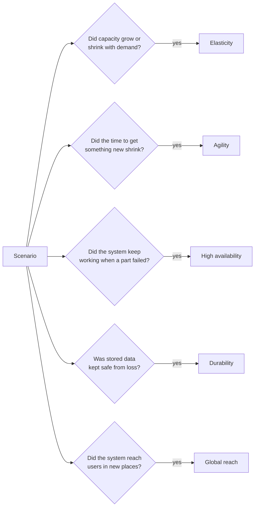

# Each cloud benefit answers a different question: what changed?

Elasticity, agility, high availability, durability and global reach are all cloud benefits, and exam questions often offer several of them as answers. Each describes a different change, in capacity, speed, surviving failure, keeping data or location, so asking what changed in a scenario names the benefit and rules out the rest.

**Exam guide:** [Domain 1, Cloud Concepts](https://docs.aws.amazon.com/aws-certification/latest/cloud-practitioner-02/cloud-practitioner-02-domain1.html) (24% of the exam): task [1.1](https://docs.aws.amazon.com/aws-certification/latest/cloud-practitioner-02/cloud-practitioner-02-domain1.html#cloud-practitioner-02-task1.1).

**For:** an adult studying alone, possibly new to IT, who wants to understand AWS and use it safely. **Time:** about 25 minutes. Reading works on a phone.

**Before you start:** read [Before and after: the demand curve](02-before-and-after-the-demand-curve.md) first.

## Warm-up: from earlier lessons

1. On the bakery's demand curve, what does the gap *below* the line of owned servers represent?
2. In one sentence: why doesn't "trade fixed expense for variable expense" mean "the cloud always costs less"?

Feedback

1. **Idle capacity:** servers the bakery pays for but doesn't use.
2. Paying by use saves money only if use varies and you remove capacity you don't need; peak capacity left running all year can cost more than owning.

## What you'll learn

By the end of this lesson, you can explain elasticity, agility, high availability, durability and global reach in plain words, and name the benefit a scenario shows and say why each of the others doesn't fit (objective 02.03a).

Try this before you read on: a website adds servers automatically when visitors increase and removes them when visitors leave. Is that agility or elasticity?

## The big picture: one question for each benefit

*Notice that each question is about a different thing: capacity, time, failure, data and place. A scenario can show more than one benefit, but a question usually asks for the one it shows best.*

**Long description.** A box labeled "Scenario" has five arrows to five questions, each leading on "yes" to one benefit: capacity changed with demand, elasticity; the time to get something new shrank, agility; the system kept working when a part failed, high availability; stored data was kept safe, durability; users in new places were reached, global reach.

## Capacity and speed: elasticity and agility

### Elasticity: capacity grows and shrinks with demand

**Elasticity** means capacity follows demand in both directions: you don't buy for your peak in advance, but grow or shrink what you use as needs change ([What is cloud computing?](https://aws.amazon.com/what-is-cloud-computing/)). On AWS it's usually automatic: **auto scaling** watches demand and adds or removes servers by rules you set. The exam guide's service list names AWS Auto Scaling; the service that adds and removes servers is Amazon EC2 Auto Scaling. Module 06 covers both.

#### "Scalability is manual, elasticity is automatic" is a myth

You may have read that scalability means adding capacity by hand and elasticity means adding it automatically. That's wrong: no AWS source we checked defines the terms that way. **Scalability**, in plain words, means a system *can* grow to handle more (we found no formal AWS definition); elasticity means capacity *follows* demand, up and down, so you stop paying for what you no longer need. The myth is tempting because elasticity on AWS usually *is* automatic, so the two ideas get merged. When capacity rises and falls with demand, answer **elasticity**.

### Agility: getting something new takes minutes, not weeks

**Agility** is speed and the freedom to experiment. A new resource is a request away, so the time to get it drops from weeks to minutes, and because trying something costs little and you can delete it afterwards, teams test ideas they couldn't justify before ([six advantages: Increase speed and agility](https://docs.aws.amazon.com/whitepapers/latest/aws-overview/six-advantages-of-cloud-computing.html)). The bakery could set up a test page for custom birthday cakes in an afternoon and delete it next week if nobody orders. [Lab 01](06-lab-01-first-resource.md) lets you time it yourself.

Both sound like "fast", so tell them apart by what happens quickly:

| | Elasticity | Agility |
|---|---|---|
| What changes | The *amount* of the same thing | You get something *new* |
| What drives it | Demand rising or falling | A person's idea or decision |
| Bakery example | Six servers in December, one in January | A test cake-ordering page in an afternoon |

> **Example:** a news site normally has 5,000 visitors an hour. During a major event visitors jump to 200,000 an hour; AWS adds servers within minutes and removes them the next day. What changed? Capacity, up then down, driven by demand: **elasticity**. Rule out the rest: "within minutes" pulls toward agility, but nothing new was created to try an idea; nothing failed, so it isn't high availability; no stored data was at risk; no new location was involved.

## Failure and data: high availability and durability

### High availability: the system keeps working when a part fails

**High availability** means a system keeps running, with little downtime, when hardware fails, software crashes or a building loses power. AWS notes it's usually measured as the percentage of time a system works ([What is high availability?](https://aws.amazon.com/what-is/high-availability/)); 99.99% still allows about 53 minutes of downtime a year.

The main way to get it is to avoid having just one of anything. AWS runs groups of data centers in a **Region**, an area of the world such as US East (N. Virginia), and splits each Region into **Availability Zones (AZs)**: one or more data centers with their own power and network, kept separate from the other AZs. As of 2026-10-23, AWS says each Region has at least three AZs ([AWS Regions and Availability Zones](https://docs.aws.amazon.com/global-infrastructure/latest/regions/aws-regions-availability-zones.html)). Run copies in more than one AZ, and if one fails the others keep serving users. The bakery's three servers sit in one room, so a power cut there stops the site, however many servers there are.

High availability is about *failure*, not *load*: a site that crashes because too many visitors arrive needs elasticity. And it isn't automatic: a website on one server in one AZ isn't highly available just because it's in the cloud.

### Durability: stored data isn't lost

**Durability** is about the data itself: a durable storage service keeps your data when disks, servers or even a whole data center fail. Amazon Simple Storage Service (Amazon S3), AWS's main service for storing files, is designed for 99.999999999% durability ("eleven nines"), and for most of its storage classes it keeps copies across at least three AZs (as of 2026-10-23; [S3 storage classes](https://docs.aws.amazon.com/AmazonS3/latest/userguide/storage-class-intro.html), [S3 FAQs](https://aws.amazon.com/s3/faqs/)).

#### Durability isn't availability

It's easy to treat durability and availability as one promise. They aren't: S3 Standard is designed for eleven nines of *durability* but 99.99% *availability* (as of 2026-10-23). The confusion is tempting because both are about things "being there" and both are written as nines.

| | Durability | Availability |
|---|---|---|
| The question it answers | Will my data still exist later? | Can I reach my data, or my system, right now? |
| A failure it describes | Data is lost for good | The service is briefly unreachable, but nothing is lost |
| S3 Standard's design (as of 2026-10-23) | 99.999999999% | 99.99% |

Durability protects against the storage failing, not against *you*: if you delete a file, a durable service deletes it reliably.

## Global reach: run close to users anywhere, in minutes

**Global reach** means you can run your system in many parts of the world. AWS calls it **Go global in minutes**: you can deploy in several Regions with a few clicks, putting your system closer to users so they get lower **latency**, the delay between a request and its response, which grows with distance ([six advantages](https://docs.aws.amazon.com/whitepapers/latest/aws-overview/six-advantages-of-cloud-computing.html)). The exam guide lists speed of deployment and global reach as benefits of AWS's global infrastructure (task [1.1](https://docs.aws.amazon.com/aws-certification/latest/cloud-practitioner-02/cloud-practitioner-02-domain1.html#cloud-practitioner-02-task1.1)). Region and AZ counts grow often, so check AWS's [global infrastructure page](https://aws.amazon.com/about-aws/global-infrastructure/) instead of memorizing them.

Global reach and agility both happen "in minutes". If a scenario stresses **where** (closer to users, less delay), it's global reach; if it stresses **how fast or cheaply** you got something new, it's agility.

## All five side by side

| Benefit | Bakery example | Often confused with | How to tell them apart |
|---|---|---|---|
| **Elasticity** | Six servers in December, one in January | Agility; "scalability" | More or less of the same thing, driven by demand |
| **Agility** | A test cake-ordering page in an afternoon | Elasticity; global reach | Speed of getting something new, wherever it is |
| **High availability** | Servers in two AZs, so a power cut doesn't stop orders | Durability; elasticity | The system stays up through a failure |
| **Durability** | Order records stored where a failed disk loses nothing | High availability | "Still exists later", not "reachable now" |
| **Global reach** | A copy of the site near customers abroad | Agility | About *where*, not *how fast* |

> **Your turn:** name the benefit each scenario shows best, and say in one line why the strongest alternative doesn't fit.
>
> 1. A start-up tests three versions of a sign-up page in one afternoon, then deletes the two that didn't work.\
> 2. A game company starts running servers in a Region in Asia so players there see less delay.\
> 3. A clinic's booking system runs in two AZs; one loses power, and patients can still book.\
> 4. A photo-archive company stores photos in a service designed so files survive failed disks.\
> 5. A ticket site adds servers automatically when a concert goes on sale and removes them an hour later.

Model answers

1. **Agility.** New things were created quickly to try ideas. Not elasticity: nothing followed demand.
2. **Global reach.** The point is *where*, closer to players. Not agility: speed isn't the focus.
3. **High availability.** The system kept working when a part failed. Not durability: it's about booking working now, not stored data.
4. **Durability.** Stored data is kept safe from loss. Not high availability: nothing says the photos are reachable at every moment.
5. **Elasticity.** Capacity rose and fell with demand. Not agility: it's more of the same site, not something new.

## Summary

- **Ask what changed** in a scenario: capacity, time, failure, data or place.
- **Elasticity** follows demand up and down, usually by auto scaling; "scalability is manual, elasticity automatic" is a myth. **Agility** is getting something new in minutes.
- **High availability** keeps a system working through a failure, mainly by running in more than one AZ; it isn't about load.
- **Durability** means stored data isn't lost, which isn't the same as reachable: S3 Standard is designed for eleven nines of durability but 99.99% availability.
- **Global reach** puts your system near users anywhere, in minutes. None of the benefits is automatic; you design your system to use them.

## Practice

1. **A streaming service runs in two Availability Zones so viewers can keep watching if one AZ fails. Which benefit does this show best?**

   A. High availability\
   B. Durability\
   C. Elasticity\
   D. Agility

   

Feedback

   **A is right.** The service keeps working when a part, a whole AZ, fails.

   - **B is wrong.** Durability is about stored data not being lost; here the point is that viewing keeps working.
   - **C is wrong.** Nothing changed in response to demand.
   - **D is wrong.** Nothing new was set up quickly.

   

2. **Which statement about scalability and elasticity is accurate?**

   A. Scalability means adding servers by hand; elasticity means the cloud adds them for you.\
   B. Elasticity means capacity follows demand up and down, so you stop paying for capacity you no longer need.\
   C. Elasticity means a system keeps working when a server fails.\
   D. Scalability and elasticity are AWS names for the same benefit.

   

Feedback

   **B is right.** Elasticity is about capacity following demand in both directions.

   - **A is wrong.** That's the myth; AWS doesn't define the terms by manual versus automatic.
   - **C is wrong.** That's high availability.
   - **D is wrong.** Scalability means a system *can* grow; elasticity adds shrinking with demand.

   

3. **From lesson 02.02: which of AWS's six advantages describes not having to decide in advance how many servers you need?**

   A. Benefit from massive economies of scale\
   B. Stop guessing capacity\
   C. Go global in minutes\
   D. Stop spending money running and maintaining data centers

   

Feedback

   **B is right.** Without a fixed amount to buy, there's no guess to get wrong.

   - **A is wrong.** Economies of scale lower the price per unit; you'd still choose a number.
   - **C is wrong.** Going global is about locations near users.
   - **D is wrong.** That one is about no longer housing and maintaining equipment.

   

**Next:** [What a data center really costs](04-what-a-data-center-really-costs.md). To see agility for yourself, do [Lab 01](06-lab-01-first-resource.md) after the guardrails primer.

## Where to check the current details

- [What is cloud computing?](https://aws.amazon.com/what-is-cloud-computing/), AWS (checked 2026-10-23)
- [AWS Regions and Availability Zones](https://docs.aws.amazon.com/global-infrastructure/latest/regions/aws-regions-availability-zones.html), AWS documentation (checked 2026-10-23)
- [Understanding and managing Amazon S3 storage classes](https://docs.aws.amazon.com/AmazonS3/latest/userguide/storage-class-intro.html), Amazon S3 User Guide (checked 2026-10-23)

---

"Telling the benefits apart" by Automate the Cloud Inc., licensed under CC BY-NC 4.0 with the Additional Permission for Internal Training from Automate the Cloud Inc.
License: https://creativecommons.org/licenses/by-nc/4.0/
Permission: https://automatethe.cloud/licenses/atc-internal-training-permission.txt
