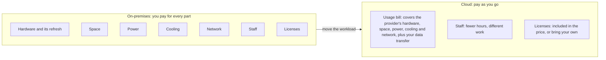

# A data center costs far more than its servers, and the cloud changes who pays for what

Running your own servers means paying for the building, power, cooling, network, people and software around them, mostly up front and mostly whether you use them or not. The cloud turns most of those costs into one bill that follows use, which is cheaper only when your use goes up and down and you switch off what you don't need.

**Exam guide:** [Domain 1, Cloud Concepts](https://docs.aws.amazon.com/aws-certification/latest/cloud-practitioner-02/cloud-practitioner-02-domain1.html) (24% of the exam): task [1.4](https://docs.aws.amazon.com/aws-certification/latest/cloud-practitioner-02/cloud-practitioner-02-domain1.html#cloud-practitioner-02-task1.4).

**For:** an adult studying alone, possibly new to IT, who wants to understand AWS and use it safely. **Time:** about 25 minutes.

**Before you start:** read [Before and after: the demand curve](02-before-and-after-the-demand-curve.md) first.

## Warm-up

1. You own a car. Name one cost you pay even in a month you never drive it.
2. *(From 02.02)* What's the difference between a fixed expense and a variable expense?

Feedback

1. Insurance, parking, loan payments and the car losing value all continue while it sits unused. Servers split the same way.
2. A **fixed** expense stays the same whatever you use, like rent. A **variable** expense rises and falls with use, like a metered electricity bill.

## What you'll learn

By the end of this lesson, you can list the main costs of running servers on-premises, compare them with pay-as-you-go costs in plain numbers (objective 02.04a), and explain how rightsizing and automation keep a cloud bill small.

Try this before you read on: true or false, moving to the cloud always lowers an organization's IT costs?

## The big picture: where the costs go

*Notice that five of the seven categories end up inside the usage bill, but staff and licenses stay with you in some form.*

**Long description.** Left box, "On-premises": the seven cost categories in the table below. An arrow labeled "move the workload" points to the right box, "Cloud: pay as you go": a usage bill covering the provider's hardware, space, power, cooling and network plus your data transfer; staff, with fewer hours and different work; licenses, included or brought by you.

## On-premises costs come in seven groups

The servers' price is only the start. **Total cost of ownership (TCO)** is every cost of owning and running something over its whole life, so a $3,000 server can have a TCO far above $3,000. This grouping is our explanation, based on common IT practice; AWS doesn't publish an itemized list.

| Cost | What it is | On-premises it is usually… |
|---|---|---|
| **Hardware and its refresh** | Servers, disks and network equipment, and the **hardware refresh**: replacing them every few years | Fixed, paid up front |
| **Space** | The room, racks and building, or a share of someone else's data center | Fixed |
| **Power** | Electricity, drawn whether or not anyone uses the server | Mostly fixed |
| **Cooling** | Air conditioning to remove the equipment's heat | Mostly fixed |
| **Network** | Cables, switches, firewalls and a fast internet line | Fixed |
| **Staff** | People who buy, install, patch, repair and watch the equipment | Fixed |
| **Licenses** | Software such as operating systems and databases, often per server or processor | Often fixed |

Two more costs never appear on an invoice: **idle capacity** (lesson 02.02) and **waiting**, the weeks to order and install new hardware, which AWS says the cloud cuts to minutes ([Six advantages of cloud computing](https://docs.aws.amazon.com/whitepapers/latest/aws-overview/six-advantages-of-cloud-computing.html)).

## Capital or operating, fixed or variable: two different questions

**Capital expense (CapEx)** is money spent up front on things that last for years, such as servers. **Operating expense (OpEx)** is money spent on running costs as you go, such as rent, salaries or a monthly cloud bill. That pair asks *when and how* you pay. Fixed or variable asks *whether the cost changes with use*. They aren't the same split: rent is an operating expense, yet it's fixed.

*Notice that both operating examples in the fixed column are fixed: operating doesn't mean variable. Moving to pay as you go changes both answers at once.*

**Long description.** A grid of four cells: columns fixed and variable, rows capital and operating. Capital and fixed: buying four servers. Capital and variable: no example. Operating and fixed: renting space, and electricity for always-on servers. Operating and variable: a cloud bill that follows use. An arrow labeled "moving to pay as you go" runs from the servers to the cloud bill.

AWS describes the main change as trading fixed expense for variable expense. People also call it a move from capital to operating expense, but for cost, fixed to variable is the part that matters, because it lets the bill follow demand.

> **Example:** the bakery's three servers need replacing, and the owner asks whether to buy six (enough for December) or move to the cloud. Over three years, with made-up figures, owning costs $29,340: $12,000 of hardware in the first month, plus space, power and cooling, network, a contractor and licenses, all paid in idle months too. The cloud, renting the 25 server-months a year that demand needs at $250 each with licenses included, plus half the contractor's hours, costs $22,350. Left at six servers all year, the same cloud setup costs $57,600, nearly twice owning.

*Notice that owning spreads its cost over six fixed categories, while both cloud options are mostly a usage bill. The only difference between the cloud columns is whether the bakery scales down.*

**Long description.** Three stacked columns, in dollars over three years, made-up figures. Own 6 servers, $29,340: hardware $12,000 (paid up front); space $3,600, power and cooling $2,880, network $2,160, staff $7,200 and licenses $1,500 (fixed). Cloud matched to demand, $22,350: usage bill $18,750 (variable) and staff $3,600. Cloud left at peak size, $57,600: usage bill $54,000 and staff $3,600.

## Moving to the cloud doesn't automatically lower costs

As lesson 02.02 showed, the cloud changes the *shape* of the bill for certain and the *total* only sometimes. A workload that runs flat out all day, every day, has no idle capacity to give back, and the meter runs for anything you leave on. Some costs also stay with you after the move:

- **Staff time.** Someone still sets up, secures and watches what you build (Module 04).
- **Licenses.** Some software comes with the license included in the price; for other software you bring licenses you already own (Module 13 compares the two) ([Microsoft licensing on AWS](https://aws.amazon.com/windows/resources/licensing/)).
- **Data you send out.** Data from AWS out to the internet is charged per gigabyte after a free monthly allowance, while data coming in is free (as of 2026-10-23; see [Amazon EC2 On-Demand pricing](https://aws.amazon.com/ec2/pricing/on-demand/)). Module 11 covers it.

> **Your turn:** a payroll company runs its system at the same load 24 hours a day, every day, and has just replaced its servers. Would you expect pay-as-you-go to save it as much as the bakery? Explain in two or three sentences, and say what you'd compare before deciding.

Model answer

Probably not. The bakery saves by giving back capacity in quiet months; the payroll system has none. Compare the full on-premises costs (space, power, staff, the next refresh) with real cloud prices, including AWS's discounts for committed steady use (Module 11); servers already paid for also argue for waiting.

## Rightsizing and automation keep the variable bill small

A variable bill only helps if you keep it in step with what you need. **Rightsizing** means choosing the type, size and number of resources that meet your needs at the lowest cost. AWS treats it as something you repeat, because usage, prices and resource types change ([Select the correct resource type, size, and number](https://docs.aws.amazon.com/wellarchitected/latest/cost-optimization-pillar/select-the-correct-resource-type-size-and-number.html)); in the cloud, a server that's too big can be swapped for a smaller one.

**Automation** means having software do a repeated task, such as starting servers before the shop opens, stopping test servers at night or adding capacity when orders climb. The Framework's cost design principle "[Adopt a consumption model](https://docs.aws.amazon.com/wellarchitected/latest/framework/cost-dp.html)" gives an example: stopping development and test environments outside a 40-hour working week cuts their running time from 168 hours to 40, about 75% less. Automation also cuts mistakes, because a script does the same steps every time. Both habits save energy as well as money, which is why the sustainability pillar asks you to use only what you need (lesson 02.05).

## Summary

- **On-premises costs come in seven groups:** hardware and its refresh, space, power, cooling, network, staff and licenses. Most are fixed, the hardware is paid up front, and idle capacity and waiting are costs too.
- **Capital or operating, fixed or variable** are two different questions. The cloud mainly turns fixed costs into variable ones.
- **The cloud doesn't automatically cut costs.** In the bakery's example it won because demand swings and the bakery scaled down; left at peak size, it cost nearly twice owning. Staff time, licenses and outbound data transfer stay with you in some form.
- **Rightsizing and automation** keep a variable bill small and save energy too.

## Practice

1. **A company says its new on-premises system "costs $50,000", the price of the servers. Which cost is it most likely leaving out?**

   A. The servers' purchase price\
   B. Power, cooling, space and staff over the servers' life\
   C. The data it sends out from AWS\
   D. Its pay-as-you-go cloud bill

   

Feedback

   **B is right.** These continue for years and often add up to more than the hardware.

   - **A is wrong.** The purchase price is the one cost it did count.
   - **C is wrong.** An on-premises system doesn't send data out from AWS.
   - **D is wrong.** An on-premises system has no cloud bill.

   

2. **Which change shows rightsizing?**

   A. Replacing a server that runs at 10% of its capacity with a smaller one\
   B. Moving a database to a different Region\
   C. Adding a tag to every resource\
   D. Buying servers for the next five years of growth

   

Feedback

   **A is right.** The same work runs on a smaller, cheaper resource, chosen from data about its use.

   - **B is wrong.** Choosing a Region is about location, not size.
   - **C is wrong.** Tags help you track costs but don't change the size of anything.
   - **D is wrong.** That's buying for a guess, which leaves capacity idle now.

   

3. **A company moves a workload from its own server room to AWS. Which cost is most likely to stay with the company in some form?**

   A. Cooling for the data center\
   B. Replacing worn-out servers\
   C. Software licenses\
   D. Rent for the server room

   

Feedback

   **C is right.** Some software comes with the license included in the price, and for other software the company brings licenses it owns; either way, it still pays for them.

   - **A is wrong.** Cooling is now inside the provider's usage bill.
   - **B is wrong.** The provider replaces its own hardware.
   - **D is wrong.** The company no longer needs a server room for this workload.

   

**Next:** [The Well-Architected Framework](05-the-well-architected-framework.md).

## Where to check the current details

- [Six advantages of cloud computing](https://docs.aws.amazon.com/whitepapers/latest/aws-overview/six-advantages-of-cloud-computing.html), Overview of Amazon Web Services (checked 2026-10-23)
- [Cost optimization design principles](https://docs.aws.amazon.com/wellarchitected/latest/framework/cost-dp.html), AWS Well-Architected Framework (checked 2026-10-23)
- [Amazon EC2 On-Demand pricing](https://aws.amazon.com/ec2/pricing/on-demand/), data transfer section (checked 2026-10-23)

---

"What a data center really costs" by Automate the Cloud Inc., licensed under CC BY-NC 4.0 with the Additional Permission for Internal Training from Automate the Cloud Inc.
License: https://creativecommons.org/licenses/by-nc/4.0/
Permission: https://automatethe.cloud/licenses/atc-internal-training-permission.txt
