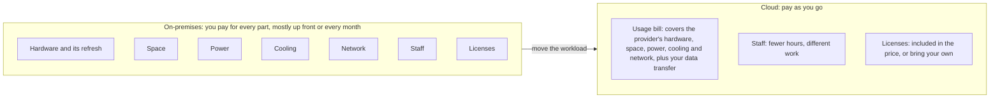

# A data center costs far more than its servers, and the cloud changes who pays for what

Running your own servers means paying for the building, power, cooling, network, people and software around them, mostly up front and mostly whether you use them or not. The cloud turns most of those costs into one bill that grows and shrinks with use. That can be much cheaper, but only when your use actually goes up and down and you switch off what you don't need.

**Who this is for:** you are studying alone, possibly new to IT, and want to understand AWS well enough to use it safely and explain it to others. **Time:** about 35 minutes.

**Before you start:** this lesson builds on [02.02 Before and after: the demand curve](02-before-and-after-the-demand-curve.md). If you haven't read it, the key terms below are enough.

## Warm-up

Answer from memory before you read on. Guessing is fine.

1. You can buy a car, or rent one by the day when you need it. Name one cost of owning that you pay even in a month you never drive.
2. In [02.02](02-before-and-after-the-demand-curve.md), what is the difference between a **fixed** expense and a **variable** expense?
3. The [guardrails primer, page 07](https://github.com/AutomateTheCloud/atc-study-aws_account_guardrails/blob/main/primer/07-habits-for-every-lab.md) asks you to delete, not just stop, what a lab creates. Why does a forgotten resource matter on the Free plan, where you can't be billed?

Feedback

1. Insurance, parking, loan payments and the car losing value continue while it sits unused. Renting by the day avoids them. Servers split the same way.
2. A **fixed** expense stays the same whatever you use, like rent. A **variable** expense rises and falls with how much you use, like a metered electricity bill.
3. It keeps spending your credits, and when they run out the Free plan ends and the account closes. It is also capacity nobody uses: the waste this lesson is about.

## What you'll be able to do

- List the main costs of running servers on-premises, and say which are fixed and which are variable.
- Compare an on-premises setup with pay-as-you-go cloud costs, in plain numbers, for a business like the bakery.
- Explain why moving to the cloud doesn't automatically lower costs, and how rightsizing and automation keep the cloud bill small.

**Guess first** (the answers are in the lesson):

- Besides the price of the servers, how many other costs of running your own server room can you list?
- True or false: moving to the cloud always lowers an organization's IT costs.

## The big picture

Moving a workload to the cloud doesn't make costs disappear. It moves most of them inside one usage bill, paid as you go, and leaves a few with you.

*Figure: where on-premises costs go when a workload moves to the cloud. Notice that five of the seven categories end up inside the usage bill, but staff and licenses stay with you in some form.*

**Long description.** Left box, "On-premises": seven cost categories (hardware and its refresh, space, power, cooling, network, staff, licenses). An arrow labeled "move the workload" points to the right box, "Cloud: pay as you go", which holds three items: a usage bill covering the provider's hardware, space, power, cooling and network plus your data transfer; staff, with fewer hours and different work; licenses, included or brought by you.

## Key terms (skip if you know them)

- **On-premises**: running your own servers in a room or building you control, instead of renting capacity from a cloud provider.
- **Total cost of ownership (TCO)**: every cost of owning and running something over its whole life, not only the purchase price. Not the same as the price tag: a $3,000 server can have a TCO far above $3,000.
- **Capital expense (CapEx)**: money spent up front on things that last for years, such as servers or a building.
- **Operating expense (OpEx)**: money spent on running costs as you go, such as rent, electricity, salaries or a monthly cloud bill.
- **Idle capacity**: equipment you paid for that does no work.
- **Hardware refresh**: replacing servers and network equipment when they wear out, go out of support, or become too slow.
- **Rightsizing**: choosing the type, size and number of resources that meet your needs at the lowest cost.
- **Automation**: having software do a repeated task, such as starting, stopping or building servers, instead of a person doing it by hand.

## On-premises costs come in seven groups

The servers' price is only the start. This grouping is our explanation, based on common IT practice; AWS doesn't publish an itemized list.

| Cost | What it is | On-premises it is usually… |
|---|---|---|
| **Hardware and its refresh** | Servers, disks and network equipment, and replacing them every few years | Fixed, and paid up front (capital expense) |
| **Space** | The room, racks and building, or a rented share of someone else's data center | Fixed |
| **Power** | Electricity for the equipment. A server that is switched on draws power whether or not anyone uses it | Mostly fixed |
| **Cooling** | Air conditioning to remove the heat the equipment gives off | Mostly fixed |
| **Network** | Cables, switches, firewalls and a fast internet connection | Fixed |
| **Staff** | People who buy, install, patch, repair and watch the equipment, including at night | Fixed (salaries or contracts) |
| **Licenses** | Payments for software such as operating systems and databases, often counted per server or per processor | Often fixed |

Two more costs never appear on an invoice, but they are real:

- **Idle capacity.** You buy for your busiest day. Every other day, part of what you paid for does nothing. In [02.02](02-before-and-after-the-demand-curve.md) this was the gap between the flat capacity line and the demand curve.
- **Waiting.** New hardware has to be ordered, delivered and installed. AWS says the cloud cuts the time to get new resources from weeks to minutes ([Six advantages of cloud computing](https://docs.aws.amazon.com/whitepapers/latest/aws-overview/six-advantages-of-cloud-computing.html)). While you wait, customers meet a crashed site.

Almost every cost in the right-hand column is fixed: you pay it in idle January just as in busy December.

> **Your turn:** the bakery's owner says, "Our server cost $3,000, so that's what our website costs us." Name four costs she has left out, and say which one she would still pay if the site had no visitors at all for a month.
>
> 

Model answer

>
> Any four of: space, power, cooling, network, staff or a contractor, software licenses, and replacing the server in a few years. Most continue in a month with no visitors: the server still draws power and needs cooling, and the rent, internet line and licenses are still due. That is what "fixed" means.
>
> 

## Capital or operating, fixed or variable: two different questions

Two pairs of words get mixed up, and the exam can use either.

- **Capital or operating** asks *when and how* you pay: a large payment up front for something that lasts, or an ongoing payment as you go.
- **Fixed or variable** asks *whether the cost changes with use*.

They are not the same split. Rent is an operating expense, yet it is fixed. The table shows four common cases.

| Example | Capital or operating | Fixed or variable |
|---|---|---|
| Buying four servers | Capital | Fixed |
| Renting space for them | Operating | Fixed |
| Electricity for servers that are always on | Operating | Mostly fixed |
| A cloud bill that follows how much you use | Operating | Variable |

The grid places the same four cases.

*Notice that both operating examples in the left column are fixed: operating doesn't mean variable. Only the cloud bill sits in the variable column, and moving to pay as you go changes both answers at once.*

**Long description.** A grid of four cells. The columns ask whether the cost changes with use: fixed or variable. The rows ask when and how you pay: capital (a big payment up front) or operating (paid as you go). Capital and fixed: buying four servers. Capital and variable: no example in this lesson. Operating and fixed: renting space for the servers, and electricity for servers that are always on (mostly fixed). Operating and variable: a cloud bill that follows how much you use. An arrow labeled "moving to pay as you go" runs from buying four servers to the cloud bill. The table above gives the same four cases.

**Same:** both describe the same money. **Different:** capital versus operating is about timing; fixed versus variable is about whether use drives the cost.

AWS describes the main change as trading fixed expense for variable expense: you pay only when you use resources, and only for how much you use ([Six advantages of cloud computing](https://docs.aws.amazon.com/whitepapers/latest/aws-overview/six-advantages-of-cloud-computing.html)). Its pricing page compares this to paying for water or electricity ([AWS Pricing](https://aws.amazon.com/pricing/)). People also call it a move from capital to operating expense. For cost, fixed to variable is the part that matters, because it lets the bill follow demand.

> **Check:** which statement is correct?
>
> - A. Every operating expense is variable.
> - B. Moving to pay-as-you-go turns a large up-front payment into smaller payments that follow use.
> - C. Capital expense and fixed expense mean the same thing.
>
> 

Feedback

>
> - **A** is wrong. Rent and salaries are operating expenses, and they are fixed.
> - **B** is correct. Instead of buying servers up front, you pay as you go, and the amount follows how much you use.
> - **C** is wrong. Rent is a fixed expense but not a capital expense. The two pairs answer different questions.
>
> 

## Worked example: the bakery's three-year comparison

The bakery's site crashes every December and sits nearly idle in January. Its three servers need replacing, so the owner asks: "If I buy enough new servers to stop the crashes, is that cheaper than the cloud?"

All numbers below are **made-up numbers for teaching**, not AWS prices or real data-center costs.

**Step 1: price the on-premises option over its life, not just the purchase.** In [02.02](02-before-and-after-the-demand-curve.md) the busiest December hour needed six servers; most months need one or two.

| Cost (made-up) | How it's charged | 3-year total |
|---|---|---|
| Hardware: 6 servers at $2,000 | Paid up front in month 1 | $12,000 |
| Space: share of a rented room | $100 a month | $3,600 |
| Power and cooling | $80 a month | $2,880 |
| Network: business line and firewall | $60 a month | $2,160 |
| Staff: a contractor, 4 hours a month at $50 | $200 a month | $7,200 |
| Licenses: operating system and database | $500 a year | $1,500 |
| **Total** | | **$29,340** |

An expert notices three things. $12,000 leaves the bank in the first month. The servers need replacing after these three years, which the table doesn't count. And in most months four or five of the six servers sit idle, yet every line is paid in full.

**Step 2: price the cloud option, following demand.** The bakery rents what each month needs: 25 server-months a year, the total of the bars in 02.02. Unlike in 02.02, renting costs more per server-month than owning: $250, licenses included. The contractor works fewer hours: no hardware to install or repair.

| Cost (made-up) | How it's charged | 3-year total |
|---|---|---|
| Usage bill: 25 server-months a year at $250 | Only for what runs | $18,750 |
| Staff: 2 hours a month at $50 | $100 a month | $3,600 |
| **Total** | | **$22,350** |

**Step 3: test the result by changing one assumption.** Suppose the bakery moves to the cloud but never scales down. It keeps six servers running all year: 6 × 36 months × $250 = $54,000, plus $3,600 of staff time, which is $57,600. That is nearly twice the cost of owning.

The chart puts the three three-year totals side by side, split by cost category.

*Notice what each total is made of. Owning spreads its cost over six fixed categories, and the biggest, hardware, is paid up front. Both cloud options are mostly a usage bill, and staff time halves. The only difference between the two cloud columns is whether the bakery scales down, and it makes the usage bill nearly three times as big.*

**Long description.** Three stacked columns, in dollars over three years. Own 6 servers, $29,340 in all: hardware $12,000 (fixed, paid up front); space $3,600, power and cooling $2,880, network $2,160, staff $7,200 and licenses $1,500 (fixed, paid every month or year). Cloud matched to demand, $22,350: a usage bill of $18,750 (variable) and staff $3,600 (fixed). Cloud left at peak size, $57,600: a usage bill of $54,000 (variable) and staff $3,600 (fixed). The tables in Steps 1 and 2 give the same figures.

**The answer:** the cloud option is about $7,000 cheaper over three years, even at a higher price per server-month, because the bakery's demand goes up and down a lot *and* because it scales down after the peak. Take away the second part and the cloud becomes the expensive choice. The first month also looks very different: more than $12,000 on-premises, against $350 in the cloud.

The second chart follows the money month by month: the total spent so far under each option.

*Notice the jump in month 1: owning has already spent $12,940, more than 40% of its three-year total, while the cloud has spent $350. The cloud matched to demand stays below owning for all three years. The cloud left at peak size passes owning in month 11 and ends at nearly twice its cost.*

**Long description.** A line chart, months 1 to 36, of the total spent so far, from $0 to $60,000; all figures are the made-up ones above. Owning 6 servers jumps to $12,940 in month 1 (the $12,000 of hardware, a month of running costs and the first year's licenses), then rises by $440 a month, plus $500 of licenses at the start of years 2 and 3, to $29,340. The cloud matched to demand starts at $350 and rises faster in the bakery's busy months, to $22,350. The cloud left at peak size rises by $1,600 every month in a straight line; it passes owning in month 11 and reaches $57,600. The chart assumes the licenses are paid at the start of each year. Totals at the end of each year:

| Spent by the end of | Year 1 | Year 2 | Year 3 |
|---|---|---|---|
| Own 6 servers | $17,780 | $23,560 | $29,340 |
| Cloud, matched to demand | $7,450 | $14,900 | $22,350 |
| Cloud, left at peak size | $19,200 | $38,400 | $57,600 |

## Moving to the cloud doesn't automatically lower costs

> **Misconception:** "Moving to the cloud always cuts an organization's operating costs."
>
> That's not right. What the cloud changes for certain is the *shape* of the bill: fixed costs become variable, and large up-front payments become payments as you go. Whether the total goes down depends on how your demand moves and on how well you match what you run to that demand. In Step 3 above, the same move cost nearly twice as much as owning. A workload that runs flat out all day, every day, gains little from paying by the hour, because it has no idle capacity to give back.
>
> It is tempting because pay-as-you-go makes waste easy to stop, many organizations do save, and AWS's economies of scale lower its prices ([Six advantages of cloud computing](https://docs.aws.amazon.com/whitepapers/latest/aws-overview/six-advantages-of-cloud-computing.html)). But the meter runs for anything you leave on. AWS's own [Cost Optimization Pillar](https://docs.aws.amazon.com/pdfs/wellarchitected/latest/cost-optimization-pillar/wellarchitected-cost-optimization-pillar.pdf) is a whole guide to avoiding cloud waste.

Some costs also stay with you after the move:

- **Staff time.** Someone still sets up, secures and watches what you build (Module 04).
- **Licenses.** Some software comes with the license included in the price; for other software you bring licenses you own (Module 13).
- **Data you send out.** Sending data from AWS out to the internet is charged per gigabyte after a free monthly allowance, while data coming in is free (as of 2026-10-23; see [Amazon EC2 On-Demand pricing](https://aws.amazon.com/ec2/pricing/on-demand/) for the current terms). Module 11 covers it.

> **Your turn:** a payroll company runs its system at the same load 24 hours a day, every day of the year. It has just replaced its servers. Would you expect moving to pay-as-you-go to save it as much as the bakery? Explain in two or three sentences, and say what you would compare before deciding.
>
> 

Model answer

>
> Probably not as much. The bakery saves by giving back capacity in quiet months; the payroll system has no quiet months. Compare the full on-premises costs (space, power, staff, the next refresh) with real cloud prices, including AWS's discounts for committed steady use (Module 11). Servers already paid for also argue for waiting.
>
> 

## Rightsizing and automation keep the variable bill small

A variable bill only helps if you keep it in step with what you need. Two habits do most of that work.

**Rightsizing** means choosing the type, size and number of resources that meet your needs at the lowest cost. AWS's Cost Optimization Pillar treats it as something you repeat, not a one-time choice: usage changes, prices drop and new resource types appear, so the right size changes too ([Select the correct resource type, size, and number](https://docs.aws.amazon.com/wellarchitected/latest/cost-optimization-pillar/select-the-correct-resource-type-size-and-number.html)). The best practice behind it is [COST06-BP02 Select resource type, size, and number based on data](https://docs.aws.amazon.com/wellarchitected/latest/cost-optimization-pillar/cost_type_size_number_resources_data.html). On-premises you buy for years ahead and guess; in the cloud, a server that is too big can be swapped for a smaller one.

**Automation** means letting software do repeated work, such as starting servers before the shop opens, stopping test servers at night, or adding capacity when orders climb. The Framework's cost design principle "[Adopt a consumption model](https://docs.aws.amazon.com/wellarchitected/latest/framework/cost-dp.html)" gives an example: stopping development and test environments outside an eight-hour working day, five days a week, cuts their running time from 168 hours a week to 40, a saving of about 75%. Automation also cuts mistakes, because a script does the same steps every time; Module 08 shows how. The related best practices include [COST09-BP03 Supply resources dynamically](https://docs.aws.amazon.com/wellarchitected/latest/cost-optimization-pillar/cost_manage_demand_resources_dynamic.html) and [COST11-BP01 Perform automation for operations](https://docs.aws.amazon.com/wellarchitected/latest/cost-optimization-pillar/cost_evaluate_cost_effort_automations_operations.html).

Both habits also save energy: a half-idle server wastes power as well as money, which is why the sustainability pillar asks you to use only what you need (Lesson 02.05).

> **Your turn:** for each change, say whether it is rightsizing or automation, and how it lowers the bakery's cloud bill.
>
> 1. A schedule switches off the bakery's test copy of the site every evening and on weekends.
> 2. After a month of data shows the site never uses more than a quarter of its server, the owner moves it to a smaller one.
> 3. Extra capacity starts automatically when orders per minute pass a set level, and stops when they fall.
>
> 

Model answer

>
> 1. **Automation.** The test copy runs only when people use it, so the bill drops by the hours it is off.
> 2. **Rightsizing.** The same work runs on a smaller, cheaper resource, chosen from data rather than a guess.
> 3. **Automation** that keeps the setup the **right size** as demand changes. You pay for peak capacity only during the peak. (In 02.03 you called this elasticity.)
>
> 

## In real work

When a team proposes a move, someone builds the comparison you just made, with real numbers: all seven on-premises groups plus the next refresh, against cloud costs for the real demand pattern. The usual mistakes are comparing the cloud bill with the server price alone, or pricing the cloud at peak size all year. Finance and technical staff build it together, as [COST01-BP02 Establish a partnership between finance and technology](https://docs.aws.amazon.com/wellarchitected/latest/cost-optimization-pillar/cost_cloud_financial_management_partnership.html) asks.

This is the **cost optimization** pillar of the AWS Well-Architected Framework, which you meet properly in the next lesson. Module 11 shows how to estimate cloud costs with the AWS Pricing Calculator, and Module 13 builds a full business case.

## Summary

- **On-premises costs come in seven groups:** hardware and its refresh, space, power, cooling, network, staff and licenses. Most are fixed, and the hardware is paid up front. Idle capacity and waiting for hardware are real costs too.
- **Capital or operating, fixed or variable** are two different questions. The cloud mainly turns fixed costs into variable ones that follow use.
- **The bakery's comparison** favored the cloud because its demand swings and it scaled down after the peak. Left at peak size all year, the cloud cost nearly twice as much as owning.
- **The cloud doesn't automatically cut costs.** It changes the shape of the bill. Staff time, licenses and outbound data transfer stay with you in some form.
- **Rightsizing and automation** keep a variable bill small, and they save energy as well as money.

## Practice

**1.** A company says its new on-premises system "costs $50,000", the price of the servers. Which cost is it most likely leaving out?

- A. The servers' purchase price
- B. Power, cooling, space and staff over the servers' life
- C. The data it sends out from AWS
- D. Its pay-as-you-go cloud bill

Feedback

- **A** is wrong. The purchase price is the one cost it did count.
- **B** is correct. These continue for years and often add up to more than the hardware.
- **C** is wrong. An on-premises system doesn't send data out from AWS.
- **D** is wrong. An on-premises system has no cloud bill.

**2.** Which change shows rightsizing?

- A. Replacing a server that runs at 10% of its capacity with a smaller one
- B. Moving a database to a different Region
- C. Adding a tag to every resource
- D. Buying servers for the next five years of growth

Feedback

- **A** is correct. The same work runs on a smaller, cheaper resource, based on data about its use.
- **B** is wrong. Choosing a Region is about location (Module 03), not size.
- **C** is wrong. Tags help you find and track costs, but they don't change the size of anything.
- **D** is wrong. That is the opposite: buying for a guess about the future, which leaves capacity idle now.

**3.** True or false: "If a company moves to the cloud, its IT costs go down." Explain your answer in one or two sentences.

Feedback

**False as a rule.** Moving changes fixed costs into variable ones; the total goes down only if demand varies and the company matches what it runs to that demand, with rightsizing and automation. A workload left at peak size all year, or one with flat demand, may cost as much or more.

**4.** *(From 02.02)* A business pays the same amount for its servers every month, however busy it is. Is that a fixed or a variable expense, and what would make it variable?

Feedback

It is a **fixed** expense. It would become variable if the business paid only for the capacity it used each month, as with pay-as-you-go pricing.

**5.** *(From 02.01)* The bakery keeps its old ordering system in its back office and runs a new delivery-tracking app in the cloud, and the two exchange data. Which deployment model is that?

Feedback

**Hybrid.** Part of the workload runs on-premises and part in the cloud, and the two are connected. All on-premises or all in the cloud would be the other two models.

**Next:** [02.05 The Well-Architected Framework](05-the-well-architected-framework.md). For hands-on practice with these numbers, try the [demand-curve simulation (S1)](07-sim-demand-curve.md).

## Where to check the current details

- [Six advantages of cloud computing](https://docs.aws.amazon.com/whitepapers/latest/aws-overview/six-advantages-of-cloud-computing.html), Overview of Amazon Web Services (checked 2026-10-23)
- [AWS Pricing](https://aws.amazon.com/pricing/) (checked 2026-10-23)
- [Cost optimization design principles](https://docs.aws.amazon.com/wellarchitected/latest/framework/cost-dp.html), AWS Well-Architected Framework (checked 2026-10-23)
- [Select the correct resource type, size, and number](https://docs.aws.amazon.com/wellarchitected/latest/cost-optimization-pillar/select-the-correct-resource-type-size-and-number.html), Cost Optimization Pillar (checked 2026-10-23)
- [Amazon EC2 On-Demand pricing](https://aws.amazon.com/ec2/pricing/on-demand/), data transfer section (checked 2026-10-23)
- [Microsoft licensing on AWS](https://aws.amazon.com/windows/resources/licensing/) (checked 2026-10-23)

---

"What a data center really costs" by Automate the Cloud Inc., licensed under CC BY-NC 4.0 with the Additional Permission for Internal Training from Automate the Cloud Inc.
License: https://creativecommons.org/licenses/by-nc/4.0/
Permission: https://automatethe.cloud/licenses/atc-internal-training-permission.txt
