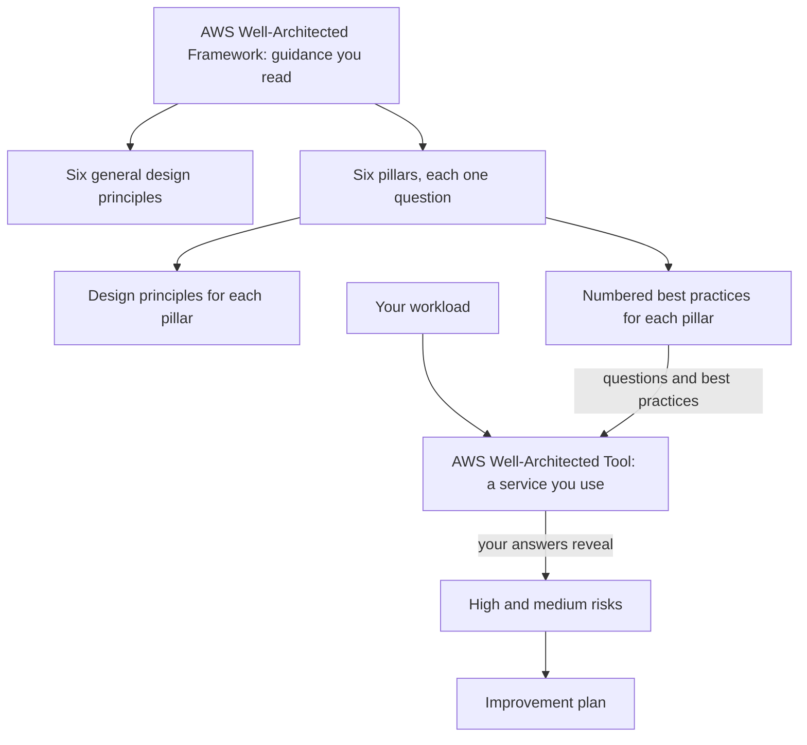
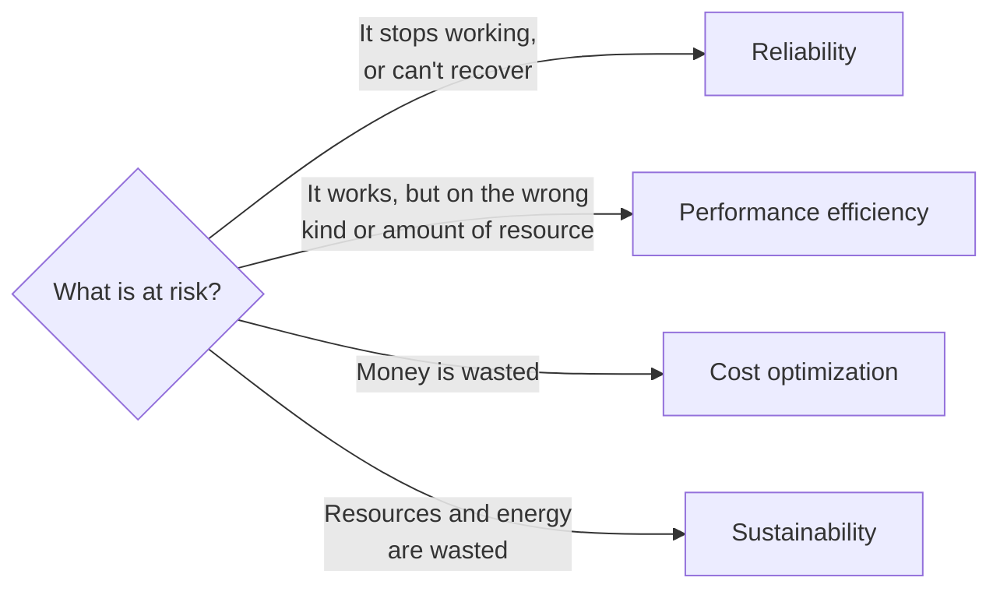

# The Well-Architected Framework turns "is this built well?" into six questions

"Is our system built well?" is too big to answer in one go. AWS's Well-Architected Framework splits it into six smaller questions, called pillars, each with named principles and numbered best practices. In this lesson you learn to tell the pillars apart, to see when one is traded against another, and to keep the Framework (guidance you read) apart from the Well-Architected Tool (a service you use).

**Who this is for:** you are studying alone, possibly new to IT, and want to understand AWS well enough to use it safely and explain it to others. **Time:** about 35 minutes.

**Before you start:** you met the Framework briefly on [page 00 of the guardrails primer](https://github.com/AutomateTheCloud/atc-study-aws_account_guardrails/blob/main/primer/00-read-this-first.md), and [02.04](04-what-a-data-center-really-costs.md) introduced the cost optimization pillar. If you skipped those, this lesson still starts from the beginning.

## Warm-up

1. In the guardrails primer, each guardrail ended with a line such as "Cost optimization · [COST01-BP06 Monitor cost proactively](https://docs.aws.amazon.com/wellarchitected/latest/cost-optimization-pillar/cost_cloud_financial_management_proactive_process.html)". What do you think the first part and the code each mean?
2. *(From 02.04)* The bakery leaves its holiday-sized cloud setup running all year. Is that mainly a problem of fixed cost or of idle capacity?
3. *(From 02.03)* The bakery's site gains capacity automatically when orders climb, and gives it back when they fall. Which benefit is that?

Feedback

1. The first part names a **pillar** of the Framework, and the code is the ID of one **best practice** in that pillar: COST is the pillar, 01 the question, BP06 the sixth best practice under it. You learn the structure in this lesson.
2. **Idle capacity.** In the cloud the bill is variable, but the bakery pays for capacity it doesn't use. Scaling down after the peak would fix it.
3. **Elasticity**: capacity follows demand up and down.

## What you'll be able to do

- Name the six pillars and match a concern to the pillar it belongs to.
- Explain a trade-off between pillars, and which pillars are generally not traded away.
- Tell the Framework apart from the AWS Well-Architected Tool, and real Framework principles from slogans that only sound like them.

**Guess first** (the answers are in the lesson):

- How many pillars does the Framework have?
- Is a Well-Architected review an audit that a system can fail?

## The big picture

The Framework is guidance: you read it. The Well-Architected Tool is a service in the AWS console: you use it to review one of your own systems against that guidance.

*Figure: how the Framework and the Tool fit together. Notice that the Tool doesn't invent its own rules; it asks you the Framework's questions about one workload.*

**Long description.** At the top, "AWS Well-Architected Framework: guidance you read" has two arrows down: to "Six general design principles" and to "Six pillars, each one question". The pillars box has two arrows down: to "Design principles for each pillar" and to "Numbered best practices for each pillar". Separately, "Your workload" points to "AWS Well-Architected Tool: a service you use". An arrow labeled "questions and best practices" runs from the best-practices box to the Tool. From the Tool, an arrow labeled "your answers reveal" points to "High and medium risks", which points to "Improvement plan".

## Key terms (skip if you know them)

- **AWS Well-Architected Framework**: AWS's published guidance for designing and running systems well in the cloud, as a set of whitepapers.
- **Pillar**: one of the Framework's six areas of concern. Not a physical column: here it means one way of judging a system.
- **Design principle**: a short, named idea that guides decisions, such as "stop guessing your capacity needs".
- **Best practice**: a specific recommended action with an ID, such as [COST06-BP02](https://docs.aws.amazon.com/wellarchitected/latest/cost-optimization-pillar/cost_type_size_number_resources_data.html).
- **Workload**: the set of parts (code, settings, AWS resources) that together deliver something of value, such as the bakery's ordering site.
- **Trade-off**: accepting less of one good thing to get more of another.
- **AWS Well-Architected Tool**: a service in the AWS console for reviewing a workload against the Framework.
- **Lens**: an extra set of questions for a particular kind of workload or industry, used in the Tool.
- **Milestone**: a saved snapshot of a review, so you can compare later.
- **High-risk issue (HRI)**: an answer in a review that shows a serious gap; a **medium-risk issue (MRI)** is a smaller one.

## Six pillars, six questions

Each pillar is easiest to remember as the question it asks about your workload. The definitions here are our summaries of AWS's ([The pillars of the framework](https://docs.aws.amazon.com/wellarchitected/latest/framework/the-pillars-of-the-framework.html)).

*Notice how the rows group the pillars: the two that are generally not traded away, the two that sound alike, and the two that usually point the same way. The rest of this lesson takes each row in turn. The short codes are the prefixes of best-practice IDs, explained below the table.*

**Long description.** Six cards in three rows of two. Each card shows a pillar's ID prefix, its name and its question. Row 1, "generally not traded away against the other pillars": operational excellence (OPS), "Can we run this well day to day, see what it is doing, and keep improving how we work?"; security (SEC), "Are the data, systems and accounts protected?" Row 2, "sound alike: both care about capacity": reliability (REL), "Does it do its job correctly whenever it is needed, and recover when something fails?"; performance efficiency (PERF), "Are we using the right kind and amount of resources to meet our needs, as demand and technology change?" Row 3, "usually point the same way: waste costs money and energy at once": cost optimization (COST), "Does it deliver its value at the lowest cost?"; sustainability (SUS), "Are we using as few resources, and as little energy, as we can?" The table gives the same questions with an example and a design principle for each.

| Pillar | The question it asks | A bakery example | One of its design principles |
|---|---|---|---|
| **Operational excellence** | Can we run this well day to day, see what it is doing, and keep improving how we work? | Updates are made by hand on the live site at night, and nobody writes down what changed | "[Make frequent, small, reversible changes](https://docs.aws.amazon.com/wellarchitected/latest/framework/oe-design-principles.html)" |
| **Security** | Are the data, systems and accounts protected? | The owner's password is on a sticky note by the till | "[Implement a strong identity foundation](https://docs.aws.amazon.com/wellarchitected/latest/framework/sec-design.html)" |
| **Reliability** | Does it do its job correctly whenever it is needed, and recover when something fails? | Nobody has ever tried restoring the site from a backup | "[Test recovery procedures](https://docs.aws.amazon.com/wellarchitected/latest/framework/rel-dp.html)" |
| **Performance efficiency** | Are we using the right kind and amount of resources to meet our needs, as demand and technology change? | Customers in another country wait seconds for each page | "[Go global in minutes](https://docs.aws.amazon.com/wellarchitected/latest/framework/perf-dp.html)" |
| **Cost optimization** | Does it deliver its value at the lowest cost? | Six rented servers run all year for a December peak | "[Adopt a consumption model](https://docs.aws.amazon.com/wellarchitected/latest/framework/cost-dp.html)" |
| **Sustainability** | Are we using as few resources, and as little energy, as we can? | Three owned servers run all January, when one would do | "[Maximize utilization](https://docs.aws.amazon.com/wellarchitected/latest/framework/sus-design-principles.html)" |

Each pillar also has a numbered list of best practices. The ID tells you where one sits: in [SEC02-BP01 Use strong sign-in mechanisms](https://docs.aws.amazon.com/wellarchitected/latest/security-pillar/sec_identities_enforce_mechanisms.html), SEC is the security pillar, 02 is its second question, and BP01 is the first best practice under that question. The other prefixes are OPS, REL, PERF, COST and SUS. You don't need to memorize IDs for the exam; you need to recognize which pillar a concern belongs to.

> **Misconception:** "The Framework has five pillars."
>
> It has six. Older material lists five because it was written before AWS added the sustainability pillar, and one older AWS security whitepaper, now marked by AWS as for historical reference only, still says five. The CLF-C02 exam guide, under task [1.2](https://docs.aws.amazon.com/aws-certification/latest/cloud-practitioner-02/cloud-practitioner-02-domain1.html#cloud-practitioner-02-task1.2), lists all six. The old figure lingers because much study material online predates the change.

> **Your turn:** match each bakery concern to a pillar, and say in one line why.
>
> 1. The site went down for a day when its only server failed, and it took a day to rebuild.
> 2. Anyone who knows the owner's email address could try to guess the one password that controls everything.
> 3. Nobody can tell how many orders failed last week, because nothing records errors.
>
> 

Model answer

>
> 1. **Reliability.** The site couldn't keep working, or recover quickly, when one part failed.
> 2. **Security.** Access to the account is weakly protected; MFA and separate identities fix it.
> 3. **Operational excellence.** The team can't see what the workload is doing, so it can't run or improve it. (If the failures themselves were the issue, reliability would also apply; the missing visibility is the operational part.)
>
> 

## Pillars that sound alike, side by side

Two pairs cause most of the confusion.

**Reliability and performance efficiency** both care about capacity, and both mention not guessing it. The difference is the question.

| | Reliability | Performance efficiency |
|---|---|---|
| Asks | Does it keep working correctly, and recover from failure? | Is it using the right type and amount of resources for the job? |
| Typical concern | A single server whose failure stops everything | A server type that is too slow for the work, or users far from the data |
| Example principles | "[Automatically recover from failure](https://docs.aws.amazon.com/wellarchitected/latest/framework/rel-dp.html)"; "[Scale horizontally to increase aggregate workload availability](https://docs.aws.amazon.com/wellarchitected/latest/framework/rel-dp.html)" | "[Use serverless architectures](https://docs.aws.amazon.com/wellarchitected/latest/framework/perf-dp.html)"; "[Experiment more often](https://docs.aws.amazon.com/wellarchitected/latest/framework/perf-dp.html)" |

**Cost optimization and sustainability** usually point the same way, because unused resources waste money and energy at once. The sustainability pillar's example is that two hosts each running at 30% are less efficient than one host running at 60%. The difference is what they measure: money for cost optimization, resources and energy for sustainability.

**The principle:** decide by what is at risk. Something stops working or can't recover: reliability. It works, but on the wrong kind or amount of resource: performance efficiency. Money is wasted: cost optimization. Resources and energy are wasted: sustainability. The flowchart turns the principle into one question.

*Notice that the question is about the harm, not about capacity: all four pillars can involve capacity. Wasted capacity usually wastes money and energy together, so one concern often belongs to both cost optimization and sustainability.*

**Long description.** A decision flowchart. One question, "What is at risk?", has four answers. "It stops working, or can't recover" leads to reliability. "It works, but on the wrong kind or amount of resource" leads to performance efficiency. "Money is wasted" leads to cost optimization. "Resources and energy are wasted" leads to sustainability.

> **Check:** the bakery's site is fast and never fails, but it runs on a large server that is busy only 5% of the time. Which two pillars does that concern most?
>
> - A. Reliability and security
> - B. Cost optimization and sustainability
> - C. Performance efficiency and operational excellence
>
> 

Feedback

>
> - **A** is wrong. Nothing fails and nothing is exposed.
> - **B** is correct. The idle capacity wastes money (cost optimization) and energy and hardware (sustainability).
> - **C** is weaker. The server is the wrong size, which performance efficiency also touches, but the site is fast, so the main harm is waste. Nothing here concerns how the team runs things.
>
> 

## Real design principles, and slogans that only sound like them

Besides the pillar principles, the Framework lists six **general design principles** that apply everywhere ([General design principles](https://docs.aws.amazon.com/wellarchitected/latest/framework/general-design-principles.html)):

- "[Stop guessing your capacity needs](https://docs.aws.amazon.com/wellarchitected/latest/framework/general-design-principles.html)": use as much as you need and scale with demand, instead of buying for a guess. This is the demand curve from 02.02.
- "[Test systems at production scale](https://docs.aws.amazon.com/wellarchitected/latest/framework/general-design-principles.html)": build a full-size copy for testing, then remove it.
- "[Automate with architectural experimentation in mind](https://docs.aws.amazon.com/wellarchitected/latest/framework/general-design-principles.html)": automated builds make it cheap to try a change and undo it.
- "[Consider evolutionary architectures](https://docs.aws.amazon.com/wellarchitected/latest/framework/general-design-principles.html)": expect the design to change over time.
- "[Drive architectures using data](https://docs.aws.amazon.com/wellarchitected/latest/framework/general-design-principles.html)": decide from measurements, not opinions.
- "[Improve through game days](https://docs.aws.amazon.com/wellarchitected/latest/framework/general-design-principles.html)": rehearse failures and busy days in practice runs.

> **Misconception:** "'Design for failure', 'think parallel', 'decouple your components', 'implement elasticity' and 'geographic diversity' are Well-Architected design principles."
>
> That's not right. None of these phrases is a general or pillar design principle in the current Framework. They circulate in older study notes and practice questions. Some of the ideas behind them are sound, but the Framework names them differently: planning for failure appears as "[Automatically recover from failure](https://docs.aws.amazon.com/wellarchitected/latest/framework/rel-dp.html)" and "[Test recovery procedures](https://docs.aws.amazon.com/wellarchitected/latest/framework/rel-dp.html)", and elasticity as "[Stop guessing your capacity needs](https://docs.aws.amazon.com/wellarchitected/latest/framework/general-design-principles.html)". As for "geographic diversity", the exam guide's examples of when to use more than one Region (task [3.2](https://docs.aws.amazon.com/aws-certification/latest/cloud-practitioner-02/cloud-practitioner-02-domain3.html#cloud-practitioner-02-task3.2)) are disaster recovery, business continuity, low latency for users and data sovereignty, which Module 03 covers. It's tempting because the slogans are short and sound official. On the exam, prefer the Framework's own wording.

## The pillars can be traded against each other, but not all of them

You can't maximize all six pillars at once, and you don't need to. The Framework expects you to weigh them against what the business needs. Its own examples: you might accept lower reliability in a development environment, or pay more for reliability in a system the business can't run without. It also says security and operational excellence are generally not traded against the other pillars ([AWS Well-Architected Framework](https://docs.aws.amazon.com/pdfs/wellarchitected/latest/framework/wellarchitected-framework.pdf), 2024-11-06 edition).

**Worked example.** The bakery has two copies of its site: the live ordering site, and a test copy where the owner's nephew tries changes.

1. *What is at stake for each?* If the live site fails at a holiday peak, the bakery loses orders. If the test copy fails, the nephew waits until tomorrow.
2. *Which pillar can bend?* For the test copy, reliability can bend toward cost: one small server, no standby copy, switched off at night. For the live site, the bakery pays more for reliability during the peak months.
3. *Which pillars must not bend?* Security and operational excellence stay on both copies. The test copy still needs a strong password with MFA, because a break-in there can reach the rest of the account.
4. *Write it down.* Record the decision and the reason, so the next person knows the test copy is unreliable on purpose.

The graphic sums up the decision.

*Notice that only one balance moves between the two copies: reliability against cost. Security and operational excellence sit outside the sliders; they stay the same on both copies, whatever is at stake.*

**Long description.** Two panels side by side, each with a slider between reliability at the left and cost optimization at the right. Test copy: if it fails, the owner's nephew waits until tomorrow; the slider sits near cost optimization, labeled "bends toward cost": one small server, no standby copy, switched off at night. Live ordering site: if it fails, the bakery loses orders at a holiday peak; the slider sits near reliability, labeled "leans toward reliability": the bakery pays more for reliability during the peak months. Below both panels, a band reads "Held on both copies: Security, Operational excellence", with the note that the test copy still needs a strong password with MFA, because a break-in there can reach the rest of the account. A last line says to write the decision down, so the next person knows the test copy is unreliable on purpose.

> **Your turn:** the owner says, "Security slows us down. Let's skip MFA on the test account; it's only test data." Using the Framework's view of trade-offs, explain in two or three sentences why that is a poor trade.
>
> 

Model answer

>
> The Framework treats security as a pillar you generally don't trade away, unlike reliability or cost. A test account without MFA is an easy way in, and an attacker who gets in can run expensive resources or move toward real data, so the "only test data" saving is small next to the risk. The acceptable trade for a test copy is lower reliability, not weaker security.
>
> 

## The Framework is guidance; the Well-Architected Tool applies it

These two names are easy to mix up, and the exam tests the difference.

| | AWS Well-Architected Framework | AWS Well-Architected Tool |
|---|---|---|
| What it is | Guidance: a set of AWS whitepapers | A service in the AWS console |
| What you do with it | Read it to learn how to design and run systems well | Define a workload, answer the Framework's questions about it, and get a list of high and medium risks and an improvement plan |
| Extras | Lenses extend it with questions for particular kinds of workload | Lets you apply lenses to a review, and saves milestones so you can track progress |
| Cost | Free to read | No charge to use (as of 2026-10-23) |

AWS describes a review as a conversation about architecture decisions, not an audit ([AWS Well-Architected Framework](https://docs.aws.amazon.com/pdfs/wellarchitected/latest/framework/wellarchitected-framework.pdf)). Nobody passes or fails. You find risks and decide which to fix first. You run one yourself in the capstone module.

Don't confuse either with **AWS Trusted Advisor**, which runs automatic checks on your account and groups them into categories, not pillars. Some practice material calls them "pillars" or names Trusted Advisor as the service that reviews a workload against the Framework; the service that does that is the Well-Architected Tool. Module 12 covers Trusted Advisor.

As of 2026-10-23, AWS also offers an AI-based **AWS Well-Architected Agent** in preview. It isn't in the CLF-C02 exam guide; if you see it in the console, it is a newer companion to the Tool, not a replacement for learning the pillars.

> **Check:** a manager wants a structured, question-by-question review of the bakery's ordering site against AWS best practices, with a saved record to compare next quarter. What should she use?
>
> - A. The AWS Well-Architected Framework whitepaper
> - B. The AWS Well-Architected Tool
> - C. AWS Trusted Advisor
>
> 

Feedback

>
> - **A** is wrong. The whitepaper is the guidance, but it doesn't record answers or save a milestone.
> - **B** is correct. The Tool asks the Framework's questions about one workload, flags risks, and saves milestones.
> - **C** is wrong. Trusted Advisor runs automatic checks on the account; it doesn't hold a question-by-question review of a workload.
>
> 

## In real work

Teams use the pillars as a shared checklist when they design something new and when they review something that already runs. A good review ends with a short list of high risks, each with an owner, not a score. Throughout this guide, each lesson's "In real work" section names the pillar it touches, and each lab's "Why this matters" cites a best practice, so you meet the Framework again in every module. The pillars you will meet most in the labs are security and cost optimization, the same two the guardrails primer leaned on.

## Summary

- **Six pillars, six questions:** operational excellence (run and improve), security (protect), reliability (work and recover), performance efficiency (right resources), cost optimization (lowest cost for the value), sustainability (fewest resources and least energy). Best-practice IDs such as [SEC02-BP01](https://docs.aws.amazon.com/wellarchitected/latest/security-pillar/sec_identities_enforce_mechanisms.html) show the pillar and question.
- **Pillars that sound alike:** decide by what is at risk. Reliability is about failing and recovering; performance efficiency about the right resources. Cost optimization measures money; sustainability measures resources and energy.
- **Real design principles** include six general ones, such as "stop guessing your capacity needs". "Design for failure", "think parallel" and "geographic diversity" are not Framework principles.
- **Trade-offs are expected**, for example less reliability in a test environment, but security and operational excellence are generally not traded away.
- **The Framework is guidance; the Well-Architected Tool is the service** that reviews one workload against it. A review is a conversation, not an audit. Trusted Advisor is a different service.

## Practice

**1.** The bakery's site loads slowly for customers in another country, though it never fails. Which pillar does this concern most?

- A. Reliability
- B. Performance efficiency
- C. Security
- D. Sustainability

Feedback

- **A** is wrong. The site keeps working; nothing fails or needs recovery.
- **B** is correct. The site isn't using resources placed and sized to serve those users well; "go global in minutes" is one of this pillar's principles.
- **C** is wrong. Nothing is exposed or unprotected.
- **D** is wrong. The issue is speed for users, not wasted resources or energy.

**2.** Which of these is a general design principle of the AWS Well-Architected Framework?

- A. Design for failure
- B. Think parallel
- C. Improve through game days
- D. Geographic diversity

Feedback

- **A** is wrong. It is a slogan from older material, not a Framework principle; the reliability pillar's "automatically recover from failure" covers the idea.
- **B** is wrong. It is not in the current Framework.
- **C** is correct. It is one of the six general design principles.
- **D** is wrong. It is not a Framework term; multi-Region reasons are disaster recovery, business continuity, latency and data sovereignty.

**3.** A team decides its development environment doesn't need a standby copy, to save money. Which statement best describes this?

- A. A breach of the Framework, which requires maximum reliability everywhere
- B. An acceptable trade-off between reliability and cost, of the kind the Framework describes
- C. A trade-off of security for cost
- D. A performance efficiency decision

Feedback

- **A** is wrong. The Framework expects trade-offs based on business needs, and gives this very kind of example.
- **B** is correct. Lower reliability in development, for lower cost, is a trade the Framework itself describes.
- **C** is wrong. A standby copy is about recovering from failure, which is reliability, not security.
- **D** is wrong. The decision is about recovering from failure and about cost, not about the type or amount of resources for the job.

**4.** Explain the difference between the AWS Well-Architected Framework and the AWS Well-Architected Tool in one or two sentences.

Feedback

**Model answer:** The Framework is AWS's written guidance, organized into six pillars with design principles and best practices. The Tool is a service in the AWS console where you review one of your workloads against that guidance, get a list of risks and an improvement plan, and save milestones.

**5.** *(From 02.04)* Name three on-premises costs, other than the servers' price, that continue in a month when the bakery's site has no visitors.

Feedback

Any three of: space (rent), power, cooling, the network connection, staff or a contractor, and software licenses. They are fixed costs, which is why idle months are expensive on-premises.

**6.** *(From the guardrails primer)* Turning on MFA for your IAM user is tagged with [SEC02-BP01](https://docs.aws.amazon.com/wellarchitected/latest/security-pillar/sec_identities_enforce_mechanisms.html). Which pillar is that, and why does it belong there?

Feedback

**Security.** MFA makes it much harder for someone with a stolen password to sign in, which protects the account and everything in it.

**Next:** put the cost ideas to work in [Lab 01: create, find and delete your first storage bucket](06-lab-01-first-resource.md).

## Where to check the current details

- [The pillars of the framework](https://docs.aws.amazon.com/wellarchitected/latest/framework/the-pillars-of-the-framework.html), AWS Well-Architected Framework (checked 2026-10-23)
- [General design principles](https://docs.aws.amazon.com/wellarchitected/latest/framework/general-design-principles.html), AWS Well-Architected Framework (checked 2026-10-24)
- [AWS Well-Architected Framework](https://docs.aws.amazon.com/pdfs/wellarchitected/latest/framework/wellarchitected-framework.pdf), whitepaper, edition of 2024-11-06 (checked 2026-10-23)
- [What is AWS Well-Architected?](https://docs.aws.amazon.com/wellarchitected/latest/userguide/well-architected.html), AWS Well-Architected Tool User Guide (checked 2026-10-23)
- [AWS Well-Architected](https://aws.amazon.com/architecture/well-architected/), product page with the Framework, lenses and the Tool (checked 2026-10-23)

---

"The Well-Architected Framework" by Automate the Cloud Inc., licensed under CC BY-NC 4.0 with the Additional Permission for Internal Training from Automate the Cloud Inc.
License: https://creativecommons.org/licenses/by-nc/4.0/
Permission: https://automatethe.cloud/licenses/atc-internal-training-permission.txt
