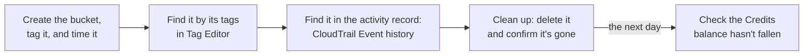
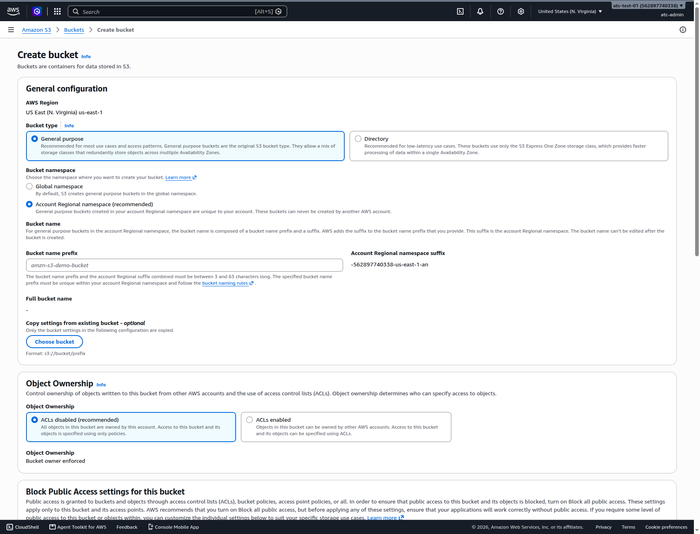
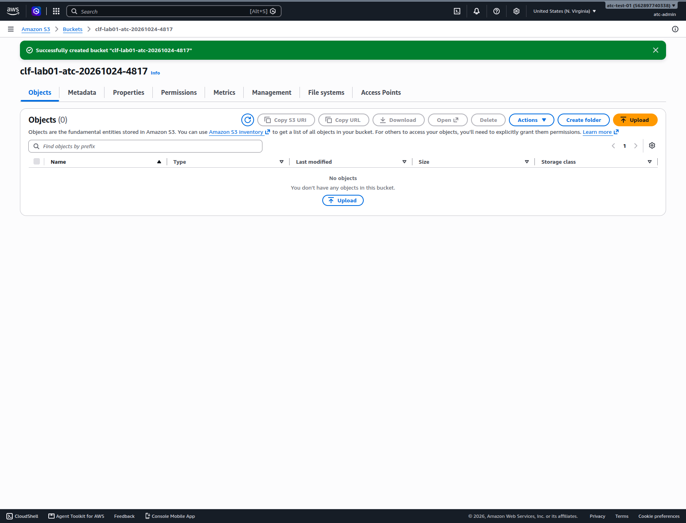
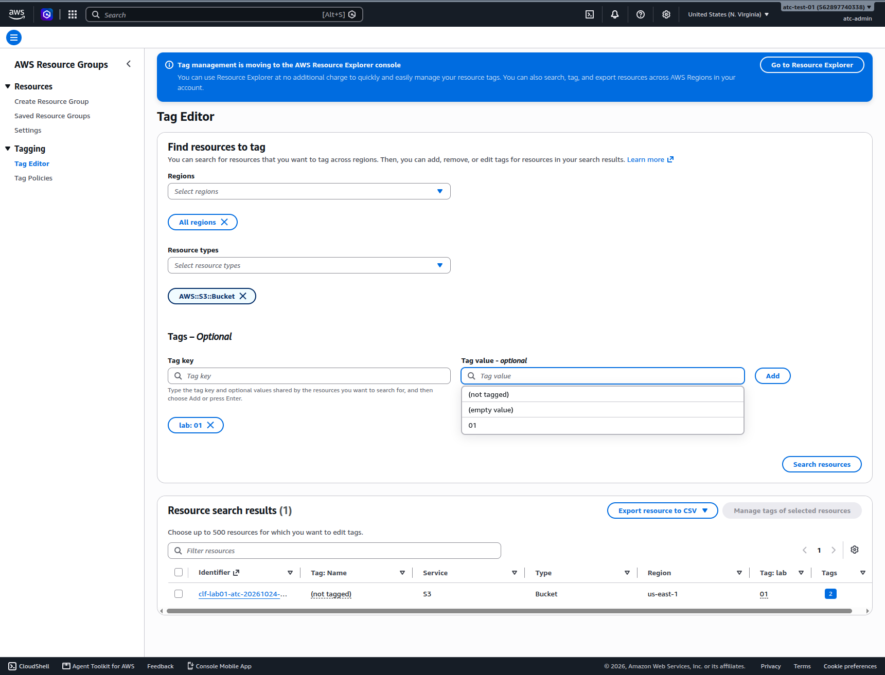
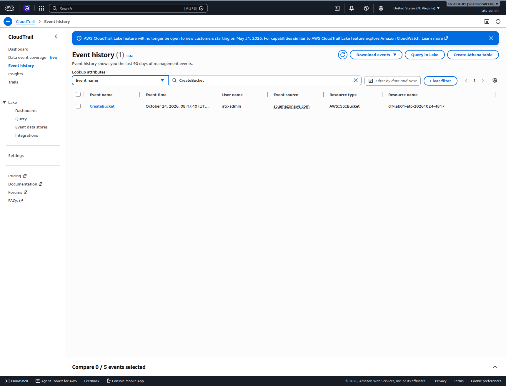

# Lab 01: Create, find and delete your first storage bucket

## Before you start: your account, your responsibility

This guide is provided as is, without warranty. We work hard to keep it correct and current, but AWS changes often, and its services, prices, and free offers may differ from what is written here. The labs run in your own AWS account. You are responsible for that account, for its security, and for any charges it incurs, including charges from resources you forget to delete. Automate the Cloud Inc. is not liable for any costs, losses, or security incidents that result from following, or failing to follow, this material. Technical guidance here is general information, not advice about your specific systems.

**Who this is for:** you have set up the guardrails and are ready for your first real resource. No AWS experience needed. **Time:** about 25 minutes, plus 5 minutes the next day.

**Goal:** you create an empty, private, tagged storage bucket and time how long it takes. Then you find it two ways, by its tags and in the account's activity record, and delete it. **End state:** nothing left behind, and your notes say how many minutes it took to get a new resource. The diagram shows the lab's five stages.

*Notice that you find the bucket twice, in two different ways, before you delete it, and that the lab doesn't end at deletion: cost data can take about a day to appear.*

**Long description.** Five stages from left to right. Create the bucket, tag it, and time it. Find it by its tags in Tag Editor. Find it in the activity record, CloudTrail Event history. Clean up: delete it and confirm it's gone. Then, the next day, check that the Credits balance hasn't fallen.

**What it creates:** one empty bucket in **Amazon S3** (Simple Storage Service), AWS's service for storing files, which it calls *objects*, in containers called *buckets*. The bucket is in US East (N. Virginia), `us-east-1`, with the tags `guide` = `clf` and `lab` = `01`. You delete it at the end.

**What it costs:** $0. AWS doesn't charge for creating a bucket; it charges for storing files in it and moving them in and out ([Getting started with Amazon S3](https://docs.aws.amazon.com/AmazonS3/latest/userguide/GetStartedWithS3.html), checked 2026-10-23). This lab stores nothing. **Worst case on a Paid plan** if you forget to delete the bucket: still $0 while it stays empty. **Free plan:** nothing here upgrades your plan. Never choose **Upgrade plan** during a lab.

**Before you start, you need these guardrails in place.** If you haven't done them, do them first (about two to three hours, once):

- Root user secured with MFA: [primer page 02](https://github.com/AutomateTheCloud/atc-study-aws_account_guardrails/blob/main/primer/02-secure-the-root-user.md).
- An IAM admin user with MFA for daily work, never the root user: [primer page 03](https://github.com/AutomateTheCloud/atc-study-aws_account_guardrails/blob/main/primer/03-your-everyday-admin-identity.md).
- Budgets and billing alerts: [primer page 05](https://github.com/AutomateTheCloud/atc-study-aws_account_guardrails/blob/main/primer/05-money-alarms.md).
- The habits for every lab, including a lab log: [primer page 07](https://github.com/AutomateTheCloud/atc-study-aws_account_guardrails/blob/main/primer/07-habits-for-every-lab.md).

**Why this matters:** in [02.03](03-telling-the-benefits-apart.md) you met **agility**: AWS says the time to get new resources falls from weeks to minutes ([Six advantages of cloud computing](https://docs.aws.amazon.com/whitepapers/latest/aws-overview/six-advantages-of-cloud-computing.html)). Here you measure it yourself. Tagging, finding and deleting what you create is how professionals keep the variable bill from [02.04](04-what-a-data-center-really-costs.md) under control: [COST03-BP02 Add organization information to cost and usage](https://docs.aws.amazon.com/wellarchitected/latest/cost-optimization-pillar/cost_monitor_usage_org_information.html) and [COST04-BP03 Decommission resources](https://docs.aws.amazon.com/wellarchitected/latest/cost-optimization-pillar/cost_decomissioning_resources_decommission.html). Checking the activity record is [SEC04-BP01 Configure service and application logging](https://docs.aws.amazon.com/wellarchitected/latest/security-pillar/sec_detect_investigate_events_app_service_logging.html) in practice.

> **If you signed up on the new sign-up path:** that experience has no root user, no console IAM users, and a Region chosen for you that you can't change (as of 2026-10-23). Use your assigned Region wherever this lab says `us-east-1`, and sign in the way that path gives you. We haven't run this lab on that path yet, so some screens may differ.

**About the screens:** names in **bold** are what we saw when we ran this lab in a new account on 2026-10-24. AWS changes its console often. If a label differs, look for the option with the same meaning.

## Steps

### Get ready

1. In your lab log, write today's date, the Region `us-east-1`, the tags `guide` = `clf` and `lab` = `01`, and a bucket name. Use `clf-lab01-`, then your initials, then today's date and four random digits, for example `clf-lab01-ab-20261024-4817`.
   A bucket name must be 3 to 63 characters of lowercase letters, numbers and hyphens, and start and end with a letter or number. It must not be in use by any other AWS account, and it appears in web addresses, so never put an email address or other personal details in it ([Getting started with Amazon S3](https://docs.aws.amazon.com/AmazonS3/latest/userguide/GetStartedWithS3.html)).
   **You should see:** a name written down that you can copy exactly.
2. Sign in to the AWS console as your **IAM admin user**, not the root user.
   **You should see:** the console home page, with your IAM user name in the account menu at the top right.
3. Look at the Region name near the top right. If it doesn't say **United States (N. Virginia)** or **US East (N. Virginia)**, choose it and pick that Region.
   **You should see:** N. Virginia selected. (Our new test accounts opened in US East (Ohio), so check every time.)

### Create the bucket and time it

4. Start a stopwatch, for example on your phone.
5. In the search bar at the top of the console, type `S3` and open **S3**.
6. Choose **Create bucket**. If your account has no buckets yet, S3 opens on a start page with a **Create bucket** button. If it shows a list of buckets, choose **General purpose buckets** in the left menu first.
   **You should see:** a page titled **Create bucket**, with **AWS Region** shown as US East (N. Virginia) us-east-1.
7. Keep **Bucket type** at **General purpose**. Under **Bucket namespace**, keep **Global namespace**, which was selected by default on 2026-10-24.
   The other option, **Account Regional namespace (recommended)**, makes the name unique to your account by adding a suffix with your account ID and Region (for example `-111122223333-us-east-1-an`). It is a good choice for real work, because no other account can ever take your names. This lab keeps the default so the steps stay simple.

   

   *Screenshot: the bucket namespace choice on the Create bucket page, with the Account Regional option selected to show its suffix (the lab keeps Global namespace), captured 2026-10-24 in our test account. AWS console screenshots are AWS material used as limited fair use and are not covered by this guide's license.*

8. In the bucket name box, type the name from your lab log.
9. Leave the security settings as AWS sets them by default, and check that they read as follows. Don't change any of them.
   - **Object Ownership:** ACLs disabled (the bucket owner owns everything in it).
   - **Block Public Access settings for this bucket:** **Block *all* public access** selected.
   - **Bucket Versioning:** disabled.
   - **Default encryption:** server-side encryption with Amazon S3 managed keys (SSE-S3).

   These defaults keep the bucket private and encrypted ([Getting started with Amazon S3](https://docs.aws.amazon.com/AmazonS3/latest/userguide/GetStartedWithS3.html)).
10. In the **Tags** section, add a tag with key `guide` and value `clf`. Add a second tag with key `lab` and value `01`. Tag keys and values are case sensitive: type them in lowercase, exactly as shown.
    **You should see:** two tags listed before you create the bucket.
11. Choose **Create bucket** at the bottom of the page.
    **You should see:** your new bucket's own page, with a green message that the bucket was created and an empty **Objects** tab.

    

    *Screenshot: the new bucket right after creation, captured 2026-10-24 in our test account. AWS console screenshots are AWS material used as limited fair use and are not covered by this guide's license.*

    > **If something went wrong:**
    > - *The name is already taken:* another account in the world uses it. Change the four digits and try again.
    > - *The name is not valid:* look for capital letters, spaces, underscores or a dot or hyphen at the end.
    > - *Access denied:* you may be signed in as the wrong user. Sign out and sign in as your IAM admin user. Never turn off Block Public Access to get past an error.
12. Stop the stopwatch when the success message appears. Write the time in your lab log. (In our run it took about three minutes, most of it reading.)

### Find it by its tags

13. In the console search bar, type `Tag Editor` and open it.
    On 2026-10-24 a banner said tag management is moving to the AWS Resource Explorer console. Tag Editor still worked; if it has moved by the time you read this, use the search in Resource Explorer instead, with the same tag.
14. In the Regions list, choose **All regions**. Tag Editor starts with only your current Region selected ([Finding resources to tag](https://docs.aws.amazon.com/tag-editor/latest/userguide/find-resources-to-tag.html)).
15. In **Resource types**, choose `AWS::S3::Bucket`.
16. Under **Tags – Optional**, enter the tag key `lab` and the tag value `01`, and choose **Add**. Then choose **Search resources**.
    **You should see:** one result, your bucket.
    The **Tag: Name** column shows *(not tagged)*. That is normal: you didn't add a tag with the key `Name`, and this lab doesn't need one.

    

    *Screenshot: Tag Editor finding the bucket by its tag, captured 2026-10-24 in our test account. AWS console screenshots are AWS material used as limited fair use and are not covered by this guide's license.*

    > **If something went wrong:** no results usually means a typo in the tag (the search is case sensitive) or a tag that wasn't added. Open the bucket in S3, choose its **Properties** tab, and scroll to **Tags**. If a tag is missing, add it there and search again.

### Find it in the activity record

17. In the console search bar, type `CloudTrail` and open **CloudTrail**. Check that the Region is still N. Virginia.
18. In the left menu, choose **Event history**. Event history is on in every account, keeps 90 days of account activity for each Region, and costs nothing to view ([Working with CloudTrail event history](https://docs.aws.amazon.com/awscloudtrail/latest/userguide/view-cloudtrail-events.html), checked 2026-10-23).
19. Under **Lookup attributes**, the first box starts on **Read-only**. Change it to **Event name**, type `CreateBucket` in the box beside it, and press Enter.
    **You should see:** one event from a few minutes ago, with your IAM user name under **User name** and your bucket's name under **Resource name**.

    

    *Screenshot: CloudTrail Event history showing the CreateBucket event, captured 2026-10-24 in our test account. AWS console screenshots are AWS material used as limited fair use and are not covered by this guide's license.*

    > **If something went wrong:** if nothing appears, wait five minutes and refresh; in our run, events took up to four minutes to appear. Then check that the Region is N. Virginia, because Event history shows one Region at a time.

## Check your work

- [ ] Your lab log shows how many minutes the bucket took, from opening S3 to seeing it in the list.
- [ ] Tag Editor, searching all Regions, found exactly one bucket tagged `lab` = `01`.
- [ ] CloudTrail Event history shows a `CreateBucket` event made by your IAM admin user, not the root user.

## Clean up

20. Open **S3**, choose **General purpose buckets**, select the option next to your bucket, and choose **Delete**.
21. Type the bucket name to confirm, and choose **Delete bucket**. The page warns that deleting a bucket can't be undone and that someone else can then use the name.
    **You should see:** a success message, and the bucket gone from the list.
    > **If something went wrong:** a message that the bucket isn't empty means a file was uploaded. Use the **Empty bucket** option the message offers, follow its prompts, then repeat steps 20 and 21. A deleted bucket can't be restored, which is fine here because it held nothing ([Deleting a general purpose bucket](https://docs.aws.amazon.com/AmazonS3/latest/userguide/delete-bucket.html)).
22. **Confirm:** in the S3 bucket list, search for your bucket name; nothing should be found. In CloudTrail Event history, look up the event name `DeleteBucket`; you should see your deletion. In Tag Editor, repeat the search from step 16; expect **No resources** (in our run it was empty three minutes after the deletion; if the bucket still shows, wait a few minutes and search again). Tick the bucket off in your lab log.
23. **The next day:** open the **Credits** page in the Billing and Cost Management console and check that the balance hasn't fallen because of S3. Cost data can take about 24 hours to appear ([primer page 07](https://github.com/AutomateTheCloud/atc-study-aws_account_guardrails/blob/main/primer/07-habits-for-every-lab.md), habit 4).

## Recap

You created a private, encrypted, tagged resource in a few minutes, found it by its tags across every Region, saw the record of who created it, and deleted it, so it costs nothing from now on. That is the cloud's pay-as-you-go model on a small scale: get a resource when you need it, and stop paying when you delete it. The tags and the activity record are what make that safe as your labs grow.

> **Reflect:** how many minutes did your bucket take? A small business that buys a new server has to choose it, order it, wait for delivery and install it. Write two sentences on what the difference means for the bakery's owner when she wants to try a new idea, such as taking orders for a new product.
>
> 

Model answer

>
> It probably took you a few minutes, most of them spent reading; getting a physical server takes days or weeks. That speed is agility: the bakery can try the new product's ordering page this week, and if nobody orders, delete what it built and stop paying, instead of being left with hardware it bought for an idea that didn't work.
>
> 

**Next:** practice the cost side in the [demand-curve simulation (S1)](07-sim-demand-curve.md).

## Where to check the current details

- [Getting started with Amazon S3](https://docs.aws.amazon.com/AmazonS3/latest/userguide/GetStartedWithS3.html), Amazon S3 User Guide (checked 2026-10-23)
- [Deleting a general purpose bucket](https://docs.aws.amazon.com/AmazonS3/latest/userguide/delete-bucket.html), Amazon S3 User Guide (checked 2026-10-23)
- [Finding resources to tag](https://docs.aws.amazon.com/tag-editor/latest/userguide/find-resources-to-tag.html), Tagging AWS Resources and Tag Editor (checked 2026-10-23)
- [Working with CloudTrail event history](https://docs.aws.amazon.com/awscloudtrail/latest/userguide/view-cloudtrail-events.html), AWS CloudTrail User Guide (checked 2026-10-23)
- [Amazon S3 pricing](https://aws.amazon.com/s3/pricing/) (checked 2026-10-23)

---

"Lab 01: Create, find and delete your first storage bucket" by Automate the Cloud Inc., licensed under CC BY-NC 4.0 with the Additional Permission for Internal Training from Automate the Cloud Inc.
License: https://creativecommons.org/licenses/by-nc/4.0/
Permission: https://automatethe.cloud/licenses/atc-internal-training-permission.txt
