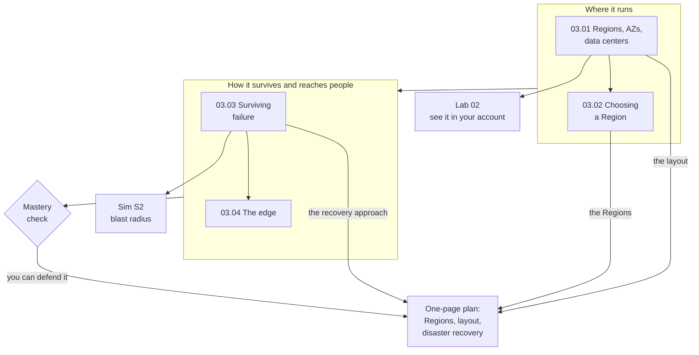

# Module 03: Decide where in the world the bakery's site runs, and how it survives a failure

This module teaches how AWS spreads its computers around the world, and how you use that to keep a site close to its customers, within the rules, and running when something breaks.

**For:** an adult studying alone, possibly new to IT, who wants to understand AWS and use it safely. You have finished [Module 02](../02-why-the-cloud/00-brief.md) and the [guardrails primer](https://github.com/AutomateTheCloud/atc-study-aws_account_guardrails/blob/main/primer/00-read-this-first.md). **Time:** about 3 hours, over several sessions.

## The scenario: the bakery opens a shop in Germany

The bakery moved its ordering site to AWS, and the owner has opened a second shop in Germany. She has three requirements:

1. **Fast for everyone.** Customers in the US and in Germany should both find the site quick.
2. **German customers' data stays in the European Union (EU).** Her German partner's contract requires it. (Real rules like this also come from laws and regulators.)
3. **The site survives losing a data center.** December orders can't stop because one building loses power.

The bakery's facts are made up for teaching, and every lesson uses them:

| Part of the site | What it does | Where it runs today |
|---|---|---|
| The web server | Runs the ordering website | One virtual server in Amazon EC2 |
| The order database | Keeps every order | A managed database in Amazon RDS, with no standby copy |
| The order functions | Send each customer a confirmation | Functions in AWS Lambda |
| The photo storage | Holds the photos of the cakes | A bucket in Amazon S3 |

All four run in one AWS Region, US East (N. Virginia), near the US shop on the East Coast. At the end you hand the owner a one-page plan: the Regions, the layout inside each, and the disaster recovery approach, each with its reason.

## You'll be able to

Tags: the kind of knowledge (C concept, J judgment) and what you do with it (Un understand, Ap apply, Ev evaluate).

| Objective | Lesson |
|---|---|
| **03.01a** Explain how Regions, Availability Zones and data centers nest, and how that gives high availability [C·Un] | 03.01 |
| **03.02a** Choose a Region for a workload and justify the choice [J·Ap] | 03.02 |
| **03.03a** Choose a way to survive failure from how long you can be down, how much data you can lose, and the budget [J·Ev] | 03.03 |
| **03.04a** Say where each kind of edge site runs and what it's for [C·Un] | 03.04 |

## What this covers on the exam

This module covers the AWS Certified Cloud Practitioner (CLF-C02) exam's task [3.2](https://docs.aws.amazon.com/aws-certification/latest/cloud-practitioner-02/cloud-practitioner-02-domain3.html#cloud-practitioner-02-task3.2), the AWS global infrastructure (all four lessons). It also finishes the global-infrastructure part of task [1.1](https://docs.aws.amazon.com/aws-certification/latest/cloud-practitioner-02/cloud-practitioner-02-domain1.html#cloud-practitioner-02-task1.1), which [lesson 02.03](../02-why-the-cloud/03-telling-the-benefits-apart.md) began. We checked the exam guide on 2026-10-24.

## How the module is laid out

**Lessons** (about 25 minutes each, except 03.03, which takes longer):

1. [Regions, Availability Zones and data centers](01-regions-availability-zones-data-centers.md)
2. [Choosing a Region](02-choosing-a-region.md)
3. [Surviving failure](03-surviving-failure.md)
4. [The edge](04-the-edge.md)

**Hands-on:**

- [Lab 02: see the global infrastructure](05-lab-02-see-the-global-infrastructure.md), in your own AWS account. It only looks; it creates nothing.
- [Simulation S2: the blast radius](06-sim-blast-radius.md), on this site, not in AWS.

**Before Lab 02:** check that you still have [root MFA](https://github.com/AutomateTheCloud/atc-study-aws_account_guardrails/blob/main/primer/02-secure-the-root-user.md), [your IAM admin user with MFA](https://github.com/AutomateTheCloud/atc-study-aws_account_guardrails/blob/main/primer/03-your-everyday-admin-identity.md), and [money alarms](https://github.com/AutomateTheCloud/atc-study-aws_account_guardrails/blob/main/primer/05-money-alarms.md). The lessons need no AWS account.

**Mastery check:** the module ends with a [mastery check](07-check.md); you pass at 80%. Each miss points you to the section to reread, then to a parallel retest. Pass first time, and you get optional [enrichment tasks](07-check.md#enrichment-harder-tasks-for-when-you-pass).

**Numbers that change:** lesson 03.01 keeps the Region and AZ counts in one dated box. Don't memorize them.

*Notice that each of the first three lessons supplies one part of the plan.*

**Long description.** Top to bottom. "Where it runs": lessons 03.01 (Regions, AZs, data centers) and 03.02 (choosing a Region). It leads to "How it survives and reaches people": lessons 03.03 (surviving failure) and 03.04 (the edge), then the mastery check. Lesson 03.01 leads to Lab 02; lesson 03.03 to Simulation S2. Arrows reach the one-page plan: the layout from 03.01, the Regions from 03.02, the recovery approach from 03.03, and "you can defend it" from the check.

## Coming back

Warm-ups bring back Module 02 (high availability, durability, global reach, the Well-Architected pillars, fixed and variable costs) and the guardrails primer (the Region selector, opt-in Regions). Regions and Availability Zones return in almost every later module, starting with Module 07's network.

---

"Module 03: AWS around the world" by Automate the Cloud Inc., licensed under CC BY-NC 4.0 with the Additional Permission for Internal Training from Automate the Cloud Inc.
License: https://creativecommons.org/licenses/by-nc/4.0/
Permission: https://automatethe.cloud/licenses/atc-internal-training-permission.txt
