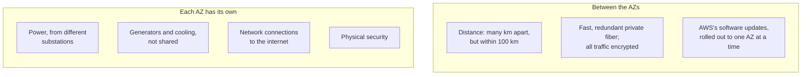

# A Region holds several Availability Zones, and each Availability Zone holds one or more data centers

AWS builds its infrastructure in three nested layers. A **data center** is a building full of servers. An **Availability Zone** groups one or more data centers that share nothing important with the other zones. A **Region** is an area of the world with at least three Availability Zones. Once you see how they nest, you can see how to keep a site running when one building, or one whole zone, fails.

**For:** an adult studying alone, possibly new to IT, who wants to understand AWS and use it safely. **Time:** about 25 minutes. Reading works on a phone.

**Before you start:** this lesson builds on [Telling the benefits apart](../02-why-the-cloud/03-telling-the-benefits-apart.md), which introduced Regions, Availability Zones and high availability in a few lines, and on pages [06](https://github.com/AutomateTheCloud/atc-study-aws_account_guardrails/blob/main/primer/06-safe-defaults.md) and [07](https://github.com/AutomateTheCloud/atc-study-aws_account_guardrails/blob/main/primer/07-habits-for-every-lab.md) of the guardrails primer. If you skipped them, the key terms below cover what you need. The bakery scenario is in the [module brief](00-brief.md).

## Warm-up: what you remember

Answer from memory before you look anything up.

1. In lesson 02.03, what is the difference between high availability and durability?
2. In the guardrails primer, you were told to search for lab resources "in every Region". Why isn't one search in your lab Region enough?
3. In lesson 02.03, the bakery's three servers sat in one room behind the shop. Why didn't owning three servers protect the site from a power cut?

Feedback

1. **High availability** means the system keeps working when a part fails: can I reach it right now? **Durability** means stored data isn't lost: will it still exist later?
2. Most resources live in one Region, and most console pages show only the Region chosen in the selector. A resource in another Region is invisible from your lab Region, but it still costs money ([primer page 07](https://github.com/AutomateTheCloud/atc-study-aws_account_guardrails/blob/main/primer/07-habits-for-every-lab.md)).
3. All three depended on the same room, the same power and the same network. One failure there stopped them all. This lesson calls that a **single point of failure**.

## What you'll learn

By the end of this lesson, you can:

- explain how Regions, Availability Zones and data centers nest, and why Availability Zones don't fail together;
- say where each part of a site lives (one zone, a whole Region, or everywhere), and describe how running in more than one Availability Zone gives high availability (objective 03.01a).

Try these before you read on. Guess if you're unsure; the answers are in the lesson.

1. Is an Availability Zone the same thing as a data center?
2. What is the smallest number of Availability Zones an AWS Region has?
3. The bakery wants its site to "survive losing a data center". Is running everything in one Availability Zone enough?

## The big picture: boxes inside boxes

The diagram shows the three layers. Read it from the outside in.

*Notice that the boundaries you design around are the Availability Zone and the Region, not the data center. You choose zones and Regions; you never choose a building.*

**Long description.** A Region box (for example Europe (Frankfurt)) holds three Availability Zone boxes, each with its own power, cooling and network, holding three, one and two data centers (an illustration only). Lines join the zones: fast private fiber, encrypted, many kilometers apart but within 100 km (60 miles). A dashed box to the right is another Region, much farther away, holding nothing unless you copy it there. Four edge locations sit outside the Regions (lesson 03.04).

## Key terms (skip if you know them)

- **Data center:** a building that holds servers, storage and network equipment, with power and cooling.
- **Availability Zone (AZ):** one or more data centers in a Region, with their own power, networking and connections, kept physically apart from the other AZs.
- **Region:** an area of the world where AWS runs at least three AZs, such as Europe (Frankfurt). Each Region has a **Region code**, such as `eu-central-1`.
- **Single point of failure:** one part whose failure stops the whole system.
- **Zonal resource:** something that lives in one AZ, such as an EC2 virtual server. A **Regional service** runs across several AZs for you, such as Amazon S3.

In everyday English, "region" and "zone" mean any area. An AWS **Region** is one named group of AZs, and an AWS **Availability Zone** is a set of buildings designed to fail on its own.

## A data center is a building; an Availability Zone is one or more of them

AWS describes an Availability Zone as **one or more** discrete data centers, each with redundant power, networking and connectivity, housed in separate facilities ([AWS Regions and Availability Zones](https://docs.aws.amazon.com/global-infrastructure/latest/regions/aws-regions-availability-zones.html)). "Discrete" means separate from each other. "Redundant" means there is more than one of each, so one failure doesn't cut the supply.

AWS doesn't tell you how many data centers an AZ has, and it doesn't let you choose one. You choose a Region and, for some resources, an AZ. That is as precise as you can be.

### "An Availability Zone is one data center" is wrong

You may have read that an AZ is simply a data center, so "a data center failure" and "an AZ failure" are the same event. That's not right: AWS says an AZ is *one or more* data centers. It's tempting because many diagrams draw an AZ as one box. But the difference changes what a requirement means:

- To survive **losing one data center**, you can't count on staying inside one AZ. You don't know which building your server is in, so you can't place a copy in "the other building". The unit you can control is the AZ.
- To survive **losing a whole AZ**, you need copies in at least two AZs.

So for the bakery's third requirement, "survive losing a data center", the practical answer is the same as for "survive losing an AZ": run in at least two AZs.

> **Your turn:** A colleague says, "Our app runs in one AZ, so it's in one data center. If that building is fine, we're fine." Correct two things in this statement, in two or three sentences.

Model answer

An AZ is one or more data centers, so the app may not be in a single building, and you can't tell which building it uses. More importantly, the app depends on one AZ: anything that takes that AZ down, such as a power or network failure, stops it. To survive that, the app needs a copy in a second AZ.

## Availability Zones don't share a single point of failure

The whole point of AZs is that they fail separately. AWS builds them so that one event shouldn't take out two of them. The AWS Certified Cloud Practitioner (CLF-C02) exam asks you to recognize this (task [3.2](https://docs.aws.amazon.com/aws-certification/latest/cloud-practitioner-02/cloud-practitioner-02-domain3.html#cloud-practitioner-02-task3.2)).

*Notice that the left panel removes the shared parts, and the right panel keeps the AZs apart in space and in time, yet still well connected.*

**Long description.** Two panels. "Each AZ has its own": power, supplied from different substations; generators and cooling, not shared with other AZs; network connections to the internet; physical security. "Between the AZs": distance, many kilometers apart but within 100 km; fast, redundant private fiber, with all traffic encrypted; AWS's software updates, rolled out to one AZ at a time.

AWS states the separate power, cooling and physical security, the distances, and the encrypted fiber links, which are fast enough to keep two copies of a database exactly in step ([Regions and Availability Zones](https://aws.amazon.com/about-aws/global-infrastructure/regions_az/)). Its Fault Isolation Boundaries whitepaper (November 2022) adds the different substations, the unshared generators and cooling, and the updates rolled out to one AZ at a time, so one bad update doesn't hit every AZ ([AWS Fault Isolation Boundaries](https://docs.aws.amazon.com/whitepapers/latest/aws-fault-isolation-boundaries/abstract-and-introduction.html)). The distance means one fire, flood or tornado is unlikely to reach two AZs.

AWS calls the result **Availability Zone Independence**. Nothing is failure-proof: AWS says failures are rare but can still affect resources in one location. What the design gives you is *separate* failures, so a copy in another AZ keeps running.

> **Check:** Which design feature most directly stops a single utility power cut from taking down two AZs?
>
> A. All traffic between AZs is encrypted.
> B. AZs are designed to draw power from different substations, with their own generators.
> C. Each Region has at least three AZs.
> D. AZs are within 100 km of each other.

Feedback

**B is right.** Separate power sources and backup equipment mean one power failure stays inside one AZ.

- **A is wrong.** Encryption protects data on the links; it doesn't keep the power on.
- **C is wrong.** Having three AZs helps only if they don't share a power supply; the count alone doesn't separate them.
- **D is wrong.** The 100 km limit keeps AZs close enough for fast links. Distance helps against local disasters such as floods, but on its own it doesn't separate the power supply.

## A Region is at least three Availability Zones in one area

A Region is a separate geographic area with several AZs. AWS states that each Region has at least three, isolated and physically separate AZs ([Regions and Availability Zones](https://aws.amazon.com/about-aws/global-infrastructure/regions_az/); [AWS Availability Zones](https://docs.aws.amazon.com/global-infrastructure/latest/regions/aws-availability-zones.html)).

Regions are also isolated from *each other*, so a service failure in one Region stays there. Your resources stay in the Region where you create them: AWS doesn't copy them to another Region unless you set that up ([AWS Regions and Availability Zones](https://docs.aws.amazon.com/global-infrastructure/latest/regions/aws-regions-availability-zones.html)). That is why the primer told you to search every Region for lab leftovers.

Each Region has a name and a code. The bakery's site runs in **US East (N. Virginia)**, code `us-east-1`, which the guide's labs use too. Its German shop is near **Europe (Frankfurt)**, `eu-central-1`. An AZ's name is the Region code plus a letter, such as `us-east-1a`. Regions launched after March 20, 2019 start switched off in your account ([AWS Regions](https://docs.aws.amazon.com/global-infrastructure/latest/regions/aws-regions.html)); [primer page 06](https://github.com/AutomateTheCloud/atc-study-aws_account_guardrails/blob/main/primer/06-safe-defaults.md) told you to leave them off.

### "A Region can have just two AZs" is wrong

You may have read that a Region needs only two AZs. AWS says every Region has at least three, and in the table we checked, none has fewer (see the dated box).

It's tempting for two reasons. Two is the smallest number that gives high availability, so some material treats it as the minimum. And your *account* may really see two: AWS notes that newer accounts can use only two AZs in US West (N. California), though the Region has three, and that it may stop offering a crowded AZ to new accounts ([AWS Availability Zones](https://docs.aws.amazon.com/global-infrastructure/latest/regions/aws-availability-zones.html)). What your account can use is a separate question from what the Region has.

> **Dated facts: counts that change (checked 2026-10-23)**
>
> - AWS's Global Infrastructure page: **124 Availability Zones in 39 geographic Regions**, with 7 more AZs and 2 more Regions (Saudi Arabia and Chile) announced ([AWS Global Infrastructure](https://aws.amazon.com/about-aws/global-infrastructure/)).
> - AWS's documentation lists **34 Regions** that a standard AWS account provides ([AWS Regions](https://docs.aws.amazon.com/global-infrastructure/latest/regions/aws-regions.html)). The two pages don't count the same set. Part of the gap is that AWS also runs Regions that need a separate kind of account, such as AWS GovCloud (US) and the China Regions, which the documentation's table leaves out.
> - Of those 34 Regions, 30 have three AZs, 3 have four, and US East (N. Virginia) has six.
>
> These numbers grow every year, and AWS's own pages don't always agree. **Don't memorize them**; check [AWS Global Infrastructure](https://aws.amazon.com/about-aws/global-infrastructure/) when you need a figure.

*Notice that no bar sits below the dashed line. The minimum of three is the fact to keep; the bar lengths will change.*

| AZs in the Region | Regions, as of 2026-10-23 |
|---|---|
| 1 or 2 | 0 |
| 3 | 30 |
| 4 | 3 |
| 6 | 1 (US East (N. Virginia)) |

### "Region counts are worth memorizing" is wrong

You may have seen questions that ask how many Regions AWS has. It's tempting because a number feels like a solid fact to learn. But the figures go out of date within months, and the two AWS pages above give different totals on the same day. The exam guide asks you to describe how Regions, AZs and edge locations relate, not to count them.

> **Your turn:** In two sentences, explain the difference between what a Region *has* and what your account *can use*, with the US West (N. California) example.

Model answer

Every Region has at least three AZs; US West (N. California) has three. But AWS can limit which AZs an account may use, and newer accounts can use only two there, so a design that needs three AZs should pick a different Region or check first.

## Where your resources live: in one AZ, across a Region, or everywhere

AWS services sit at different levels of the nesting, and the level tells you what you must do for high availability ([AWS Fault Isolation Boundaries](https://docs.aws.amazon.com/whitepapers/latest/aws-fault-isolation-boundaries/abstract-and-introduction.html)):

| Level | What it means | Examples | What high availability needs from you |
|---|---|---|---|
| **Zonal** | You choose one AZ for the resource, and it fails with that AZ | An EC2 virtual server; an EBS disk | Put copies in more than one AZ yourself |
| **Regional** | AWS runs the service across several AZs and gives you one Regional address | Amazon S3; AWS Lambda; Amazon DynamoDB | Usually nothing: AWS spreads it for you |
| **Global** | Not tied to one Region | IAM; Amazon Route 53; Amazon CloudFront | Nothing at this level |

Amazon Relational Database Service (Amazon RDS) sits in between. It runs a database in one AZ unless you ask for a **Multi-AZ** deployment, which adds a **standby**: a second copy of the database in another AZ that takes over if the first fails. The Well-Architected Framework names RDS as a service where you must turn this on yourself ([REL10-BP01 Deploy the workload to multiple locations](https://docs.aws.amazon.com/wellarchitected/latest/reliability-pillar/rel_fault_isolation_multiaz_region_system.html); [Multi-AZ deployments for Amazon RDS](https://docs.aws.amazon.com/AmazonRDS/latest/UserGuide/Concepts.MultiAZ.html)).

> **Check:** Use the table on the bakery's four parts from the [module brief](00-brief.md). Which would stop working if the AZ holding them failed today?
>
> A. The cake photos and the order functions
> B. The web server and the order database
> C. All four
> D. None, because AWS spreads everything across AZs

Feedback

**B is right.** The web server is zonal, and the database has no standby, so both live only in one AZ.

- **A is wrong.** S3 stores objects across at least three AZs in most storage classes ([Amazon S3 FAQs](https://aws.amazon.com/s3/faqs/)); the cheaper One Zone-IA class, in lesson 05.03, is the exception. The Well-Architected Framework names Lambda as natively multi-AZ ([REL11-BP02 Fail over to healthy resources](https://docs.aws.amazon.com/wellarchitected/latest/reliability-pillar/rel_withstand_component_failures_failover2good.html)).
- **C is wrong.** Two of the four parts are already spread out.
- **D is wrong.** AWS spreads *Regional* services. Zonal resources, and an RDS database without Multi-AZ, stay where you put them.

## High availability means running in more than one Availability Zone

You get high availability on AWS by giving every zonal part a copy in a second AZ, and sending users to the healthy copies. AWS calls deploying across several AZs a best practice, so the application keeps running if one AZ fails ([AWS Regions and Availability Zones](https://docs.aws.amazon.com/global-infrastructure/latest/regions/aws-regions-availability-zones.html)). A **load balancer** does the sending: it spreads users' requests across servers in one or more AZs and skips any that fail its health checks ([What is Elastic Load Balancing?](https://docs.aws.amazon.com/elasticloadbalancing/latest/userguide/what-is-load-balancing.html)). Lesson 06.02 teaches it properly.

### Worked example: making the bakery survive losing an AZ

The owner's requirement: the site keeps taking orders if a data center fails. Here is how someone who knows the nesting works it out.

1. **Translate the requirement.** You can't choose a data center, so it becomes "survive losing an AZ".
2. **List each part and its level.** S3 and Lambda are Regional; the web server is zonal; the database is single-AZ.
3. **Find the single points of failure:** anything in only one AZ. The web server and the database; either alone would stop orders.
4. **Add a copy of each in a second AZ:** a second web server in AZ b, and Multi-AZ for the database, so it gets a standby in AZ b.
5. **Send users to healthy copies** with a load balancer in front of the web servers.
6. **Count the cost** (see the box below). S3 and Lambda needed no change.

*Notice that only the two zonal parts changed. After the change, no single AZ holds the only copy of anything the site needs.*

**Long description.** Two panels with AZ columns a, b and c in US East (N. Virginia). Before: the only web server (EC2) and the database without a standby (RDS) are in AZ a; the functions (Lambda) and photos (S3) span all three AZs. If AZ a fails, the site stops. After: a load balancer spans AZs a and b; web servers in a and b; the database primary in a and its standby in b; Lambda and S3 unchanged. If AZ a fails, web server 2 keeps taking orders and the standby takes over.

> **What you pay for (as of 2026-10-23).** High availability isn't free. The second web server runs, and bills, all the time. The standby database is a second database server that you pay for even though it serves no orders. A load balancer bills by the hour. Data between EC2 and RDS in *different* AZs costs $0.01 per GB in each direction in US East (N. Virginia), though RDS doesn't charge for its own Multi-AZ copying ([Amazon RDS pricing](https://aws.amazon.com/rds/pricing/)). For a site that loses real money when it stops, that is usually worth it. Module 11 shows how to price it.

This design survives losing an AZ. It does **not** survive losing the whole Region, and it doesn't protect against someone deleting the orders by mistake: a mistake is copied to the standby too. High availability and disaster recovery are different jobs, and lesson 03.03 separates them.

> **Your turn:** A clinic runs its booking site on two EC2 servers, both in AZ `eu-central-1a`, behind a load balancer, with an RDS database that has a standby in `eu-central-1b`. Is the site highly available? Name the single point of failure, and the fix.

Model answer

No. Both web servers are in the same AZ, so a failure of `eu-central-1a` stops the web tier even though the database could fail over. The fix is to move one web server into another AZ, such as `eu-central-1b`, and let the load balancer use both AZs. Two copies only help if they are in different AZs.

## Going deeper (optional): one AZ name, two different places

In AWS's oldest Regions, accounts created before November 2025 have their AZ names, such as `us-east-1a`, mapped to physical AZs separately, so your `us-east-1a` may be another account's `us-east-1c`. The **AZ ID**, such as `use1-az1`, names the same place in every account ([AWS Availability Zones](https://docs.aws.amazon.com/global-infrastructure/latest/regions/aws-availability-zones.html)). [Lab 02](05-lab-02-see-the-global-infrastructure.md) shows you your own mapping.

## In real work: avoid one of anything

At work, the first question about any system is, "What happens when this part fails?" The answer usually starts with AZs.

- **Reliability.** [REL10-BP01 Deploy the workload to multiple locations](https://docs.aws.amazon.com/wellarchitected/latest/reliability-pillar/rel_fault_isolation_multiaz_region_system.html) names a production workload in a single AZ as a common mistake. It also warns against the opposite: several Regions when several AZs would do (lesson 03.02). The design principle "[Automatically recover from failure](https://docs.aws.amazon.com/wellarchitected/latest/framework/rel-dp.html)" is what the load balancer's health checks and the database's failover do.
- **Cost optimization.** Every extra copy costs money, so match the design to what an outage really costs the business.

As lesson 02.03 said, the benefits are possibilities, not defaults: AWS builds and runs the AZs, and placing your servers in more than one is your job. Module 04 names this split the shared responsibility model.

## Summary

- **A data center is a building; an Availability Zone is one or more of them.** You choose AZs, never buildings, so "survive losing a data center" means "run in more than one AZ".
- **AZs don't share a single point of failure:** separate power, generators, cooling and network, many kilometers apart but within 100 km, joined by fast encrypted links, updated at different times.
- **A Region has at least three AZs** and is isolated from other Regions; your resources stay in their Region unless you copy them. Your account may see fewer AZs than the Region has. Counts change: see the dated box, and don't memorize them.
- **Resources live in one AZ, across a Region, or globally.** Zonal parts such as EC2 servers need copies in other AZs; Regional services such as S3 and Lambda are spread for you; RDS needs Multi-AZ turned on.
- **High availability means copies in at least two AZs**, with a load balancer and a database standby. It doesn't cover losing a Region or deleting data by mistake.

**For the owner's plan:** you now have the layout inside a Region: two web servers in two AZs behind a load balancer, and a Multi-AZ database.

## Practice

1. **How does AWS describe an Availability Zone?**

   A. A single data center in a Region
   B. One or more data centers in a Region, with redundant power, networking and connectivity
   C. A group of Regions on one continent
   D. A small site in a city that caches content near users

   

Feedback

   **B is right.** That is AWS's description.

   - **A is wrong.** An AZ can be several data centers; "one data center" is a common error.
   - **C is wrong.** That reverses the nesting: Regions contain AZs.
   - **D is wrong.** That describes an edge location (lesson 03.04).

   

2. **Which statement about Regions is correct?**

   A. Each Region has at least two AZs.
   B. AWS copies your resources to a second Region automatically.
   C. Each Region has at least three AZs, and Regions are isolated from each other.
   D. All Regions are switched on in every account.

   

Feedback

   **C is right.**

   - **A is wrong.** AWS states a minimum of three. Your account may see two in one Region, but the Region has three.
   - **B is wrong.** Resources stay in their Region unless you copy or replicate them.
   - **D is wrong.** Regions launched after March 20, 2019 start switched off.

   

3. **A company runs its web servers in two AZs but keeps its only database server in one of them. An engineer says the system is highly available "because we use two AZs". Explain in two sentences why that's not enough.**

   

Feedback

   **Model answer:** The database exists in only one AZ, so it is a single point of failure: if that AZ fails, the web servers in the other AZ have no database to use. High availability needs a copy of every part that the system depends on in more than one AZ, for example an RDS Multi-AZ standby.

   

4. **Which of these does a company need to set up itself to keep working if an AZ fails?**

   A. Copies of its EC2 web servers in a second AZ
   B. Copies of its S3 objects in a second AZ
   C. Copies of its Lambda functions in a second AZ
   D. A copy of its IAM users in a second AZ

   

Feedback

   **A is right.** EC2 servers are zonal: each lives in one AZ.

   - **B is wrong.** S3 already stores objects across at least three AZs in most storage classes.
   - **C is wrong.** Lambda runs across AZs for you.
   - **D is wrong.** IAM is a global service, not tied to an AZ or a Region.

   

5. **(From lesson 02.03.) A clinic's booking system keeps working when one AZ loses power. Which benefit does this show, and why isn't it durability?**

   

Feedback

   **High availability**: the system keeps working when a part fails. Durability is about stored data not being lost later; the scenario is about bookings working right now.

   

**Next:** [Choosing a Region](02-choosing-a-region.md). To see your account's Regions and AZs for yourself, do [Lab 02](05-lab-02-see-the-global-infrastructure.md).

## Where to check the current details

- [AWS Global Infrastructure](https://aws.amazon.com/about-aws/global-infrastructure/), for current Region and AZ counts (checked 2026-10-23)
- [Regions and Availability Zones](https://aws.amazon.com/about-aws/global-infrastructure/regions_az/), AWS (checked 2026-10-23)
- [AWS Regions and Availability Zones](https://docs.aws.amazon.com/global-infrastructure/latest/regions/aws-regions-availability-zones.html), [AWS Regions](https://docs.aws.amazon.com/global-infrastructure/latest/regions/aws-regions.html) and [AWS Availability Zones](https://docs.aws.amazon.com/global-infrastructure/latest/regions/aws-availability-zones.html), AWS documentation (checked 2026-10-23)
- [AWS Fault Isolation Boundaries](https://docs.aws.amazon.com/whitepapers/latest/aws-fault-isolation-boundaries/abstract-and-introduction.html), AWS whitepaper, published November 16, 2022 (checked 2026-10-23)
- [Amazon S3 FAQs](https://aws.amazon.com/s3/faqs/) (checked 2026-10-23)
- [Multi-AZ deployments for Amazon RDS](https://docs.aws.amazon.com/AmazonRDS/latest/UserGuide/Concepts.MultiAZ.html) and [Amazon RDS pricing](https://aws.amazon.com/rds/pricing/) (checked 2026-10-23)
- [REL10-BP01 Deploy the workload to multiple locations](https://docs.aws.amazon.com/wellarchitected/latest/reliability-pillar/rel_fault_isolation_multiaz_region_system.html), AWS Well-Architected Framework (checked 2026-10-24)

---

"Regions, Availability Zones and data centers" by Automate the Cloud Inc., licensed under CC BY-NC 4.0 with the Additional Permission for Internal Training from Automate the Cloud Inc.
License: https://creativecommons.org/licenses/by-nc/4.0/
Permission: https://automatethe.cloud/licenses/atc-internal-training-permission.txt
