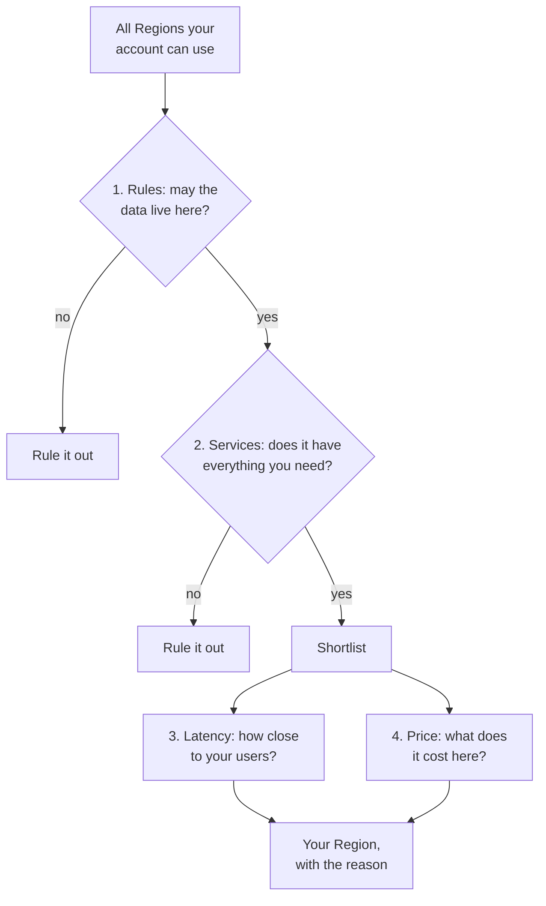

# Choose a Region by checking the rules first, then the services, then the distance to your users, then the price

Every resource you create lives in a Region you choose, so the choice decides where your data sits, which services you can use, how quickly your users get answers, and what you pay. The first two are must-haves; the other two are trade-offs. This lesson gives you that order and shows when one Region isn't enough.

**For:** an adult studying alone, possibly new to IT, who wants to understand AWS and use it safely. **Time:** about 25 minutes. Reading works on a phone.

**Before you start:** read [Regions, Availability Zones and data centers](01-regions-availability-zones-data-centers.md) first. This lesson also builds on global reach from [lesson 02.03](../02-why-the-cloud/03-telling-the-benefits-apart.md#global-reach-run-close-to-users-anywhere-in-minutes). The bakery scenario is in the [module brief](00-brief.md).

## Warm-up: what you remember

1. From lesson 03.01: you create a database in Europe (Frankfurt). Does AWS also keep a copy in another Region, in case Frankfurt fails?
2. From lesson 02.03: a company opens a site near customers abroad in two days. Which part of that is *global reach*, and which part is *agility*?
3. From the guardrails primer: your new account opened in a Region you didn't expect. What did the primer tell you to do, and why does it matter?

Feedback

1. **No.** Resources stay in the Region where you create them. AWS copies them to another Region only if you set that up.
2. **Global reach** is *where*: closer to those customers, so less delay. **Agility** is *how fast*: two days instead of a year.
3. Check the Region selector and switch to US East (N. Virginia), the guide's lab Region. Most resources and console pages belong to one Region, so working in the wrong one scatters your resources ([primer page 04](https://github.com/AutomateTheCloud/atc-study-aws_account_guardrails/blob/main/primer/04-command-line-without-access-keys.md)).

## What you'll learn

By the end of this lesson, you can:

- name the four things that decide a Region choice, and which of them are must-haves;
- choose a Region for a workload and justify it, including when to use more than one Region (objective 03.02a).

Try these before you read on. Guessing is fine.

1. The bakery's owner chose US East (N. Virginia) because it is near her office. Is "near the owner" a good reason?
2. Is every AWS service available in every Region?
3. A contract says German customers' data must stay in the EU. Is Europe (London) a safe choice?

## The big picture: two filters, then a trade-off

Think of the choice as a funnel. The first two questions remove Regions you can't use. The last two help you pick among the rest.

*Notice that latency and price never rescue a Region that fails a rule or lacks a service. They only rank the Regions that passed.*

**Long description.** A funnel from top to bottom. Start with all Regions your account can use. Question 1, rules: may the data live here? If no, rule it out. If yes, question 2, services: does it have everything you need? If no, rule it out. If yes, it joins the shortlist. The shortlist is weighed on two things side by side, latency (how close to your users) and price (what it costs here), which lead to your Region, with the reason.

The Well-Architected Framework gives the same list in [SUS01-BP01 Choose Region based on both business requirements and sustainability goals](https://docs.aws.amazon.com/wellarchitected/latest/sustainability-pillar/sus_sus_region_a2.html): shortlist Regions by compliance, available features, cost and latency.

## Key terms (skip if you know them)

- **Data residency:** where data is physically stored.
- **Data sovereignty:** keeping data under the control and the laws that apply to it, which often means keeping it in particular countries. AWS gives no single definition; the AWS Certified Cloud Practitioner (CLF-C02) exam lists it as a reason to use more than one Region.
- **Compliance requirement:** a rule you must follow, from a law, a regulator or a contract.
- **Latency:** the delay between a request and its answer. It grows with distance.
- **Multi-Region:** running a workload, or copies of it, in more than one Region.

## Rules first: decide where the data may live

Some data has rules about where it may be stored. They come from laws, regulators, contracts or customers. If a Region breaks a rule, nothing else about it matters.

AWS's part is to give you the control. AWS says you control where your data is stored by choosing Regions, and that you can put your data in any of its Regions ([Data Privacy](https://aws.amazon.com/compliance/data-privacy/); [Digital Sovereignty](https://aws.amazon.com/compliance/digital-sovereignty/)). As lesson 03.01 showed, AWS doesn't copy your resources to another Region unless you set that up.

Your part is to use that control correctly. AWS says customers remain responsible for complying with the laws and regulations that apply to them ([AWS Compliance Programs](https://aws.amazon.com/compliance/programs/)). Module 04 calls this split the shared responsibility model; choosing where your data lives is on your side of it.

Three traps catch people:

- **Region names aren't legal borders.** "Europe" in a Region's name doesn't mean "EU". Europe (London) is in the United Kingdom and Europe (Zurich) is in Switzerland, and neither country is in the EU. AWS lists each Region's country ([AWS Regions](https://docs.aws.amazon.com/global-infrastructure/latest/regions/aws-regions.html)).
- **Copies count too.** A backup, a database replica or a test copy in another Region moves the data there. Every copy must stay inside the allowed area.
- **Location isn't the whole rule.** Laws and contracts often also say who may see the data and how it must be protected. Choosing an EU Region fixes the location; access and encryption settings are still yours (Module 04).

For stricter needs, AWS offers more. The **AWS European Sovereign Cloud** is a separate, independent AWS cloud for Europe, aimed at public bodies and highly regulated industries. **Dedicated Local Zones** put AWS infrastructure in a location the customer names, for the exclusive use of one customer or community. Both are part of what AWS calls its Digital Sovereignty Pledge ([Digital Sovereignty](https://aws.amazon.com/compliance/digital-sovereignty/), checked 2026-10-23). A small bakery won't need either, but you should recognize the names.

> **Your turn:** The bakery's German partner asks, "If we use AWS, will AWS keep our customers' data in the EU?" Answer in two or three sentences, using what AWS does and what the bakery must do.

Model answer

AWS keeps data in the Region where the bakery puts it and doesn't copy it to another Region on its own. So the bakery must choose an EU Region, such as Europe (Frankfurt), and make sure every copy, including backups and test copies, also stays in EU Regions. Keeping to the contract is the bakery's responsibility; AWS provides the means.

## Then check that the Region has the services you need

Not every service, or every feature of a service, is in every Region. A Region you can legally use is no good if it lacks something your workload depends on.

AWS's Regions page lists core services that are included whenever a new Region launches, among them Amazon EC2, Amazon RDS, AWS Lambda, Amazon S3 and IAM. Many others usually follow within 12 months of a Region's launch ([Regions and Availability Zones](https://aws.amazon.com/about-aws/global-infrastructure/regions_az/), checked 2026-10-23). So new Regions are the most likely to be missing something.

To check, use AWS's [Services by Region](https://aws.amazon.com/about-aws/global-infrastructure/regional-product-services/) list (checked 2026-10-24), which is also linked from the [Regions documentation](https://docs.aws.amazon.com/global-infrastructure/latest/regions/aws-regions.html). AWS's [Global Infrastructure](https://aws.amazon.com/about-aws/global-infrastructure/) page also announces a newer planning tool, AWS Capabilities by Region (checked 2026-10-23). Lists change, so check when you decide.

For the bakery, all four of its services are on AWS's list of core services, so this filter removes no Region it is considering.

> **Check:** A team wants a Region that opened three months ago, close to its users. One service it relies on isn't in that Region yet. What should it do first?
>
> A. Use the Region anyway; AWS adds every service within a month.\
> B. Check whether the service is planned, and meanwhile choose the nearest Region that has it, if the data rules allow.\
> C. Choose the cheapest Region instead.\
> D. Ignore the gap, because latency matters more than services.

Feedback

**B is right.** A missing service is a must-have failing; latency can't make up for it. The nearest Region that passes both filters is the sensible choice.

- **A is wrong.** AWS says many services *usually* follow within 12 months, not a month, and it makes no promise for any one service.
- **C is wrong.** Price only ranks Regions that pass both filters, and cheapest isn't nearest.
- **D is wrong.** The order is the other way round: services are a filter, latency is a trade-off.

## Pick the shortlisted Region closest to your users

Among the Regions left, the closer one to your users usually gives them faster answers. **Latency** is the delay between a user's request and the answer, and distance is one of its main causes. AWS's latency page gives the case of a business selling in Italy: servers in Italy, or elsewhere in Europe, serve those customers better than servers in North America ([What is latency?](https://aws.amazon.com/what-is/latency/)).

Distance sets a floor that no amount of computing power removes. AWS says light in a fiber-optic cable takes about 4.9 microseconds per kilometer. A request and its answer both travel, so the shortest possible round trip doubles that:

*Notice how the floor climbs: within a Region (up to 100 km between AZs) it is about 1 millisecond; across an ocean it is tens of milliseconds, before any equipment adds its own delay.*

| Straight-line fiber | Shortest round trip, about |
|---|---|
| 100 km (the most between two AZs) | 1 ms |
| 1,000 km | 10 ms |
| 3,000 km | 29 ms |
| 6,000 km | 59 ms |
| 10,000 km | 98 ms |

We worked these out from AWS's figure, and they are lower limits: real cables don't run straight, and each piece of network equipment adds delay. A web page makes many requests, so the delays add up. Lesson 03.04 shows how edge locations shorten some trips without moving your Region.

### "Choose the Region nearest your office" is wrong

You may think the natural Region is the one near you or your company. It usually isn't. What matters is where your *users* and your *data* are. The Well-Architected Framework lists choosing a Region based on your own location as a common mistake ([SUS01-BP01](https://docs.aws.amazon.com/wellarchitected/latest/sustainability-pillar/sus_sus_region_a2.html)) and says user-facing applications belong close to their users ([PERF04-BP06 Choose your workload's location based on network requirements](https://docs.aws.amazon.com/wellarchitected/latest/performance-efficiency-pillar/perf_networking_choose_workload_location_network_requirements.html)).

It's tempting because, for a small business, the owner and the customers are often in the same place, as the bakery's first shop was. The German shop breaks that: its customers are an ocean away from N. Virginia.

> **Your turn:** A company with an office in Canada sells mostly to customers in Japan, and has no rules about where its data lives. Which Region area should it consider first, and which pillar's best practice supports you?

Model answer

A Region in or near Japan, such as Asia Pacific (Tokyo), because its users are there, not its office. That follows performance efficiency's [PERF04-BP06](https://docs.aws.amazon.com/wellarchitected/latest/performance-efficiency-pillar/perf_networking_choose_workload_location_network_requirements.html): put user-facing workloads close to their users. It would still check that the Region has the services it needs.

## Weigh the price: the same thing costs different amounts in different Regions

AWS prices differ from Region to Region. AWS explains that each Region runs in its local market, where land, fiber, electricity and taxes cost different amounts ([COST07-BP02 Choose Regions based on cost](https://docs.aws.amazon.com/wellarchitected/latest/cost-optimization-pillar/cost_pricing_model_region_cost.html)). The S3 FAQ gives one example: AWS's costs are lower in US East (N. Virginia) than in US West (N. California), and its prices follow ([Amazon S3 FAQs](https://aws.amazon.com/s3/faqs/)).

Sending data from AWS to the internet shows the difference clearly. The bakery does this every time a customer loads a cake photo.

*Notice the spread: the same gigabyte costs about 70% more to send from Cape Town than from N. Virginia. The bakery's two Regions happen to be at the low end.*

| Region | US dollars per GB to the internet, first 10 TB a month (price list published 2026-09-16) |
|---|---|
| US East (N. Virginia) | 0.090 |
| Europe (Frankfurt) | 0.090 |
| Europe (Ireland) | 0.090 |
| Asia Pacific (Tokyo) | 0.114 |
| Asia Pacific (Singapore) | 0.120 |
| South America (São Paulo) | 0.150 |
| Africa (Cape Town) | 0.154 |

Source: AWS's public price list for data transfer ([AWSDataTransfer offer file](https://pricing.us-east-1.amazonaws.com/offers/v1.0/aws/AWSDataTransfer/current/index.json), published 2026-09-16). The first 100 GB a month sent to the internet is free, counted across all Regions (as of 2026-10-23).

Moving data *between* Regions costs money too. In the same price list, sending data from US East (N. Virginia) to most other Regions cost $0.02 per GB. Every multi-Region design pays this for its copies.

The Well-Architected advice is to pay a higher-priced Region only when latency, data residency or sovereignty requires it, and otherwise to prefer cheaper ones. AWS's own example: development and test servers with no data restrictions can run in a lower-priced Region ([COST07-BP02](https://docs.aws.amazon.com/wellarchitected/latest/cost-optimization-pillar/cost_pricing_model_region_cost.html)). Module 11 shows you how to compare Regions in AWS Pricing Calculator.

> **Check:** Which reason for choosing a Region is a trade-off you weigh, rather than a filter that rules Regions out?
>
> A. A law says the data must stay in one country.\
> B. The workload needs a service that some Regions don't have.\
> C. One Region charges less than another for the same service.\
> D. A contract says the data must stay in the EU.

Feedback

**C is right.** Price helps you choose among Regions that are allowed and have what you need.

- **A and D are wrong.** Data rules are must-haves: a Region outside the allowed area is out, however cheap or close.
- **B is wrong.** A missing service is also a must-have failing.

## Use more than one Region only when you have a reason

Most workloads run in one Region. The exam guide lists four reasons to use more than one (task [3.2](https://docs.aws.amazon.com/aws-certification/latest/cloud-practitioner-02/cloud-practitioner-02-domain3.html#cloud-practitioner-02-task3.2)):

| Reason | What it means | Bakery example |
|---|---|---|
| **Disaster recovery** | Keep a copy of the workload in another Region, to bring it back if a whole Region fails | A copy of the German site's data in a second EU Region (lesson 03.03 picks the approach) |
| **Business continuity** | Keep the business running through a major disruption, not just restore it later | The owner's December orders keep coming even in a rare Region-wide failure |
| **Low latency for users far apart** | Run near each group of users | US customers on us-east-1, German customers on eu-central-1 |
| **Data sovereignty** | Keep each group's data where its rules say | German customers' data in the EU, US data in the US |

Two cautions apply:

- **It's harder and costs more.** You duplicate the workload in each Region, keep the copies in step, pay for data between Regions, and practice switching over. AWS believes most customers can meet their resilience goals in a single Region with Multi-AZ designs or Regional services ([AWS Fault Isolation Boundaries](https://docs.aws.amazon.com/whitepapers/latest/aws-fault-isolation-boundaries/abstract-and-introduction.html)), and [REL10-BP01](https://docs.aws.amazon.com/wellarchitected/latest/reliability-pillar/rel_fault_isolation_multiaz_region_system.html) names going multi-Region when multi-AZ would do as a common mistake.
- **Rules can pull against resilience.** A rule may keep data in one place while resilience wants a copy far away. AWS's sovereignty material names this tension ([Digital Sovereignty](https://aws.amazon.com/compliance/digital-sovereignty/)). The answer is usually a second Region *inside* the allowed area.

| | Several AZs in one Region (lesson 03.01) | Several Regions |
|---|---|---|
| Protects against | Losing a data center or a whole AZ | Losing a whole Region; also serves users far apart and data rules |
| Distance between copies | Within 100 km | Usually much farther; another country or continent |
| Data copied | Automatically for Regional services; with settings like RDS Multi-AZ for others | Only what you set up to copy |
| Cost and effort | Moderate | Higher: duplicate stacks, data transfer between Regions, failover practice |
| Where the data goes | Stays in one Region | Goes wherever you copy it, so the rules apply to every copy |

> **Your turn:** The owner says, "If two AZs are good, two Regions must be better. Let's run everything in two Regions." Give her two reasons to slow down, and one case where she would be right.

Model answer

Two Regions cost more and are harder to run: two copies of everything, charges for copying data between Regions, and a failover she must practice. And for German data, the second Region must also be in the EU. She would be right where a Region-wide outage would be unacceptable, or where users are far apart, as with her German customers, who need a Region near them anyway.

## Worked example: the bakery's Regions

The owner's three requirements are in the module brief. Here is how an experienced adviser reasons it through, using the funnel.

*Notice that one picture shows two of the filters: the dashed EU line is the rule, and the arrow lengths are the latency.*

**Long description.** A schematic in two areas. United States: US customers with a solid "short trip" arrow to US East (N. Virginia), us-east-1, where the site runs today; US East (Ohio), us-east-2, is another US Region. Europe: a dashed boundary marks the EU. Inside it, German customers have a "short trip" arrow to Europe (Frankfurt), eu-central-1, in Germany; Europe (Ireland), eu-west-1, and Europe (Paris), eu-west-3, are also inside. Outside the EU boundary: Europe (London), eu-west-2, UK, and Europe (Zurich), eu-central-2, Switzerland. A dashed arrow from the German customers to N. Virginia notes that the trip would cross an ocean and take the data out of the EU.

1. **Separate the data by its rules.** German customers' data must stay in the EU. US customers' data has no location rule in this story. So the German orders need their own database in an EU Region; they can't share the US one.
2. **Filter the German shortlist by the rule.** EU Regions only: Frankfurt, Ireland, Paris and others. London and Zurich are out, despite "Europe" in their names.
3. **Filter by services.** EC2, RDS, Lambda and S3 are core services, in every Region. Nothing drops out.
4. **Rank by latency.** The German customers are in Germany; Europe (Frankfurt) is in Germany. It's the closest.
5. **Check the price.** Frankfurt's internet data price matched N. Virginia's in the dated table, so price doesn't push elsewhere.
6. **Keep the US side where it is.** US customers are near US East (N. Virginia), and moving would gain nothing.
7. **Note what's left for later.** A disaster-recovery copy of German data must go to a second EU Region, such as Ireland or Paris, never to the US. Lesson 03.03 picks how.

**Answer:** run the US site in US East (N. Virginia) and a German copy of the site, with its own order database, in Europe (Frankfurt), each laid out across two AZs as in lesson 03.01. The reasons, in order: the EU rule, then latency, with price confirming.

> **New sign-up path:** Accounts made through the newer sign-up path don't let you choose a Region. AWS assigns one from your contact address: US East (Ohio), Europe (Stockholm) or Asia Pacific (Sydney), and you can't change it, though you can activate advanced features to use other Regions ([AWS Regions for your projects](https://docs.aws.amazon.com/accounts/latest/reference/project-regions.html), checked 2026-10-23). The guide's labs assume the advanced sign-up path, where you choose US East (N. Virginia).

## Mixed practice: choose and justify

For each case, name a Region (or a group of Regions) and give the deciding reason. Then say which other reason you checked.

1. A hospital group in Germany stores patient records. Its regulator requires the records to stay in Germany. Its staff are all in Germany.
2. A start-up in Australia wants a test copy of its app for a week. The test data is made up, and there are no location rules. It wants the lowest cost.
3. A video game studio has players in Brazil and in Japan, and players complain about delay.
4. A company's main users are in a country whose Region opened recently. A database feature it relies on isn't offered there yet.

Model answers

1. **Europe (Frankfurt).** Deciding reason: the rule. It is the only Region in Germany in AWS's table of standard Regions (checked 2026-10-23); the other EU Regions are outside Germany, so they fail the rule. Latency also favors it.
2. **A lower-priced Region**, such as US East (N. Virginia). Deciding reason: price, because no rule or latency need applies. This is the example AWS gives in [COST07-BP02](https://docs.aws.amazon.com/wellarchitected/latest/cost-optimization-pillar/cost_pricing_model_region_cost.html). Check that the Region has the services the test needs.
3. **Two Regions:** one near Brazil, such as South America (São Paulo), and one near Japan, such as Asia Pacific (Tokyo). Deciding reason: low latency for users far apart, one of the four multi-Region reasons. São Paulo's higher price is worth paying here, because latency requires it.
4. **The nearest Region that offers the feature**, if no rule requires the new one. Deciding reason: services are a filter. Revisit later; many services usually reach a new Region within 12 months.

## In real work: write the reason down

Choosing a Region is easy to do and hard to undo, because moving a running workload with its data takes real work. So teams record *why* a Region was chosen and check the reason again when things change, such as a new shop abroad.

- **Performance efficiency:** [PERF04-BP06](https://docs.aws.amazon.com/wellarchitected/latest/performance-efficiency-pillar/perf_networking_choose_workload_location_network_requirements.html), close to users and data; and the design principle "[Go global in minutes](https://docs.aws.amazon.com/wellarchitected/latest/framework/perf-dp.html)", which lesson 02.03 introduced.
- **Cost optimization:** [COST07-BP02](https://docs.aws.amazon.com/wellarchitected/latest/cost-optimization-pillar/cost_pricing_model_region_cost.html), pay a pricier Region only for a reason.
- **Sustainability:** [SUS01-BP01](https://docs.aws.amazon.com/wellarchitected/latest/sustainability-pillar/sus_sus_region_a2.html) adds a fifth factor beyond the exam: a Region's carbon footprint, which AWS suggests weighing alongside the business requirements.
- **Reliability:** [REL10-BP01](https://docs.aws.amazon.com/wellarchitected/latest/reliability-pillar/rel_fault_isolation_multiaz_region_system.html), several AZs first, several Regions when the business needs it and the data rules allow it.

## Summary

- **The big picture:** two filters, then a trade-off. Rules and services rule Regions out; latency and price rank the rest.
- **Rules first.** AWS lets you choose where data lives and doesn't copy it between Regions on its own; following the law or contract is your job. Check the country, not the Region's name, and keep every copy inside the allowed area.
- **Services next.** Not every service is in every Region, especially new ones. Check AWS's Services by Region list when you decide.
- **Latency:** choose near your users, not near your office. Distance alone puts a floor under delay.
- **Price** differs by Region, because local costs differ. Pay more only when a rule or latency requires it.
- **More than one Region** is for disaster recovery, business continuity, users far apart, or data sovereignty. It costs more and is harder; several AZs often suffice.

**For the owner's plan:** you now have the Regions: US East (N. Virginia) for the US site, Europe (Frankfurt) for the German site and its data, each across two AZs. Lesson 03.03 adds the recovery approach.

## Practice

1. **Which two are must-haves that can rule a Region out, before you compare anything else?**

   A. Rules about where the data may live\
   B. The price of the services\
   C. Whether the Region offers the services you need\
   D. How close the Region is to your office

   

Feedback

   **A and C are right.** A Region that breaks a rule, or lacks a service you need, is out, whatever else it offers.

   - **B is wrong.** Price is a trade-off among the Regions that pass.
   - **D is wrong.** Closeness to your *users* matters as a trade-off; closeness to your office isn't a reason at all.

   

2. **Which is one of the reasons the exam guide gives for using more than one Region?**

   A. Each Region has only one Availability Zone.\
   B. Data sovereignty: keeping data in the places its rules require\
   C. AWS requires every production workload to run in two Regions.\
   D. Regions share power, so one Region is risky.

   

Feedback

   **B is right.** The four reasons are disaster recovery, business continuity, low latency for users far apart, and data sovereignty.

   - **A is wrong.** Every Region has at least three AZs (lesson 03.01).
   - **C is wrong.** AWS requires no such thing; many workloads meet their goals in one Region with several AZs.
   - **D is wrong.** Regions are isolated from each other.

   

3. **A company keeps EU customers' data in Europe (Frankfurt) to meet a contract, and copies nightly backups to US East (N. Virginia) "for safety". Explain in two sentences what is wrong, and a fix.**

   

Feedback

   **Model answer:** The backups are copies of the EU customers' data, so storing them in the US takes the data out of the EU and breaks the contract, even though the main database stays in Frankfurt. Copy the backups to a second EU Region, such as Europe (Ireland) or Europe (Paris), instead.

   

4. **Why might the same workload cost more in one Region than another?**

   

Feedback

   **Model answer:** Each Region operates in its own local market, where land, fiber, electricity and taxes cost different amounts, and AWS's prices reflect those costs. For example, sending a GB to the internet cost $0.09 from US East (N. Virginia) and $0.15 from South America (São Paulo) in the price list published 2026-09-16.

   

5. **(From lesson 03.01.) The bakery's German site runs in Europe (Frankfurt). What else must the bakery do so that the German site survives losing one data center?**

   

Feedback

   Lay it out across at least two AZs in Frankfurt: two web servers in different AZs behind a load balancer, and a Multi-AZ database with a standby in a second AZ. A Region choice alone doesn't give high availability.

   

6. **(From lesson 02.02.) The owner wants to run the German site on four servers all year "to be safe in December". Which idea from Module 02 should she remember?**

   

Feedback

   **Pay for what you use.** Keeping peak capacity all year brings back the idle cost of owning servers. Capacity should follow demand (elasticity), which Module 06 shows how to automate.

   

**Next:** [Surviving failure](03-surviving-failure.md). To see the Region selector and your account's Regions, do [Lab 02](05-lab-02-see-the-global-infrastructure.md).

## Where to check the current details

- [AWS Regions](https://docs.aws.amazon.com/global-infrastructure/latest/regions/aws-regions.html), AWS documentation: each Region's code, country and opt-in status, and a link to AWS Services by Region (checked 2026-10-23)
- [Regions and Availability Zones](https://aws.amazon.com/about-aws/global-infrastructure/regions_az/), AWS: services included at Region launch (checked 2026-10-23)
- [Data Privacy](https://aws.amazon.com/compliance/data-privacy/), [Digital Sovereignty](https://aws.amazon.com/compliance/digital-sovereignty/) and [AWS Compliance Programs](https://aws.amazon.com/compliance/programs/), AWS (checked 2026-10-23)
- [What is latency?](https://aws.amazon.com/what-is/latency/), AWS (checked 2026-10-23)
- [Amazon S3 FAQs](https://aws.amazon.com/s3/faqs/), on choosing a Region and why prices vary (checked 2026-10-23)
- [AWS Price List, data transfer offer file](https://pricing.us-east-1.amazonaws.com/offers/v1.0/aws/AWSDataTransfer/current/index.json), published 2026-09-16 (checked 2026-10-23); AWS Pricing Calculator for estimates
- [AWS Fault Isolation Boundaries](https://docs.aws.amazon.com/whitepapers/latest/aws-fault-isolation-boundaries/abstract-and-introduction.html), AWS whitepaper, published 2022-11-16 (checked 2026-10-23)
- [AWS Regions for your projects](https://docs.aws.amazon.com/accounts/latest/reference/project-regions.html), AWS Account Management Reference Guide (checked 2026-10-23)
- Well-Architected best practices [SUS01-BP01](https://docs.aws.amazon.com/wellarchitected/latest/sustainability-pillar/sus_sus_region_a2.html), [COST07-BP02](https://docs.aws.amazon.com/wellarchitected/latest/cost-optimization-pillar/cost_pricing_model_region_cost.html), [PERF04-BP06](https://docs.aws.amazon.com/wellarchitected/latest/performance-efficiency-pillar/perf_networking_choose_workload_location_network_requirements.html) and [REL10-BP01](https://docs.aws.amazon.com/wellarchitected/latest/reliability-pillar/rel_fault_isolation_multiaz_region_system.html) (checked 2026-10-24)

---

"Choosing a Region" by Automate the Cloud Inc., licensed under CC BY-NC 4.0 with the Additional Permission for Internal Training from Automate the Cloud Inc.
License: https://creativecommons.org/licenses/by-nc/4.0/
Permission: https://automatethe.cloud/licenses/atc-internal-training-permission.txt
