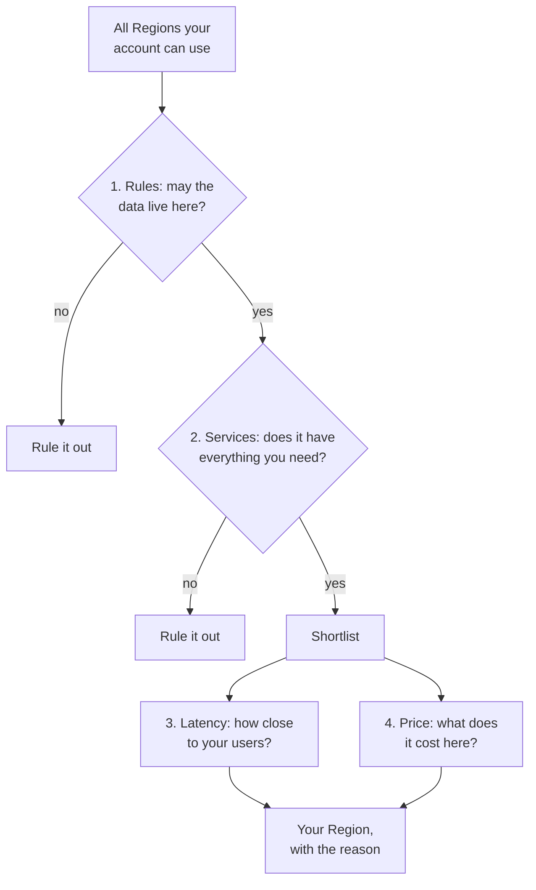

# Choose a Region by checking the rules first, then the services, then the distance to your users, then the price

Rules about where data may live, and the services you need, rule Regions out; distance to your users and price rank the rest. Use more than one Region only for a reason the exam names: disaster recovery, business continuity, users far apart, or data sovereignty.

**Exam guide:** [Domain 1, Cloud Concepts](https://docs.aws.amazon.com/aws-certification/latest/cloud-practitioner-02/cloud-practitioner-02-domain1.html) (24% of the exam): task [1.1](https://docs.aws.amazon.com/aws-certification/latest/cloud-practitioner-02/cloud-practitioner-02-domain1.html#cloud-practitioner-02-task1.1); [Domain 2, Security and Compliance](https://docs.aws.amazon.com/aws-certification/latest/cloud-practitioner-02/cloud-practitioner-02-domain2.html) (30% of the exam): task [2.2](https://docs.aws.amazon.com/aws-certification/latest/cloud-practitioner-02/cloud-practitioner-02-domain2.html#cloud-practitioner-02-task2.2); [Domain 3, Cloud Technology and Services](https://docs.aws.amazon.com/aws-certification/latest/cloud-practitioner-02/cloud-practitioner-02-domain3.html) (34% of the exam): task [3.2](https://docs.aws.amazon.com/aws-certification/latest/cloud-practitioner-02/cloud-practitioner-02-domain3.html#cloud-practitioner-02-task3.2).

**For:** an adult studying alone, possibly new to IT, who wants to understand AWS and use it safely. **Time:** about 12 minutes. Reading works on a phone.

**Before you start:** read [Regions, Availability Zones and data centers](01-regions-availability-zones-data-centers.md) first; the bakery scenario is in the [module brief](00-brief.md).

## Warm-up: what you remember

1. From lesson 03.01: you create a database in Europe (Frankfurt). Does AWS also keep a copy in another Region, in case Frankfurt fails?
2. From lesson 02.03: a company opens a site near customers abroad in two days. Which part is *global reach*, and which is *agility*?

Feedback

1. **No.** Resources stay in their Region unless you set up a copy.
2. **Global reach** is *where*: closer to customers, so less delay. **Agility** is *how fast*: two days, not a year.

## What you'll learn

By the end of this lesson, you can choose a Region for a workload and justify it, including when to use more than one Region (objective 03.02a).

Try this before you read on: a contract says German customers' data must stay in the European Union (EU). Is Europe (London) a safe choice?

## The big picture: two filters, then a trade-off

*Notice that latency and price never rescue a Region that fails a rule or lacks a service. They only rank the Regions that passed.*

**Long description.** A funnel from top to bottom. Start with all Regions your account can use. Question 1, rules: may the data live here? If no, rule it out. If yes, question 2, services: does it have everything you need? If no, rule it out. If yes, it joins the shortlist. The shortlist is weighed on latency (how close to your users) and price (what it costs here), which lead to your Region, with the reason.

## Rules first: decide where the data may live

A **compliance requirement** is a rule from a law, a regulator or a contract. **Data residency** is where data is physically stored; **data sovereignty** is keeping data under the control and laws that apply to it, often in particular countries. A Region that breaks a rule is out.

AWS gives you the control: you choose where your data is stored ([Data Privacy](https://aws.amazon.com/compliance/data-privacy/)). Complying with the laws that apply to you stays your job ([AWS Compliance Programs](https://aws.amazon.com/compliance/programs/)). Two traps:

- **Region names aren't legal borders.** Europe (London) is in the United Kingdom and Europe (Zurich) in Switzerland; neither is in the EU. So London is out for EU-only data. Check each Region's country in [AWS Regions](https://docs.aws.amazon.com/global-infrastructure/latest/regions/aws-regions.html).
- **Copies count too.** A backup or replica in another Region moves the data there.

## Then services, latency and price

**Services.** Not every service or feature is in every Region. Core services such as Amazon EC2, Amazon S3 and IAM come with every new Region, and many others usually follow within 12 months ([Regions and Availability Zones](https://aws.amazon.com/about-aws/global-infrastructure/regions_az/), checked 2026-10-23), so new Regions are the likeliest to lack something; check AWS's Services by Region list when you decide.

**Latency** is the delay between a request and its answer, and it grows with distance ([What is latency?](https://aws.amazon.com/what-is/latency/)). So pick the Region closest to your *users*. Choosing by your office's location is a mistake the Well-Architected Framework names in [SUS01-BP01 Choose Region based on both business requirements and sustainability goals](https://docs.aws.amazon.com/wellarchitected/latest/sustainability-pillar/sus_sus_region_a2.html).

**Price** differs by Region, because local costs such as land, power and taxes differ ([COST07-BP02 Choose Regions based on cost](https://docs.aws.amazon.com/wellarchitected/latest/cost-optimization-pillar/cost_pricing_model_region_cost.html)). Sending a GB to the internet, for example, cost $0.09 from US East (N. Virginia) and $0.15 from South America (São Paulo) (first 10 TB a month, AWS price list published 2026-09-16). Pay more only when a rule or latency requires it.

> **Example:** the bakery's German orders must stay in the EU, so London and Zurich are out. Its services are all core services. Frankfurt is in Germany, nearest the customers, at N. Virginia's transfer price. So the German site and its own order database go to Europe (Frankfurt); the US site stays in US East (N. Virginia).

## Use more than one Region only when you have a reason

Most workloads run in one Region. Running in more than one is **multi-Region**, and the exam guide lists four reasons for it (task [3.2](https://docs.aws.amazon.com/aws-certification/latest/cloud-practitioner-02/cloud-practitioner-02-domain3.html#cloud-practitioner-02-task3.2)):

| Reason | What it means | Bakery example |
|---|---|---|
| **Disaster recovery** | A copy to bring back if a whole Region fails | Backups of German data in a second EU Region (lesson 03.03) |
| **Business continuity** | Keep the business running through a major disruption | December orders keep coming in a rare Region-wide failure |
| **Low latency for users far apart** | Run near each group of users | US customers on `us-east-1`, German customers on `eu-central-1` |
| **Data sovereignty** | Keep each group's data where its rules say | German data in the EU, US data in the US |

It costs more and is harder: duplicate stacks, charges for data between Regions, a failover to practice. AWS believes most customers can meet their resilience goals in one Region with several AZs ([AWS Fault Isolation Boundaries](https://docs.aws.amazon.com/whitepapers/latest/aws-fault-isolation-boundaries/abstract-and-introduction.html)). Several AZs survive losing an AZ; only several Regions survive losing a Region. And a data rule applies to the second Region too.

> **Your turn:** the owner says, "If two AZs are good, two Regions must be better." Give her two reasons to slow down, and one case where she'd be right.

Model answer

Two Regions cost more and are harder to run, and for German data the second Region must also be in the EU. She'd be right if a Region-wide outage were unacceptable, or for users far apart, as her German customers already are.

## Summary

- **Two filters, then a trade-off:** rules and services rule Regions out; latency and price rank the rest.
- **Rules first.** You choose where data lives; complying is your job. Check the country, not the name, and keep every copy inside the allowed area.
- **Choose near your users, not your office.** Prices differ by Region; pay more only for a reason.
- **More than one Region** is for disaster recovery, business continuity, users far apart, or data sovereignty. Several AZs often suffice.

## Practice

1. **Which two are must-haves that can rule a Region out, before you compare anything else? (Select TWO.)**

   A. Rules about where the data may live\
   B. The price of the services\
   C. Whether the Region offers the services you need\
   D. How close the Region is to your office

   

Feedback

   **A and C are right.** A Region that breaks a rule, or lacks a service you need, is out, whatever else it offers.

   - **B is wrong.** Price ranks the Regions that pass.
   - **D is wrong.** Closeness to your office isn't a reason at all.

   

2. **Which is one of the reasons the exam guide gives for using more than one Region?**

   A. Each Region has only one Availability Zone.\
   B. Data sovereignty: keeping data in the places its rules require\
   C. AWS requires every production workload to run in two Regions.\
   D. Regions share power, so one Region is risky.

   

Feedback

   **B is right.** The four reasons are disaster recovery, business continuity, low latency for users far apart, and data sovereignty.

   - **A is wrong.** Every Region has at least three AZs.
   - **C is wrong.** AWS requires no such thing.
   - **D is wrong.** Regions are isolated from each other.

   

3. **A company keeps EU customers' data in Europe (Frankfurt) to meet a contract, and copies nightly backups to US East (N. Virginia) "for safety". What is wrong?**

   A. Nothing: backups don't count as data.\
   B. The backups take the data out of the EU; copy them to a second EU Region instead.\
   C. Backups must always stay in the same Region as the database.\
   D. AWS copies backups across Regions automatically, so the copy is redundant.

   

Feedback

   **B is right.** A backup is a copy of the customers' data, so a US copy breaks the contract.

   - **A is wrong.** Every copy counts.
   - **C is wrong.** A copy in another Region is how you survive losing the first; it must just be an allowed one.
   - **D is wrong.** AWS copies data between Regions only if you set it up.

   

**Next:** [Surviving failure](03-surviving-failure.md).

## Where to check the current details

- [AWS Regions](https://docs.aws.amazon.com/global-infrastructure/latest/regions/aws-regions.html), each Region's code and country (checked 2026-10-23)
- [AWS Services by Region](https://aws.amazon.com/about-aws/global-infrastructure/regional-product-services/) (checked 2026-10-24)
- [Data Privacy](https://aws.amazon.com/compliance/data-privacy/), AWS (checked 2026-10-23)

---

"Choosing a Region" by Automate the Cloud Inc., licensed under CC BY-NC 4.0 with the Additional Permission for Internal Training from Automate the Cloud Inc.
License: https://creativecommons.org/licenses/by-nc/4.0/
Permission: https://automatethe.cloud/licenses/atc-internal-training-permission.txt
