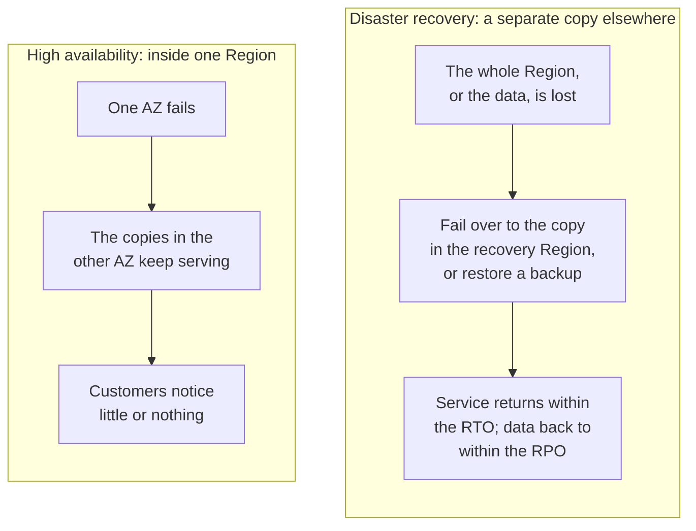
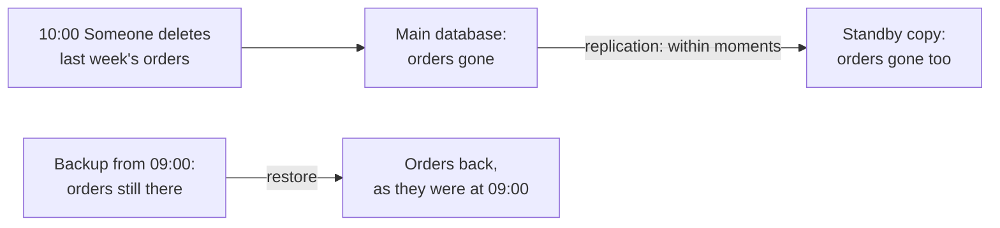
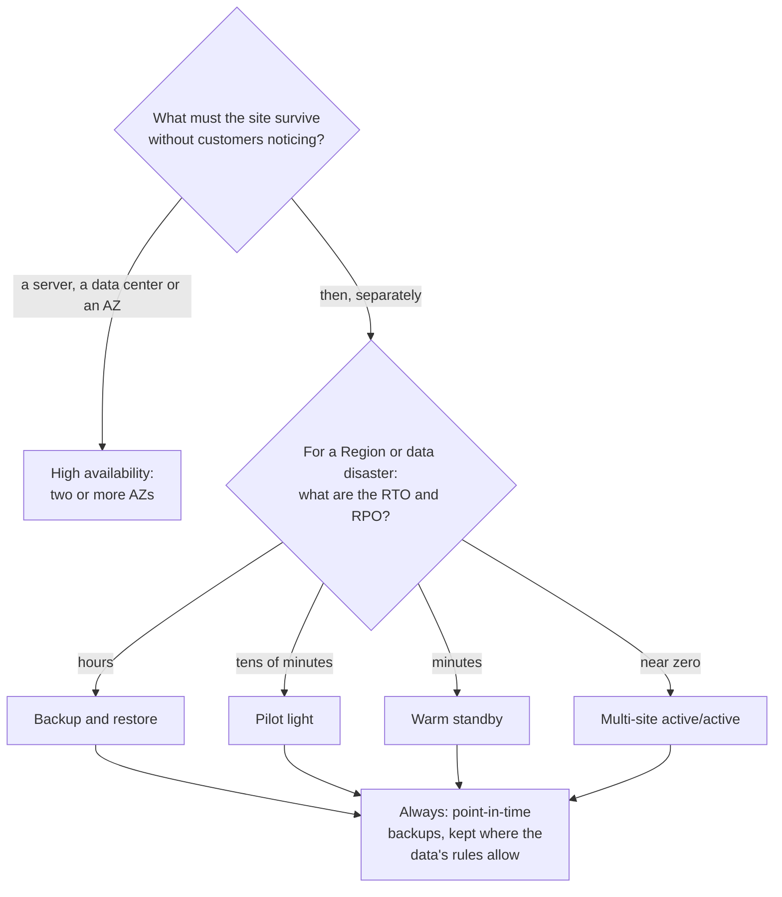

# High availability keeps the site running through a failure; disaster recovery brings it back after a bigger one

Running in two Availability Zones protects the bakery from losing a data center, but not from losing a whole Region, and not from a mistake that wipes its data. Those need a disaster recovery plan, sized by two numbers the business chooses: how long it can be down, and how much data it can lose. By the end of this lesson you can choose a resilience approach from those two numbers and a budget.

**For:** an adult studying alone, possibly new to IT, who wants to understand AWS and use it safely. **Time:** about 35 minutes. Reading works on a phone.

**Before you start:** this lesson builds on [Telling the benefits apart](../02-why-the-cloud/03-telling-the-benefits-apart.md) (high availability and durability), [Regions, Availability Zones and data centers](01-regions-availability-zones-data-centers.md) and [Choosing a Region](02-choosing-a-region.md). If you skipped them, the key terms below give you enough to follow. The bakery scenario is in the [module brief](00-brief.md).

## Warm-up: what you remember

Answer from memory before you look anything up.

1. In lesson 02.03, the bakery's site crashed in December because of too many orders. A friend said, "You need high availability." What was the better word, and why?
2. Amazon S3 Standard is designed for eleven nines of durability but four nines of availability (as of 2026-10-23). In one sentence each, what does each number promise?
3. From lesson 03.01: an Availability Zone is "one data center". True or false?

Feedback

1. **Elasticity.** The site failed because demand rose above capacity, not because a part broke. High availability is about surviving a failure.
2. **Durability:** the data will still exist later. **Availability:** you can reach it right now.
3. **False.** AWS describes an AZ as one or more separate data centers. Losing one data center and losing a whole AZ can be different events.

## What you'll learn

By the end of this lesson, you can:

- explain the difference between high availability and disaster recovery, and between RTO and RPO;
- name AWS's four disaster recovery strategies in order of cost and recovery speed;
- explain why copying data live to a second place doesn't replace backups;
- choose a resilience approach for a business from its RTO, its RPO and its budget (objective 03.03a).

Try these before you read on. Guess if you're unsure; the answers are in the lesson.

1. The bakery's order database has a standby copy in a second AZ that receives every change within moments. Someone deletes last week's orders by mistake. Does the standby save them?
2. Which costs more to run every month: a recovery plan that can take over in minutes, or one that takes hours?

## The big picture: how far a failure reaches

Failures come in sizes, and the further one reaches, the more you need in place beforehand.

![A ladder of four rungs from largest to smallest failure. A whole Region: protected by a copy of the site, or at least its data, in another Region, labeled disaster recovery. One Availability Zone: protected by servers and the database running in two or more AZs, labeled high availability. One data center: the same protection, more than one AZ, labeled high availability. One server: protected by a second server and automatic replacement, labeled high availability. A dashed box off the ladder: a mistake or attack on the data itself reaches every live copy; only a point-in-time backup undoes it.](../../images/03-03-blast-radius-ladder.svg)

*Notice two things. The bottom three rungs stay inside one Region and are handled by high availability; only the top rung needs a second Region. And the box off the ladder reaches every live copy, whatever the rung.*

**Long description.** Four rungs, each wider the further the failure reaches. A whole Region: a disaster or a large outage makes the Region unusable; protection is a copy of the site, or at least of its data, in another Region; this is disaster recovery. One Availability Zone: a flood or fire takes out every data center in the AZ; protection is servers and the database in two or more AZs; high availability. One data center: a power or cooling failure in one building; the same protection, because an AZ may be just one data center; high availability. One server: a disk fails or the server crashes; protection is a second server and automatic replacement; high availability. Off the ladder, in a dashed box: a mistake or an attack on the data itself, such as a deleted orders table, reaches every live copy at once; only a point-in-time backup from before the mistake undoes it.

People call how far a failure reaches its **blast radius**. You will use this ladder again in [Simulation S2](06-sim-blast-radius.md).

## Key terms (skip if you know them)

- **Disaster:** an event bigger than an ordinary failure. AWS names three kinds: natural (floods, earthquakes), technical (power or network failures) and human (mistakes, attacks) ([Disaster Recovery of Workloads on AWS](https://docs.aws.amazon.com/pdfs/whitepapers/latest/disaster-recovery-workloads-on-aws/disaster-recovery-workloads-on-aws.pdf), 2021).
- **Disaster recovery (DR):** getting a whole workload working again after a disaster, usually from a separate copy in another place.
- **Failover:** switching users from the failed copy to a working one.
- **Recovery Region:** the second Region where a DR plan keeps its copy.
- **Recovery time objective (RTO):** the longest the business accepts being down.
- **Recovery point objective (RPO):** the most data the business accepts losing, measured as time before the failure.
- **Replication:** copying every change to a second place as it happens.
- **Backup:** a saved copy of data as it was at one moment. A **point-in-time backup** lets you go back to that moment.

"Disaster" is an everyday word with a wider meaning here. In daily speech it means a catastrophe, such as a fire or a flood. In DR planning, a person deleting the wrong table is a disaster too, if it stops the business.

## High availability and disaster recovery answer different questions

High availability keeps the system running *through* the failure of one part. Disaster recovery brings the whole system back *after* a bigger event. AWS's DR whitepaper makes the same split: availability is about the components of a workload, and DR is about separate copies of the entire workload ([Disaster Recovery of Workloads on AWS](https://docs.aws.amazon.com/pdfs/whitepapers/latest/disaster-recovery-workloads-on-aws/disaster-recovery-workloads-on-aws.pdf), section "High availability is not disaster recovery").

*Notice how each panel ends. With high availability, customers notice little. With disaster recovery, service comes back after some downtime, perhaps with some data lost, but within limits set in advance.*

**Long description.** Two panels side by side. High availability, inside one Region: one AZ fails; the copies in the other AZ keep serving; customers notice little or nothing. Disaster recovery, a separate copy elsewhere: the whole Region, or the data, is lost; the workload fails over to the copy in the recovery Region, or a backup is restored; service returns within the RTO, and data is back to within the RPO.

| | High availability | Disaster recovery |
|---|---|---|
| The question | Can the system keep working when a part fails? | Can we bring the whole system back after a disaster, and how fast? |
| What it protects | Components: a server, a data center, an AZ | Whole copies of the workload |
| Usual place | Two or more AZs in one Region | A second Region, and backups |
| How it's measured | Percentage of time the system works (the "nines" from lesson 02.03) | RTO and RPO |
| Bakery example | Two web servers and a standby database in two AZs (lesson 03.01) | Backups of the orders copied to a second Region |

The two share tools, such as monitoring and automatic failover, and AWS says to make a workload highly available first. But neither replaces the other.

### "High availability is the same as disaster recovery" is wrong

A common belief is that a highly available system needs no disaster recovery plan. It still needs one. Spreading a system over three AZs gets it through a flood in one of them. A Region-wide outage, or a mistake that deletes its data, takes a separate copy and a plan to use it.

> **Example (AWS Health Dashboard, checked 2026-10-25):** since March 2026, AWS's Middle East (UAE) Region, `me-central-1`, has been "unable to reliably support customer applications", in AWS's words. In its update of 2026-09-15, AWS said it was "unable to restore access to the resources and data hosted exclusively in the mec1-az2 Availability Zone", and that "most customers have been able to re-establish their operations in other Regions by restoring backups or copying data that remained accessible" ([AWS Health Dashboard](https://health.aws.amazon.com/health/status)). Data kept in one place was lost, and customers with a copy elsewhere recovered. The top rung of the ladder does happen.

It's an easy mistake to make: the same tools serve both, and a multi-AZ design does survive the smallest disasters. Use the ladder: high availability covers the lower rungs; DR covers the top rung and the box beside it.

> **Your turn:** The bakery's website runs on two servers in two AZs of Europe (Frankfurt), and its database has a standby in the second AZ. The owner says, "So we're safe from any disaster." In two sentences, tell her what this setup protects against, and what it doesn't.

Model answer

It keeps the site running if a server, a data center or a whole AZ fails, because the copies in the other AZ take over: that is high availability. It doesn't protect against losing the whole Frankfurt Region, or against a mistake that damages the order data, because every live copy is in that Region and receives every change; for those, the bakery needs backups and a plan to restore them elsewhere.

## RTO and RPO: how long you can be down, and how much you can lose

Every DR plan starts with two numbers that the business sets. AWS defines them like this ([Disaster Recovery of Workloads on AWS](https://docs.aws.amazon.com/pdfs/whitepapers/latest/disaster-recovery-workloads-on-aws/disaster-recovery-workloads-on-aws.pdf); [Disaster Recovery (DR) objectives](https://docs.aws.amazon.com/wellarchitected/latest/reliability-pillar/disaster-recovery-dr-objectives.html)):

- **Recovery time objective (RTO):** the longest acceptable delay between the service stopping and working again. It looks *forward* from the failure.
- **Recovery point objective (RPO):** the longest acceptable time between the last saved copy of the data (the *recovery point*) and the failure; everything after it is lost. It looks *back* from the failure.

*Notice that the failure sits in the middle. Data loss is measured back to the last backup; downtime is measured forward to the restart. Improving one doesn't improve the other.*

**Long description.** A time line from 00:00 to 16:00 with three events, made up for teaching. At 02:00, the last good backup: the recovery point. At 10:00, the bakery's order database is lost and orders stop. At 14:00, the site is taking orders again. A span from 02:00 to 10:00 is labeled "Data lost: 8 hours of orders". A span from 10:00 to 14:00 is labeled "Downtime: 4 hours". RPO is the most data loss the business accepts, measured back from the failure; RTO is the most downtime it accepts, measured forward.

| Made-up event | Time | Measures |
|---|---|---|
| Last good backup | 02:00 | Data lost: 8 hours, back to here (RPO side) |
| Database lost | 10:00 | The failure |
| Site taking orders again | 14:00 | Downtime: 4 hours, forward to here (RTO side) |

A way to keep them apart: the **P** in RPO is a **point** in your data; the **T** in RTO is **time** without service.

The numbers come from what a failure costs the business: an hour down costs a ticket website far more than a bakery that can take phone orders. AWS adds a warning: if a recovery plan costs more than the loss it prevents, don't build it, unless something else, such as a regulation, requires it.

> **Check:** The bakery's owner says, "If the site goes down, it must be back within two hours. And we can't lose more than 15 minutes of orders." Which statement is right?
>
> A. RTO is 15 minutes; RPO is 2 hours.\
> B. RTO is 2 hours; RPO is 15 minutes.\
> C. Both are 2 hours, because the larger number decides.

Feedback

**B is right.** "Back within two hours" is downtime: RTO. "Lose no more than 15 minutes of orders" is data: RPO. To meet it, the bakery needs a saved copy of its orders at least every 15 minutes.

- **A is wrong.** It swaps them. Time without service is RTO; the gap back to the last saved point is RPO.
- **C is wrong.** They measure different things and are met in different ways: frequent copies for RPO, fast restart for RTO.

## Four strategies, from cheap and slow to costly and fast

AWS groups disaster recovery into four strategies. Each step keeps more running in the recovery Region, so it costs more and is more complex, and recovers faster with less data lost ([Disaster recovery options in the cloud](https://docs.aws.amazon.com/whitepapers/latest/disaster-recovery-workloads-on-aws/disaster-recovery-options-in-the-cloud.html)).

![Four boxes rising like stairs from left to right. Backup and restore, recovery in hours: backups copied to the recovery Region, everything else rebuilt after the disaster. Pilot light, tens of minutes: data copied continuously, the database runs, app servers off until needed. Warm standby, minutes: a smaller copy of the whole site always running, scaled up to take over. Multi-site active/active, real time: full copies in two or more Regions, all serving customers. Running cost and complexity rise to the right; recovery time falls. No scale or prices.](../../images/03-03-dr-strategies.svg)

*Notice that the axes have no numbers: AWS gives an order and typical ranges, not prices. Each step right buys faster recovery with more money spent every month.*

**Long description.** Four boxes rise like stairs from left to right. Moving right, running cost and complexity rise and typical recovery time falls. Backup and restore, hours: backups of data and setup are copied to the recovery Region, and everything else is rebuilt after the disaster. Pilot light, tens of minutes: data is copied continuously and the database runs; app servers are off until needed. Warm standby, minutes: a smaller copy of the whole site is always running and is scaled up to take over. Multi-site active/active, real time or near zero: full copies in two or more Regions all serve customers at once.

| Strategy | What runs in the recovery Region before a disaster | Typical RTO and RPO |
|---|---|---|
| **Backup and restore** | Only backups of the data and setup; servers are rebuilt after the disaster | Hours |
| **Pilot light** | Data copied continuously; core parts such as the database on; app servers off | Tens of minutes |
| **Warm standby** | A smaller but complete working copy; it only has to scale up | Minutes |
| **Multi-site active/active** | Full copies in two or more Regions, all serving customers | Near zero (real time) |

The ranges are AWS's typical figures (2021 whitepaper, checked 2026-10-24). Real times depend on how well the plan is built and tested.

AWS's figure gives one range for RTO and RPO together, but the two can differ. A pilot light, like a warm standby, copies data continuously to live databases in the recovery Region, which AWS calls the best approach for a low RPO. So a pilot light can lose only minutes of data, or less, even though switching it on takes tens of minutes. Check the RTO and the RPO separately.

Three details help on the exam and at work:

- **Pilot light vs warm standby** is a pair AWS itself calls hard to tell apart. Ask: *could it serve a customer right now?* A pilot light can't until its app servers are switched on; a warm standby can, at reduced size.
- **Backup and restore needs infrastructure as code.** Rebuilding by hand during a disaster is slow and error-prone, so AWS recommends describing the setup as code (Module 08), and backing up that code with the data.
- **Hot standby** is a variation of the last step: a full second copy that takes no customers until a failover.

Two AWS services do much of this work: **AWS Backup** schedules backups across many services and can copy them to another Region, and **AWS Elastic Disaster Recovery** continuously copies whole servers so they can be launched in minutes, a pilot light approach ([What is AWS Backup?](https://docs.aws.amazon.com/aws-backup/latest/devguide/whatisbackup.html); [What is Elastic Disaster Recovery?](https://docs.aws.amazon.com/drs/latest/userguide/what-is-drs.html)). Module 05 compares them.

> **Check:** A company wants a copy in a second Region that can serve customers immediately, at lower capacity, if the main Region fails. It doesn't want both Regions serving customers every day. Which strategy fits?
>
> A. Backup and restore\
> B. Pilot light\
> C. Warm standby\
> D. Multi-site active/active

Feedback

**C is right.** A warm standby is a smaller, fully working copy that can take traffic at once and then scale up.

- **A is wrong.** Nothing is running in the second Region; it must be rebuilt first.
- **B is wrong.** In a pilot light the app servers are off, so it can't serve customers until they're switched on.
- **D is wrong.** Active/active serves customers from both Regions all the time, which the company doesn't want.

## Replication copies your mistakes; backups undo them

Replication protects you from losing a *place*. A backup protects you from losing the *data*. You usually need both.

When data is replicated, every change reaches the copy within moments, including the bad ones. AWS's DR whitepaper says so directly: deletions and corruption on the main storage are carried to the second copy, so a point-in-time backup is still needed ([Disaster Recovery of Workloads on AWS](https://docs.aws.amazon.com/pdfs/whitepapers/latest/disaster-recovery-workloads-on-aws/disaster-recovery-workloads-on-aws.pdf)).

*Notice that the standby did exactly its job: it copied the change. Only the backup, which stopped changing at 09:00, still holds the orders.*

**Long description.** At 10:00 someone deletes last week's orders. The main database loses them. Replication carries the deletion to the standby copy within moments, so its orders are gone too. A backup taken at 09:00 still holds the orders; restoring it brings them back as they were at 09:00.

### "Replication replaces backup" is wrong

You may have heard that a database with a live copy in another AZ or Region doesn't need backups. It does. Replication faithfully copies deletions, corruption and changes made by an attacker. Only a copy that *stops changing*, a point-in-time backup, lets you go back to before the damage. Even multi-site active/active, AWS notes, needs backups for data disasters, and recovering from them means some data loss.

It's tempting because replication *looks* like a backup: a second copy, often elsewhere. The difference is time: a replica shows the data as it is now; a backup, as it was.

On AWS, point-in-time copies include Amazon RDS backups and snapshots, and Amazon S3 **versioning**, which keeps earlier versions of each object (Module 05). This is the limit of durability from lesson 02.03: it protects data from failing hardware, not from you.

> **Your turn:** Answer the first prequestion now. The bakery's standby database receives every change within moments. Last week's orders are deleted by mistake. What happens to the standby, and what would actually bring the orders back?

Model answer

The standby deletes them too, within moments, because it copies every change. Only a point-in-time backup taken before the deletion, such as an RDS snapshot, can bring them back; orders placed after that backup must be recovered another way.

## Worked example: a resilience plan for the bakery

The owner sets the requirements. "The site must survive losing a data center without anyone noticing. If something bigger happens, I can take phone orders for a day. Losing a few hours of orders is painful but survivable, because every order also sends an email I can rebuild from. And German customers' data must stay in the EU." The budget is small.

Here is how someone who knows the material works it out, with the flowchart as the method.

*Notice the two separate questions: high availability answers the first, the RTO and RPO answer the second, and every path ends in backups.*

**Long description.** A decision flowchart. First question: what must the site survive without customers noticing? A server, a data center or an AZ: high availability, in two or more AZs. Then, separately, a second question: for a Region or data disaster, what are the RTO and RPO? Hours: backup and restore. Tens of minutes: pilot light. Minutes: warm standby. Near zero: multi-site active/active. Every strategy then leads to the same box: always keep point-in-time backups, stored where the data's rules allow.

1. **Survive a data center, unnoticed.** A lower rung, so high availability. Lesson 03.01's design already does it: two web servers and a standby database across two AZs.
2. **Write down the DR numbers.** "Phone orders for a day" means an **RTO of about a day**. "A few hours of orders" means an **RPO of a few hours**.
3. **Pick the cheapest strategy that meets both.** Backup and restore recovers in hours, inside a day. A pilot light would keep a database running in a second Region all year, to save time the owner doesn't need. **Choose backup and restore.**
4. **Place the copies by the data rules.** German customers' backups go to a second EU Region, such as Europe (Ireland), never to the US; US backups can go to US East (Ohio). The recovery Region inherits the data's rules.
5. **Set the backup schedule from the RPO,** at least every few hours, and keep the setup as code so it can be rebuilt within the day.
6. **Test it.** Restore into the recovery Region now and then, and time it. An untested plan is a guess.

The expert started from what the business can live with, not from the most impressive design, and bought exactly that much protection.

> **Your turn:** Two years later the bakery takes most orders online, and a day of downtime would lose too much money. The owner's new numbers are an RTO of 30 minutes and an RPO of 5 minutes, with a larger budget. Which strategy would you now suggest, and why not the one on either side of it?

Model answer

**Pilot light.** Its typical recovery takes tens of minutes, which fits 30 minutes, and continuously copied data keeps the RPO in minutes. Backup and restore usually takes hours: too slow. Warm standby would also work, but keeps a whole copy running, so it costs more than needed. Test that the switch-on really fits in 30 minutes; if not, move up to warm standby.

## In real work: plan recovery like a reliability engineer

At work, resilience is a business decision first: engineers ask for the RTO and RPO, cost the options, and test the result. The Well-Architected **reliability** pillar spells this out:

- [REL13-BP01 Define recovery objectives for downtime and data loss](https://docs.aws.amazon.com/wellarchitected/latest/reliability-pillar/rel_planning_for_recovery_objective_defined_recovery.html).
- [REL13-BP02 Use defined recovery strategies to meet the recovery objectives](https://docs.aws.amazon.com/wellarchitected/latest/reliability-pillar/rel_planning_for_recovery_disaster_recovery.html).
- [REL09-BP04 Perform periodic recovery of the data to verify backup integrity and processes](https://docs.aws.amazon.com/wellarchitected/latest/reliability-pillar/rel_backing_up_data_periodic_recovery_testing_data.html).
- [REL10-BP01 Deploy the workload to multiple locations](https://docs.aws.amazon.com/wellarchitected/latest/reliability-pillar/rel_fault_isolation_multiaz_region_system.html), which is the high availability half.

The reliability design principle "[Test recovery procedures](https://docs.aws.amazon.com/wellarchitected/latest/framework/rel-dp.html)" says the same thing as step 6: in the cloud, you can rehearse a failure cheaply, so do it.

Resilience follows the split you will meet in Module 04: AWS's DR whitepaper calls the Regions and AZs resiliency *of* the cloud, which is AWS's job, and using them well resiliency *in* the cloud, which is yours. A site on one server in one AZ isn't highly available just because it runs on AWS. And every step up the DR ladder is a **cost optimization** trade-off: it costs money every month, disaster or not.

## Summary

- **How far a failure reaches decides the protection.** A server, a data center or an AZ: high availability, in two or more AZs. A whole Region: disaster recovery, with a copy in another Region.
- **High availability isn't disaster recovery.** One keeps components working; the other brings the whole workload back.
- **RTO is the longest acceptable downtime; RPO is the most data you accept losing,** measured back from the failure. The business sets both.
- **Four DR strategies,** cheapest and slowest first: backup and restore (hours), pilot light (tens of minutes), warm standby (minutes), multi-site active/active (real time). Choose the cheapest that meets the RTO and RPO.
- **Replication copies mistakes; backups undo them.** Every strategy still needs point-in-time backups.

**For the bakery's plan:** you now have its resilience approach: two AZs for high availability, backup and restore for Region disasters, and backups that keep German data in the EU.

## Practice

1. **A company runs its application in three Availability Zones of one Region. Which event does this design NOT protect it against?**

   A. A power failure in one data center\
   B. A flood that closes one Availability Zone\
   C. A failed disk in one server\
   D. A large disaster that makes the whole Region unusable

   

Feedback

   **D is right.** All three AZs are in one Region, so losing it stops everything; that needs disaster recovery in another Region.

   - **A is wrong.** A data center is inside one AZ; the other AZs keep running.
   - **B is wrong.** Surviving the loss of one AZ is exactly what a multi-AZ design is for.
   - **C is wrong.** One failed disk is the smallest rung; the other copies keep serving.

   

2. **Put AWS's four disaster recovery strategies in order, from lowest running cost to highest.**

   

Feedback

   **Backup and restore, pilot light, warm standby, multi-site active/active.** Recovery time runs the other way: hours, tens of minutes, minutes, near zero. If you swapped the middle two, ask which can serve customers right now: only warm standby, so it costs more.

   

3. **A colleague says, "We replicate our database to another Region every second, so we don't need backups." Explain in two sentences why that's wrong.**

   

Feedback

   **Model answer:** Replication copies every change to the other Region, including a mistaken deletion, corruption or an attacker's changes, so the copy is damaged along with the original. Only a point-in-time backup, a copy that stopped changing before the damage, lets you go back to good data.

   

4. **(From lesson 02.05.) Which Well-Architected pillar covers recovering from failures and planning for disasters, and which pillar does the monthly cost of a warm standby concern?**

   

Feedback

   **Reliability** covers recovering from failure; the standby's cost concerns **cost optimization**. The RTO and RPO settle the trade-off between them.

   

**Next:** [The edge](04-the-edge.md). To practice choosing strategies, try [Simulation S2: the blast-radius ladder](06-sim-blast-radius.md).

## Where to check the current details

- [Disaster Recovery of Workloads on AWS: Recovery in the Cloud](https://docs.aws.amazon.com/pdfs/whitepapers/latest/disaster-recovery-workloads-on-aws/disaster-recovery-workloads-on-aws.pdf), AWS whitepaper, published 2021-02-12 (checked 2026-10-24)
- [Disaster recovery options in the cloud](https://docs.aws.amazon.com/whitepapers/latest/disaster-recovery-workloads-on-aws/disaster-recovery-options-in-the-cloud.html), the same whitepaper online (checked 2026-10-24)
- [Disaster Recovery (DR) objectives](https://docs.aws.amazon.com/wellarchitected/latest/reliability-pillar/disaster-recovery-dr-objectives.html), Reliability Pillar (checked 2026-10-24)
- [AWS Regions and Availability Zones](https://docs.aws.amazon.com/global-infrastructure/latest/regions/aws-regions-availability-zones.html), AWS documentation (checked 2026-10-23)
- [What is AWS Backup?](https://docs.aws.amazon.com/aws-backup/latest/devguide/whatisbackup.html) and [What is Elastic Disaster Recovery?](https://docs.aws.amazon.com/drs/latest/userguide/what-is-drs.html), AWS documentation (checked 2026-10-23)
- [AWS Certified Cloud Practitioner (CLF-C02) exam guide](https://docs.aws.amazon.com/aws-certification/latest/cloud-practitioner-02/cloud-practitioner-02.html), task [3.2](https://docs.aws.amazon.com/aws-certification/latest/cloud-practitioner-02/cloud-practitioner-02-domain3.html#cloud-practitioner-02-task3.2) (checked 2026-10-24)

---

"Surviving failure" by Automate the Cloud Inc., licensed under CC BY-NC 4.0 with the Additional Permission for Internal Training from Automate the Cloud Inc.
License: https://creativecommons.org/licenses/by-nc/4.0/
Permission: https://automatethe.cloud/licenses/atc-internal-training-permission.txt
