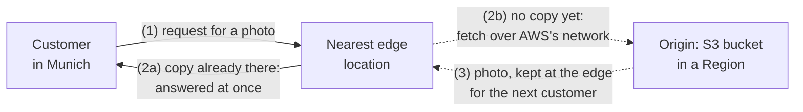
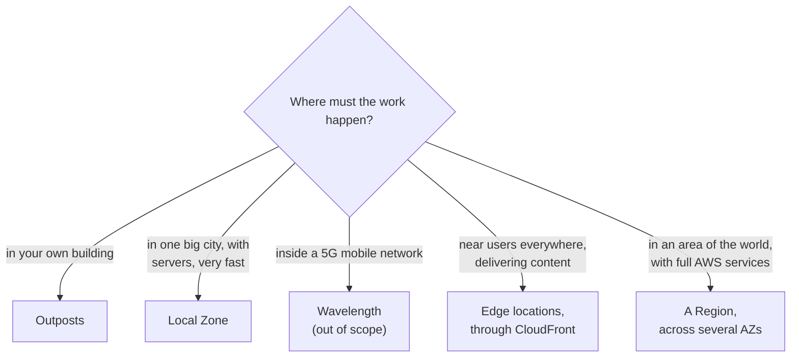

# Edge locations bring AWS's network close to your users; Local Zones and Outposts bring its computers close to a city or into your building

Regions are few and far apart, but your customers are everywhere. AWS closes the gap in two ways: many small **edge locations** that deliver content and answer requests near users, and a few ways to run your own servers outside a Region: **Local Zones**, **Outposts** and **Wavelength Zones**. By the end of this lesson you can say where each one physically is and what it's for.

**For:** an adult studying alone, possibly new to IT, who wants to understand AWS and use it safely. **Time:** about 25 minutes. Reading works on a phone.

**Before you start:** this lesson builds on [Telling the benefits apart](../02-why-the-cloud/03-telling-the-benefits-apart.md) (latency and global reach) and [Regions, Availability Zones and data centers](01-regions-availability-zones-data-centers.md). If you skipped them, the key terms below cover what you need. The bakery scenario is in the [module brief](00-brief.md).

## Warm-up: what you remember

Answer from memory before you look anything up.

1. From lesson 02.03: what is latency, and what makes it grow?
2. From lesson 02.01: a company keeps some systems in its own building and some on AWS, connected together. Which deployment model is that?
3. From lesson 03.03: the bakery copies backups of its German orders to a second Region. Why must that Region be in the EU?

Feedback

1. **Latency** is the delay between a user's request and the response. It grows with distance, so serving users from somewhere near them lowers it.
2. **Hybrid.** Keep it in mind: one of the options in this lesson, Outposts, is a way to build exactly that.
3. German customers' data must stay in the EU, and a backup is a copy of that data. **The recovery Region inherits the data's rules.**

## What you'll learn

By the end of this lesson, you can:

- explain what edge locations are, how they relate to Regions and Availability Zones, and why they make sites faster;
- say what Amazon CloudFront, Amazon Route 53 and AWS Global Accelerator each do at the edge;
- say where Local Zones, Outposts and Wavelength Zones physically are, and what each is for (objective 03.04a).

Try these before you read on. Guess if you're unsure; the answers are in the lesson.

1. The bakery's cake photos are stored in a bucket in US East (N. Virginia). A customer in Munich opens the order page. Must every photo travel across the Atlantic each time?
2. Is an edge location a small Availability Zone where you could run the bakery's web server?

## The big picture: few Regions, many edge locations

Regions are large groups of data centers in a limited number of places. Edge locations are much smaller sites in many more cities. AWS's own network links them all.

*Notice the customer's path. The first hop goes to the nearest edge location, which is close by. Only when the edge can't answer by itself does the request travel on, over AWS's network, to a Region.*

**Long description.** A schematic, not a map. Three panels: North America, Europe and Asia Pacific. Each holds two Region boxes, each with three small Availability Zone squares inside, and about eight small dots for edge locations, scattered more widely. In the Europe panel, a customer connects by a short solid line to the nearest edge location; a dashed line runs from that edge location to a Region, used when the edge can't answer by itself. Dashed lines under the panels show AWS's own global network linking Regions and edge locations. The number and position of shapes are illustrative.

## Key terms (skip if you know them)

- **Edge location:** a small AWS site in a city, close to internet users, that runs a few AWS networking services. AWS also calls these sites **points of presence (PoPs)**.
- **Content delivery network (CDN):** a network of servers in many places that keeps copies of content near users, so it arrives faster.
- **Cache:** a stored copy kept close by so it can be served again quickly. To **cache** is to keep such a copy.
- **Origin:** the place where the original content lives, such as an S3 bucket in a Region.
- **Domain Name System (DNS):** the internet's address book. It turns a name like `example.com` into the network address of a server.
- **Local Zone, Outposts, Wavelength Zone:** three ways to run AWS servers outside a Region: in a big city, in your own building, and inside a mobile phone network.

"Edge" is an everyday word used in a narrow sense. In daily speech, an edge is the outer border of something. Here it means **the part of AWS's network nearest to users**, which can be in the middle of a city.

## Edge locations deliver and answer close to users; they don't run your servers

An edge location is not a small Region or a small Availability Zone. It runs a short list of AWS networking services, and it exists so that requests travel a short distance before AWS answers them. You can't launch an EC2 server in one.

How they relate to the rest:

- **A Region** holds at least three Availability Zones (lesson 03.01). Your servers, databases and storage live there.
- **Edge locations** sit outside the Regions, in many more cities, often beside or inside internet providers' networks. AWS's own network connects them to the Regions ([Amazon CloudFront key features](https://aws.amazon.com/cloudfront/features/)).
- **Three main services run at edge locations:** Amazon CloudFront, Amazon Route 53 and AWS Global Accelerator. AWS designs each site to be isolated from the others, so a problem at one doesn't spread ([AWS Fault Isolation Boundaries](https://docs.aws.amazon.com/whitepapers/latest/aws-fault-isolation-boundaries/abstract-and-introduction.html), 2022).
- **Some features ride along with them.** AWS WAF and AWS Shield Advanced, when used with CloudFront, also do their work at the edge, and CloudFront's edge functions (CloudFront Functions and Lambda@Edge) run small pieces of your code close to viewers ([Global services](https://docs.aws.amazon.com/whitepapers/latest/aws-fault-isolation-boundaries/global-services.html); [Customize at the edge with functions](https://docs.aws.amazon.com/AmazonCloudFront/latest/DeveloperGuide/edge-functions.html)). They add filtering or small tweaks to requests; none of them gives you a server.

Edge locations give you three benefits: faster answers, because the first trip is short; fewer requests reaching your servers, because the edge answers many; and attack traffic absorbed far from your servers. CloudFront includes AWS Shield Standard, which protects against common network attacks, at no extra cost (checked 2026-10-23; Module 09 covers Shield).

> **Dated (checked 2026-10-23):** don't memorize these counts. When we checked, AWS's CloudFront features page listed more than 750 points of presence in more than 100 cities across more than 50 countries, plus more than 1,140 smaller "embedded" points of presence inside internet providers' networks. For Region and AZ counts, see the dated box in [lesson 03.01](01-regions-availability-zones-data-centers.md) or AWS's [Global Infrastructure](https://aws.amazon.com/about-aws/global-infrastructure/) page. Older material quotes smaller numbers, so learn the pattern rather than the number.

> **Your turn:** Answer the second prequestion in two sentences: is an edge location a small Availability Zone where the bakery could run its web server?

Model answer

No. An Availability Zone is one or more full data centers inside a Region, where you run servers and databases; an edge location is a smaller site outside the Regions that runs AWS's networking services, such as CloudFront, but never your own servers. The bakery's web server runs in AZs, and edge locations help deliver its pages and photos to customers faster.

## Three services use the edge, each in its own way

CloudFront, Route 53 and Global Accelerator all run at edge locations, and exam questions often offer them side by side. This is a preview; Module 07 teaches them fully.

**Amazon CloudFront** is AWS's content delivery network. A request goes to the edge location with the lowest latency for that user. If the edge already has a cached copy, it answers at once. If not, it fetches the content from your origin, such as an S3 bucket, over AWS's network, keeps a copy, and serves it ([What is Amazon CloudFront?](https://docs.aws.amazon.com/AmazonCloudFront/latest/DeveloperGuide/Introduction.html); [How CloudFront delivers content](https://docs.aws.amazon.com/AmazonCloudFront/latest/DeveloperGuide/HowCloudFrontWorks.html)).

*Notice that the long trip to the Region (dashed) happens only when the edge has no copy yet. After that, nearby customers get the photo from the edge.*

**Long description.** A customer in Munich sends a request for a photo to the nearest edge location. If the edge already has a copy, it answers at once. If not, shown dashed, the edge fetches the photo from the origin, an S3 bucket in a Region, over AWS's network; the photo comes back and is kept at the edge for the next customer.

**Amazon Route 53** is AWS's DNS service. It answers the question "where is this site?" with an address, and it can choose the answer: for example, the Region with the lowest latency for this user, the Region for the user's location, or a standby when the main site fails its health checks ([What is Amazon Route 53?](https://docs.aws.amazon.com/Route53/latest/DeveloperGuide/Welcome.html); [Choosing a routing policy](https://docs.aws.amazon.com/Route53/latest/DeveloperGuide/routing-policy.html)). That last ability is one way a DR plan from lesson 03.03 can send customers to the recovery Region.

**AWS Global Accelerator** gives an application fixed internet addresses that AWS announces from its edge locations. A user's traffic enters AWS's network at the nearest edge and travels on AWS's network to the best healthy endpoint in a Region. It doesn't cache anything ([What is AWS Global Accelerator?](https://docs.aws.amazon.com/global-accelerator/latest/dg/what-is-global-accelerator.html)).

| | Amazon CloudFront | Amazon Route 53 | AWS Global Accelerator |
|---|---|---|---|
| What it does | Delivers content, keeping cached copies at the edge | Answers DNS questions: tells users where to go | Carries traffic from the nearest edge to your application, over AWS's network |
| Keeps copies of content? | Yes | No | No |
| Typical use | Websites, images, video, downloads for users worldwide | Your domain names; sending users to the right Region or to a standby | Fixed addresses for an application; non-web traffic such as games; fast switching between Regions |
| Bakery example | Cake photos served from near each customer | `bakery.example` sends German customers to Frankfurt | Not needed: the bakery's traffic is ordinary web pages |

**Route 53 is not a CDN.** You may read that Route 53 delivers content. It doesn't: it only answers "where is it?", and the content comes from elsewhere, often CloudFront. The mix-up is tempting because both run at edge locations and are often used together.

> **Check:** A video-streaming company wants viewers around the world to load its video files faster, and to reduce the load on its storage in one Region. Which service fits best?
>
> A. Amazon Route 53\
> B. Amazon CloudFront\
> C. AWS Global Accelerator\
> D. A second Availability Zone

Feedback

**B is right.** CloudFront keeps copies of the files at edge locations near viewers, which makes delivery faster and sends fewer requests to the origin.

- **A is wrong.** Route 53 answers name lookups; it doesn't deliver or cache the videos.
- **C is wrong.** Global Accelerator speeds up the network path but keeps no copies, so every request still reaches the origin.
- **D is wrong.** A second AZ adds high availability in the same Region; it doesn't bring content closer to viewers abroad.

## Local Zones, Outposts and Wavelength run AWS servers outside a Region

Sometimes the computing itself must run closer: a game server that must answer within milliseconds, or a factory system that can't wait for a distant Region. Edge locations can't run your servers, so AWS offers three other options. Each one extends a Region: it connects back to a parent Region and works with the services there.

![Four cards. Edge location: in many cities, beside and inside internet providers' networks; runs CloudFront, Route 53 and Global Accelerator, plus features that work through them such as AWS WAF, not your servers; for delivering content and answering requests close to users. Local Zone: in a large city away from the Region it extends; runs selected services such as compute, storage and databases; for single-digit-millisecond latency in that city and keeping data there. Outposts: in your own building; AWS-managed racks or servers, with you providing space, power and network; for low latency to on-site systems, local processing and keeping data on site. Wavelength Zone, with a dashed border: inside a telecom carrier's 5G network; runs compute and storage; for ultra-low latency to mobile devices; out of scope for CLF-C02 as a service.](../../images/03-04-edge-options.svg)

*Notice the first line of each card: the location is what tells them apart. The dashed card is the one the exam lists as out of scope.*

**Long description.** Four cards. Edge location: in many cities worldwide, beside and inside internet providers' networks; runs CloudFront, Route 53 and Global Accelerator, plus features that work through them such as AWS WAF, but not your own servers; used for delivering content and answering requests close to users. Local Zone: in a large city away from the Region it extends; runs selected services such as compute, storage and databases; used for single-digit-millisecond latency for users in that city and for keeping data there. Outposts: in your own building; AWS racks or servers that AWS manages, while you provide space, power and network; used for low latency to on-site systems, local processing and keeping data on site. Wavelength Zone, dashed: inside a telecom carrier's 5G network, extending a Region; runs compute and storage such as EC2 instances; used for ultra-low latency to phones and other mobile devices; out of scope for CLF-C02 as a service.

**AWS Local Zones** put compute, storage, databases and other selected services in large cities, close to people and industry ([What is AWS Local Zones?](https://docs.aws.amazon.com/local-zones/latest/ug/what-is-aws-local-zones.html)). Each Local Zone extends a parent Region. AWS describes uses such as real-time games, live streaming and virtual workstations that need single-digit-millisecond latency, and meeting rules that keep data in a state or city. You turn a Local Zone on before using it; turning it on is free, and you pay for what you run there (as of 2026-10-23).

**AWS Outposts** brings AWS's hardware, services and tools into your own data center or site. AWS delivers racks or smaller servers, then operates, monitors and maintains them as part of a Region; each Outpost extends an Availability Zone ([What is AWS Outposts?](https://docs.aws.amazon.com/outposts/latest/userguide/what-is-outposts.html)). It suits systems that must be very close to on-site equipment and data that must stay on the premises: the **hybrid** deployment model from lesson 02.01. Note the responsibility shift: AWS maintains the hardware; you provide the building, power and network connection.

**AWS Wavelength** places AWS compute and storage inside telecom carriers' 5G networks, for applications that need very low latency to mobile devices ([What is AWS Wavelength?](https://docs.aws.amazon.com/wavelength/latest/developerguide/what-is-wavelength.html)). The CLF-C02 exam guide lists Wavelength as **out of scope** as a service (checked 2026-10-24). Know it well enough to recognize it as a wrong answer: if an option mentions 5G carriers and the question isn't about mobile networks, it's a distractor.

### Region, AZ, edge location, Local Zone, Outposts: where is it?

These five are the module's most confused group. One question separates them: **where is it, physically?**

| Name | Where it physically is | What you can run there | Choose it when |
|---|---|---|---|
| **Region** | A geographic area with at least three AZs | Almost every AWS service | You need to place a workload: near users, under the right laws |
| **Availability Zone** | One or more data centers inside a Region | Your servers and databases | You need copies that survive one location failing (lesson 03.03) |
| **Edge location** | Many cities, near internet users, outside the Regions | CloudFront, Route 53 and Global Accelerator, plus features that work through them, such as AWS WAF; never your own servers | You want content delivered, or requests answered, close to users |
| **Local Zone** | A large city away from its parent Region | Selected services, such as compute and storage | Users in one city need single-digit-millisecond latency, or data must stay there |
| **Outposts** | Your own building | AWS racks or servers that AWS manages | Systems or data must stay on your premises, with AWS's tools |

*Notice that every branch answers "where", not "how fast". Speed alone doesn't pick the answer; the location does.*

**Long description.** A decision flowchart starting from "Where must the work happen?" In your own building: Outposts. In one big city, with servers, very fast: a Local Zone. Inside a 5G mobile network: Wavelength, out of scope. Near users everywhere, delivering content: edge locations, through CloudFront. In an area of the world, with full AWS services: a Region, across several AZs.

> **Check:** A hospital must keep patient images on its own premises, but wants to use the same AWS services and tools it uses in its Region. Which option fits?
>
> A. A Local Zone\
> B. AWS Outposts\
> C. An edge location\
> D. AWS Wavelength

Feedback

**B is right.** Outposts puts AWS-managed hardware in the customer's own building, running AWS services with the same tools.

- **A is wrong.** A Local Zone is AWS's site in a city, not the hospital's building.
- **C is wrong.** Edge locations run AWS's networking services, such as CloudFront, not customers' own systems; you can't store the hospital's systems there.
- **D is wrong.** Wavelength is inside 5G carriers' networks, for mobile devices, and is out of scope for the exam.

## Worked example: faster photos for the bakery's German customers

German customers say the order page loads slowly, especially the cake photos. The order site for German customers runs in Europe (Frankfurt), but the photos all sit in one S3 bucket in US East (N. Virginia). Here is how an experienced engineer reasons:

1. **Find what's slow and why.** The photos cross the Atlantic on every request: distance, so latency.
2. **Ask what kind of content it is.** Photos rarely change and are the same for every customer: the kind of content a CDN caches well.
3. **Pick the edge service.** **CloudFront**, with the photo bucket as its origin. After the first request, customers near Munich get photos from a nearby edge location.
4. **Rule out the others, one at a time:**
   - *Route 53?* It already sends German customers to Frankfurt. It can't deliver photos.
   - *Global Accelerator?* It speeds up the path but keeps no copies; every photo would still come from Virginia.
   - *A Local Zone or Outposts?* They run servers closer. Nothing here needs a server closer; the photos just need to be nearby.
5. **Check the data rules.** CloudFront keeps copies at edge locations around the world. Cake photos aren't customer data, so that's fine; German customers' orders stay in Frankfurt and aren't cached. Before caching anything, ask whether it may be copied outside its home area.

**Answer:** put CloudFront in front of the photo bucket. AWS's [pricing information](https://aws.amazon.com/cloudfront/pricing/) also notes that moving content from an AWS origin such as S3 to CloudFront carries no transfer charge (checked 2026-10-23); Module 11 explains data transfer costs.

> **Your turn:** A mobile game company has players in one large city who complain of lag. The game's servers run in a Region several hundred kilometers away, and every move needs a reply within a few milliseconds. Which option would you look at first, and why not CloudFront?

Model answer

**A Local Zone** in or near that city: it lets the company run its game servers close to the players, for single-digit-millisecond latency. CloudFront wouldn't help, because the problem isn't delivering the same files to many people; each move needs a fresh answer from a game server, so the server itself must be close. (If the players connect over a 5G carrier's network, Wavelength is another option, but it's out of scope for the exam.)

## In real work: choose locations from network needs

At work, "where should this run?" comes up whenever users complain of delay or rules limit where data may go. The Well-Architected **performance efficiency** pillar covers it in [PERF04-BP06 Choose your workload's location based on network requirements](https://docs.aws.amazon.com/wellarchitected/latest/performance-efficiency-pillar/perf_networking_choose_workload_location_network_requirements.html), and the design principle "[Go global in minutes](https://docs.aws.amazon.com/wellarchitected/latest/framework/perf-dp.html)" from lesson 02.03 is what edge locations and Regions make possible.

Edge services also support **reliability**: Route 53 health checks can send users away from a failed Region, one way to fail over in a DR plan. And they help **cost optimization**: every request answered at the edge is one your servers don't have to handle.

As always, the benefits are possibilities, not defaults: AWS runs the edge locations; you decide what goes behind CloudFront and what may be cached where.

## Summary

- **Edge locations deliver and answer close to users.** They are many small sites outside the Regions, linked by AWS's network. They run CloudFront, Route 53 and Global Accelerator, plus features that work through them such as AWS WAF, but not your servers. Counts change; don't memorize them.
- **CloudFront caches content near users; Route 53 tells users where to go; Global Accelerator carries traffic over AWS's network** from the nearest edge. Route 53 is not a CDN.
- **Local Zones, Outposts and Wavelength run AWS servers outside a Region:** in a big city, in your own building, and inside 5G networks. Wavelength is out of scope for CLF-C02.
- **To tell them apart, ask where it physically is.**

**For the bakery's plan:** add CloudFront in front of the photos for customers far from the photo bucket, and keep the German order data in the EU.

## Practice

1. **Which statement about edge locations is correct?**

   A. Each edge location is a small Availability Zone inside a Region.\
   B. Edge locations run services such as CloudFront and Route 53 close to users.\
   C. You choose an edge location when you launch an EC2 instance.\
   D. There are fewer edge locations than Regions.

   

Feedback

   **B is right.** Edge locations run a few networking services near users.

   - **A is wrong.** Edge locations sit outside the Regions; an AZ is one or more data centers inside a Region.
   - **C is wrong.** EC2 instances run in Availability Zones (or in Local Zones and Outposts), not in edge locations.
   - **D is wrong.** There are many more edge locations than Regions; that's the point of them.

   

2. **A company needs AWS services running inside its own factory so that machines get answers within milliseconds. Which option fits?**

   A. Amazon CloudFront\
   B. AWS Outposts\
   C. A second AWS Region\
   D. Amazon Route 53

   

Feedback

   **B is right.** Outposts puts AWS-managed hardware in the customer's own building.

   - **A is wrong.** CloudFront delivers content from edge locations; it doesn't run the factory's applications on site.
   - **C is wrong.** Another Region is still far from the factory.
   - **D is wrong.** Route 53 answers DNS questions; it doesn't run applications.

   

3. **A colleague says, "Route 53 is AWS's CDN." In two sentences, correct them.**

   

Feedback

   **Model answer:** Route 53 is AWS's DNS service: it answers "where is this site?" and can pick the answer by latency, location or health. AWS's CDN is CloudFront, which keeps copies of content at edge locations; the two are often used together.

   

4. **A practice question lists "AWS Wavelength" as an option for a website whose visitors are spread across Europe. Why is it almost certainly wrong?**

   

Feedback

   **Model answer:** Wavelength puts compute inside 5G carriers' networks for mobile devices that need very low latency, which doesn't match an ordinary website with visitors across a continent; CloudFront or a well-chosen Region does. It's also out of scope for CLF-C02 as a service, so it appears only as a distractor.

   

5. **(From lesson 03.03.) Which DR strategy keeps a smaller but complete copy of the site always running in a second Region?**

   

Feedback

   **Warm standby.** It can serve customers at once, at reduced capacity, and scales up to take over. A pilot light keeps only the data and core parts running.

   

**Next:** see Regions and Availability Zones in your own account in [Lab 02](05-lab-02-see-the-global-infrastructure.md).

## Where to check the current details

- [AWS Global Infrastructure](https://aws.amazon.com/about-aws/global-infrastructure/), for current counts (checked 2026-10-23)
- [Amazon CloudFront key features](https://aws.amazon.com/cloudfront/features/), points of presence (checked 2026-10-23)
- [What is Amazon CloudFront?](https://docs.aws.amazon.com/AmazonCloudFront/latest/DeveloperGuide/Introduction.html) and [How CloudFront delivers content](https://docs.aws.amazon.com/AmazonCloudFront/latest/DeveloperGuide/HowCloudFrontWorks.html), Amazon CloudFront Developer Guide (checked 2026-10-23)
- [What is Amazon Route 53?](https://docs.aws.amazon.com/Route53/latest/DeveloperGuide/Welcome.html) and [Choosing a routing policy](https://docs.aws.amazon.com/Route53/latest/DeveloperGuide/routing-policy.html) (checked 2026-10-23)
- [What is AWS Global Accelerator?](https://docs.aws.amazon.com/global-accelerator/latest/dg/what-is-global-accelerator.html) (checked 2026-10-23)
- [What is AWS Local Zones?](https://docs.aws.amazon.com/local-zones/latest/ug/what-is-aws-local-zones.html), [What is AWS Outposts?](https://docs.aws.amazon.com/outposts/latest/userguide/what-is-outposts.html) and [What is AWS Wavelength?](https://docs.aws.amazon.com/wavelength/latest/developerguide/what-is-wavelength.html) (checked 2026-10-23)
- [AWS Fault Isolation Boundaries](https://docs.aws.amazon.com/whitepapers/latest/aws-fault-isolation-boundaries/abstract-and-introduction.html), AWS whitepaper, 2022 (checked 2026-10-23)
- [AWS Certified Cloud Practitioner (CLF-C02) exam guide](https://docs.aws.amazon.com/aws-certification/latest/cloud-practitioner-02/cloud-practitioner-02.html), task [3.2](https://docs.aws.amazon.com/aws-certification/latest/cloud-practitioner-02/cloud-practitioner-02-domain3.html#cloud-practitioner-02-task3.2) and the out-of-scope services list (checked 2026-10-24)

---

"The edge" by Automate the Cloud Inc., licensed under CC BY-NC 4.0 with the Additional Permission for Internal Training from Automate the Cloud Inc.
License: https://creativecommons.org/licenses/by-nc/4.0/
Permission: https://automatethe.cloud/licenses/atc-internal-training-permission.txt
