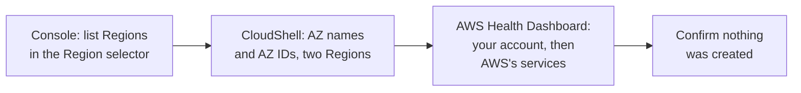

# Lab 02: See Regions, Availability Zones and AWS Health in your own account

## Before you start: your account, your responsibility

This guide is provided as is, without warranty. We work hard to keep it correct and current, but AWS changes often, and its services, prices, and free offers may differ from what is written here. The labs run in your own AWS account. You are responsible for that account, for its security, and for any charges it incurs, including charges from resources you forget to delete. Automate the Cloud Inc. is not liable for any costs, losses, or security incidents that result from following, or failing to follow, this material. Technical guidance here is general information, not advice about your specific systems.

**Who this is for:** you have set up the guardrails and read lessons [03.01](01-regions-availability-zones-data-centers.md) and [03.03](03-surviving-failure.md). **Time:** about 20 minutes.

**Goal:** you look at AWS's global infrastructure from inside your own account, without creating anything: Regions in the console, the Availability Zones of two Regions with their AZ IDs in AWS CloudShell, and the AWS Health Dashboard. **End state:** your lab log holds three Region codes, two tables of AZ names and AZ IDs, and notes from the Health Dashboard. Nothing new exists in your account.



*Notice that every stage only reads. There is nothing to delete at the end, but you still confirm it, as you will in every lab.*

**Long description.** Four stages from left to right. In the console, list Regions in the Region selector. In CloudShell, list AZ names and AZ IDs for two Regions. In the AWS Health Dashboard, look at your account's events, then at AWS's services. Finally, confirm that nothing was created.

**What it creates:** nothing, so there is nothing to tag with `guide` = `clf` and `lab` = `02`.

**What it costs:** $0. The commands only read information, and AWS charges nothing extra for CloudShell itself ([AWS CloudShell Pricing](https://aws.amazon.com/cloudshell/pricing/), checked 2026-10-23). **Worst case on a Paid plan:** $0, because nothing is left running. **Free plan:** nothing here upgrades your plan. Never choose **Upgrade plan**, and don't enable any new Region, during this lab.

**Before you start, you need these guardrails in place.** If you haven't done them, do them first:

- Root user secured with MFA: [primer page 02](https://github.com/AutomateTheCloud/atc-study-aws_account_guardrails/blob/main/primer/02-secure-the-root-user.md).
- An IAM admin user with MFA for daily work, never the root user: [primer page 03](https://github.com/AutomateTheCloud/atc-study-aws_account_guardrails/blob/main/primer/03-your-everyday-admin-identity.md).
- CloudShell, used without access keys: [primer page 04](https://github.com/AutomateTheCloud/atc-study-aws_account_guardrails/blob/main/primer/04-command-line-without-access-keys.md).
- Budgets and billing alerts: [primer page 05](https://github.com/AutomateTheCloud/atc-study-aws_account_guardrails/blob/main/primer/05-money-alarms.md).
- The habits for every lab, including a lab log: [primer page 07](https://github.com/AutomateTheCloud/atc-study-aws_account_guardrails/blob/main/primer/07-habits-for-every-lab.md).

**Why this matters:** high availability means placing copies in more than one Availability Zone, [REL10-BP01 Deploy the workload to multiple locations](https://docs.aws.amazon.com/wellarchitected/latest/reliability-pillar/rel_fault_isolation_multiaz_region_system.html). To do that, you need to see which AZs your account has, and name them so they mean the same place to everyone: the AZ ID. The Health Dashboard is where AWS reports events that could affect your resources: the first place to look when a failure from lesson [03.03](03-surviving-failure.md) happens for real.

> **New sign-up path:** that experience assigns your Region from your contact country (US East (Ohio), Europe (Stockholm) or Asia Pacific (Sydney), as of 2026-10-23), and you can't change it. Run step 9 in your assigned Region and skip the `--region` part of step 10. We haven't run this lab on that path, and we haven't confirmed how CloudShell and the Health Dashboard behave there.

**About the screens:** labels in **bold** are what we saw when we ran this lab end to end in our test account on 2026-10-25. AWS changes its console often. If a label differs, look for the option with the same meaning.

## Steps

### Get ready

1. In your lab log, write today's date, "Lab 02, read-only", and the Region `us-east-1`.
   **You should see:** a new entry, with no resources listed under it.
2. Sign in to the AWS console as your **IAM admin user**, not the root user.
   **You should see:** the console home page, with your IAM user name in the account menu at the top right.

### List Regions in the Region selector

3. Open the Region selector near the top right of the console (it showed names such as **United States (N. Virginia)** on 2026-10-23).
   **You should see:** a list of Regions grouped by part of the world. Each has a name and a **Region code**, such as `us-east-1`.
4. Find these three and copy their codes into your lab log: N. Virginia, Ohio and Frankfurt.
   **You should see:** `us-east-1`, `us-east-2` and `eu-central-1`. These are the Regions this module's bakery uses or could use.
5. Look for Regions that are marked as not enabled, or that you expected and can't find. On 2026-10-25 our selector listed only enabled Regions, with a line at the bottom, "There are 17 Regions that are not enabled for this account", next to **Manage Regions**. **Don't enable them.**
   Regions launched after 2019-03-20 are **opt-in Regions**: off until someone turns them on, and possibly hidden while off ([Enable or disable AWS Regions](https://docs.aws.amazon.com/accounts/latest/reference/manage-acct-regions.html), checked 2026-10-23). A Region you don't use is one more place to forget a resource.
6. Choose **United States (N. Virginia)** to close the selector with N. Virginia selected.
   **You should see:** N. Virginia in the selector. (Our test account first opened in US East (Ohio), so check every time.)

### List AZ names and AZ IDs in CloudShell

7. Open **CloudShell**, as on [primer page 04](https://github.com/AutomateTheCloud/atc-study-aws_account_guardrails/blob/main/primer/04-command-line-without-access-keys.md) (on 2026-10-23, a link at the bottom left of the console and a small terminal icon in the top bar).
   **You should see:** a terminal panel with a tab named `us-east-1` and a `$` prompt, after about 30 seconds.
8. Check who you are. Type this and press Enter:

   ```bash
   aws sts get-caller-identity
   ```

   **You should see:** three lines, `UserId`, `Account` and `Arn`. The `Arn` line ends in `:user/` and your IAM user name.
   > **If something went wrong:** if `Arn` ends in `:root`, you are signed in as root. Close CloudShell, sign out, and sign in as your IAM admin user.
9. List the Availability Zones of N. Virginia, with each one's name and AZ ID. Type this on one line and press Enter:

   ```bash
   aws ec2 describe-availability-zones --query "AvailabilityZones[].[ZoneName,ZoneId]" --output table
   ```

   `--query` picks two fields from each AZ; `--output table` prints them as a table.
   **You should see:** one row per Availability Zone: the **AZ name**, such as `us-east-1a`, and the **AZ ID**, `use1-az` plus a number. The shape is like this (your values will differ):

   ```text
   -------------------------------
   |  DescribeAvailabilityZones  |
   +--------------+--------------+
   |  us-east-1a  |  use1-az?    |
   |  us-east-1b  |  use1-az?    |
   |  ...         |  ...         |
   +--------------+--------------+
   ```

   Our account showed six on 2026-10-25, from `use1-az1` to `use1-az6`, and the letters didn't follow the ID numbers (`us-east-1c` was `use1-az4`); your account may show fewer, because AWS can stop offering a crowded AZ to new accounts ([AWS Availability Zones](https://docs.aws.amazon.com/global-infrastructure/latest/regions/aws-availability-zones.html)). Copy every row into your lab log.
   > **If something went wrong:**
   > - *The output fills the screen and ends in `(END)` or a colon:* the CLI opened its page viewer. Press `q` to return to the prompt.
   > - *`UnauthorizedOperation` or access denied:* sign in as your IAM admin user and try again.
   > - *An error about the query or an option:* copy the command again exactly; look for a missing quote or space.
10. List the AZs of Europe (Frankfurt) without leaving N. Virginia. Add `--region eu-central-1` to the same command:

    ```bash
    aws ec2 describe-availability-zones --region eu-central-1 --query "AvailabilityZones[].[ZoneName,ZoneId]" --output table
    ```

    **You should see:** rows named `eu-central-1a`, `eu-central-1b` and so on, with AZ IDs starting `euc1-az`. AWS's table listed three for Frankfurt on 2026-10-23. Copy them into your lab log.
    > **If something went wrong:** an error about the endpoint or the Region usually means a typo in `eu-central-1`.
11. Compare your tables with the figure below. Each **AZ name** is the Region code plus a letter; each **AZ ID** means the same physical place in every account.

    

    *Notice the two thick lines: the same name, `us-east-1a`, leads to different physical AZs in the two accounts. The mapping is a made-up example.*

    **Long description.** Three columns. In the middle, three physical Availability Zones labeled by AZ ID: use1-az1, use1-az2, use1-az3. On the left, your account's names: us-east-1a to use1-az1, us-east-1b to use1-az2, us-east-1c to use1-az3. On the right, a friend's account: us-east-1a to use1-az2, us-east-1b to use1-az3, us-east-1c to use1-az1. The two us-east-1a lines are thick. The mapping is a made-up example.

    AWS says that in its oldest Regions, accounts created before November 2025 had their AZ names mapped separately, while accounts created since then get the same mapping (checked 2026-10-23). Either way, to agree on a place across accounts, compare **AZ IDs**, not names.
    **You should see:** in your lab log, each AZ name paired with an AZ ID, for two Regions.
12. Type `exit` and press Enter, or close the CloudShell panel.

### Look at the AWS Health Dashboard

The **AWS Health Dashboard** shows events that affect AWS services and your account, free and with no setup ([What is AWS Health?](https://docs.aws.amazon.com/health/latest/ug/what-is-aws-health.html), checked 2026-10-23). Older material calls it the Personal Health Dashboard or the Service Health Dashboard; both names are replaced.

13. In the console search bar, type `Health` and open **AWS Health Dashboard**.
    **You should see:** your account's view: open and recent issues, scheduled changes, other notifications, and an event log covering 90 days ([Getting started with your AWS Health Dashboard](https://docs.aws.amazon.com/health/latest/ug/getting-started-phd.html)). These are **account-specific events**, such as scheduled maintenance on one of your servers. A new account may have none. Note what the page shows, even "no open issues".
14. In the dashboard's left menu, under **Service health**, choose **Open and recent issues**. It opens AWS's public status page, `health.aws.amazon.com`.
    **You should see:** **public events**, which are AWS service issues not tied to any one account, for every Region ([Concepts for AWS Health](https://docs.aws.amazon.com/health/latest/ug/aws-health-concepts-and-terms.html)).
    > **If something went wrong:** if you can't find it, open a private browser window and go to `https://health.aws.amazon.com/health/status`, AWS's public status page. It needs no sign-in ([AWS Health Dashboard](https://docs.aws.amazon.com/health/latest/ug/aws-health-dashboard-status.html)).
15. Choose the **Service history** tab (the last 12 months), then **List of events**. It filters by **Locales**, not by Region: keep **North America** and find `us-east-1` in the **Region** column, then switch to **Europe** and find `eu-central-1`.
    **You should see:** past events, each naming a service and its Region, such as "Amazon Elastic Compute Cloud [Increased Error Rates]" in `us-east-1`, as we saw on 2026-10-25. Global services such as CloudFront show `-` instead of a Region. Write down one event's service and Region, or "none listed", and note whether it names one Region or several. An event confined to one Region is the Region isolation of lesson 03.01 at work.

## Check your work

- [ ] Your lab log has the codes `us-east-1`, `us-east-2` and `eu-central-1`.
- [ ] It has a table of AZ names and AZ IDs for N. Virginia and one for Frankfurt.
- [ ] It has a note from your account's Health Dashboard and one from service history (an event, or "none").
- [ ] `aws sts get-caller-identity` showed your IAM user, not root.

## Clean up

Nothing was created, but confirm it anyway; the habit saves you in later labs.

16. Open **Tag Editor**. Choose **All regions**; in **Resource types**, choose the option covering every type (wording such as "all supported resource types"). Enter the tag key `lab` and value `02`, choose **Add**, then **Search resources**. (On 2026-10-24 a banner said tag management is moving to the AWS Resource Explorer console; if it has moved, search there.) (task card: [Find everything a lab left behind, in every Region](../98-how-to/03-find-what-a-lab-left-behind.md))
    **You should see:** no resources.
17. Check the Region selector shows **United States (N. Virginia)**, and that you didn't enable any Region in step 5.
18. **Confirm:** tick "Lab 02: nothing created" in your lab log. No next-day billing check is needed.

## Recap

You saw the global infrastructure from inside your account: Regions with their codes, some off until enabled; each Region's AZs, named with a letter in your account and identified everywhere by an AZ ID; and AWS's record of events, usually confined to one Region. You pick AZs from lists like these when you design for high availability, and you check the Health Dashboard first when something fails.

> **Reflect:** a colleague in another AWS account says, "Put the standby database in `us-east-1a`, the same AZ as mine, so they're close." Using what you saw today, write two sentences on what could go wrong and what you would ask for instead.
>
> <details><summary>Model answer</summary>
>
> If either account was created before November 2025, `us-east-1a` may be a different physical AZ in each account, so "the same AZ" isn't guaranteed by the name. Ask for the AZ ID, such as `use1-az` plus its number, which means the same physical location in every account.
>
> </details>

**Next:** choose resilience strategies for three businesses in [Simulation S2](06-sim-blast-radius.md).

## Where to check the current details

- [AWS Availability Zones](https://docs.aws.amazon.com/global-infrastructure/latest/regions/aws-availability-zones.html) and [AWS Regions](https://docs.aws.amazon.com/global-infrastructure/latest/regions/aws-regions.html), AWS Regions and Availability Zones User Guide (checked 2026-10-23)
- [Enable or disable AWS Regions in your account](https://docs.aws.amazon.com/accounts/latest/reference/manage-acct-regions.html), AWS Account Management Reference Guide (checked 2026-10-23)
- [What is AWS CloudShell?](https://docs.aws.amazon.com/cloudshell/latest/userguide/welcome.html) and [AWS CloudShell Pricing](https://aws.amazon.com/cloudshell/pricing/) (checked 2026-10-23)
- [What is AWS Health?](https://docs.aws.amazon.com/health/latest/ug/what-is-aws-health.html), [Concepts for AWS Health](https://docs.aws.amazon.com/health/latest/ug/aws-health-concepts-and-terms.html), [Getting started with your AWS Health Dashboard](https://docs.aws.amazon.com/health/latest/ug/getting-started-phd.html) and [AWS Health Dashboard](https://docs.aws.amazon.com/health/latest/ug/aws-health-dashboard-status.html), AWS Health User Guide (checked 2026-10-23)

---

"Lab 02: See Regions, Availability Zones and AWS Health in your own account" by Automate the Cloud Inc., licensed under CC BY-NC 4.0 with the Additional Permission for Internal Training from Automate the Cloud Inc.
License: https://creativecommons.org/licenses/by-nc/4.0/
Permission: https://automatethe.cloud/licenses/atc-internal-training-permission.txt
