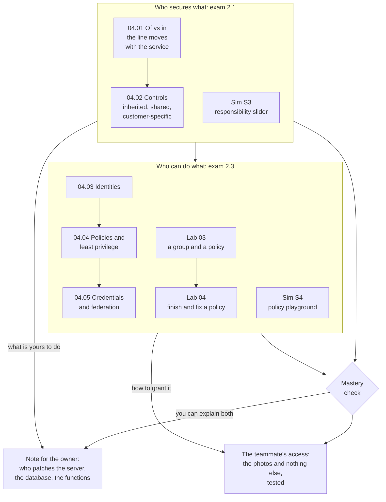

# Module 04: Give a new teammate access to the cake photos and nothing else, then explain who patches what

This module teaches how security work is split between AWS and you, and how you decide who can do what in your account. By the end, you give a new teammate exactly the access she needs, prove it works, and tell the bakery's owner which security updates are still hers to make.

**For:** an adult studying alone, possibly new to IT, who wants to understand AWS and use it safely. You have finished [Module 02](../02-why-the-cloud/00-brief.md) and the [guardrails primer](https://github.com/AutomateTheCloud/atc-study-aws_account_guardrails/blob/main/primer/00-read-this-first.md). **Time:** about 5 hours, over several sessions.

## The scenario: the bakery's site now runs on AWS

The bakery moved its ordering site to AWS, and it stayed up through December. Now the owner has two questions.

1. "A new teammate starts on Monday. Her job is to keep the cake photos on the site up to date. Give her access to the photos, **and nothing else**. Show me that it works."
2. "AWS runs the computers now. Do I still have to install security updates? For which parts?"

The bakery's parts on AWS are made up for teaching, and every lesson here uses them:

| Part of the site | What it does | AWS service |
|---|---|---|
| The web server | Runs the ordering website | A virtual server in Amazon EC2 |
| The order database | Keeps every order | A managed database in Amazon RDS |
| The order functions | Small pieces of code that send each customer a confirmation | Functions in AWS Lambda |
| The photo storage | Holds the photos of the cakes | A bucket in Amazon S3 |

At the end you hand the owner the teammate's access, tested, and a short note on who patches the server, the database and the functions.

## You'll be able to

Tags: the kind of knowledge (F fact, C concept, P procedure, J judgment) and what you do with it (Re recall, Un understand, Ap apply, An analyze).

| Objective | Lesson |
|---|---|
| **04.01a** Say whether AWS or you does a security task, for EC2, RDS, Lambda or S3, and why [C·Ap] | 04.01 |
| **04.02a** Explain what "shared" means, with examples of inherited, shared and customer-specific controls [C·Un] | 04.02 |
| **04.03a** Pick the right kind of identity for a case [C·Ap] | 04.03 |
| **04.03b** Recognize the tasks only the root user can do [F·Re] | 04.03 |
| **04.04a** Predict whether a request is allowed or denied [P·An] | 04.04 |
| **04.05a** Choose a way to store credentials and a way to manage identities [J·Ap] | 04.05 |

## What this covers on the exam

This module covers two tasks in Domain 2, Security and Compliance, of the AWS Certified Cloud Practitioner (CLF-C02) exam. We checked the exam guide on 2026-10-24.

- task [2.1](https://docs.aws.amazon.com/aws-certification/latest/cloud-practitioner-02/cloud-practitioner-02-domain2.html#cloud-practitioner-02-task2.1), the AWS shared responsibility model (lessons 04.01 and 04.02);
- task [2.3](https://docs.aws.amazon.com/aws-certification/latest/cloud-practitioner-02/cloud-practitioner-02-domain2.html#cloud-practitioner-02-task2.3), access management (lessons 04.03 to 04.05).

Domain 2 is 30% of the exam (as of 2026-10-24), the largest share. Module 09 returns to access management for whole organizations.

## How the module is laid out

**Lessons** (about 35 minutes each):

1. [Security of the cloud vs security in the cloud](01-security-of-vs-in-the-cloud.md)
2. [Shared, inherited and customer-specific controls](02-shared-inherited-customer-specific.md)
3. [Identities](03-identities.md)
4. [Policies and least privilege](04-policies-and-least-privilege.md)
5. [Credentials and federation](05-credentials-and-federation.md)

**Hands-on:**

- [Lab 03: a group and a policy](06-lab-03-a-group-and-a-policy.md), a follow-along lab.
- [Lab 04: finish and fix a policy](07-lab-04-finish-and-fix-a-policy.md), including one for the teammate.
- [Simulation S3: the responsibility slider](08-sim-responsibility-slider.md) and [Simulation S4: the policy playground](09-sim-policy-playground.md). They run on this site.

Both labs run in your own AWS account and cost $0 on the Free plan (as of 2026-10-24). Each one says what to do if you signed up through AWS's new sign-up experience.

**Before the labs:** check that you still have [root MFA](https://github.com/AutomateTheCloud/atc-study-aws_account_guardrails/blob/main/primer/02-secure-the-root-user.md), [your IAM admin user with MFA](https://github.com/AutomateTheCloud/atc-study-aws_account_guardrails/blob/main/primer/03-your-everyday-admin-identity.md), and [money alarms](https://github.com/AutomateTheCloud/atc-study-aws_account_guardrails/blob/main/primer/05-money-alarms.md). The lessons need no AWS account.

**Mastery check:** the module ends with a check; you pass at 80%. Each miss points you to the section to reread, then to a parallel retest. Pass first time, and you get optional "going deeper" material.

*Notice that each half of the module produces one of the owner's two requests: the first says which security work is yours; the second is how you do one part of it.*

**Long description.** A map from top to bottom. The first box, "Who secures what: exam 2.1", holds lesson 04.01 (of vs in; the line moves with the service), then lesson 04.02 (inherited, shared and customer-specific controls), and Simulation S3, the responsibility slider. It leads to the second box, "Who can do what: exam 2.3", which holds lessons 04.03 identities, 04.04 policies and least privilege, and 04.05 credentials and federation; Lab 03 (a group and a policy), then Lab 04 (finish and fix a policy); and Simulation S4, the policy playground. Both boxes lead to the mastery check. The first box leads to the note for the owner on who patches the server, the database and the functions, labeled "what is yours to do". The second box leads to the teammate's access, the photos and nothing else, tested, labeled "how to grant it". The check leads to both.

## Coming back

Warm-ups bring back Module 02 (deployment models, the Well-Architected pillars) and the guardrails primer (the root user, MFA, your IAM admin user); here you learn the reasons behind the primer's steps. After this module, the shared responsibility model returns in every service lesson as a section called "your side of the line".

---

"Module 04: Who secures what: shared responsibility and access" by Automate the Cloud Inc., licensed under CC BY-NC 4.0 with the Additional Permission for Internal Training from Automate the Cloud Inc.
License: https://creativecommons.org/licenses/by-nc/4.0/
Permission: https://automatethe.cloud/licenses/atc-internal-training-permission.txt
