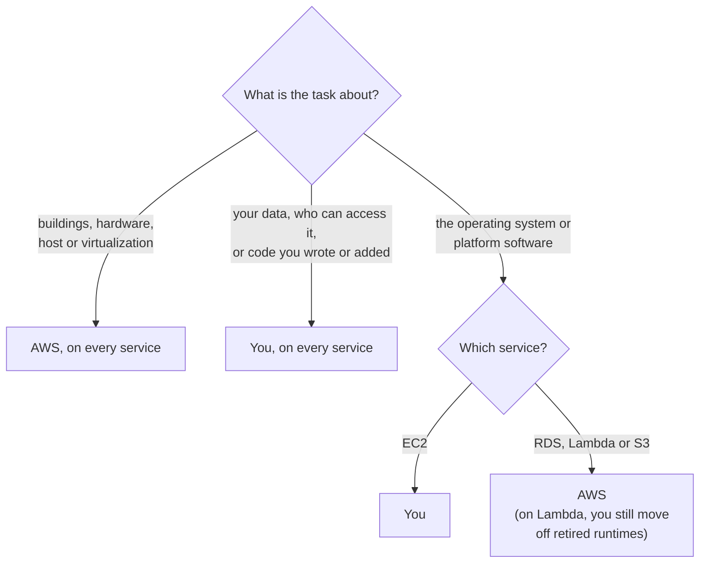

# AWS secures the cloud itself; you secure what you put in it, and the line between moves with the service

AWS splits security work into two parts. AWS is responsible for security **of** the cloud: the buildings, machines and software that run its services. You are responsible for security **in** the cloud: what you build, configure and store there. Where the line falls depends on the service you choose, and in this lesson you learn to find it for four services.

**For:** an adult studying alone, possibly new to IT, who wants to understand AWS and use it safely. **Time:** about 35 minutes. Reading works on a phone.

**Before you start:** this lesson builds on [What cloud computing is](../02-why-the-cloud/01-what-cloud-computing-is.md) and on pages [02](https://github.com/AutomateTheCloud/atc-study-aws_account_guardrails/blob/main/primer/02-secure-the-root-user.md) and [06](https://github.com/AutomateTheCloud/atc-study-aws_account_guardrails/blob/main/primer/06-safe-defaults.md) of the guardrails primer. If you skipped them, the key terms below give you what you need. The bakery scenario is in the [module brief](00-brief.md).

## Warm-up: what you remember

Answer from memory before you look anything up.

1. In a Module 02 example, the bakery runs its ordering website on AWS and keeps its till system in the shop, with orders flowing between them. Which deployment model is that?
2. In the guardrails primer, you protected your account's root user with MFA. Who did that: you or AWS? Why didn't AWS simply do it for you?
3. Which Well-Architected pillar asks, "Are the data, systems and accounts protected?"

Feedback

1. **Hybrid.** Some parts run at AWS and some in the bakery's own building, and the parts are connected (lesson 02.01).
2. **You did.** AWS provides MFA as a feature, but only you can choose your sign-in device and register it. This lesson explains why that is your share of the work.
3. **Security**, one of the two pillars that lesson 02.05 said are generally not traded away.

## What you'll learn

By the end of this lesson, you can:

- say what AWS secures and what you secure, in AWS's own terms;
- say whether AWS or you does a given security task on Amazon EC2, Amazon RDS, AWS Lambda or Amazon S3, and give the reason (objective 04.01a).

Try these before you read on. Guess if you're unsure; the answers are in the lesson.

1. The bakery's website runs on a virtual server in Amazon EC2. Who installs the security updates for that server's operating system?
2. Someone at the bakery makes the cake-photo storage public by mistake. Whose responsibility was that setting?

## The big picture: two parts of one job

Think of the bakery's site as a stack of layers. AWS secures the bottom ones; the bakery secures the top ones.

*Notice the label on the dashed line: "where it sits depends on the service". For services where AWS runs more for you, the line moves up, and you have fewer layers to look after.*

**Long description.** Six layers split by a dashed line. Above it, "Security in the cloud: you": your data and who can reach it (the bakery's orders and cake photos); your settings and encryption choices (firewall rules, storage settings, MFA); the operating system and software you install on services such as EC2 (the web server's operating system and website software). Below it, "Security of the cloud: AWS": the software that runs AWS's services; the host operating system and virtualization, which splits one physical machine into many virtual servers; hardware and the global infrastructure of Regions, Availability Zones and edge locations (buildings, machines, power, cooling). A note says the stack is drawn for EC2, and the line sits higher on RDS, Lambda and S3.

## Key terms (skip if you know them)

- **Shared responsibility model:** AWS's description of which security work AWS does and which you do ([Shared Responsibility Model](https://aws.amazon.com/compliance/shared-responsibility-model/)).
- **Infrastructure:** the hardware, software, networks and buildings that run AWS's services.
- **Virtualization:** software that splits one physical computer into several **virtual servers**. The **host operating system** runs on the physical machine; AWS runs it. The **guest operating system**, such as Linux or Windows, runs inside your virtual server.
- **Patch:** a software update that fixes a flaw, often a security flaw.
- **Security group:** a firewall that AWS provides for each EC2 virtual server. You write its rules: who may connect, and how.
- **Managed service:** AWS runs the servers and software underneath, and you use the service through its settings. Amazon RDS and Amazon S3 are examples.
- **Abstracted service:** AWS's name for the most managed kind, such as Amazon S3 or Amazon DynamoDB, where AWS also runs the operating system and platform and you work only with your data and its settings.
- **Region, Availability Zone, edge location:** parts of AWS's global infrastructure. A Region is a place in the world with several Availability Zones; an Availability Zone is one or more separate data centers; edge locations are smaller sites. Module 03 covers them.

"Shared" is an everyday word that misleads here. Two people sharing a job often do the same task together. In this model, AWS and you each do **different** parts. Lesson 04.02 returns to this.

## AWS is responsible for security of the cloud

AWS protects the infrastructure that runs every AWS service ([Shared Responsibility Model](https://aws.amazon.com/compliance/shared-responsibility-model/)). AWS describes its share as everything "from the host operating system and virtualization layer down to the physical security of the facilities". So you never guard a data center door, replace a failed disk, or update the virtualization software. You couldn't if you wanted to: you can't enter AWS's buildings or reach its machines.

How do you know AWS does its part? Independent auditors regularly test AWS's security, and AWS makes their reports available to customers ([Security in AWS Lambda](https://docs.aws.amazon.com/lambda/latest/dg/lambda-security.html) says this for one service). Module 09 shows you where to find them.

For the bakery, this ends the back room of Module 02: locking it, cooling it and repairing its servers are now AWS's job.

> **Your turn:** The owner asks, "If someone breaks into an AWS data center and steals a disk, is that our problem?" Answer her in two sentences, using the words "of the cloud".

Model answer

No. Physical security of the buildings and hardware is security **of** the cloud, which is AWS's responsibility. The bakery relies on AWS for it, and on the auditors who check AWS's controls.

## You are responsible for security in the cloud, and how much depends on the service

Your share is everything you put into the cloud and every setting you choose there. AWS says it depends on the services you select, on how they connect to your other systems, and on the laws that apply to you ([Shared Responsibility Model](https://aws.amazon.com/compliance/shared-responsibility-model/)). AWS gives two examples at opposite ends.

**Amazon Elastic Compute Cloud (Amazon EC2)** rents you virtual servers. AWS classes it as **infrastructure as a service (IaaS)**: you get basic building blocks and do the rest. On EC2, you are responsible for:

- the guest operating system, including its updates and security patches;
- any software you install on the server;
- the rules of the server's security group.

**Abstracted services, such as Amazon Simple Storage Service (Amazon S3),** are different. AWS runs the infrastructure, the operating system and the platform; you store and fetch data through the service. On S3, you are responsible for:

- your data, including which encryption options to use;
- classifying your data (deciding which of it is sensitive);
- using AWS Identity and Access Management (IAM) to say who can do what.

As the going-deeper box of [lesson 02.01](../02-why-the-cloud/01-what-cloud-computing-is.md) suggested, the more the provider runs for you, the less you secure yourself.

> **Check:** Which of these is the customer's responsibility on Amazon EC2?
>
> A. Patching the host operating system
> B. Patching the guest operating system
> C. Replacing a failed disk in the physical server
> D. Controlling who enters the data center

Feedback

**B is right.** The guest operating system runs inside your virtual server, and AWS says EC2 customers manage it, including its security patches.

- **A is wrong.** The host operating system sits under the virtualization layer, which AWS runs.
- **C is wrong.** Hardware is infrastructure: security of the cloud.
- **D is wrong.** Physical security of the buildings is AWS's.

## The line moves with the service: EC2, RDS, Lambda and S3

The CLF-C02 exam guide names EC2, RDS and Lambda as examples of how responsibility shifts (task [2.1](https://docs.aws.amazon.com/aws-certification/latest/cloud-practitioner-02/cloud-practitioner-02-domain2.html#cloud-practitioner-02-task2.1)). This section uses only AWS's published statements for each.

### A database three ways: on-premises, on EC2, on RDS

The Amazon RDS User Guide has the clearest comparison AWS publishes ([What is Amazon RDS?](https://docs.aws.amazon.com/AmazonRDS/latest/UserGuide/Welcome.html)). It compares running a database on your own server, on an EC2 virtual server, and on **Amazon Relational Database Service (Amazon RDS)**, AWS's managed database service.

*Notice that the dashed line climbs from the bottom of the first column to near the top of the third. Moving to EC2 hands AWS the physical work; moving on to RDS hands AWS the operating system and database software too.*

The table gives the same data.

| Task | On-premises | Database on EC2 | Amazon RDS |
|---|---|---|---|
| Application optimization | You | You | You |
| Scaling, high availability, database backups | You | You | AWS |
| Database software install and patching | You | You | AWS |
| Operating system installation and patching | You | You | AWS |
| Server maintenance, hardware lifecycle | You | AWS | AWS |
| Power, network and cooling | You | AWS | AWS |

Even on RDS, one row stays yours. The RDS User Guide calls it **query tuning**: adjusting your database requests so they run well. It also says you control who reaches your database, with IAM and with security groups.

### Four services side by side

The next graphic puts four services in one picture. Each column uses only what AWS says about that service: the [Shared Responsibility Model](https://aws.amazon.com/compliance/shared-responsibility-model/) page for EC2 and S3, the RDS User Guide for RDS, and the Lambda Developer Guide for **AWS Lambda**. Lambda runs small programs, called **functions**, when something triggers them, and AWS says it manages "server maintenance, capacity provisioning, scaling, and patching" ([What is AWS Lambda?](https://docs.aws.amazon.com/lambda/latest/dg/welcome.html)).

*Notice two things. The line sits lowest on EC2, where you run the operating system yourself. And whatever the service, the top row is yours: your data, and who can access it.*

The table gives the same data.

| Layer | Amazon EC2 | Amazon RDS | AWS Lambda | Amazon S3 |
|---|---|---|---|---|
| Your data, and who can access it | You | You | You | You |
| Your code, and how well it runs | You: software you install | You: query tuning | You: function code and its libraries | None: no code of yours runs in S3 |
| Platform software (database engine, language runtime) | You | AWS | AWS, for supported runtimes; you move off old ones | AWS |
| Operating system | You: the guest OS | AWS | AWS | AWS |
| Servers, hardware, buildings | AWS | AWS | AWS | AWS |

The Lambda column is easy to oversimplify. A **runtime** is the language software that runs your function's code, such as a version of Python. Lambda's runtime documentation splits the work like this ([Lambda runtimes](https://docs.aws.amazon.com/lambda/latest/dg/lambda-runtimes.html)):

- **AWS** publishes security updates for the runtimes it manages and, by default, applies them automatically.
- **You** update your function's code, **including the libraries it depends on**, when they have security flaws.
- **You** move your functions to a supported runtime before the old one is retired.

You also choose, through the function's IAM **role**, which other AWS resources it may use ([AWS Lambda FAQs](https://aws.amazon.com/lambda/faqs/)). And you stay responsible for how sensitive your data is and the laws that apply ([Security in AWS Lambda](https://docs.aws.amazon.com/lambda/latest/dg/lambda-security.html)).

### "With serverless, AWS handles the security" is wrong

You may have read that on Lambda, AWS takes care of security and you only write code, or only code and permissions. That's not right. AWS runs and patches the servers, but you still own your code's libraries, the move off retired runtimes, the function's permissions, and your data.

It's tempting because "serverless" sounds like "nothing to manage", and the servers really are gone from your list. But an old library or an over-broad permission is a common way in, and both stay with you.

> **Check:** The bakery's order functions run on Lambda. A security flaw is found in a code library they use to send emails. Who updates it?
>
> A. AWS, because Lambda is serverless
> B. AWS, because it applies runtime updates automatically
> C. The bakery, because a function's libraries are the customer's
> D. Both, because security is shared

Feedback

**C is right.** Lambda's runtime documentation says you update your function code, including its dependencies, to fix security flaws.

- **A is wrong.** Serverless means AWS runs and patches the servers, not your code.
- **B is wrong.** Automatic updates cover the runtime AWS manages, not the libraries you add.
- **D is wrong.** "Shared" doesn't mean both sides do this task. This one is the bakery's (lesson 04.02 explains).

## Your data, and who can reach it, are always yours

One thing never moves: on every service, you decide what data you put in AWS and who can reach it. AWS gives you tools and safe defaults; keeping the right settings is your job.

Take the second prequestion. The cake photos sit in an S3 **bucket**, S3's name for a storage container, and someone makes it public by mistake.

- **What AWS provides:** S3's **Block Public Access** settings, turned on by default for buckets created on or after April 28, 2023 ([ACCT.08](https://docs.aws.amazon.com/prescriptive-guidance/latest/aws-startup-security-baseline/acct-08.html)). S3 has also encrypted every new upload automatically since January 5, 2023 ([Default encryption FAQ](https://docs.aws.amazon.com/AmazonS3/latest/userguide/default-encryption-faq.html)). Both checked 2026-10-24.
- **What the customer did:** changed a setting on its own bucket. AWS puts data, encryption options and permissions on the customer's side for S3.
- **Answer:** the bakery's. AWS's default was safe; the bakery undid it.

You already did some of this work. On [primer page 06](https://github.com/AutomateTheCloud/atc-study-aws_account_guardrails/blob/main/primer/06-safe-defaults.md) you turned on Block Public Access for your whole account; in the account we created on 2026-10-23, that setting started off. On [primer page 02](https://github.com/AutomateTheCloud/atc-study-aws_account_guardrails/blob/main/primer/02-secure-the-root-user.md) you added MFA to the root user. Both were your side of the line.

### "AWS protects my data, because it's in AWS" is wrong

You may have heard that putting data in AWS makes it AWS's job to protect. That's not right. AWS protects the infrastructure your data sits on. Who may read or change the data, and whether a bucket is public, are settings you choose and check.

It's tempting because AWS's defaults are often safe. But a safe default helps only until someone changes it. Lessons 04.03 to 04.05 teach you to decide who can do what, which is how you give the new teammate the photos and nothing else.

> **Your turn:** For each task, say who does it, AWS or the bakery, and name the fact that decides it.
>
> a) Installing a new version of the database software for the order database on RDS
> b) Deciding which people may read the order records
> c) Replacing a failed power supply in the machine under the bakery's EC2 server
> d) Writing the security group rules for the EC2 web server

Model answer

a) **AWS.** The RDS User Guide puts database software install and patching on AWS for RDS.
b) **The bakery.** Data and access are always the customer's; on RDS you control access with IAM and security groups.
c) **AWS.** Hardware is infrastructure, on every service.
d) **The bakery.** AWS puts security group configuration on EC2 customers.

## Worked example: who patches what at the bakery

The owner asked: "AWS runs the computers now. Do I still have to install security updates? For which parts?" Here is how someone who knows the model works it out. The flowchart is the method.

*Notice that only the middle layers depend on the service. For those, look up the service's own statement; the top and bottom answers never change.*

**Long description.** A decision flowchart. Start: what is the task about? Buildings, hardware, the host or virtualization: AWS, on every service. Your data, who can access it, or code you wrote or added: you, on every service. The operating system or platform software: it depends on the service. On EC2, you; on RDS, Lambda or S3, AWS, except that on Lambda you still move your functions off retired runtimes.

1. **The web server (EC2).** *Layers touched:* the guest operating system and the website software. *The line for EC2* sits below the operating system. **So the bakery patches both.** AWS patches the host and maintains the hardware.
2. **The order database (RDS).** *Layers touched:* the operating system and the database software. *The line for RDS* sits above both. **So AWS patches them.** The bakery tunes its queries and decides who may connect.
3. **The order functions (Lambda).** *Layers touched:* the servers, the runtime, and the code with its libraries. *The line for Lambda* sits below the code. **So the bakery updates its code and libraries**, and moves to a new runtime before the old one is retired. AWS patches the servers and the managed runtime.
4. **The photo storage (S3).** Nothing for the bakery to patch: AWS runs the operating system and platform. The bakery keeps Block Public Access on and decides who can read and change the photos.

The expert ignored how "managed" a service sounds; the answer comes from the service's own statement.

> **Your turn:** Write the owner a three-sentence note: which security updates are still the bakery's, which are now AWS's, and one thing the bakery must still do on the services where AWS patches everything.

Model answer

The bakery still updates the web server's operating system and website software (EC2), and the order functions' code and libraries, moving to a new runtime when Lambda retires the old one. AWS patches the order database's operating system and database software (RDS), the servers under the functions, and everything under the photo storage (S3). On every service, the bakery still decides who can reach its data, for example by keeping the photo bucket private.

## In real work: read the service's security chapter first

You meet the model every time you choose a service. AWS advises reviewing the security chapter in each service's documentation ([Shared Responsibility Model](https://aws.amazon.com/compliance/shared-responsibility-model/)); Lambda's, for example, opens by applying the model to Lambda. Make it a habit: before you use a new service, find its security chapter and write down what is yours.

The model touches two Well-Architected pillars:

- **Security.** Patching what you run is [SEC06-BP01 Perform vulnerability management](https://docs.aws.amazon.com/wellarchitected/latest/security-pillar/sec_protect_compute_vulnerability_management.html). The design principle "[Apply security at all layers](https://docs.aws.amazon.com/wellarchitected/latest/framework/sec-design.html)" reminds you that AWS's layers being secure doesn't make yours secure.
- **Cost optimization.** Moving the database from EC2 to RDS hands AWS the patching and backups: the design principle "[Stop spending money on undifferentiated heavy lifting](https://docs.aws.amazon.com/wellarchitected/latest/framework/cost-dp.html)" from lesson 02.01, applied to security work.

## Summary

- **AWS secures the cloud itself:** buildings, hardware, networks, the host operating system and virtualization.
- **You secure what you put in the cloud:** your data, your settings, and any software you run. How much that includes depends on the service.
- **The line moves with the service.** EC2: you run the guest operating system. RDS: AWS also patches the operating system and database software. Lambda: AWS patches the servers and managed runtimes; you keep your code, its libraries and runtime upgrades. S3: AWS runs everything under your data.
- **Your data, and who can reach it, are always yours.** Safe defaults help only until someone changes them.
- **In real work**, read each service's security chapter to find your side.

**For the owner's note:** you now have the "who patches what" answer. Lesson 04.02 explains why "shared" doesn't mean "done together".

## Practice

1. **In one sentence each, what does "security of the cloud" cover, and what does "security in the cloud" cover?**

   

Feedback

   Security **of** the cloud is AWS's: the infrastructure that runs its services, from the host operating system and virtualization down to the buildings. Security **in** the cloud is yours: your data, settings and access, and any software you run, to an extent that depends on the service.

   

2. **A company moves its database from an EC2 virtual server to Amazon RDS. Which task moves from the company to AWS?**

   A. Deciding which employees can read the data
   B. Installing operating system patches
   C. Replacing failed server hardware
   D. Tuning the company's database queries

   

Feedback

   **B is right.** On EC2 the customer patches the operating system; on RDS, AWS does.

   - **A is wrong.** Access to your data stays yours on every service.
   - **C is wrong.** Hardware was already AWS's on EC2.
   - **D is wrong.** Query tuning stays with you on RDS.

   

3. **Which task is the customer's when using AWS Lambda?**

   A. Patching the operating system of the servers that run the functions
   B. Applying security updates to a supported managed runtime
   C. Moving a function to a supported runtime before its runtime is retired
   D. Adding servers when traffic grows

   

Feedback

   **C is right.** Lambda's runtime documentation puts that upgrade on you.

   - **A is wrong.** Lambda manages server maintenance and patching.
   - **B is wrong.** AWS publishes these updates and, by default, applies them automatically.
   - **D is wrong.** Lambda manages capacity and scaling.

   

4. **A colleague says, "We use only S3, so security is AWS's problem." Explain in two sentences why that's wrong.**

   

Feedback

   **Model answer:** AWS runs S3's infrastructure, operating system and platform, but the customer manages its data, its encryption options and who can access it. A bucket the customer makes public exposes the data even though AWS's side worked perfectly.

   

5. **(From lesson 02.05.) The nephew says the test copy of the site has no real data, so its sign-ins don't need MFA. Which pillar does that weaken, and why does it matter even for a test copy?**

   

Feedback

   **Security**, which is generally not traded away. A break-in through the test copy can reach the rest of the account, and protecting sign-ins is always on the customer's side of the line.

   

**Next:** [Shared, inherited and customer-specific controls](02-shared-inherited-customer-specific.md). To move the line yourself, try [Simulation S3: the responsibility slider](08-sim-responsibility-slider.md).

## Where to check the current details

- [Shared Responsibility Model](https://aws.amazon.com/compliance/shared-responsibility-model/), AWS (checked 2026-10-24)
- [What is Amazon RDS?](https://docs.aws.amazon.com/AmazonRDS/latest/UserGuide/Welcome.html), Amazon RDS User Guide: the comparison table and "Amazon RDS shared responsibility model" (checked 2026-10-24)
- [What is AWS Lambda?](https://docs.aws.amazon.com/lambda/latest/dg/welcome.html), [Lambda runtimes](https://docs.aws.amazon.com/lambda/latest/dg/lambda-runtimes.html) and [Security in AWS Lambda](https://docs.aws.amazon.com/lambda/latest/dg/lambda-security.html), AWS Lambda Developer Guide; [AWS Lambda FAQs](https://aws.amazon.com/lambda/faqs/) (checked 2026-10-24)
- [Blocking public access to your Amazon S3 storage](https://docs.aws.amazon.com/AmazonS3/latest/userguide/access-control-block-public-access.html) and [Default encryption FAQ](https://docs.aws.amazon.com/AmazonS3/latest/userguide/default-encryption-faq.html), Amazon S3 User Guide (checked 2026-10-24)
- [ACCT.08 Prevent public access to private Amazon S3 buckets](https://docs.aws.amazon.com/prescriptive-guidance/latest/aws-startup-security-baseline/acct-08.html), AWS Startup Security Baseline (checked 2026-10-24)
- [AWS Certified Cloud Practitioner (CLF-C02) exam guide](https://docs.aws.amazon.com/aws-certification/latest/cloud-practitioner-02/cloud-practitioner-02.html) (checked 2026-10-24)

---

"Security of the cloud vs security in the cloud" by Automate the Cloud Inc., licensed under CC BY-NC 4.0 with the Additional Permission for Internal Training from Automate the Cloud Inc.
License: https://creativecommons.org/licenses/by-nc/4.0/
Permission: https://automatethe.cloud/licenses/atc-internal-training-permission.txt
