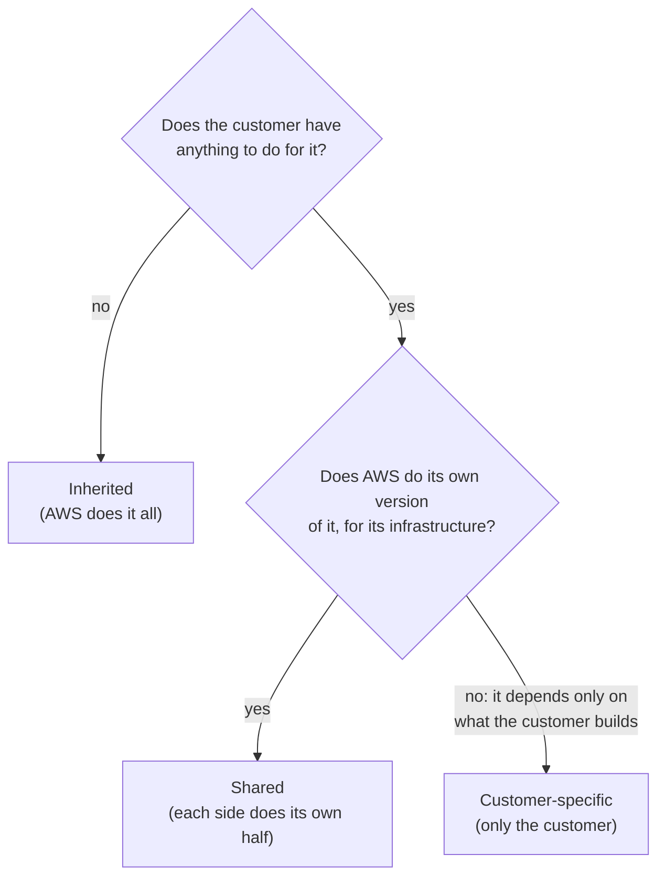

# "Shared" means each side does its own half of the same kind of work, not the same task together

AWS sorts security safeguards into three kinds. Some you **inherit** from AWS without lifting a finger. Some are **shared**: AWS and you each do the same kind of work, but on different things. Some are **customer-specific**: only you can do them. In this lesson you learn to tell the three apart and to explain what "shared" really means.

**For:** an adult studying alone, possibly new to IT, who wants to understand AWS and use it safely. **Time:** about 35 minutes. Reading works on a phone.

**Before you start:** read [lesson 04.01](01-security-of-vs-in-the-cloud.md) first; this lesson uses its "line" between AWS's side and yours. It also points back to pages [03](https://github.com/AutomateTheCloud/atc-study-aws_account_guardrails/blob/main/primer/03-your-everyday-admin-identity.md) and [06](https://github.com/AutomateTheCloud/atc-study-aws_account_guardrails/blob/main/primer/06-safe-defaults.md) of the guardrails primer; if you skipped them, the lesson explains what they did.

## Warm-up: what you remember

1. (Lesson 04.01.) The bakery's website runs on an EC2 virtual server. Who patches that server's guest operating system?
2. (Lesson 02.04.) Before the move to AWS, the bakery's servers sat in a back room. Name two costs of that room that had nothing to do with the servers' software.
3. (Primer page 03.) You set a password policy for your account's IAM users. Did AWS set it for you, or did you?

Feedback

1. **The bakery.** On EC2, AWS says the customer manages the guest operating system, including its patches.
2. Any two of: space, power, cooling, the network line, and someone's time to look after it. Those are the physical and environmental side of running servers, which this lesson calls inherited controls.
3. **You did.** AWS offered the setting; choosing the rules was your job. That is configuration management on your side of the line.

## What you'll learn

By the end of this lesson, you can explain what "shared" means in the shared responsibility model, with examples of inherited, shared and customer-specific controls (objective 04.02a).

Try these first. The answers are in the lesson.

1. Patch management is called a "shared control". Does that mean AWS helps you patch your EC2 server?
2. An auditor asks the bakery, "How do you protect your servers from fire and power cuts?" What should the bakery say?

## The big picture: three kinds of control

The difference between the three kinds is who does the work. The graphic shows each kind as two parts, AWS's and yours.

*Notice that only the middle panel has work on both sides, and even there each side has its own part. No panel shows the two sides working on the same thing.*

**Long description.** Three panels side by side. Inherited: AWS's part is all of it; your part is nothing to do, because you inherit it. AWS's example is physical and environmental controls; for the bakery, no more locking the server room or keeping it cool. Shared, highlighted: AWS does its own half, for the infrastructure; you do your own half, for what you run. AWS's examples are patch management, configuration management, and awareness and training; for the bakery, AWS patches its hosts and the bakery patches its web server. Customer-specific: AWS has no counterpart, and your part is all of it. AWS's example is routing or zoning data within specific security environments; for the bakery, the order database accepts connections only from the web server.

## Key terms (skip if you know them)

- **IT control:** a safeguard, such as a rule, a process or a setting, that lowers a risk to computer systems. Not the everyday "control" of steering or operating something: here it means a protection someone can check.
- **Audit:** an independent check that controls exist and work. An **auditor** does the checking.
- **Compliance:** meeting the rules that apply to you, such as laws, industry standards or a customer's requirements.
- **Inherited control:** a control AWS fully carries out, which you get the benefit of.
- **Shared control:** a kind of control that applies on both sides, with each side doing it for its own things.
- **Customer-specific control:** a control that depends only on what you build, so only you can do it.
- **Patch management, configuration management, awareness and training:** keeping software updated; keeping systems set up correctly; teaching people to work securely.

## Controls are the safeguards an auditor checks

The shared responsibility model covers controls as well as tasks ([Shared Responsibility Model](https://aws.amazon.com/compliance/shared-responsibility-model/)). When an organization moves to AWS, AWS takes over the controls for the physical infrastructure, which the organization used to run itself. The result, in AWS's words, is a "distributed control environment": some controls run at AWS, some at the customer, and some at both.

This matters when someone asks for proof. Banks, insurers, big customers and regulators often send a security questionnaire or an auditor. For each control, they want to know who carries it out and how you know it works. AWS says customers can use AWS's control and compliance documentation for their part of the check. Module 09 shows you where AWS publishes it.

> **Your turn:** The bakery's insurer sends a questionnaire. Explain to the owner in two sentences why she can't answer every question with "AWS handles that".

Model answer

AWS carries out only some controls, mostly the physical ones; others she shares with AWS, and some are hers alone. For each question she must say who does the work, and for her own controls she must show evidence herself.

## Inherited controls: AWS does all of it

An inherited control is one you take over from AWS completely. AWS gives one example: **physical and environmental controls**. These cover the buildings and their surroundings, such as who can enter, and the power, cooling and network that keep machines running. You can't do anything about these controls on AWS, and you don't need to.

For the bakery, this is the old back room again. Locking it, keeping it cool, and keeping the power on were the bakery's controls. Now they are AWS's, and the bakery inherits them.

Inheriting a control doesn't remove the need for evidence. AWS suggests reviewing third-party audit reports to see which controls you inherit and which you still need to put in place yourself ([Shared Responsibility Model](https://aws.amazon.com/compliance/shared-responsibility-model/)). So the bakery's answer to the fire-and-power question is: "AWS carries out those controls; here is AWS's audit report."

> **Check:** Which of these is an inherited control for a company running on AWS?
>
> A. Training the company's staff to spot fake sign-in pages\
> B. Controlling who can enter the data center building\
> C. Patching the operating system on the company's EC2 servers\
> D. Deciding which staff may read customer records

Feedback

**B is right.** Physical access to the buildings is a physical and environmental control, which customers fully inherit from AWS.

- **A is wrong.** Training is shared: AWS trains its staff, and the company must train its own.
- **C is wrong.** Patching the guest OS on EC2 is the customer's half of patch management, a shared control.
- **D is wrong.** Access to your own data is always yours.

## Shared controls: each side does its own half

A shared control applies to both AWS's infrastructure and your part, "in completely separate contexts", as AWS puts it ([Shared Responsibility Model](https://aws.amazon.com/compliance/shared-responsibility-model/)). AWS sets the requirements for the infrastructure; you put your own version of the control in place for what you run. AWS gives three examples, shown in the graphic.

*Notice the dashed divider down the middle. It is the line from lesson 04.01. Each row has work on both sides of it, but no single task crosses it.*

**Long description.** Three rows, each split into AWS's half and your half by a dashed divider. Patch management: AWS patches and fixes flaws in its infrastructure; you patch the guest operating system and applications you run, such as the bakery's web server and the libraries in its order functions. Configuration management: AWS configures its own infrastructure devices; you configure your operating systems, databases, applications and resource settings, such as the web server's security group and Block Public Access on the photo bucket. Awareness and training: AWS trains AWS employees; you train your own people, such as the owner, her nephew and the new teammate. A note says a question about one specific task has one answer, one side; the control as a whole is what is shared.

**Patch management.** AWS patches and fixes flaws in its infrastructure. You patch your guest operating systems and applications. How much your half holds depends on the service, which is the line from 04.01:

| Bakery part | AWS's half of patching | The bakery's half of patching |
|---|---|---|
| Web server (EC2) | The host and virtualization | The guest operating system and the website software |
| Order database (RDS) | Also the operating system and the database software ([RDS User Guide](https://docs.aws.amazon.com/AmazonRDS/latest/UserGuide/Welcome.html)) | Nothing on the database itself |
| Order functions (Lambda) | Also the servers and, by default, the managed runtime ([Lambda runtimes](https://docs.aws.amazon.com/lambda/latest/dg/lambda-runtimes.html)) | The function code and its libraries; moving off retired runtimes |
| Photo storage (S3) | Everything under the stored data | Nothing to patch |

**Configuration management.** AWS keeps its own infrastructure devices set up correctly. You keep your guest operating systems, databases and applications set up correctly, and the settings of the AWS resources you create. You have done this already: on [primer page 06](https://github.com/AutomateTheCloud/atc-study-aws_account_guardrails/blob/main/primer/06-safe-defaults.md) you turned on Block Public Access for your account, and on [primer page 03](https://github.com/AutomateTheCloud/atc-study-aws_account_guardrails/blob/main/primer/03-your-everyday-admin-identity.md) you set a password policy. For the bakery, it includes the web server's security group rules.

**Awareness and training.** AWS trains its own employees, and you must train yours, because AWS's training does nothing for the bakery's staff. The owner, her nephew and the new teammate each need to know the bakery's rules: sign in with MFA, never share a password, and report anything unexpected. This guide is part of your half too.

> **Your turn:** For each shared control, write one sentence for the new teammate's first day: what is AWS's half, and what is hers?

Model answer

- **Patch management:** AWS patches the machines under our site; the photo storage needs no patching at all, and the bakery keeps the web server patched.
- **Configuration management:** AWS keeps its own equipment set up; you never change the photo bucket's public-access settings.
- **Awareness and training:** AWS trains its staff; you are learning our rules today, starting with MFA on your sign-in.

Any answer that gives AWS a half for its own things and her a half for the bakery's things is right.

## "Shared" doesn't mean both sides do the same task

You may have read that "shared responsibility" means AWS and you work on the same tasks together, so that patching your EC2 server is something AWS helps with. It doesn't. A shared control is a *kind* of work that both sides do, each for its own things. Any specific task belongs to one side only. The customer alone patches the guest operating system on EC2; AWS alone patches the host underneath.

Everyday English is the problem: "shared" usually means "done together". Practice questions also offer "both AWS and the customer" as an answer choice. It is almost never right for a specific task, even though patch management, as a whole, is a shared control.

Use this rule. If a question names **one specific thing** ("who patches the guest OS on EC2?"), the answer is one side. If it asks which **type of control** is shared ("which is a shared control?"), patch management, configuration management and training are the answers.

> **Check:** Which statement about patch management is correct?
>
> A. AWS and the customer patch the EC2 guest operating system together.\
> B. It is a shared control: AWS patches its infrastructure, and the customer patches its own guest operating systems and applications.\
> C. It is an inherited control, so AWS patches everything.\
> D. It is a customer-specific control, so AWS patches nothing.

Feedback

**B is right.** Each side patches its own things, in separate contexts.

- **A is wrong.** No specific task is done by both. The EC2 guest OS is the customer's alone.
- **C is wrong.** An inherited control leaves the customer nothing to do, but customers patch their own systems.
- **D is wrong.** AWS patches its infrastructure, so it has a half.

## Customer-specific controls: only you can do these

A customer-specific control depends on what you build, so AWS has no matching half. AWS's example is "service and communications protection or zone security": rules that keep certain data inside certain protected areas, or send it only along certain paths ([Shared Responsibility Model](https://aws.amazon.com/compliance/shared-responsibility-model/)). Only you know which of your data needs that, and why.

For the bakery, this might look like:

- the order database accepts connections only from the web server, never from the internet;
- customers' phone numbers live only in the order database, never in the photo bucket.

You might ask: isn't a database rule configuration management? The setting itself is. What makes it customer-specific is the requirement behind it, which comes only from the bakery's own application. AWS's three groups are examples to reason with, not a complete sorting of every control. To sort one, use the flowchart.

*Notice that the first question is about you. Only if you have work to do do you ask whether AWS has a matching half.*

**Long description.** A decision flowchart. First question: does the customer have anything to do for this control? If no, it is inherited: AWS does it all. If yes, ask: does AWS do its own version of it for its infrastructure? If yes, it is shared: each side does its own half. If no, because it depends only on what the customer builds, it is customer-specific: only the customer does it.

| | Inherited | Shared | Customer-specific |
|---|---|---|---|
| Who does the work | AWS only | Each side, on its own things | The customer only |
| AWS's example | Physical and environmental controls | Patch management, configuration management, awareness and training | Routing or zoning data in specific security environments |
| Bakery example | Locking and cooling the server room is now AWS's | The bakery patches its web server; AWS patches the host | Order data reachable only from the web server |
| Evidence for an auditor | AWS's audit reports | AWS's reports for its half; the bakery's own records for its half | The bakery's own records |

**What's the same:** all three are safeguards someone can check. **What differs:** who does the work, and so who must show evidence.

## Worked example: answering the insurer's questionnaire

The bakery's insurer sends five questions. Here is how someone who knows the model answers each: name the control, sort it with the flowchart, then say who shows the evidence.

1. **"How are your servers protected from fire, floods and power cuts?"** Physical and environmental. The bakery has nothing to do: **inherited**. Evidence: AWS's audit reports.
2. **"How do you keep operating systems up to date?"** Patch management, with work on both sides: **shared**. The bakery patches the web server's guest OS; AWS patches the hosts, and the database's OS on RDS. Evidence: AWS's reports for its half; the bakery's patch records for the web server.
3. **"Have your staff been trained in security?"** Awareness and training: **shared**, but the question is about the bakery's staff, so the answer is the bakery's alone. AWS training its own employees doesn't count.
4. **"Who can reach your customer data, and from where?"** Access to data is always the customer's. Keeping the order data reachable only from the web server is a **customer-specific** requirement. Evidence: the bakery's own settings and records.
5. **"Are your systems' security settings reviewed?"** Configuration management: **shared**. AWS sets up its devices; the bakery reviews its own settings, such as Block Public Access and the security group.

What the expert did each time: split the question into AWS's things and the bakery's things before answering. A question about the bakery's own staff or settings never has "AWS" as the whole answer.

> **Your turn:** Answer this sixth question in two sentences, naming the kind of control: "Who replaces failed hard disks in the servers that store your orders?"

Model answer

AWS does: the hardware under RDS is part of the physical infrastructure, so this is a control the bakery inherits. The bakery's evidence is AWS's audit reports, not its own records.

## In real work: map every requirement to a side

At work, security and compliance teams keep a list of the controls they must meet. For each one they record who carries it out: AWS, the organization, or both. This is the Well-Architected security pillar's [SEC01-BP03 Identify and validate control objectives](https://docs.aws.amazon.com/wellarchitected/latest/security-pillar/sec_securely_operate_control_objectives.html) in action. AWS's advice is to review its audit reports to see what you inherit, and then put the remaining controls in place yourself ([Shared Responsibility Model](https://aws.amazon.com/compliance/shared-responsibility-model/)).

Two habits from this lesson carry into every module:

- When a control is shared, write down **your** half. That is the half nobody else will do.
- Training counts. Each person with access to your account is part of your half of awareness and training, including you.

## Going deeper (optional): the same pattern beyond security

AWS splits other responsibilities the same way. In the disaster recovery whitepaper, AWS is responsible for the resilience of the cloud, and you for resilience in it, for example by backing up your own data ([Disaster Recovery of Workloads on AWS](https://docs.aws.amazon.com/pdfs/whitepapers/latest/disaster-recovery-workloads-on-aws/disaster-recovery-workloads-on-aws.pdf)). The Well-Architected Sustainability Pillar describes sustainability of and in the cloud in the same way ([Sustainability Pillar](https://docs.aws.amazon.com/pdfs/wellarchitected/latest/sustainability-pillar/wellarchitected-sustainability-pillar.pdf)). Modules 03 and 05 return to resilience.

## Summary

- **Controls are safeguards an auditor checks.** The shared responsibility model divides controls as well as tasks.
- **Inherited controls** are AWS's alone, such as physical and environmental controls. You show AWS's audit reports as evidence.
- **Shared controls** are patch management, configuration management, and awareness and training. Each side does its own half, in its own context, and how big your half is depends on the service.
- **"Shared" doesn't mean done together.** A specific task belongs to one side; the kind of control is what is shared.
- **Customer-specific controls** come only from what you build, such as keeping certain data in certain protected areas.
- **In real work**, map every control to a side, and write down your half.

**For the owner's note:** add one line on training: the new teammate's training is the bakery's job, not AWS's.

## Practice

1. **Name the three kinds of control in the shared responsibility model, with one AWS example of each.**

   

Feedback

   Inherited: physical and environmental controls. Shared: patch management, configuration management, or awareness and training. Customer-specific: service and communications protection, or zone security (keeping data in specific security environments).

   

2. **Which of these is a shared control?**

   A. Physical security of the data centers\
   B. Configuration management\
   C. Zoning sensitive data into a specific security environment\
   D. Replacing failed hardware

   

Feedback

   **B is right.** AWS configures its infrastructure devices; customers configure their own operating systems, databases and applications.

   - **A is wrong.** Physical security is inherited.
   - **C is wrong.** That is AWS's example of a customer-specific control.
   - **D is wrong.** Hardware is AWS's alone, part of the physical infrastructure.

   

3. **A colleague says, "Training is a shared control, so AWS's security training covers our staff." What's wrong with that, in two sentences?**

   

Feedback

   **Model answer:** Shared means each side does its own half: AWS trains AWS employees, and the customer must train its own. AWS's training doesn't reach the colleague's staff at all.

   

4. **A company runs its application on EC2 and its database on RDS. For patch management, which part is the company's?**

   A. Patching the RDS database software\
   B. Patching the EC2 guest operating system\
   C. Patching the hosts under both services\
   D. None, because patch management is inherited

   

Feedback

   **B is right.** On EC2, the customer patches the guest OS.

   - **A is wrong.** On RDS, AWS patches the database software.
   - **C is wrong.** The hosts are AWS's on every service.
   - **D is wrong.** Patch management is shared, not inherited.

   

5. **(From lesson 04.01.) On which service is the line between AWS and the customer lowest: EC2, RDS, Lambda or S3? Why?**

   

Feedback

   **EC2.** The customer runs the guest operating system and everything installed on it, so the customer has more layers than on the other three.

   

6. **(From lesson 02.05.) The bakery decides to save money by skipping security training for the new teammate. Which pillar does that weaken, and is it a trade-off the Framework accepts?**

   

Feedback

   **Security.** Lesson 02.05 showed that security is generally not traded away against other pillars, such as cost. And training is the bakery's half of a shared control: if the bakery skips it, nobody does it.

   

**Next:** [Identities](03-identities.md) starts the second half of the module: who can do what in your account. To practice sorting responsibilities, try [Simulation S3: the responsibility slider](08-sim-responsibility-slider.md).

## Where to check the current details

- [Shared Responsibility Model](https://aws.amazon.com/compliance/shared-responsibility-model/), AWS, including the inherited, shared and customer-specific controls (checked 2026-10-24)
- [What is Amazon RDS?](https://docs.aws.amazon.com/AmazonRDS/latest/UserGuide/Welcome.html), Amazon RDS User Guide (checked 2026-10-24)
- [Lambda runtimes](https://docs.aws.amazon.com/lambda/latest/dg/lambda-runtimes.html), AWS Lambda Developer Guide (checked 2026-10-24)
- [Disaster Recovery of Workloads on AWS](https://docs.aws.amazon.com/pdfs/whitepapers/latest/disaster-recovery-workloads-on-aws/disaster-recovery-workloads-on-aws.pdf), AWS whitepaper, and the [Sustainability Pillar](https://docs.aws.amazon.com/pdfs/wellarchitected/latest/sustainability-pillar/wellarchitected-sustainability-pillar.pdf) of the Well-Architected Framework (checked 2026-10-24)

---

"Shared, inherited and customer-specific controls" by Automate the Cloud Inc., licensed under CC BY-NC 4.0 with the Additional Permission for Internal Training from Automate the Cloud Inc.
License: https://creativecommons.org/licenses/by-nc/4.0/
Permission: https://automatethe.cloud/licenses/atc-internal-training-permission.txt
