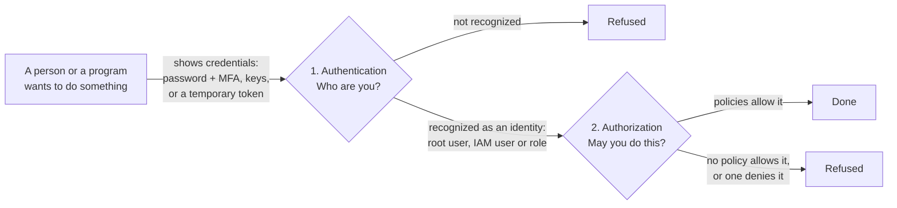
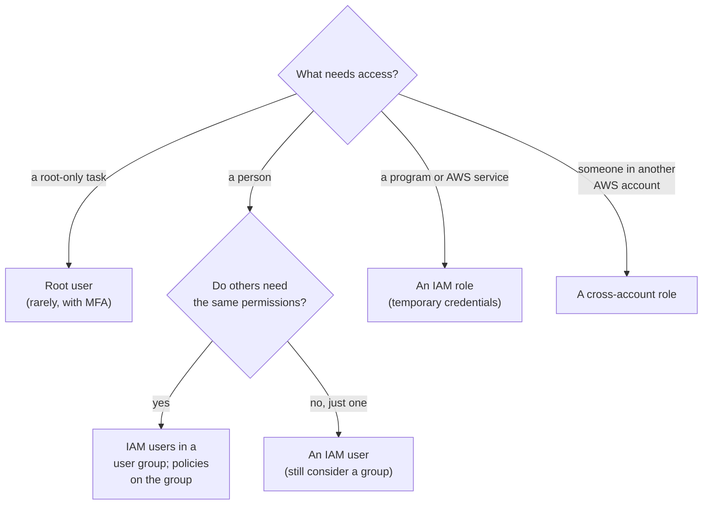

# Every request to AWS starts with an identity: pick the right kind for each person and program

Before AWS does anything you ask, it checks who you are and whether you may do it. The first check is about **identities**, and an AWS account has four kinds: the root user, IAM users, IAM user groups and IAM roles. In this lesson you learn what each is for, how to pick one for a case, and which few tasks only the root user can do.

**For:** an adult studying alone, possibly new to IT, who wants to understand AWS and use it safely. **Time:** about 35 minutes. Reading works on a phone.

**Before you start:** this lesson builds on the [guardrails primer](https://github.com/AutomateTheCloud/atc-study-aws_account_guardrails/blob/main/primer/00-read-this-first.md), especially [page 02, the root user](https://github.com/AutomateTheCloud/atc-study-aws_account_guardrails/blob/main/primer/02-secure-the-root-user.md), and [page 03, your everyday admin identity](https://github.com/AutomateTheCloud/atc-study-aws_account_guardrails/blob/main/primer/03-your-everyday-admin-identity.md). If you haven't done the primer, the lesson still makes sense, but do the primer before [Lab 03](06-lab-03-a-group-and-a-policy.md). [Lesson 04.01](01-security-of-vs-in-the-cloud.md) explains why access is always your job, not AWS's.

## Warm-up

Answer from memory first, then check.

1. *(Primer page 02)* You protected the root user with a passkey and a backup device. Why does the primer then tell you to stop signing in as root for daily work?
2. *(Primer page 03)* You attached the `AdministratorAccess` policy to a group called `Admins`, then put your IAM user in the group. Why a group?
3. *(Lesson 02.05)* Deciding who may sign in to the bakery's AWS account belongs to which Well-Architected pillar?

Feedback

1. Root can do everything, and IAM policies can't limit it. One wrong click or one stolen session as root can change anything, billing included. Only a few tasks need it; this lesson lists them.
2. When a second admin joins, you add them to the group instead of repeating the setup, and you see in one place who has admin rights.
3. **Security.** Its design principle "[Implement a strong identity foundation](https://docs.aws.amazon.com/wellarchitected/latest/framework/sec-design.html)" is about exactly this.

## What you'll learn

This lesson, with the next two, covers task [2.3](https://docs.aws.amazon.com/aws-certification/latest/cloud-practitioner-02/cloud-practitioner-02-domain2.html#cloud-practitioner-02-task2.3) of the AWS Certified Cloud Practitioner (CLF-C02) exam. By the end of it, you can:

- tell authentication from authorization;
- pick the right kind of identity for a person, a team, a program or another account, and say why (objective 04.03a);
- recognize the tasks that only the root user can do, and the one that older material wrongly adds (objective 04.03b).

Guess before you read on:

1. Can you sign in to AWS as a group?
2. Can an IAM user with the `AdministratorAccess` policy close the AWS account?

## The big picture: two questions for every request

Every time a person or a program asks AWS to do something, AWS asks two questions in order ([How IAM works](https://docs.aws.amazon.com/IAM/latest/UserGuide/intro-structure.html)). This lesson is about the first. [Lesson 04.04](04-policies-and-least-privilege.md) covers the second.

*Notice that both checks must pass, in order. Being recognized in step 1 gives you no permissions; permissions come only from step 2.*

**Long description.** A flowchart from left to right. A person or program shows credentials (a password with MFA, keys, or a temporary token) to the first check, "Authentication: who are you?". If not recognized, the request is refused. If recognized as an identity (root user, IAM user or role), it goes to the second check, "Authorization: may you do this?". If policies allow it, it is done; if no policy allows it, or one denies it, it is refused.

## Key terms (skip if you know them)

- **Identity:** something AWS recognizes and attaches permissions to, such as a user or a role. In everyday speech your identity is *you*; in AWS one person can use several identities, and one role can be used by many people or programs.
- **Credentials:** what an identity shows to prove who it is: a password, an MFA device, an access key, or a temporary token.
- **Principal:** an identity that can make a request: the root user, an IAM user or an IAM role ([IAM roles](https://docs.aws.amazon.com/IAM/latest/UserGuide/id_roles.html)).
- **AWS Identity and Access Management (IAM):** the AWS service that holds your account's identities and permissions, at no extra charge (as of 2026-10-23; [IAM](https://aws.amazon.com/iam/)).

## Authentication asks who you are; authorization asks what you may do

**Authentication** is proving who you are: signing in is authentication. **Authorization** is AWS checking, for every single request after that, whether your identity may do that one action on that one thing. Everyday English uses "authorized" loosely for "let in"; in AWS it is the second check, and it repeats on every request.

When you signed in as your IAM admin user in the primer, your password and passkey were checked: authentication. When you then created a group, AWS checked that your identity was allowed to create groups: authorization.

| | Authentication | Authorization |
|---|---|---|
| Question | Who are you? | May you do this? |
| When | At sign-in, or when a program presents credentials | On every request, after authentication |
| Decided by | Credentials: password, MFA, keys, tokens | Policies ([04.04](04-policies-and-least-privilege.md)) |

> **Your turn:** Sort each event into authentication or authorization. (a) The bakery's new teammate types the wrong password and can't get in. (b) The teammate signs in fine but gets "access denied" on the billing pages. (c) A program presents an expired temporary token and is turned away.

Model answer

(a) **Authentication**: AWS couldn't confirm who it was. (b) **Authorization**: AWS knew who it was, but no policy allowed the action. (c) **Authentication**: expired credentials no longer prove anything. A quick test: if AWS knows who you are and still says no, it's authorization.

## An AWS account has four kinds of identity

Each kind answers a different need. The graphic compares them on the questions that matter most ([IAM identities](https://docs.aws.amazon.com/IAM/latest/UserGuide/id.html)).

*Notice the credentials labels: the root user and IAM users have long-term credentials that work until someone changes them; a role's are temporary; a group has none.*

**Long description.** Four cards. **Root user:** long-term credentials; the account's first identity, created with the sign-up email; signs in with email, password and MFA; IAM policies can't be attached to it; use only for tasks that need root. **IAM user:** long-term credentials; one named person or program; signs in with a console password and MFA, or a program uses access keys; limited by the policies on it or its groups; use for our labs' everyday admin, and programs that can't use a role. **IAM user group:** no credentials; a set of users who share policies; can't be signed in as; carries policies for its members; use to give a team the same permissions. **IAM role** (highlighted): temporary credentials; permissions anyone allowed can take on for a while; a person or program assumes it; limited by its permissions policy; use for programs and AWS services, other accounts, and people from a central sign-in.

- **The root user** is created with the account from the sign-up email address and password. It has complete access to every service and resource ([AWS account root user](https://docs.aws.amazon.com/IAM/latest/UserGuide/id_root-user.html)). IAM policies can't be attached to it, so nothing inside the account narrows its power ([Policies and the root user](https://docs.aws.amazon.com/IAM/latest/UserGuide/access_policies.html)).
- **An IAM user** is a named identity for one person or program, with long-term credentials: a console password, access keys, or both ([IAM users](https://docs.aws.amazon.com/IAM/latest/UserGuide/id_users.html)). Your `lab-admin` from the primer is one.
- **An IAM user group** is a set of IAM users; a policy on the group applies to every member ([IAM user groups](https://docs.aws.amazon.com/IAM/latest/UserGuide/id_groups.html)). A group isn't a principal: you can't sign in as one, and a resource's policy can't name a group. Groups can't contain other groups. A user can be in several groups and gets the permissions of each.
- **An IAM role** is a set of permissions not tied to one person. Whoever you allow can **assume** it, taking on its permissions for a session with temporary credentials; a role has no password or keys of its own ([IAM roles](https://docs.aws.amazon.com/IAM/latest/UserGuide/id_roles.html)). Programs on AWS, other accounts and centrally signed-in people all reach an account through roles ([04.05](05-credentials-and-federation.md)).

You have met roles already. The IAM dashboard in the primer showed roles you didn't create. They are **service-linked roles**: roles an AWS service creates and owns so it can act for you. You can view their permissions but not edit them.

**What's the same:** all four live in IAM, and all except root get their permissions only from policies. **What differs:** who they are for, and whether their credentials are long-term, temporary or absent.

> **Check:** Which statement about IAM user groups is true?
>
> A. A group can sign in with its own password.\
> B. You can put a group inside another group.\
> C. A policy attached to a group applies to every user in it.\
> D. A user can belong to only one group.

Feedback

**C is right.** That is what groups are for.

- **A is wrong.** A group has no credentials and isn't a principal.
- **B is wrong.** Groups contain users only; they can't be nested.
- **D is wrong.** A user can be in several groups and gets the permissions of each.

## An IAM admin is not the root user

You may have read that an IAM user with `AdministratorAccess` is "the same as root". That's not right, for two reasons:

1. **Some tasks need the root user itself.** No policy, however broad, lets an IAM user do them. The next section lists them.
2. **An admin can be limited; root can't.** An admin's power comes from a policy, which can be removed, narrowed or blocked by a deny. Root's power doesn't come from IAM policies: in general, AWS allows root's requests on the account's own resources ([How IAM works](https://docs.aws.amazon.com/IAM/latest/UserGuide/intro-structure.html)). A resource's own policy can still block root: a bucket policy with an explicit deny stops root like anyone else (which is why one root-only task is fixing a bucket policy that denies everyone). And AWS Organizations, in module 09, can restrict a member account's root user across the whole account.

The idea is tempting because in daily work the two seem to do the same things. The difference shows at the edges, and the exam tests the edges.

## Only the root user can do a short list of tasks

AWS keeps a list of **root-only tasks**: tasks that need the root user's credentials ([Tasks that require root user credentials](https://docs.aws.amazon.com/IAM/latest/UserGuide/id_root-user.html)). The graphic sorts the current list against tasks that look as if they need root but don't.

*Notice the trap at the top right: changing the AWS Support plan is not on AWS's current list, although much older material says it is.*

**Long description.** Two panels, checked against AWS's list on 2026-10-23. Left, "Only the root user can": change the account's email address, root password or root access keys (standalone account); close the account, or reopen it after closing; restore permissions when the only IAM admin has locked themselves out; turn on IAM access to the billing pages; view certain tax invoices and some other billing tasks; sign up for AWS GovCloud (US); register as a seller in the Reserved Instance Marketplace; recover a KMS key nobody can manage, through AWS Support; turn on MFA Delete for an S3 bucket; fix an S3 bucket policy or SQS queue policy that denies everyone. Right, "No root needed": change the AWS Support plan (marked "Trap: older material says root"); change the account name or contact details; choose which Regions the account uses; create IAM users, groups and roles; create budgets and read bills, once IAM access to billing is on.

You don't need to know every service in the list yet. Learn the pattern: **root-only tasks change the account itself or rescue it from a lockout.** You did one in the primer: turning on IAM access to the billing pages.

### "Changing the Support plan needs root" is out of date

Older material and many practice questions list changing the AWS Support plan as root-only. AWS's current list doesn't include it (checked 2026-10-23). It's tempting because the claim is everywhere, and the Support plan sounds like an account-level choice. If an option offers it as root-only, the current documentation doesn't support it. Module 12 covers the Support plans.

> **Your turn:** Root only, or can an IAM admin do it? Give the pattern that tells you. (a) Close the bakery's AWS account. (b) Create a group for the shop staff. (c) Change the email address used to sign up. (d) Upgrade from Basic Support to a paid Support plan.

Model answer

(a) **Root only**: it changes the account itself. (b) **IAM admin**: ordinary IAM work. (c) **Root only**, for a standalone account like the bakery's: the sign-up email is the root user's. (In an account that belongs to an AWS Organizations organization, an authorized admin in the management account can change it instead.) (d) **IAM admin**: not on AWS's root-only list (as of 2026-10-23); this is the trap.

## Protecting the root user is your job, and you've already done it

Securing the identities in your account is your side of the shared responsibility model ([04.01](01-security-of-vs-in-the-cloud.md)). AWS's advice for the root user ([Root user best practices](https://docs.aws.amazon.com/IAM/latest/UserGuide/root-user-best-practices.html)) is what you did in [primer page 02](https://github.com/AutomateTheCloud/atc-study-aws_account_guardrails/blob/main/primer/02-secure-the-root-user.md):

| AWS's advice | What you did in the primer |
|---|---|
| Use MFA, preferably a passkey or security key | Registered a passkey and a backup authenticator app |
| Never create root access keys | Checked for **Access keys (0)** |
| Keep recovery paths (email, phone) under control | Checked contact details; added alternate contacts |
| Watch for root activity | Filtered CloudTrail Event history by `root` |
| Don't use root for everyday work | Created an IAM admin user and signed out of root |

### Root MFA isn't optional

You may have read that root MFA is a recommended extra. That is out of date: AWS now requires MFA on the root user of every kind of account, registered within 14 days of the first sign-in attempt (checked 2026-10-23; [AWS account root user](https://docs.aws.amazon.com/IAM/latest/UserGuide/id_root-user.html)). Older material says "optional" because it once was. Our test account wasn't forced to add MFA at sign-up, which is why the primer has you add it at once.

## Worked example: an identity for every need at the bakery

The bakery's ordering site now runs on AWS, with its cake photos stored there. The owner asks you to set up access for four needs. The expert's method: ask *what* needs access (a person, a team, a program, or an outsider), then *how long* the access should last.

1. **The owner, who owns the account but rarely touches AWS.** *Thinking:* someone must hold the root user, but root is only for root-only tasks. **Answer:** root stays locked away with MFA; for anything else the owner gets an IAM user.
2. **A new teammate who looks after the cake photos, and another joining next month.** *Thinking:* both need the same permissions; attaching them user by user means repeated work and drift. **Answer:** an IAM user each, in one group, with the permissions on the group. (A company with many accounts would use IAM Identity Center; [04.05](05-credentials-and-federation.md) explains why our labs don't.)
3. **The website's code, on a server in AWS, which reads the photos.** *Thinking:* a program, not a person. Access keys on the server would never expire. **Answer:** an IAM role the server assumes, so the code gets temporary credentials that renew on their own.
4. **A delivery company, with its own AWS account, that must read the day's orders.** *Thinking:* outsiders; I don't want to manage users for them. **Answer:** a role in the bakery's account that the delivery company's account may assume: a cross-account role ([04.05](05-credentials-and-federation.md)).

*Notice that only people end up as IAM users; programs and outsiders get roles. In a company, people usually come in through IAM Identity Center and receive roles too (lesson 04.05).*

**Long description.** A decision flowchart starting at "What needs access?". A root-only task leads to the root user, used rarely with MFA. A person leads to "Do others need the same permissions?": yes leads to IAM users in a user group with policies on the group; no leads to an IAM user, still considering a group. A program or AWS service leads to an IAM role with temporary credentials. Someone in another AWS account leads to a cross-account role.

> **Your turn:** Pick the identity and give one reason. (a) A nightly program on an AWS server that copies the day's orders into a report. (b) Three shop assistants who all read the stock list. (c) Resetting the bakery account's root password.

Model answer

(a) **An IAM role**: a program on AWS should get temporary credentials, not stored keys. (b) **Three IAM users in one group**, so they stay identical and the next assistant is one step to add. (c) **The root user**: changing the root password is root-only.

## In real work: identity is the foundation of security

The first questions in any security review are about identities: who can sign in, with what, and who still uses root. The Well-Architected security pillar's design principle "[Implement a strong identity foundation](https://docs.aws.amazon.com/wellarchitected/latest/framework/sec-design.html)" covers this lesson, through three best practices:

- [SEC01-BP02 Secure account root user and properties](https://docs.aws.amazon.com/wellarchitected/latest/security-pillar/sec_securely_operate_aws_account.html): use root only for the tasks that need it. The pillar names any other use as an anti-pattern.
- [SEC02-BP06 Employ user groups and attributes](https://docs.aws.amazon.com/wellarchitected/latest/security-pillar/sec_identities_groups_attributes.html): give permissions to groups, not one person at a time.
- [SEC02-BP02 Use temporary credentials](https://docs.aws.amazon.com/wellarchitected/latest/security-pillar/sec_identities_unique.html): prefer roles, whose credentials expire, to long-term keys.

## Summary

- **Two questions:** authentication asks who you are; authorization asks, on every request, whether that identity may do it.
- **Four kinds of identity:** the root user (all-powerful, long-term credentials, not limited by IAM policies); IAM users (one person or program, long-term credentials); IAM user groups (shared policies, no credentials, not nested); IAM roles (assumed, temporary credentials).
- **An IAM admin is not root:** some tasks need root itself, and an admin's power comes from policies that can be narrowed.
- **Root-only tasks** change the account or rescue it from a lockout. Changing the Support plan isn't one (as of 2026-10-23).
- **Protecting root** means required MFA, no access keys, safe recovery details, watching for its use, and no daily work as root.

## Practice

1. **Which kind of identity gets temporary credentials each time it's used?**

   A. The root user\
   B. An IAM user\
   C. An IAM user group\
   D. An IAM role

   

Feedback

   **D is right.** Assuming a role gives temporary credentials for that session.

   - **A is wrong.** Root signs in with a long-term password, plus MFA.
   - **B is wrong.** IAM users have long-term credentials: a password, access keys, or both.
   - **C is wrong.** A group has no credentials; it only carries policies.

   

2. **Which tasks require the root user? (Choose two.)**

   A. Closing a standalone AWS account\
   B. Changing the AWS Support plan\
   C. Creating an IAM user group\
   D. Turning on IAM access to the billing pages\
   E. Creating a budget

   

Feedback

   **A and D are right.** Both are on AWS's current root-only list (checked 2026-10-23).

   - **B is wrong.** Older material says so, but it isn't on AWS's current list.
   - **C is wrong.** Creating groups is ordinary IAM work.
   - **E is wrong.** Once billing access is on, an IAM user with permission can create budgets, as you did in the primer.

   

3. **A colleague says: "Our IAM admin has `AdministratorAccess`, so we can remove root's MFA and forget about root." What two things would you tell them?**

   

Feedback

   **Model answer:** The IAM admin can't do root-only tasks, such as closing the account or restoring access after a lockout, so root must stay usable. And root MFA is required by AWS; root is the one identity IAM policies can't limit, so it needs the strongest protection, not the weakest.

   

4. **The bakery's website code runs on an AWS server and must read the cake photos. Why is an IAM role better than an IAM user with access keys?**

   

Feedback

   **Model answer:** A role gives the code temporary credentials that expire and renew on their own, so nothing long-lived sits on the server to be stolen. Access keys would work until someone deletes them, for anyone who copied them.

   

5. *(From lesson 02.01)* **The bakery runs its ordering site on AWS and its till system in the shop, with orders flowing between them. Which deployment model is that, and who manages the identities that can reach the AWS side?**

   

Feedback

   **Model answer:** Hybrid: some parts in the cloud, some on-premises, connected. Whatever the model, the bakery manages who can access its AWS account; that is the customer's side of the shared responsibility model.

   

**Next:** [Policies and least privilege](04-policies-and-least-privilege.md) shows how AWS answers "may you do this?", and how to give each identity only what it needs.

## Where to check the current details

- [How IAM works](https://docs.aws.amazon.com/IAM/latest/UserGuide/intro-structure.html), IAM User Guide (checked 2026-10-23)
- [IAM identities](https://docs.aws.amazon.com/IAM/latest/UserGuide/id.html), with its pages on [users](https://docs.aws.amazon.com/IAM/latest/UserGuide/id_users.html), [user groups](https://docs.aws.amazon.com/IAM/latest/UserGuide/id_groups.html) and [roles](https://docs.aws.amazon.com/IAM/latest/UserGuide/id_roles.html), IAM User Guide (checked 2026-10-23)
- [AWS account root user](https://docs.aws.amazon.com/IAM/latest/UserGuide/id_root-user.html), with the current list of tasks that require root user credentials, IAM User Guide (checked 2026-10-23). The list changes; check it before you rely on it.
- [Root user best practices for your AWS account](https://docs.aws.amazon.com/IAM/latest/UserGuide/root-user-best-practices.html), IAM User Guide (checked 2026-10-23)
- [Security best practices in IAM](https://docs.aws.amazon.com/IAM/latest/UserGuide/best-practices.html), IAM User Guide (checked 2026-10-23)
- [AWS Certified Cloud Practitioner (CLF-C02) exam guide](https://docs.aws.amazon.com/aws-certification/latest/cloud-practitioner-02/cloud-practitioner-02.html) (checked 2026-10-23)

---

"Identities" by Automate the Cloud Inc., licensed under CC BY-NC 4.0 with the Additional Permission for Internal Training from Automate the Cloud Inc.
License: https://creativecommons.org/licenses/by-nc/4.0/
Permission: https://automatethe.cloud/licenses/atc-internal-training-permission.txt
