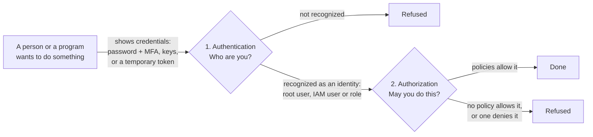

# Every request to AWS starts with an identity: pick the right kind for each person and program

Before AWS does anything you ask, it checks who you are and whether you may do it. An AWS account has four kinds of identity, the root user, IAM users, IAM user groups and IAM roles, and a few tasks only the root user can do.

**For:** an adult studying alone, possibly new to IT, who wants to understand AWS and use it safely. **Time:** about 20 minutes. Reading works on a phone.

**Before you start:** this lesson builds on [primer page 02, the root user](https://github.com/AutomateTheCloud/atc-study-aws_account_guardrails/blob/main/primer/02-secure-the-root-user.md), and [page 03, your everyday admin identity](https://github.com/AutomateTheCloud/atc-study-aws_account_guardrails/blob/main/primer/03-your-everyday-admin-identity.md).

## Warm-up

1. *(Primer page 02)* You protected the root user with a passkey and a backup device. Why does the primer then tell you to stop signing in as root for daily work?
2. *(Primer page 03)* You attached the `AdministratorAccess` policy to a group called `Admins`, then put your IAM user in the group. Why a group?

Feedback

1. Root can do everything, and no policy can limit it, so one wrong click or stolen session as root can change anything. Only a few tasks need it; this lesson lists them.
2. When a second admin joins, you add them to the group instead of repeating the setup, and you see in one place who has admin rights.

## What you'll learn

By the end of this lesson, you can pick the right kind of identity for a person, a team, a program or another account, and say why (objective 04.03a), and recognize the tasks that only the root user can do (objective 04.03b).

Guess before you read on: can an IAM user with the `AdministratorAccess` policy close the AWS account?

## The big picture: two questions for every request

**AWS Identity and Access Management (IAM)** is the service that holds your account's identities and permissions, at no extra charge (as of 2026-10-23; [IAM](https://aws.amazon.com/iam/)). Every time a person or program asks AWS to do something, AWS asks two questions in order ([How IAM works](https://docs.aws.amazon.com/IAM/latest/UserGuide/intro-structure.html)).

*Notice that both checks must pass, in order. Being recognized in step 1 gives you no permissions; permissions come only from step 2.*

**Long description.** A flowchart from left to right. A person or program shows credentials (a password with MFA, keys, or a temporary token) to the first check, "Authentication: who are you?". If not recognized, the request is refused. If recognized as an identity (root user, IAM user or role), it goes to the second check, "Authorization: may you do this?". If policies allow it, it is done; if no policy allows it, or one denies it, it is refused.

**Authentication** is proving who you are with **credentials**: a password, an MFA device, an access key or a temporary token. **Authorization** is AWS checking, on every request, whether your identity may do that action on that thing; policies decide it ([lesson 04.04](04-policies-and-least-privilege.md)). If AWS knows who you are and still says no, it's authorization. An **identity** is something AWS recognizes and attaches permissions to; a **principal** is one that can make a request: the root user, an IAM user or a role.

## An AWS account has four kinds of identity

Each kind answers a different need ([IAM identities](https://docs.aws.amazon.com/IAM/latest/UserGuide/id.html)).

*Notice the credentials labels: the root user and IAM users have long-term credentials that work until someone changes them; a role's are temporary; a group has none.*

**Long description.** Four cards. **Root user:** long-term credentials; the account's first identity, created with the sign-up email; signs in with email, password and MFA; IAM policies can't be attached to it; use only for tasks that need root. **IAM user:** long-term credentials; one named person or program; signs in with a console password and MFA, or a program uses access keys; limited by the policies on it or its groups; use for our labs' everyday admin, and programs that can't use a role. **IAM user group:** no credentials; a set of users who share policies; can't be signed in as; carries policies for its members; use to give a team the same permissions. **IAM role** (highlighted): temporary credentials; permissions anyone allowed can take on for a while; a person or program assumes it; limited by its permissions policy; use for programs and AWS services, other accounts, and people from a central sign-in.

- **The root user** is created with the account from the sign-up email address and has complete access to every service and resource. IAM policies can't be attached to it, so nothing inside the account narrows its power.
- **An IAM user** is one person or program, with long-term credentials: a console password, access keys, or both. Your `lab-admin` from the primer is one.
- **An IAM user group** is a set of IAM users; a policy on the group applies to every member. You can't sign in as a group, groups can't contain other groups, and a user in several groups gets the permissions of each.
- **An IAM role** is a set of permissions not tied to one person. Whoever you allow can **assume** it, taking on its permissions for a session with temporary credentials; it has no password or keys of its own. Programs on AWS, other accounts and centrally signed-in people all get in through roles ([04.05](05-credentials-and-federation.md)).

### "An IAM admin with `AdministratorAccess` equals root" is wrong

You may have read that an IAM user with `AdministratorAccess` is "the same as root". It isn't: some tasks need the root user itself, and no policy lets an IAM user do them. And an admin's power comes from a policy, which can be removed, narrowed or blocked by a deny. It's tempting because in daily work the two seem to do the same things; the exam tests the edges.

## Only the root user can do a short list of tasks

AWS keeps a list of **root-only tasks**: tasks that need the root user's credentials ([Tasks that require root user credentials](https://docs.aws.amazon.com/IAM/latest/UserGuide/id_root-user.html)). The graphic sorts the current list against tasks that look as if they need root but don't.

*Notice the trap at the top right: changing the AWS Support plan is not on AWS's current list, although much older material says it is.*

**Long description.** Two panels, checked against AWS's list on 2026-10-23. Left, "Only the root user can": change the account's email address, root password or root access keys (standalone account); close the account, or reopen it after closing; restore permissions when the only IAM admin has locked themselves out; turn on IAM access to the billing pages; view certain tax invoices and some other billing tasks; sign up for AWS GovCloud (US); register as a seller in the Reserved Instance Marketplace; recover a KMS key nobody can manage, through AWS Support; turn on MFA Delete for an S3 bucket; fix an S3 bucket policy or SQS queue policy that denies everyone. Right, "No root needed": change the AWS Support plan (marked "Trap: older material says root"); change the account name or contact details; choose which Regions the account uses; create IAM users, groups and roles; create budgets and read bills, once IAM access to billing is on.

Learn the pattern, not the list: **root-only tasks change the account itself or rescue it from a lockout.**

### "Changing the Support plan needs root" is out of date

Older material and many practice questions list changing the AWS Support plan as root-only, but AWS's current list doesn't include it (checked 2026-10-23). It's tempting because the claim is everywhere, and the Support plan sounds like an account-level choice.

## Protecting the root user is your job, and you've already done it

Securing your account's identities is your side of the line. AWS's advice for the root user ([Root user best practices](https://docs.aws.amazon.com/IAM/latest/UserGuide/root-user-best-practices.html)) is what you did in [primer page 02](https://github.com/AutomateTheCloud/atc-study-aws_account_guardrails/blob/main/primer/02-secure-the-root-user.md):

| AWS's advice | What you did in the primer |
|---|---|
| Use MFA, preferably a passkey or security key | Registered a passkey and a backup authenticator app |
| Never create root access keys | Checked for **Access keys (0)** |
| Keep recovery paths (email, phone) under control | Checked contact details; added alternate contacts |
| Watch for root activity | Filtered CloudTrail Event history by `root` |
| Don't use root for everyday work | Created an IAM admin user and signed out of root |

### "Root MFA is optional" is out of date

You may have read that root MFA is a recommended extra. That's out of date: AWS now requires MFA on the root user of every kind of account, registered within 14 days of the first sign-in attempt (checked 2026-10-23; [AWS account root user](https://docs.aws.amazon.com/IAM/latest/UserGuide/id_root-user.html)). Older material says "optional" because it once was.

> **Example:** the owner asks for access for four needs, and the expert asks *what* needs access. **The owner:** root stays locked away with MFA; for everything else she gets an IAM user. **The new teammate, and another joining next month:** an IAM user each, in one group that carries the permissions. **The website's code on an AWS server:** a program, so an IAM role, whose temporary credentials renew on their own. **A delivery company with its own AWS account:** a role in the bakery's account that the delivery company may assume, a cross-account role ([04.05](05-credentials-and-federation.md)). Only people end up as IAM users; programs and outsiders get roles.

> **Your turn:** Pick the identity and give one reason. (a) A nightly program on an AWS server that copies the day's orders into a report. (b) Three shop assistants who all read the stock list. (c) Resetting the bakery account's root password.

Model answer

(a) **An IAM role**: a program on AWS should get temporary credentials, not stored keys. (b) **Three IAM users in one group**, so they stay identical and the next assistant is one step to add. (c) **The root user**: changing the root password is root-only.

## Summary

- **Two questions:** authentication asks who you are; authorization asks, on every request, whether that identity may do it.
- **Four kinds of identity:** the root user (all-powerful, long-term credentials, not limited by IAM policies); IAM users (one person or program, long-term credentials); IAM user groups (shared policies, no credentials, not nested); IAM roles (assumed, temporary credentials).
- **An IAM admin is not root:** some tasks need root itself, and an admin's power comes from policies that can be narrowed.
- **Root-only tasks** change the account or rescue it from a lockout. Changing the Support plan isn't one (as of 2026-10-23).
- **Protecting root** means required MFA, no access keys, safe recovery details, watching for its use, and no daily work as root.

## Practice

1. **Which kind of identity gets temporary credentials each time it's used?**

   A. The root user\
   B. An IAM user\
   C. An IAM user group\
   D. An IAM role

   

Feedback

   **D is right.** Assuming a role gives temporary credentials for that session.

   - **A is wrong.** Root signs in with a long-term password, plus MFA.
   - **B is wrong.** IAM users have long-term credentials: a password, access keys, or both.
   - **C is wrong.** A group has no credentials; it only carries policies.

   

2. **Which tasks require the root user? (Choose two.)**

   A. Closing a standalone AWS account\
   B. Changing the AWS Support plan\
   C. Creating an IAM user group\
   D. Turning on IAM access to the billing pages\
   E. Creating a budget

   

Feedback

   **A and D are right.** Both are on AWS's current root-only list (checked 2026-10-23).

   - **B is wrong.** Older material says so, but it isn't on AWS's current list.
   - **C is wrong.** Creating groups is ordinary IAM work.
   - **E is wrong.** Once billing access is on, an IAM user with permission can create budgets, as you did in the primer.

   

3. **A colleague says: "Our IAM admin has `AdministratorAccess`, so we can remove root's MFA and forget about root." Which reply is correct?**

   A. Fine: the IAM admin can do everything root can.\
   B. Fine, as long as the root password is long.\
   C. No: root MFA is required, and the admin can't do root-only tasks such as closing the account.\
   D. No: IAM admins can't create other users.

   

Feedback

   **C is right.** Root must stay usable for root-only tasks, and it needs the strongest protection.

   - **A is wrong.** Some tasks need root itself.
   - **B is wrong.** AWS requires MFA on the root user; a password alone isn't enough.
   - **D is wrong.** Creating users is ordinary IAM admin work.

   

**Next:** [Policies and least privilege](04-policies-and-least-privilege.md) shows how AWS answers "may you do this?", and how to give each identity only what it needs.

## Where to check the current details

- [IAM identities](https://docs.aws.amazon.com/IAM/latest/UserGuide/id.html), IAM User Guide (checked 2026-10-23)
- [AWS account root user](https://docs.aws.amazon.com/IAM/latest/UserGuide/id_root-user.html), with the current list of tasks that require root user credentials, IAM User Guide (checked 2026-10-23). The list changes; check it before you rely on it.
- [Root user best practices for your AWS account](https://docs.aws.amazon.com/IAM/latest/UserGuide/root-user-best-practices.html), IAM User Guide (checked 2026-10-23)

---

"Identities" by Automate the Cloud Inc., licensed under CC BY-NC 4.0 with the Additional Permission for Internal Training from Automate the Cloud Inc.
License: https://creativecommons.org/licenses/by-nc/4.0/
Permission: https://automatethe.cloud/licenses/atc-internal-training-permission.txt
