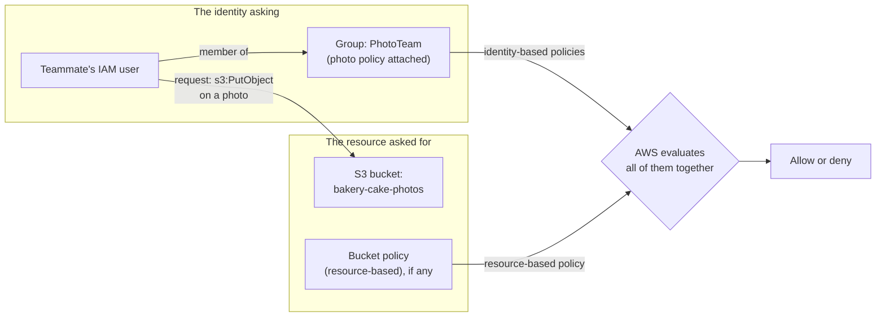
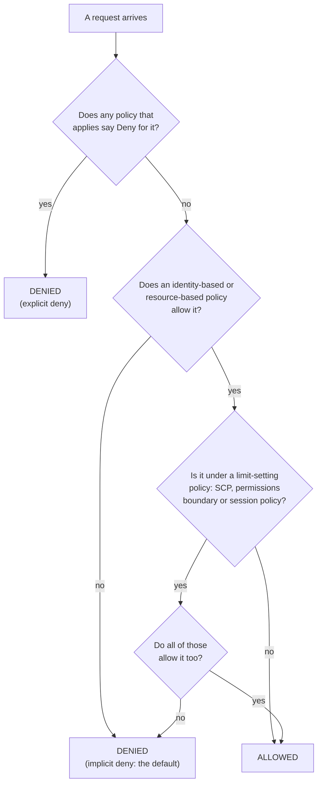

# Everything is denied until a policy allows it, and an explicit deny beats any allow

Lesson 04.03 covered who is asking; this lesson covers what they may do. Permissions are written in **policies**: documents that allow or deny actions on resources. Two rules decide almost every case: nothing is allowed until a policy allows it, and a deny anywhere beats every allow. By the end, you can read a simple policy and predict whether a request is allowed or denied.

**For:** an adult studying alone, possibly new to IT, who wants to understand AWS and use it safely. **Time:** about 35 minutes. You don't need to write code: the policies here are short, and every line is explained.

**Before you start:** read [lesson 04.03, Identities](03-identities.md) first. This lesson uses the `Admins` group you made on [primer page 03](https://github.com/AutomateTheCloud/atc-study-aws_account_guardrails/blob/main/primer/03-your-everyday-admin-identity.md) as an example; if you haven't done the primer, the lesson still works.

## Warm-up

1. *(Lesson 04.03)* The bakery's new teammate can sign in but gets "access denied" opening a page. Did authentication or authorization fail?
2. *(Primer page 03)* You attached `AdministratorAccess` to the `Admins` group. Its type in the console was "AWS managed - job function". What do you think "AWS managed" means?
3. *(Lesson 02.05)* Giving an identity more permissions than it needs makes daily work easier. Which pillar pays the price?

<details><summary>Feedback</summary>

1. **Authorization.** AWS knew who it was; no policy allowed the action.
2. AWS wrote it and keeps it up to date; you can attach it but not change it.
3. **Security.** If that identity is misused, more can go wrong.

</details>

## What you'll learn

This lesson covers part of task [2.3](https://docs.aws.amazon.com/aws-certification/latest/cloud-practitioner-02/cloud-practitioner-02-domain2.html#cloud-practitioner-02-task2.3) of the AWS Certified Cloud Practitioner (CLF-C02) exam. By the end, you can:

- read the parts of a policy statement;
- tell identity-based from resource-based policies, and AWS managed, customer managed and inline policies apart;
- predict whether AWS allows or denies a request (objective 04.04a);
- explain the principle of least privilege and name the tools that help apply it.

Guess first:

1. A new IAM user has no policies at all. What can it do?
2. One policy allows an action and another denies it. Which wins?

## The big picture: policies sit on identities and on resources

When a request arrives, AWS gathers every policy that applies to it and evaluates them together ([How IAM works](https://docs.aws.amazon.com/IAM/latest/UserGuide/intro-structure.html)). Policies can be attached in two places: on the identity making the request, or on the resource it wants.



*Notice that AWS doesn't look at one policy. It collects the identity's policies (including its groups') and the resource's policy, and decides from all of them.*

**Long description.** Left, the identity asking: the teammate's IAM user, a member of the group PhotoTeam, which has the photo policy attached. Right, the resource: the S3 bucket bakery-cake-photos and its bucket policy, if any. An arrow labeled "request: s3:PutObject on a photo" runs from the user to the bucket. The group's identity-based policies and the bucket's resource-based policy both feed one evaluation, which gives allow or deny.

## Key terms (skip if you know them)

- **Policy:** a document that lists permissions. Most are written in JSON, a text format of names and values in curly brackets. The console also has a visual editor, so you don't have to type JSON ([Policies and permissions](https://docs.aws.amazon.com/IAM/latest/UserGuide/access_policies.html)).
- **Statement:** one permission inside a policy. A policy can hold several.
- **Amazon Resource Name (ARN):** the unique name of a resource in AWS, such as `arn:aws:s3:::bakery-cake-photos` for a bucket.
- **S3 bucket:** a container for files in Amazon S3, AWS's storage service (module 05). The bakery's photos live in `bakery-cake-photos`, a made-up name.

## A policy is a list of statements: Effect, Action, Resource

Each statement says three things: whether it allows or denies (**Effect**), what may be done (**Action**), and to which thing (**Resource**). An optional **Condition** adds "only when…" ([Policies and permissions](https://docs.aws.amazon.com/IAM/latest/UserGuide/access_policies.html)).

For her first weeks, the owner wants the new teammate to see the photo bucket, read the photos and add new ones; removing old photos can wait. Here is a policy that grants exactly that.


*Notice that each statement names its resource precisely: the bucket itself for listing, and the files inside it (`/*`) for reading and adding. Deleting isn't mentioned, so it isn't allowed.*

**Long description.** A JSON policy with version "2012-10-17" and two statements. Statement 1, labeled SeeTheBucket: Effect Allow, Action s3:ListBucket, Resource arn:aws:s3:::bakery-cake-photos. Statement 2, labeled ReadAndAddPhotos: Effect Allow, Actions s3:GetObject and s3:PutObject, Resource arn:aws:s3:::bakery-cake-photos/*. Notes explain that Effect is Allow or Deny, Action is what may be done written as service:action, and Resource is which thing by its ARN, where /* means every file in the bucket. A footnote says there is no Principal line, because an identity-based policy applies to whoever it is attached to.

Reading it line by line:

- **Version** is the policy-language version (AWS recommends `2012-10-17`), and **Sid** is an optional label.
- **Action** names are `service:action`: `s3:ListBucket` lists the files in a bucket, `s3:GetObject` reads a file, `s3:PutObject` adds or replaces one.
- To browse to the bucket in the console, the teammate would also need to list the account's buckets (`s3:ListAllMyBuckets`), as AWS's own tutorial policy includes ([cross-account tutorial](https://docs.aws.amazon.com/IAM/latest/UserGuide/tutorial_cross-account-with-roles.html)). [Lab 03](06-lab-03-a-group-and-a-policy.md) builds a read-only version and tests it; [Lab 04](07-lab-04-finish-and-fix-a-policy.md) has you write her full policy.

> **Your turn:** Using only the policy above, may the teammate (a) download `birthday-cake.jpg` from the bucket, (b) delete it, (c) upload a photo to a different bucket called `bakery-invoices`? Say which line decides each.

<details><summary>Model answer</summary>

(a) **Yes**: statement 2 allows `s3:GetObject` on every file in `bakery-cake-photos`. (b) **No**: no statement mentions a delete action, so nothing allows it. (c) **No**: `s3:PutObject` is allowed only on `bakery-cake-photos/*`; `bakery-invoices` matches no Resource line.

</details>

## Identity-based policies follow the identity; resource-based policies sit on the thing

There are two main places to attach a policy, and the exam expects you to tell them apart ([Policies and permissions](https://docs.aws.amazon.com/IAM/latest/UserGuide/access_policies.html)).

| | Identity-based policy | Resource-based policy |
|---|---|---|
| Attached to | A user, a group or a role | A resource, such as an S3 bucket (a **bucket policy**) |
| Says | What *this identity* may do, to which resources | *Who* may do what to *this resource* |
| Names a Principal? | No: it applies to whoever holds it | Yes: it must say who it applies to |
| Example | The teammate's photo policy, on the PhotoTeam group | A bucket policy letting another AWS account read the photos |

**What's the same:** both use the same statements (Effect, Action, Resource), and AWS evaluates both together. **What differs:** where they live, and whether they name a **principal**, the identity allowed or denied. Within one account, an allow in either kind is enough. Across two accounts, both sides must allow: the resource's policy must let the other account in, *and* the requester's identity-based policy must allow the action.

A role uses both kinds. Its **trust policy** is a resource-based policy saying who may assume the role; its permissions policy is identity-based and says what the role may do. Lesson 04.05 uses this for cross-account access.

> **Check:** The bakery wants a delivery company's AWS account to read one bucket, without creating any users for the company. Where does the bakery write the permission?
>
> A. In an inline policy on the bakery owner's IAM user
> B. In a resource-based policy (bucket policy) on that bucket, naming the delivery company's account
> C. In an AWS managed policy
> D. Nowhere: other accounts can read any bucket by default

<details><summary>Feedback</summary>

**B is right.** A bucket policy can name a principal in another account. (The delivery company must also allow its own people the action, in its own account.)

- **A is wrong.** A policy on the owner's user gives permissions to the owner, not to anyone else.
- **C is wrong.** AWS managed policies are identity-based; you can't edit them, and they can't name another account.
- **D is wrong.** Nothing is allowed by default, least of all to other accounts.

</details>

## AWS managed, customer managed or inline: who writes it, and how far it reaches

Identity-based policies come in three kinds ([Managed policies and inline policies](https://docs.aws.amazon.com/IAM/latest/UserGuide/access_policies_managed-vs-inline.html)).


*Notice the shapes: a managed policy is a standalone box attached to several identities; an inline policy is drawn inside one identity and disappears with it.*

**Long description.** Three cards. **AWS managed:** one standalone policy attached to a user, a group and a role; written by AWS; you can't edit it; attaches to many users, groups and roles, in any account; it stays when an identity is deleted; example: AdministratorAccess from primer page 03. **Customer managed** (highlighted): the same standalone shape; written by you; editable; attaches to many identities in your account; it stays, ready to reuse; example: the bakery's photo-bucket policy. **Inline:** a policy drawn inside one role; written by you; editable; attaches to exactly one user, group or role; deleted with it; example: a one-off exception for one role.

- **AWS managed policies** are written and updated by AWS, for example when new services launch. They are a quick start, but they are shared by every customer, so they may grant more than your case needs.
- **Customer managed policies** are ones you write, such as the photo policy. When the exam guide says "custom policies", this is what it means.
- **Inline policies** are written directly into one identity and deleted with it. Use them only for a strict one-to-one case; if a policy could apply to more than one identity, AWS advises a managed policy.

AWS's advice is to start with AWS managed policies and move toward least privilege with customer managed ones ([Security best practices in IAM](https://docs.aws.amazon.com/IAM/latest/UserGuide/best-practices.html)). The primer did the first half: `AdministratorAccess` is right for the one person who owns a lab account. The teammate's policy is the second half.

> **Your turn:** Which kind fits each? (a) Read-only access to everything, for an auditor, as a quick start. (b) The photo policy, used by the teammate now and a second teammate next month. (c) One extra permission for one role, that must vanish if the role is deleted.

<details><summary>Model answer</summary>

(a) **AWS managed**: AWS publishes ready-made job-function policies, and you can narrow later. (b) **Customer managed**: you wrote it, and it attaches to the group both teammates join. (c) **Inline**: strictly one-to-one, and deleted with the role.

</details>

## How AWS decides: default deny, then allows, then an explicit deny wins

For a request inside one account, AWS applies these rules ([How IAM works](https://docs.aws.amazon.com/IAM/latest/UserGuide/intro-structure.html); [IAM FAQs](https://aws.amazon.com/iam/faqs/)):

1. **By default, every request is denied.** This is an **implicit deny**: nothing has to say "no".
2. **An allow in an identity-based or resource-based policy overrides that default.**
3. **Some policy types only set limits.** AWS Organizations service control policies (SCPs, module 09), permissions boundaries and session policies grant nothing. If any of them applies, it must allow the request too.
4. **An explicit deny in any policy beats every allow.** A statement with `"Effect": "Deny"` that matches the request ends the decision.

The root user is the exception from lesson 04.03: in general, AWS allows root's requests on the account's own resources.



*Notice that there is only one path to ALLOWED, and it needs a real allow. Every other path ends in DENIED, and the very first question looks for a deny.*

**Long description.** A decision flowchart. A request arrives. First question: does any applicable policy say Deny for it? Yes leads to DENIED (explicit deny). No leads to the second question: does an identity-based or resource-based policy allow it? No leads to DENIED (implicit deny, the default). Yes leads to the third question: is it under a limit-setting policy (SCP, permissions boundary or session policy)? No leads to ALLOWED. Yes leads to the fourth question: do all of those allow it too? Yes leads to ALLOWED; no leads to DENIED (implicit deny).

### "An allow somewhere means it's allowed" is wrong

You may think that if any policy allows an action, the action is allowed. That's not right: an explicit deny in any policy that applies overrides every allow, wherever the allow is. It's tempting because most people meet only Allow statements at first, so allows seem to add up. They do add up, until a deny appears.

### Worked example: four requests from the teammate

The teammate's IAM user is in the `PhotoTeam` group, which has the photo policy. During the December rush, the owner also freezes all photo changes: every member of staff is in a `HolidayFreeze` group until January, with this statement:

```json
{
  "Effect": "Deny",
  "Action": "s3:PutObject",
  "Resource": "arn:aws:s3:::bakery-cake-photos/*"
}
```

Here is how an expert works through four requests, always in the flowchart's order:

| Request | Any matching Deny? | Any matching Allow? | Result |
|---|---|---|---|
| Read `birthday-cake.jpg` | No | Yes: `s3:GetObject` on the bucket's files | **Allowed** |
| Delete `birthday-cake.jpg` | No | No: no statement allows deleting | **Denied** (implicit) |
| List the `bakery-invoices` bucket | No | No: the policy names only the photo bucket | **Denied** (implicit) |
| Upload `wedding-cake.jpg` in December | Yes: `HolidayFreeze` denies `s3:PutObject` there | Yes, from the photo policy | **Denied** (explicit deny wins) |

*The expert's habit:* look for a matching Deny first, because it settles the question at once; then look for an Allow; if neither, it's denied.

> **Your turn:** January comes, and the teammate leaves the `HolidayFreeze` group. A colleague also adds a bucket policy to `bakery-cake-photos` that allows the teammate's user `s3:DeleteObject`. Predict: (a) uploading `wedding-cake.jpg`; (b) deleting `birthday-cake.jpg`.

<details><summary>Model answer</summary>

(a) **Allowed**: the Deny came from `HolidayFreeze`, which no longer applies to her, and the photo policy allows `s3:PutObject`. (b) **Allowed**: within one account, an allow in a resource-based policy is enough, and nothing denies it. That surprises people; it's why a bucket policy deserves the same review as an identity's.

</details>

## Least privilege: grant only what the task needs, then keep trimming

The **principle of least privilege** means giving each identity only the permissions it needs for its task: specific actions, on specific resources, under specific conditions ([Security best practices in IAM](https://docs.aws.amazon.com/IAM/latest/UserGuide/best-practices.html)). If that identity is misused or makes a mistake, less can go wrong.


*Notice that each box is a smaller grant than the one around it. The highlighted box is what the photo job needs; anything outside it is risk with no benefit.*

**Long description.** Four nested boxes, each inside the last. Outermost: AdministratorAccess, every action on every resource in the account. Next: a storage-wide policy, every S3 action on every bucket in the account. Next, highlighted as what the photo job needs: the teammate's policy, list one bucket and read and add the photos in it. Innermost: with a condition, and only when signed in with MFA.

The boxes show the three ways to narrow a policy:

- **Fewer actions:** read and add, not delete.
- **Fewer resources:** one bucket's ARN, not `*` (which means "all").
- **Conditions:** for example, allow only when the request was made with MFA. AWS's own policy examples use this, with a condition key named `aws:MultiFactorAuthPresent`. This is one element you add inside a statement, not a whole policy:

```json
"Condition": { "Bool": { "aws:MultiFactorAuthPresent": "true" } }
```

**Practical advice from AWS:** it's safer to start small and add permissions than to start broad and try to remove them later. When you do start broad, watch what the identity actually uses, then cut back ([Policies and permissions](https://docs.aws.amazon.com/IAM/latest/UserGuide/access_policies.html)). IAM has tools for each step:

| Tool | What it does | Where you use it |
|---|---|---|
| **IAM policy simulator** | Tests what a policy would allow or deny, without sending real requests. AWS warns that results can differ from the live account, so check for real afterward ([policy simulator](https://docs.aws.amazon.com/IAM/latest/UserGuide/access_policies_testing-policies.html)) | [Lab 03](06-lab-03-a-group-and-a-policy.md) |
| **IAM Access Analyzer, policy validation** | Checks a policy as you write it, with over 100 checks, and warns about overly broad statements | [Lab 04](07-lab-04-finish-and-fix-a-policy.md) |
| **IAM Access Analyzer, policy generation** | Drafts a policy from what an identity actually did, using CloudTrail records | Later, at work |
| **Last accessed information** | Shows which services an identity has used, and when, so you can remove the rest | Module 09 |

[Simulation S4, the policy playground](09-sim-policy-playground.md), lets you practice the evaluation rules on many more cases.

> **Check:** A developer says: "I'll give the new teammate `AdministratorAccess` for now and tighten it later." What is the main problem?
>
> A. `AdministratorAccess` can't be attached to a group.
> B. It breaks least privilege: until "later" arrives, a mistake or a stolen password can affect everything in the account.
> C. AWS charges more for broad policies.
> D. There's no problem: AWS managed policies are always least privilege.

<details><summary>Feedback</summary>

**B is right.** Broad access now is risk now, and "later" often never comes. Start with the photo policy and add what's missing.

- **A is wrong.** You attached it to the `Admins` group in the primer.
- **C is wrong.** IAM policies have no extra charge (as of 2026-10-23).
- **D is wrong.** AWS says the opposite: AWS managed policies are shared by all customers and may not be least privilege for your case.

</details>

## In real work: permissions shrink over time

At work, access reviews ask "who can do what, and do they still need it?" Three Well-Architected security best practices match this lesson:

- [SEC03-BP02 Grant least privilege access](https://docs.aws.amazon.com/wellarchitected/latest/security-pillar/sec_permissions_least_privileges.html): the photo policy, not `AdministratorAccess`.
- [SEC03-BP04 Reduce permissions continuously](https://docs.aws.amazon.com/wellarchitected/latest/security-pillar/sec_permissions_continuous_reduction.html): use last accessed information and policy generation to cut what isn't used.
- [SEC03-BP07 Analyze public and cross-account access](https://docs.aws.amazon.com/wellarchitected/latest/security-pillar/sec_permissions_analyze_cross_account.html): check bucket policies and trust policies that let other accounts in.

The free external-access analyzer you created on [primer page 06](https://github.com/AutomateTheCloud/atc-study-aws_account_guardrails/blob/main/primer/06-safe-defaults.md) reports that kind of access.

## Summary

- **A policy is a list of statements:** Effect (Allow or Deny), Action (`service:action`), Resource (an ARN), and an optional Condition.
- **Identity-based policies** sit on users, groups and roles; **resource-based policies** sit on things like buckets and name a principal. AWS evaluates them together.
- **Identity-based policies are AWS managed, customer managed or inline.** Start with AWS managed, move to customer managed for least privilege, and keep inline for strict one-to-one cases.
- **AWS denies by default,** an allow overrides that, limit-setting policies must also allow, and **an explicit deny always wins.**
- **Least privilege** narrows actions, resources and conditions; the policy simulator, Access Analyzer and last accessed information help.

## Practice

1. **An IAM user is in two groups. Group A's policy allows `s3:GetObject` on a bucket. Group B's policy denies `s3:GetObject` on the same bucket. What happens when the user reads a file there?**

   A. Allowed, because an allow exists.
   B. Denied, because an explicit deny overrides any allow.
   C. Allowed, because group A was attached first.
   D. Denied, because users can't be in two groups.

   <details><summary>Feedback</summary>

   **B is right.** An explicit deny in any applicable policy overrides every allow.

   - **A is wrong.** An allow alone isn't enough when a matching deny exists.
   - **C is wrong.** Order doesn't matter; AWS evaluates all applicable policies together.
   - **D is wrong.** A user can be in several groups.

   </details>

2. **A brand-new IAM user has no policies, and nothing else in the account mentions it. It tries to list an S3 bucket. What happens, and why?**

   <details><summary>Feedback</summary>

   **Model answer:** Denied. Every request is denied by default, and nothing allows this one. No Deny statement is needed: it's an implicit deny.

   </details>

3. **Which statement about inline policies is true?**

   A. AWS writes and updates them.
   B. One inline policy can be attached to many users.
   C. An inline policy is deleted when its identity is deleted.
   D. Inline policies can't be edited.

   <details><summary>Feedback</summary>

   **C is right.** An inline policy lives inside one identity and goes with it.

   - **A is wrong.** That describes AWS managed policies.
   - **B is wrong.** Reuse across identities is what managed policies are for.
   - **D is wrong.** You write and can edit inline policies.

   </details>

4. **Rewrite this goal as least privilege: "The bakery's accountant needs AWS access to do the books."** Name the actions and resources you would ask about.

   <details><summary>Feedback</summary>

   **Model answer:** Ask which tasks "the books" involves: probably reading bills and cost reports. Grant read-only access to the billing and cost pages and nothing else. A good answer names specific actions (read, not change) and specific resources (billing, not storage or servers).

   </details>

5. *(From primer page 03)* **Why was `AdministratorAccess` the right choice for your own lab admin, but the wrong choice for the bakery's new teammate?**

   <details><summary>Feedback</summary>

   **Model answer:** You are the one person who owns and runs the lab account, so your task really is "administer everything". The teammate's task is only the photos. Least privilege is about matching permissions to the task, not about the person being trusted.

   </details>

**Next:** [Credentials and federation](05-credentials-and-federation.md) covers how identities prove who they are: MFA, keys, temporary credentials, and signing in from a central place. Then [Lab 03](06-lab-03-a-group-and-a-policy.md) builds the photo group and policy for real.

## Where to check the current details

- [How IAM works](https://docs.aws.amazon.com/IAM/latest/UserGuide/intro-structure.html), including the basic evaluation rules, IAM User Guide (checked 2026-10-23)
- [Policies and permissions in IAM](https://docs.aws.amazon.com/IAM/latest/UserGuide/access_policies.html), IAM User Guide (checked 2026-10-23)
- [Managed policies and inline policies](https://docs.aws.amazon.com/IAM/latest/UserGuide/access_policies_managed-vs-inline.html), IAM User Guide (checked 2026-10-23)
- [Security best practices in IAM](https://docs.aws.amazon.com/IAM/latest/UserGuide/best-practices.html), IAM User Guide (checked 2026-10-23)
- [IAM policy testing with the IAM policy simulator](https://docs.aws.amazon.com/IAM/latest/UserGuide/access_policies_testing-policies.html), IAM User Guide (checked 2026-10-23)
- [IAM FAQs](https://aws.amazon.com/iam/faqs/) (checked 2026-10-23)

---

"Policies and least privilege" by Automate the Cloud Inc., licensed under CC BY-NC 4.0 with the Additional Permission for Internal Training from Automate the Cloud Inc.
License: https://creativecommons.org/licenses/by-nc/4.0/
Permission: https://automatethe.cloud/licenses/atc-internal-training-permission.txt
