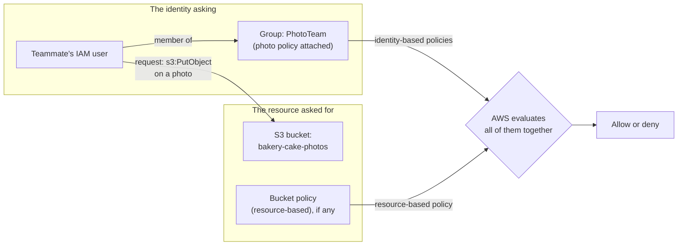

# Everything is denied until a policy allows it, and an explicit deny beats any allow

Permissions live in **policies**: documents that allow or deny actions on resources. Give each identity only what its task needs, using ready-made AWS managed policies to start and your own customer managed policies to narrow them.

**Exam guide:** [Domain 2, Security and Compliance](https://docs.aws.amazon.com/aws-certification/latest/cloud-practitioner-02/cloud-practitioner-02-domain2.html) (30% of the exam): task [2.3](https://docs.aws.amazon.com/aws-certification/latest/cloud-practitioner-02/cloud-practitioner-02-domain2.html#cloud-practitioner-02-task2.3).

**For:** an adult studying alone, possibly new to IT, who wants to understand AWS and use it safely. **Time:** about 15 minutes. You don't need to write code.

**Before you start:** read [lesson 04.03, Identities](03-identities.md) first. The `Admins` group from [primer page 03](https://github.com/AutomateTheCloud/atc-study-aws_account_guardrails/blob/main/primer/03-your-everyday-admin-identity.md) is an example here.

## Warm-up

1. *(Lesson 04.03)* The bakery's new teammate can sign in but gets "access denied" opening a page. Did authentication or authorization fail?
2. *(Primer page 03)* You attached `AdministratorAccess` to the `Admins` group. Its type in the console was "AWS managed - job function". What do you think "AWS managed" means?

Feedback

1. **Authorization.** AWS knew who it was; no policy allowed the action.
2. AWS wrote it and keeps it up to date; you can attach it but not change it.

## What you'll learn

By the end of this lesson, you can choose between identity-based and resource-based policies and between AWS managed, customer managed and inline policies, apply the principle of least privilege, and predict allow or deny in simple cases (objective 04.04a).

Guess first: a new IAM user has no policies at all. What can it do?

## The big picture: policies sit on identities and on resources

A **policy** is a document, usually written in JSON (the console also has a visual editor), made of one or more **statements**. Each statement says whether it allows or denies (its Effect), which actions (Action) and on which resources (Resource) ([Policies and permissions](https://docs.aws.amazon.com/IAM/latest/UserGuide/access_policies.html)). Policies can sit in two places, and AWS evaluates all that apply to a request together.

*Notice that AWS doesn't look at one policy. It collects the identity's policies (including its groups') and the resource's policy, and decides from all of them.*

**Long description.** Left, the identity asking: the teammate's IAM user, a member of the group PhotoTeam, which has the photo policy attached. Right, the resource: the S3 bucket bakery-cake-photos and its bucket policy, if any. An arrow labeled "request: s3:PutObject on a photo" runs from the user to the bucket. The group's identity-based policies and the bucket's resource-based policy both feed one evaluation, which gives allow or deny.

## Identity-based policies follow the identity; resource-based policies sit on the thing

| | Identity-based policy | Resource-based policy |
|---|---|---|
| Attached to | A user, a group or a role | A resource, such as an S3 bucket (a **bucket policy**) |
| Says | What *this identity* may do, to which resources | *Who* may do what to *this resource* |
| Example | The teammate's photo policy, on the PhotoTeam group | A bucket policy letting another AWS account read the photos |

A resource-based policy names the principal it applies to, so it can let another AWS account in without creating users for it. An identity-based policy doesn't name one: it applies to whoever holds it.

## AWS managed, customer managed or inline: who writes it, and how far it reaches

Identity-based policies come in three kinds ([Managed policies and inline policies](https://docs.aws.amazon.com/IAM/latest/UserGuide/access_policies_managed-vs-inline.html)).

*Notice the shapes: a managed policy is a standalone box attached to several identities; an inline policy is drawn inside one identity and disappears with it.*

**Long description.** Three cards. **AWS managed:** one standalone policy attached to a user, a group and a role; written by AWS; you can't edit it; attaches to many users, groups and roles, in any account; it stays when an identity is deleted; example: AdministratorAccess from primer page 03. **Customer managed** (highlighted): the same standalone shape; written by you; editable; attaches to many identities in your account; it stays, ready to reuse; example: the bakery's photo-bucket policy. **Inline:** a policy drawn inside one role; written by you; editable; attaches to exactly one user, group or role; deleted with it; example: a one-off exception for one role.

- **AWS managed policies** are written and updated by AWS. They're a quick start, but they're shared by every customer, so they may grant more than your case needs.
- **Customer managed policies** are ones you write and can attach to many identities, such as the photo policy. When the exam guide says "custom policies", this is what it means.
- **Inline policies** are written directly into one identity and deleted with it. Use them only for a strict one-to-one case.

AWS's advice is to start with AWS managed policies and move toward least privilege with customer managed ones ([Security best practices in IAM](https://docs.aws.amazon.com/IAM/latest/UserGuide/best-practices.html)).

> **Your turn:** Which kind fits each? (a) Read-only access to everything, for an auditor, as a quick start. (b) The photo policy, used by the teammate now and a second teammate next month. (c) One extra permission for one role, that must vanish if the role is deleted.

Model answer

(a) **AWS managed**: AWS publishes ready-made job-function policies, and you can narrow later. (b) **Customer managed**: you wrote it, and it attaches to the group both teammates join. (c) **Inline**: strictly one-to-one, and deleted with the role.

## How AWS decides: default deny, then allows, then an explicit deny wins

Two rules settle most requests inside one account ([How IAM works](https://docs.aws.amazon.com/IAM/latest/UserGuide/intro-structure.html); [IAM FAQs](https://aws.amazon.com/iam/faqs/)):

1. **By default, every request is denied.** This is an **implicit deny**: nothing has to say "no", so a new user with no policies can do nothing. An allow in an identity-based or resource-based policy overrides that default.
2. **An explicit deny in any policy beats every allow.** A statement that denies the request ends the decision, wherever the allow came from.

The root user is the exception from lesson 04.03: in general, AWS allows root's requests on the account's own resources.

## Least privilege: grant only what the task needs, then keep trimming

The **principle of least privilege** means giving each identity only the permissions its task needs: specific actions, on specific resources, under specific conditions ([Security best practices in IAM](https://docs.aws.amazon.com/IAM/latest/UserGuide/best-practices.html)). If that identity is misused or makes a mistake, less can go wrong.

*Notice that each box is a smaller grant than the one around it. The highlighted box is what the photo job needs; anything outside it is risk with no benefit.*

**Long description.** Four nested boxes, each inside the last. Outermost: AdministratorAccess, every action on every resource in the account. Next: a storage-wide policy, every S3 action on every bucket in the account. Next, highlighted as what the photo job needs: the teammate's policy, list one bucket and read and add the photos in it. Innermost: with a condition, and only when signed in with MFA.

It's safer to start small and add permissions than to start broad and try to remove them later. IAM has tools to help:

- The **IAM policy simulator** tests what policies would allow or deny, without sending real requests ([policy simulator](https://docs.aws.amazon.com/IAM/latest/UserGuide/access_policies_testing-policies.html)). You use it in [Lab 03](06-lab-03-a-group-and-a-policy.md).
- **IAM Access Analyzer** checks a policy as you write it and warns about overly broad statements; it can also report resources shared outside your account.

> **Example:** a developer says, "I'll give the new teammate `AdministratorAccess` for now and tighten it later." That breaks least privilege: until "later" arrives, a mistake or a stolen password can affect everything in the account. Start with the photo policy and add what's missing.

## Summary

- **A policy** is a list of statements that allow or deny actions on resources.
- **Identity-based policies** sit on users, groups and roles; **resource-based policies**, such as bucket policies, sit on resources and name who they apply to.
- **AWS managed, customer managed or inline:** start with AWS managed, move to customer managed for least privilege, and keep inline for strict one-to-one cases.
- **AWS denies by default**, an allow overrides that, and **an explicit deny always wins.**
- **Least privilege** grants only what the task needs; the policy simulator and Access Analyzer help.

## Practice

1. **An IAM user is in two groups. Group A's policy allows `s3:GetObject` on a bucket. Group B's policy denies `s3:GetObject` on the same bucket. What happens when the user reads a file there?**

   A. Allowed, because an allow exists.\
   B. Denied, because an explicit deny overrides any allow.\
   C. Allowed, because group A was attached first.\
   D. Denied, because users can't be in two groups.

   

Feedback

   **B is right.** An explicit deny in any applicable policy overrides every allow.

   - **A is wrong.** An allow alone isn't enough when a matching deny exists.
   - **C is wrong.** Order doesn't matter; AWS evaluates all applicable policies together.
   - **D is wrong.** A user can be in several groups.

   

2. **Which statement about inline policies is true?**

   A. AWS writes and updates them.\
   B. One inline policy can be attached to many users.\
   C. An inline policy is deleted when its identity is deleted.\
   D. Inline policies can't be edited.

   

Feedback

   **C is right.** An inline policy lives inside one identity and goes with it.

   - **A is wrong.** That describes AWS managed policies.
   - **B is wrong.** Reuse across identities is what managed policies are for.
   - **D is wrong.** You write and can edit inline policies.

   

3. **The bakery wants a delivery company's AWS account to read one bucket, without creating any users for the company. Where does the bakery write the permission?**

   A. In an inline policy on the bakery owner's IAM user\
   B. In a bucket policy on that bucket, naming the delivery company's account\
   C. In an AWS managed policy\
   D. Nowhere: other accounts can read any bucket by default

   

Feedback

   **B is right.** A resource-based policy can name a principal in another account.

   - **A is wrong.** A policy on the owner's user gives permissions to the owner, not to anyone else.
   - **C is wrong.** AWS managed policies are identity-based, and you can't edit them.
   - **D is wrong.** Nothing is allowed by default, least of all to other accounts.

   

**Next:** [Credentials and federation](05-credentials-and-federation.md) covers how identities prove who they are. Then [Lab 03](06-lab-03-a-group-and-a-policy.md) builds a group and a least-privilege policy for real.

## Where to check the current details

- [Policies and permissions in IAM](https://docs.aws.amazon.com/IAM/latest/UserGuide/access_policies.html), IAM User Guide (checked 2026-10-23)
- [Managed policies and inline policies](https://docs.aws.amazon.com/IAM/latest/UserGuide/access_policies_managed-vs-inline.html), IAM User Guide (checked 2026-10-23)
- [Security best practices in IAM](https://docs.aws.amazon.com/IAM/latest/UserGuide/best-practices.html), IAM User Guide (checked 2026-10-23)

---

"Policies and least privilege" by Automate the Cloud Inc., licensed under CC BY-NC 4.0 with the Additional Permission for Internal Training from Automate the Cloud Inc.
License: https://creativecommons.org/licenses/by-nc/4.0/
Permission: https://automatethe.cloud/licenses/atc-internal-training-permission.txt
