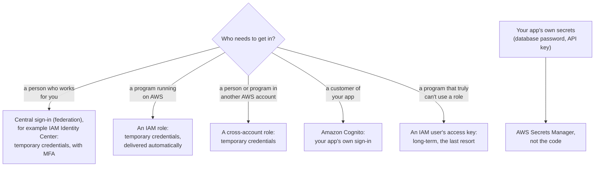
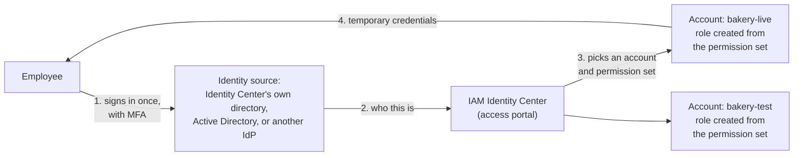
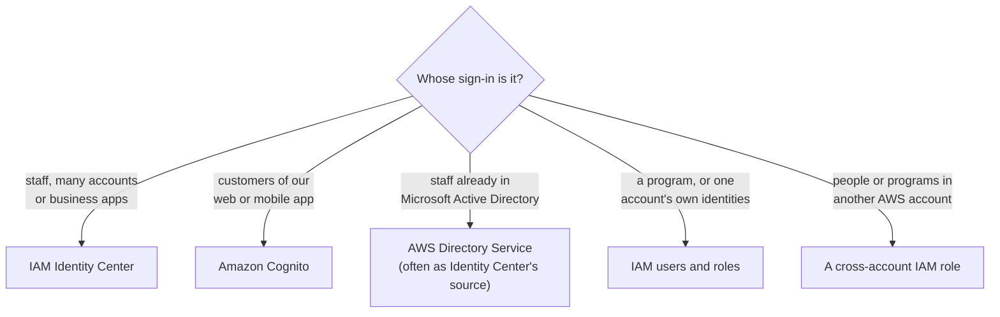
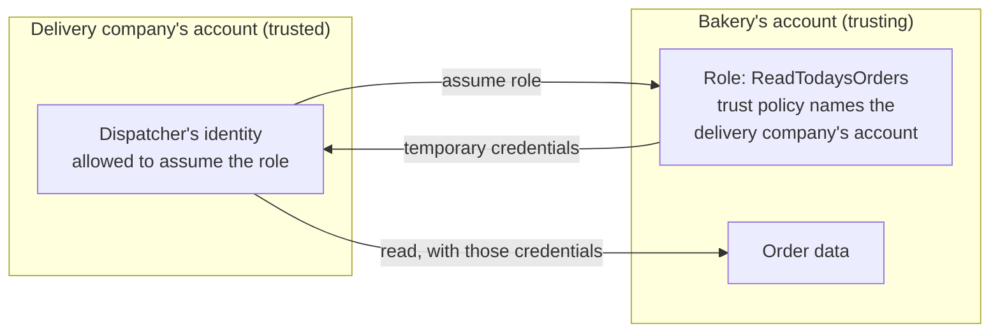

# Prefer credentials that expire: MFA for people, roles for programs, a vault for secrets

Lessons 04.03 and 04.04 covered who is asking and what they may do; this lesson covers how they prove it. AWS's advice comes down to one idea: **long-lived secrets are the risk, so prefer credentials that expire on their own.** By the end, you can choose how a person or a program should get into AWS, and where an application should keep its secrets.

**For:** an adult studying alone, possibly new to IT, who wants to understand AWS and use it safely. **Time:** about 35 minutes.

**Before you start:** read [04.03, Identities](03-identities.md) and [04.04, Policies and least privilege](04-policies-and-least-privilege.md) first. [Primer page 04](https://github.com/AutomateTheCloud/atc-study-aws_account_guardrails/blob/main/primer/04-command-line-without-access-keys.md) showed the command line without access keys; this lesson explains why that matters.

## Warm-up

1. *(Lesson 04.04)* A user's group allows `s3:PutObject` on a bucket, and another group denies it. Can the user upload?
2. *(Lesson 04.03)* Which kind of identity gets temporary credentials each time it's used?
3. *(Primer page 04)* An access key ID starts with `AKIA`; another starts with `ASIA`. What's the difference?

Feedback

1. **No.** An explicit deny beats every allow.
2. **An IAM role.** Assuming it gives credentials for one session.
3. `AKIA` marks a long-term key that never expires on its own; `ASIA` marks temporary credentials that stop working within hours. This lesson builds on that difference.

## What you'll learn

This lesson completes task [2.3](https://docs.aws.amazon.com/aws-certification/latest/cloud-practitioner-02/cloud-practitioner-02-domain2.html#cloud-practitioner-02-task2.3) of the AWS Certified Cloud Practitioner (CLF-C02) exam. By the end, you can:

- explain what password policies, MFA, access keys and temporary credentials each do;
- choose between AWS Secrets Manager and Parameter Store for a value;
- choose an identity approach: IAM users, IAM Identity Center, IAM federation, Amazon Cognito, AWS Directory Service or a cross-account role (objective 04.05a);
- explain why our labs use an IAM user although AWS recommends Identity Center.

Guess first:

1. Is "AWS Single Sign-On" the current name of an AWS service?
2. Which service can store a database password *and* change it automatically?

## The big picture: match the credential to who is asking

AWS's best practices sort the answer by who needs access ([Security best practices in IAM](https://docs.aws.amazon.com/IAM/latest/UserGuide/best-practices.html)).

*Notice that every route but one ends in temporary credentials. The long-term access key is the exception, kept for programs that can't do better.*

**Long description.** A decision flowchart from "Who needs to get in?". A person who works for you: central sign-in such as IAM Identity Center, with MFA and temporary credentials. A program on AWS: an IAM role. Someone in another AWS account: a cross-account role. A customer of your app: Amazon Cognito. A program that truly can't use a role: an IAM user's access key, the long-term last resort. Separately, your app's own secrets go into AWS Secrets Manager, not the code.

## Key terms (skip if you know them)

- **Long-term credentials:** credentials that keep working until someone changes or deletes them: passwords and access keys.
- **Temporary credentials:** credentials that AWS issues for a limited time, from a few minutes to several hours, and then stops accepting. The **AWS Security Token Service (AWS STS)** issues them; roles and federation are built on them ([Temporary security credentials](https://docs.aws.amazon.com/IAM/latest/UserGuide/id_credentials_temp.html)).
- **Secret:** any value that grants access: a password, an API key, a token.
- **Federation:** letting people sign in with an account held somewhere else, such as a company directory, and giving them temporary access to AWS.
- **Identity provider (IdP):** the system that holds those accounts and confirms who people are.

## Passwords and MFA protect a person's sign-in

**A password policy** is the account's rule for IAM user passwords ([password policy](https://docs.aws.amazon.com/IAM/latest/UserGuide/id_credentials_passwords_account-policy.html)). As of 2026-10-23:

- **The default** asks for 8 to 128 characters with three of four character types; passwords never expire.
- **A custom policy** can raise the minimum length, require each character type, expire passwords (1 to 1,095 days), and block reuse of the last 1 to 24.
- **It doesn't cover** the root user's password or access keys.
- **There is no lockout setting** after wrong guesses; AWS recommends a strong policy plus MFA instead.

You set a custom policy on [primer page 03](https://github.com/AutomateTheCloud/atc-study-aws_account_guardrails/blob/main/primer/03-your-everyday-admin-identity.md): 16 characters and no reuse of the last 24, to meet the [CIS AWS Foundations Benchmark](https://www.cisecurity.org/benchmark/amazon_web_services).

**Multi-factor authentication (MFA)** adds a second proof besides the password. AWS supports three kinds, and the root user and each IAM user can register up to eight devices ([MFA in IAM](https://docs.aws.amazon.com/IAM/latest/UserGuide/id_credentials_mfa.html), checked 2026-10-23):

| MFA type | What it is | Resists phishing? |
|---|---|---|
| **Passkey or security key** (recommended first) | A passkey in your device or password manager, or a physical key you touch | Yes |
| **Virtual authenticator app** | A phone app showing a six-digit code that keeps changing | No: a code can be typed into a fake page |
| **Hardware TOTP token** | A small device showing a six-digit code | No, for the same reason |

> **Your turn:** The bakery owner says: "Our password policy needs 16 characters, so we don't need MFA, and it protects the root user too." Correct both claims.

Model answer

The password policy doesn't cover the root user at all, and root MFA is required by AWS anyway. Even long passwords can be stolen through a fake sign-in page; MFA, best of all a passkey, means a stolen password isn't enough on its own.

## Access keys are long-term secrets: avoid them where you can

An **access key** lets a program act as an IAM user (or, worse, the root user) without a password or MFA. It has two parts, an access key ID and a secret access key, and the secret is shown only once, when the key is created. A user can have at most two ([access keys](https://docs.aws.amazon.com/IAM/latest/UserGuide/id_credentials_access-keys.html)). AWS's own documentation calls IAM users with access keys a security risk to the account.

The chart compares how long credentials keep working once issued.

*Notice that the long-term bars never stop: a copied access key works until someone notices and deletes it. The temporary ones end on their own.*

| Credential | Kind | How long it keeps working (as of 2026-10-23) |
|---|---|---|
| Access key on an IAM user | Long-term | Until someone deletes it |
| IAM user password, default policy | Long-term | Never expires by default |
| `aws login` on your own computer | Temporary | Renewed every 15 minutes, for up to 12 hours |
| AWS CloudShell session | Temporary | About 12 hours at most; ends after 20 to 30 idle minutes |

### "Access keys are the normal way to use the command line" is out of date

Older material often says to create an access key for your IAM user to use the AWS CLI. That's no longer the right default: AWS's best practices tell people to use temporary credentials, and you have two keyless options, both on [primer page 04](https://github.com/AutomateTheCloud/atc-study-aws_account_guardrails/blob/main/primer/04-command-line-without-access-keys.md): **AWS CloudShell** in the console, and **`aws login`**, which AWS added in November 2025 (AWS CLI 2.32.0 or later; [Login for AWS local development](https://docs.aws.amazon.com/cli/latest/userguide/cli-configure-sign-in.html)). The old advice is tempting because it was the standard method for years.

Long-term keys still have a few legitimate uses, such as a workload outside AWS that can't use roles. If you must have one, rotate it when needed, watch its "last used" information, delete it when unused, and never put it in code.

> **Check:** A program runs on an AWS server and needs to write to a bucket. What should it use?
>
> A. An access key for the root user, stored on the server
> B. An access key for an IAM user, stored in the code
> C. An IAM role that the server assumes
> D. The administrator's console password

Feedback

**C is right.** On AWS compute, AWS delivers the role's temporary credentials to the program, so nothing long-lived is stored.

- **A is wrong.** Root keys are what you must never create; they give unlimited access.
- **B is wrong.** A key in code is long-term and easy to leak, for example into a public repository.
- **D is wrong.** Passwords are for people signing in, and sharing one defeats every control.

## Your application's secrets belong in a store, not in the code

The bakery's website needs a few values: the name of the photo bucket, and the API key for its card-payment provider. Neither should be typed into the code, where anyone who sees the code sees the value. AWS offers two stores; the task statement names both ([Secrets Manager](https://docs.aws.amazon.com/secretsmanager/latest/userguide/intro.html); [Parameter Store](https://docs.aws.amazon.com/systems-manager/latest/userguide/systems-manager-parameter-store.html)).

*Notice the highlighted row: **rotation**, meaning replacing a secret with a new one on a schedule, is what only Secrets Manager does.*

| | AWS Secrets Manager | Parameter Store (a capability of AWS Systems Manager) |
|---|---|---|
| Made for | Secrets through their life: database passwords, API keys, tokens | Configuration values: settings, IDs, addresses |
| Encryption | Always, with AWS KMS (the key service, module 09) | Optional, with the `SecureString` type |
| Automatic rotation | Yes, on a schedule; built in for some databases | No |
| Cost (checked 2026-10-23) | Per secret per month plus API calls; AWS's examples use $0.40 per secret per month and $0.05 per 10,000 calls | Standard parameters at no additional charge |

**What's the same:** both keep values out of your code, and your code reads them when it runs, with permissions from IAM. **What differs:** Secrets Manager is built for secrets and can rotate them; Parameter Store is built for configuration. AWS's rule of thumb: for passwords and other secrets, use Secrets Manager. On an exam, "rotate automatically" points to Secrets Manager.

One thing doesn't belong in either: AWS's own credentials. For those, Secrets Manager's documentation points you back to IAM: give the code a role.

> **Your turn:** Where would you put each? (a) The payment provider's API key, which the provider asks you to change every 90 days. (b) The name of the photo bucket. (c) Credentials for the website to read that bucket.

Model answer

(a) **Secrets Manager**: it's a secret, and rotation on a schedule is its job. (b) **Parameter Store**: plain configuration, and the standard tier has no extra charge. (c) **Neither**: give the website's server an **IAM role**, so AWS delivers temporary credentials.

## Federation: sign in once, elsewhere, and receive temporary access

With **federation**, people get no IAM user. They sign in with an account held by an identity provider, such as the company's staff directory, and AWS gives them temporary credentials through a role. AWS recommends this for people ([Identity providers and federation](https://docs.aws.amazon.com/IAM/latest/UserGuide/id_roles_providers.html)). When someone leaves, one account is disabled in one place.

**AWS IAM Identity Center** is AWS's recommended way to do this for a workforce ([What is IAM Identity Center?](https://docs.aws.amazon.com/singlesignon/latest/userguide/what-is.html)). It gives people **single sign-on**: one sign-in, with MFA, to many AWS accounts and to business applications. It has no extra charge (as of 2026-10-23).

*Notice that the employee never gets an IAM user in either account. They sign in once and receive a role's temporary credentials in the account they pick.*

**Long description.** Left to right. 1: an employee signs in once, with MFA, to an identity source (Identity Center's directory, Active Directory, or another identity provider). 2: it tells IAM Identity Center who this is. 3: in the access portal, the employee picks an account (bakery-live or bakery-test, made-up names) and a permission set, for which Identity Center has created a role in each account. 4: the account returns temporary credentials.

A **permission set** is Identity Center's bundle of permissions; it creates the matching IAM roles in the accounts you choose. Identity Center works with AWS Organizations, the service for running many accounts together (module 09).

### "AWS Single Sign-On" is the old name

You may see "AWS Single Sign-On" or "AWS SSO" in older questions. AWS renamed it **AWS IAM Identity Center** on 2022-07-26. It's the same service, so pick Identity Center when a scenario asks for workforce single sign-on. The old name survives in some command names, which is one reason it lingers.

### Four identity services, side by side

The exam asks you to tell these apart. The key question is *whose* identities they hold.

| | IAM | IAM Identity Center | Amazon Cognito | AWS Directory Service |
|---|---|---|---|---|
| Whose identities | Identities inside one AWS account | Your workforce, across many accounts | The customers of your web or mobile app | Your Microsoft Active Directory |
| What it gives | Users, groups, roles, policies | Single sign-on with temporary credentials | Sign-up and sign-in for the app; optionally temporary AWS credentials for app users | A managed directory on AWS, or a connector to your existing one |
| Bakery example | The owner's IAM user; the website's role | Staff reaching the live and test accounts | Customers signing in to order cakes | Only if the bakery ran Active Directory |

A few details from the services' pages ([Cognito](https://docs.aws.amazon.com/cognito/latest/developerguide/what-is-amazon-cognito.html); [Directory Service](https://docs.aws.amazon.com/directoryservice/latest/admin-guide/what_is.html); checked 2026-10-23):

- Cognito **user pools** sign app users in, including with Google, Apple or Facebook accounts; **identity pools** swap that sign-in for temporary, limited AWS credentials.
- Directory Service offers **AWS Managed Microsoft AD**, and **AD Connector**, which passes sign-ins to an existing on-premises directory. A third type, Simple AD, has been closed to new customers since 2026-07-30.
- IAM itself can federate one standalone account with a SAML 2.0 or OIDC identity provider, without Identity Center.

*Notice that the question is about the people, not the technology. "Customers" points to Cognito; "employees" points to Identity Center.*

**Long description.** A decision flowchart from "Whose sign-in is it?": staff using many accounts or business apps lead to IAM Identity Center; customers of our app to Amazon Cognito; staff already in Microsoft Active Directory to AWS Directory Service, often as Identity Center's source; a program or one account's own identities to IAM users and roles; people or programs in another AWS account to a cross-account IAM role.

### Cross-account roles let another account in without new users

A **cross-account role** lives in the account that owns the resources, the *trusting* account. Its **trust policy**, a resource-based policy, names the *trusted* account that may assume it; its permissions policy says what the role may do. People in the trusted account, if their own policies allow it, assume the role and get temporary credentials ([cross-account tutorial](https://docs.aws.amazon.com/IAM/latest/UserGuide/tutorial_cross-account-with-roles.html)). Nobody needs a second IAM user, or to sign out and back in.

*Notice that both accounts take part: the bakery's trust policy lets the delivery account in, and the delivery account must allow its dispatcher to assume the role. That is the "both sides must allow" rule from 04.04.*

**Long description.** The delivery company's account (trusted) holds the dispatcher's identity, allowed to assume the role. The bakery's account (trusting) holds the role ReadTodaysOrders, whose trust policy names the delivery company's account, and the order data. The dispatcher assumes the role, receives temporary credentials, and reads the orders with them.

## Why our labs use an IAM user anyway

AWS recommends Identity Center for people, and the Well-Architected best practice [SEC02-BP04 Rely on a centralized identity provider](https://docs.aws.amazon.com/wellarchitected/latest/security-pillar/sec_identities_identity_provider.html) says the same. Yet the primer and our labs use an IAM user with MFA. That's a deliberate exception, for a Free plan reason (as of 2026-10-23; [primer page 03](https://github.com/AutomateTheCloud/atc-study-aws_account_guardrails/blob/main/primer/03-your-everyday-admin-identity.md)):

- In a single account, the kind of Identity Center instance that gives people console access, an *organization instance*, creates an organization in AWS Organizations. On the Free plan, that moves the account to the Paid plan automatically, and the Free Tier credits can no longer be used.
- The other kind, an *account instance*, avoids Organizations but has no access portal to AWS accounts, so it can't give you console access ([instance types](https://docs.aws.amazon.com/singlesignon/latest/userguide/identity-center-instances.html)).
- An IAM user with a strong password and MFA for each person is the baseline AWS itself gives for a single account ([Startup Security Baseline, ACCT.03](https://docs.aws.amazon.com/prescriptive-guidance/latest/aws-startup-security-baseline/acct-03.html)).

At work, with many accounts under AWS Organizations, expect Identity Center.

## Worked example: the bakery grows

A year on, the bakery has a live account and a test account, six staff, a mobile app for customers, and a delivery partner. The owner asks you how each should get in. The expert asks *whose* access it is, then *which credential expires*.

1. **Six staff using both accounts.** *Thinking:* people, two accounts; IAM users would mean twelve long-term passwords. **Answer:** IAM Identity Center, with MFA and a permission set per job.
2. **Customers signing in to the app.** *Thinking:* not staff, maybe thousands; never IAM users. **Answer:** Amazon Cognito.
3. **The app's database password.** *Thinking:* needed at run time, best changed on a schedule. **Answer:** Secrets Manager with rotation, read through the app's IAM role.
4. **The delivery partner reading orders.** *Thinking:* another AWS account. **Answer:** a cross-account role with read-only permissions.

> **Your turn:** A new accountant will check the bills once a month, and the bakery has moved to Identity Center. How should the accountant get in, and what permissions should they get?

Model answer

Through **IAM Identity Center**, with MFA, like other staff, with a permission set limited to reading billing and cost information (least privilege from 04.04). No IAM user and no access keys.

## In real work: credentials are what attackers look for

The Well-Architected security pillar names the risk directly: long-term credentials can leak, for example through uploads to public repositories. Five of its best practices cover this lesson:

- [SEC02-BP01 Use strong sign-in mechanisms](https://docs.aws.amazon.com/wellarchitected/latest/security-pillar/sec_identities_enforce_mechanisms.html): password policies and phishing-resistant MFA.
- [SEC02-BP02 Use temporary credentials](https://docs.aws.amazon.com/wellarchitected/latest/security-pillar/sec_identities_unique.html): roles, federation, CloudShell and `aws login` over access keys.
- [SEC02-BP03 Store and use secrets securely](https://docs.aws.amazon.com/wellarchitected/latest/security-pillar/sec_identities_secrets.html): Secrets Manager, not code.
- [SEC02-BP04 Rely on a centralized identity provider](https://docs.aws.amazon.com/wellarchitected/latest/security-pillar/sec_identities_identity_provider.html): Identity Center for a workforce.
- [SEC02-BP05 Audit and rotate credentials periodically](https://docs.aws.amazon.com/wellarchitected/latest/security-pillar/sec_identities_audit.html): "last used" information, rotation, deleting what's unused.

## Summary

- **Passwords and MFA** protect a person's sign-in. The password policy covers IAM users only; passkeys and security keys are the phishing-resistant MFA AWS recommends first.
- **Access keys** are long-term and risky. Use CloudShell or `aws login` for the command line, roles for programs, and keys only as a last resort, rotated and deleted when unused.
- **Temporary credentials** from roles and federation expire on their own.
- **Secrets Manager** stores and rotates secrets; **Parameter Store** holds configuration. Neither should hold AWS credentials; use roles.
- **Federation:** Identity Center (formerly AWS Single Sign-On) for the workforce; Cognito for app customers; Directory Service for Active Directory; cross-account roles for other accounts. Our labs use an IAM user only because of the Free plan.

## Practice

1. **A company wants its 200 employees to sign in once and reach 30 AWS accounts. Which service fits best?**

   A. Amazon Cognito
   B. AWS IAM Identity Center
   C. An IAM user for each employee in each account
   D. AWS Secrets Manager

   

Feedback

   **B is right.** Identity Center gives a workforce single sign-on across many accounts, with temporary credentials.

   - **A is wrong.** Cognito is for the customers of your own app, not employees.
   - **C is wrong.** That's 6,000 long-term identities to manage, the opposite of AWS's advice.
   - **D is wrong.** Secrets Manager stores application secrets; it doesn't sign people in.

   

2. **An application's database password must change every 30 days without anyone editing code. Where should it be stored?**

   A. Parameter Store, as a String
   B. AWS Secrets Manager, with rotation turned on
   C. In the application's configuration file
   D. In an IAM user's access key

   

Feedback

   **B is right.** Automatic rotation is what Secrets Manager adds.

   - **A is wrong.** Parameter Store has no rotation, and a String isn't even encrypted.
   - **C is wrong.** Anyone who sees the file sees the password, and changing it means editing the file.
   - **D is wrong.** Access keys are AWS credentials, not a place to store other passwords.

   

3. **Explain to a beginner, in two or three sentences, why AWS prefers temporary credentials to access keys.**

   

Feedback

   **Model answer:** An access key works until someone deletes it, so a copy leaked in code or a screenshot can be used for months. Temporary credentials stop working on their own within hours, so a leaked copy soon becomes useless, and nothing long-lived has to be stored or rotated.

   

4. *(From primer page 02)* **Why should the root user never have an access key?**

   

Feedback

   **Model answer:** An access key is long-term and skips the password and MFA. On the root user it would give anyone who copied it unlimited control of the account, billing included, until someone deleted it.

   

**Next:** put the ideas to work in [Lab 03: a group and a policy](06-lab-03-a-group-and-a-policy.md), then try [Simulation S4, the policy playground](09-sim-policy-playground.md), which includes Identity Center and cross-account roles.

## Where to check the current details

- [Security best practices in IAM](https://docs.aws.amazon.com/IAM/latest/UserGuide/best-practices.html), IAM User Guide (checked 2026-10-23)
- [Set an account password policy for IAM users](https://docs.aws.amazon.com/IAM/latest/UserGuide/id_credentials_passwords_account-policy.html) and [AWS Multi-factor authentication in IAM](https://docs.aws.amazon.com/IAM/latest/UserGuide/id_credentials_mfa.html), IAM User Guide (checked 2026-10-23)
- [Manage access keys for IAM users](https://docs.aws.amazon.com/IAM/latest/UserGuide/id_credentials_access-keys.html) and [Temporary security credentials in IAM](https://docs.aws.amazon.com/IAM/latest/UserGuide/id_credentials_temp.html), IAM User Guide (checked 2026-10-23)
- [Login for AWS local development using console credentials](https://docs.aws.amazon.com/cli/latest/userguide/cli-configure-sign-in.html), AWS CLI User Guide (checked 2026-10-23)
- [What is AWS Secrets Manager?](https://docs.aws.amazon.com/secretsmanager/latest/userguide/intro.html) and [AWS Secrets Manager pricing](https://aws.amazon.com/secrets-manager/pricing/) (checked 2026-10-23). Prices change; check before you rely on them.
- [AWS Systems Manager Parameter Store](https://docs.aws.amazon.com/systems-manager/latest/userguide/systems-manager-parameter-store.html) (checked 2026-10-23)
- [What is IAM Identity Center?](https://docs.aws.amazon.com/singlesignon/latest/userguide/what-is.html) and [Organization and account instances of IAM Identity Center](https://docs.aws.amazon.com/singlesignon/latest/userguide/identity-center-instances.html) (checked 2026-10-23)
- [Identity providers and federation into AWS](https://docs.aws.amazon.com/IAM/latest/UserGuide/id_roles_providers.html) and the [cross-account access tutorial](https://docs.aws.amazon.com/IAM/latest/UserGuide/tutorial_cross-account-with-roles.html), IAM User Guide (checked 2026-10-23)
- [What is Amazon Cognito?](https://docs.aws.amazon.com/cognito/latest/developerguide/what-is-amazon-cognito.html) and [What is AWS Directory Service?](https://docs.aws.amazon.com/directoryservice/latest/admin-guide/what_is.html) (checked 2026-10-23)
- [Choosing a plan](https://docs.aws.amazon.com/awsaccountbilling/latest/aboutv2/free-tier-plans.html), AWS Billing User Guide, for the Free plan rules (checked 2026-10-23)

---

"Credentials and federation" by Automate the Cloud Inc., licensed under CC BY-NC 4.0 with the Additional Permission for Internal Training from Automate the Cloud Inc.
License: https://creativecommons.org/licenses/by-nc/4.0/
Permission: https://automatethe.cloud/licenses/atc-internal-training-permission.txt
