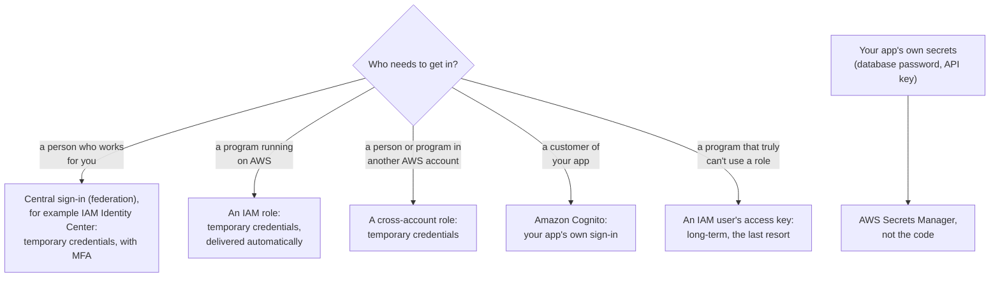

# Prefer credentials that expire: MFA for people, roles for programs, a vault for secrets

Long-lived secrets are the risk, so AWS advises credentials that expire on their own: central sign-in with MFA for people, roles for programs and other accounts, and a store, not the code, for an application's secrets.

**Exam guide:** [Domain 2, Security and Compliance](https://docs.aws.amazon.com/aws-certification/latest/cloud-practitioner-02/cloud-practitioner-02-domain2.html) (30% of the exam): task [2.3](https://docs.aws.amazon.com/aws-certification/latest/cloud-practitioner-02/cloud-practitioner-02-domain2.html#cloud-practitioner-02-task2.3).

**For:** an adult studying alone, possibly new to IT, who wants to understand AWS and use it safely. **Time:** about 20 minutes.

**Before you start:** read [04.03, Identities](03-identities.md) and [04.04, Policies and least privilege](04-policies-and-least-privilege.md) first. [Primer page 04](https://github.com/AutomateTheCloud/atc-study-aws_account_guardrails/blob/main/primer/04-command-line-without-access-keys.md) showed the command line without access keys.

## Warm-up

1. *(Lesson 04.04)* A user's group allows `s3:PutObject` on a bucket, and another group denies it. Can the user upload?
2. *(Lesson 04.03)* Which kind of identity gets temporary credentials each time it's used?

Feedback

1. **No.** An explicit deny beats every allow.
2. **An IAM role.** Assuming it gives credentials for one session. This lesson builds on that.

## What you'll learn

By the end of this lesson, you can choose a way to store credentials and a way to manage identities: IAM users, IAM Identity Center, Amazon Cognito, AWS Directory Service or a cross-account role (objective 04.05a).

Guess first: is "AWS Single Sign-On" the current name of an AWS service?

## The big picture: match the credential to who is asking

**Long-term credentials**, such as passwords and access keys, keep working until someone changes or deletes them. **Temporary credentials** work for a limited time, from minutes to hours, and are issued by the **AWS Security Token Service (AWS STS)**; roles and federation are built on them ([Temporary security credentials](https://docs.aws.amazon.com/IAM/latest/UserGuide/id_credentials_temp.html)). AWS's best practices sort the answer by who needs access ([Security best practices in IAM](https://docs.aws.amazon.com/IAM/latest/UserGuide/best-practices.html)).

*Notice that every route but one ends in temporary credentials. The long-term access key is the exception, kept for programs that can't do better.*

**Long description.** A decision flowchart from "Who needs to get in?". A person who works for you: central sign-in such as IAM Identity Center, with MFA and temporary credentials. A program on AWS: an IAM role. Someone in another AWS account: a cross-account role. A customer of your app: Amazon Cognito. A program that truly can't use a role: an IAM user's access key, the long-term last resort. Separately, your app's own secrets go into AWS Secrets Manager, not the code.

## Passwords and MFA protect a person's sign-in

A **password policy** is the account's rule for IAM user passwords: minimum length, character types, expiry and reuse ([password policy](https://docs.aws.amazon.com/IAM/latest/UserGuide/id_credentials_passwords_account-policy.html)). It doesn't cover the root user, and it has no lockout setting; AWS recommends a strong policy plus MFA instead. You set a custom one on [primer page 03](https://github.com/AutomateTheCloud/atc-study-aws_account_guardrails/blob/main/primer/03-your-everyday-admin-identity.md).

**Multi-factor authentication (MFA)** adds a second proof besides the password. AWS supports three kinds ([MFA in IAM](https://docs.aws.amazon.com/IAM/latest/UserGuide/id_credentials_mfa.html), checked 2026-10-23):

| MFA type | What it is | Resists phishing? |
|---|---|---|
| **Passkey or security key** (recommended first) | A **passkey** in your device or password manager, or a physical key you touch | Yes |
| **Virtual authenticator app** | A phone app showing a six-digit code that keeps changing | No: a code can be typed into a fake page |
| **Hardware TOTP token** | A small device showing a six-digit code | No, for the same reason |

## Access keys are long-term secrets: avoid them where you can

An **access key** lets a program act as an IAM user (or, worse, the root user) without a password or MFA. It has an access key ID and a secret access key, and it works until someone deletes it ([access keys](https://docs.aws.amazon.com/IAM/latest/UserGuide/id_credentials_access-keys.html)), so a copy leaked in code can be used for months. AWS's own documentation calls IAM users with access keys a security risk. Never create one for the root user. If you must have one, for example for a workload outside AWS that can't use a role, rotate it, watch its "last used" information, and delete it when it's unused.

### "Access keys are the normal way to use the command line" is out of date

Older material often says to create an access key to use the AWS CLI. That's no longer the right default: AWS's best practices tell people to use temporary credentials, and you have two keyless options, both on [primer page 04](https://github.com/AutomateTheCloud/atc-study-aws_account_guardrails/blob/main/primer/04-command-line-without-access-keys.md): **AWS CloudShell** in the console, and **`aws login`** on your own computer, added in November 2025 ([Login for AWS local development](https://docs.aws.amazon.com/cli/latest/userguide/cli-configure-sign-in.html)). The old advice is tempting because it was the standard method for years.

## Your application's secrets belong in a store, not in the code

A **secret** is any value that grants access: a password, an API key, a token. Typed into code, it's visible to anyone who sees the code. AWS offers two stores, and the exam names both ([Secrets Manager](https://docs.aws.amazon.com/secretsmanager/latest/userguide/intro.html); [Parameter Store](https://docs.aws.amazon.com/systems-manager/latest/userguide/systems-manager-parameter-store.html)).

*Notice the highlighted row: **rotation**, meaning replacing a secret with a new one on a schedule, is what only Secrets Manager does.*

| | AWS Secrets Manager | Parameter Store (a capability of AWS Systems Manager) |
|---|---|---|
| Made for | Secrets through their life: database passwords, API keys, tokens | Configuration values: settings, IDs, addresses |
| Encryption | Always, with AWS KMS (module 09) | Optional, with the `SecureString` type |
| Automatic rotation | Yes, on a schedule; built in for some databases | No |

On an exam, "rotate automatically" points to Secrets Manager. AWS's own credentials belong in neither: give the code an IAM role.

> **Your turn:** Where would you put each? (a) The payment provider's API key, which must change every 90 days. (b) The name of the photo bucket. (c) Credentials for the website to read that bucket.

Model answer

(a) **Secrets Manager**: it's a secret, and scheduled rotation is its job. (b) **Parameter Store**: plain configuration. (c) **Neither**: give the website's server an **IAM role**, so AWS delivers temporary credentials.

## Federation: sign in once, elsewhere, and receive temporary access

With **federation**, people get no IAM user. They sign in with an account held by an **identity provider (IdP)**, such as the company's staff directory, and AWS gives them temporary credentials through a role ([Identity providers and federation](https://docs.aws.amazon.com/IAM/latest/UserGuide/id_roles_providers.html)). When someone leaves, you disable one account in one place.

**AWS IAM Identity Center** is AWS's recommended way to do this for a workforce ([What is IAM Identity Center?](https://docs.aws.amazon.com/singlesignon/latest/userguide/what-is.html)). It gives people **single sign-on**: one sign-in, with MFA, to many AWS accounts and business applications. A **permission set** is its bundle of permissions; Identity Center creates matching IAM roles in the accounts you choose. It works with AWS Organizations (module 09).

### "AWS Single Sign-On" is the old name

You may see "AWS Single Sign-On" or "AWS SSO" in older questions. AWS renamed it **AWS IAM Identity Center** on 2022-07-26; it's the same service, so pick Identity Center when a scenario asks for workforce single sign-on. The old name lingers because it survives in some command names.

### Four identity services, side by side

The question to ask is *whose* identities they hold.

| | IAM | IAM Identity Center | Amazon Cognito | AWS Directory Service |
|---|---|---|---|---|
| Whose identities | Identities inside one AWS account | Your workforce, across many accounts | The customers of your web or mobile app | Your Microsoft Active Directory |
| What it gives | Users, groups, roles, policies | Single sign-on with temporary credentials | Sign-up and sign-in for the app | A managed directory on AWS, or a connector to your existing one |
| Bakery example | The owner's IAM user; the website's role | Staff reaching the live and test accounts | Customers signing in to order cakes | Only if the bakery ran Active Directory |

"Customers" points to **Amazon Cognito**; "employees" points to Identity Center; an existing Active Directory points to **AWS Directory Service**, often as Identity Center's source.

### Cross-account roles let another account in without new users

A **cross-account role** lives in the account that owns the resources. Its **trust policy** names the other account that may assume it, and its permissions policy says what the role may do. People in the other account, if their own policies allow it, assume the role and get temporary credentials ([cross-account tutorial](https://docs.aws.amazon.com/IAM/latest/UserGuide/tutorial_cross-account-with-roles.html)). Nobody needs a second IAM user.

**Why our labs use an IAM user anyway:** in a single Free plan account, the kind of Identity Center instance that gives console access creates an organization in AWS Organizations, which moves the account to the Paid plan (as of 2026-10-23; [primer page 03](https://github.com/AutomateTheCloud/atc-study-aws_account_guardrails/blob/main/primer/03-your-everyday-admin-identity.md)). So the labs use an IAM user with MFA, the baseline AWS itself gives for a single account. At work, expect Identity Center.

> **Example:** a year on, the bakery has two accounts, six staff, a customer app and a delivery partner. **Staff:** IAM Identity Center with MFA, not twelve IAM users. **App customers:** Amazon Cognito. **The app's database password:** Secrets Manager with rotation, read through the app's IAM role. **The delivery partner:** a cross-account role with read-only permissions.

## Summary

- **Passwords and MFA** protect a person's sign-in. The password policy covers IAM users only; passkeys and security keys resist phishing.
- **Access keys** are long-term and risky: use CloudShell or `aws login` for the command line, roles for programs, and keys only as a last resort.
- **Secrets Manager** stores and rotates secrets; **Parameter Store** holds configuration; AWS credentials come from roles.
- **Identity Center** (formerly AWS Single Sign-On) for the workforce; **Cognito** for app customers; **Directory Service** for Active Directory; **cross-account roles** for other accounts.

## Practice

1. **A company wants its 200 employees to sign in once and reach 30 AWS accounts. Which service fits best?**

   A. Amazon Cognito\
   B. AWS IAM Identity Center\
   C. An IAM user for each employee in each account\
   D. AWS Secrets Manager

   

Feedback

   **B is right.** Identity Center gives a workforce single sign-on across many accounts, with temporary credentials.

   - **A is wrong.** Cognito is for the customers of your own app, not employees.
   - **C is wrong.** That's 6,000 long-term identities to manage, the opposite of AWS's advice.
   - **D is wrong.** Secrets Manager stores application secrets; it doesn't sign people in.

   

2. **An application's database password must change every 30 days without anyone editing code. Where should it be stored?**

   A. Parameter Store, as a String\
   B. AWS Secrets Manager, with rotation turned on\
   C. In the application's configuration file\
   D. In an IAM user's access key

   

Feedback

   **B is right.** Automatic rotation is what Secrets Manager adds.

   - **A is wrong.** Parameter Store has no rotation, and a String isn't even encrypted.
   - **C is wrong.** Anyone who sees the file sees the password, and changing it means editing the file.
   - **D is wrong.** Access keys are AWS credentials, not a place to store other passwords.

   

3. **A program runs on an AWS server and needs to write to a bucket. What should it use?**

   A. An access key for the root user, stored on the server\
   B. An access key for an IAM user, stored in the code\
   C. An IAM role that the server assumes\
   D. The administrator's console password

   

Feedback

   **C is right.** On AWS compute, AWS delivers the role's temporary credentials to the program, so nothing long-lived is stored.

   - **A is wrong.** Root keys are what you must never create; they give unlimited access.
   - **B is wrong.** A key in code is long-term and easy to leak, for example into a public repository.
   - **D is wrong.** Passwords are for people signing in, and sharing one defeats every control.

   

**Next:** put the ideas to work in [Lab 03: a group and a policy](06-lab-03-a-group-and-a-policy.md), then take the [mastery check](10-check.md).

## Where to check the current details

- [Security best practices in IAM](https://docs.aws.amazon.com/IAM/latest/UserGuide/best-practices.html), IAM User Guide (checked 2026-10-23)
- [What is IAM Identity Center?](https://docs.aws.amazon.com/singlesignon/latest/userguide/what-is.html) (checked 2026-10-23)
- [What is AWS Secrets Manager?](https://docs.aws.amazon.com/secretsmanager/latest/userguide/intro.html) (checked 2026-10-23)

---

"Credentials and federation" by Automate the Cloud Inc., licensed under CC BY-NC 4.0 with the Additional Permission for Internal Training from Automate the Cloud Inc.
License: https://creativecommons.org/licenses/by-nc/4.0/
Permission: https://automatethe.cloud/licenses/atc-internal-training-permission.txt
