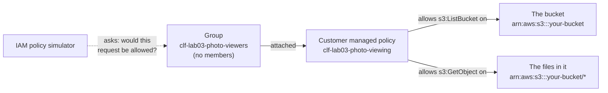
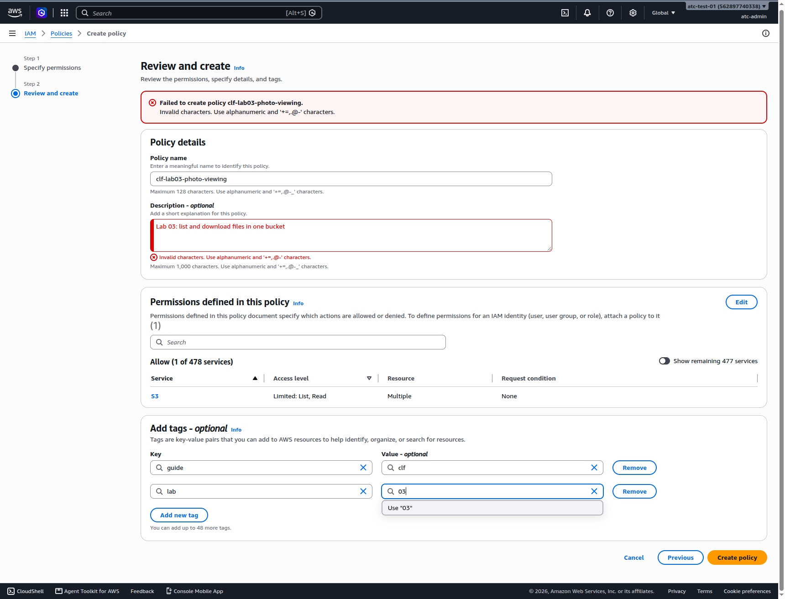
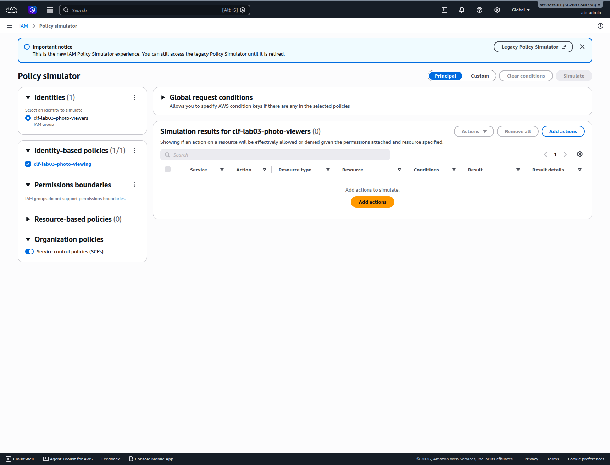
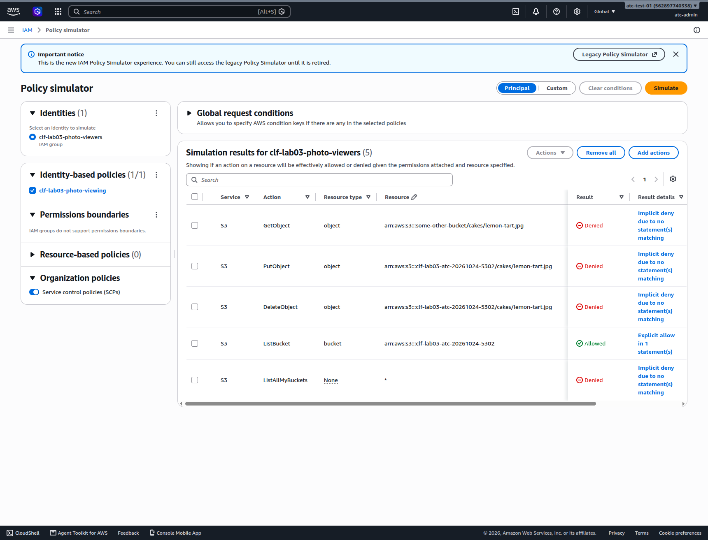

# Lab 03: Give a group read-only access to one bucket, and test it in the policy simulator

## Before you start: your account, your responsibility

This guide is provided as is, without warranty. We work hard to keep it correct and current, but AWS changes often, and its services, prices, and free offers may differ from what is written here. The labs run in your own AWS account. You are responsible for that account, for its security, and for any charges it incurs, including charges from resources you forget to delete. Automate the Cloud Inc. is not liable for any costs, losses, or security incidents that result from following, or failing to follow, this material. Technical guidance here is general information, not advice about your specific systems.

**Who this is for:** you have done [Lab 01](../02-why-the-cloud/06-lab-01-first-resource.md) and read [04.04 Policies and least privilege](04-policies-and-least-privilege.md). **Time:** about 35 minutes.

**Goal:** the bakery's shop staff want to look at the cake photos on the site, but they must not change them. You build that access and prove it works, without creating any new sign-in. **End state:** a group whose only permission is to list one bucket and download its files, a set of simulator results that show it, and then nothing left behind.



*Notice that the policy names two different things: the bucket itself, and the files inside it. Listing is something you do to the bucket; downloading is something you do to a file.*

**Long description.** Left to right. A group named `clf-lab03-photo-viewers`, with no members, has one customer managed policy attached, `clf-lab03-photo-viewing`. The policy allows `s3:ListBucket` on the bucket, written `arn:aws:s3:::your-bucket`, and allows `s3:GetObject` on the files in it, written `arn:aws:s3:::your-bucket/*`. A dotted arrow from the IAM policy simulator to the group is labeled "asks: would this request be allowed?".

**What it creates**, in US East (N. Virginia), `us-east-1`:

- one empty S3 bucket, tagged `guide` = `clf` and `lab` = `03`, which stands in for the bakery's photo storage;
- one **customer managed policy**: a permissions policy that you write and manage yourself, which you can attach to many identities;
- one IAM user group with that policy attached and no users in it.

You delete all three at the end.

**What it costs:** $0. IAM has no extra charge ([IAM FAQs](https://aws.amazon.com/iam/faqs/), checked 2026-10-24), and an empty bucket costs nothing (see Lab 01). **Worst case on a Paid plan** if you forget to clean up: still $0, but leftover permissions are clutter you must audit later. **Free plan:** nothing here upgrades your plan. Never choose **Upgrade plan** during a lab.

**Before you start, you need these guardrails in place:** [root MFA](https://github.com/AutomateTheCloud/atc-study-aws_account_guardrails/blob/main/primer/02-secure-the-root-user.md) (primer page 02), [an IAM admin user with MFA](https://github.com/AutomateTheCloud/atc-study-aws_account_guardrails/blob/main/primer/03-your-everyday-admin-identity.md), which you use for this lab (page 03), [budgets and billing alerts](https://github.com/AutomateTheCloud/atc-study-aws_account_guardrails/blob/main/primer/05-money-alarms.md) (page 05), and [the habits for every lab](https://github.com/AutomateTheCloud/atc-study-aws_account_guardrails/blob/main/primer/07-habits-for-every-lab.md), including your lab log (page 07).

**Why this matters:** in the primer you gave yourself `AdministratorAccess`, which suits the one owner of a lab account. Shop staff need far less. Granting only what a job needs is [SEC03-BP02 Grant least privilege access](https://docs.aws.amazon.com/wellarchitected/latest/security-pillar/sec_permissions_least_privileges.html); giving permissions to a group rather than to each person is [SEC02-BP06 Employ user groups and attributes](https://docs.aws.amazon.com/wellarchitected/latest/security-pillar/sec_identities_groups_attributes.html).

> **If you signed up on the new sign-up path:** there, IAM users can't sign in to the console, and AWS lists IAM Access Analyzer as not supported apart from policy validation (as of 2026-10-23). We haven't run this lab on that path. Read the steps, then practice the same reasoning in [Simulation S4](09-sim-policy-playground.md).

**About the screens:** names in **bold** are what AWS's documentation or our own test account showed on 2026-10-23 or 2026-10-24. We haven't yet run this lab end to end, and AWS changes its console often. If a label differs, look for the option with the same meaning.

## Steps

### Get ready

1. In your lab log, write today's date, the Region `us-east-1`, the tags `guide` = `clf` and `lab` = `03`, and a bucket name: `clf-lab03-`, your initials, today's date and four random digits, for example `clf-lab03-ab-20261024-4817`.
2. Below it, write the bucket's **Amazon Resource Name (ARN)**, the name that identifies a resource in policies. For an S3 bucket it is `arn:aws:s3:::` followed by the bucket name, for example `arn:aws:s3:::clf-lab03-ab-20261024-4817`. Then write the ARN for the files in it: the same text followed by `/*`.
   **You should see:** two lines, one ending in your bucket name and one ending in `/*`.
3. Sign in to the console as your **IAM admin user**, not the root user, and check that the Region selector shows N. Virginia.

### Create the bucket

4. Create the bucket exactly as in [Lab 01, steps 5 to 11](../02-why-the-cloud/06-lab-01-first-resource.md#create-the-bucket-and-time-it), using your new name and the tags `guide` = `clf` and `lab` = `03`. Leave every security setting at its default; you don't need the stopwatch.
   **You should see:** your bucket in the list of general purpose buckets.

### Write the policy

5. In the console search bar, type `IAM` and open it. In the left menu, choose **Policies**, then **Create policy**.
6. Choose the **JSON** option. Delete what's in the editor and paste this policy. Then replace both copies of `YOUR-BUCKET-NAME` with your bucket name.

   ```json
   {
     "Version": "2012-10-17",
     "Statement": [
       {
         "Sid": "ListThePhotoBucket",
         "Effect": "Allow",
         "Action": "s3:ListBucket",
         "Resource": "arn:aws:s3:::YOUR-BUCKET-NAME"
       },
       {
         "Sid": "DownloadPhotos",
         "Effect": "Allow",
         "Action": "s3:GetObject",
         "Resource": "arn:aws:s3:::YOUR-BUCKET-NAME/*"
       }
     ]
   }
   ```

   `s3:ListBucket` acts on the bucket; `s3:GetObject` acts on files, so its resource ends in `/*`, meaning every file in the bucket.
7. Look at the policy validation pane below the editor, with tabs for **Security**, **Errors**, **Warnings** and **Suggestions**. This is IAM Access Analyzer checking your policy against the policy grammar and AWS's best practices, at no extra charge ([Validate policies with IAM Access Analyzer](https://docs.aws.amazon.com/IAM/latest/UserGuide/access-analyzer-policy-validation.html)).
   **You should see:** no security warnings and no errors.
   > **If something went wrong:** an error usually means a missing quote, comma or bracket, or `YOUR-BUCKET-NAME` still in the text. Compare your text with the policy above, character by character.
8. Choose **Next**. In **Policy name**, type `clf-lab03-photo-viewing`. For the description, type `Lab 03 - list and download files in one bucket`. (A colon isn't allowed: on 2026-10-24 the description accepted only letters, numbers, spaces and `+ = , . @ - _`.) If the page offers a tags section, add `guide` = `clf` and `lab` = `03`.
9. Read the summary of permissions the page shows. It should name one service, S3, with list and read access only. Choose **Create policy**.
   **You should see:** a success message, and your policy in the list. Choose the filter for customer managed policies to see it alone.

   

   *Screenshot: the review step before creating the policy, with its permissions summary, captured 2026-10-24 in our test account. AWS console screenshots are AWS material used as limited fair use and are not covered by this guide's license.*


### Create the group and attach the policy

10. In IAM's left menu, choose **IAM user groups**, then choose the button to create a group. The page that opens is titled **Create user group**.
11. In **User group name**, type `clf-lab03-photo-viewers`. Skip the section for adding users.
12. Under **Attach permissions policies**, search for `clf-lab03-photo-viewing` and select it. Then choose **Create user group**.
    **You should see:** "clf-lab03-photo-viewers user group created." (as of 2026-10-24).
    **You should see:** the group in the list, with your one policy and no users. If IAM offers no tags for the group, the `clf-lab03-` name marks it instead.
    > **If something went wrong:** if you can't find the policy, clear any filter in the policy list and search again; its type is customer managed.

### Test it in the policy simulator

The **IAM policy simulator** works out whether a request would be allowed or denied by the policies you choose, without sending the request ([IAM policy testing with the IAM policy simulator](https://docs.aws.amazon.com/IAM/latest/UserGuide/access_policies_testing-policies.html)). On 2026-10-24 it opened inside the IAM console, with a notice that this is the new simulator and that the older, separate one will be retired.

13. Open the group `clf-lab03-photo-viewers` and choose its **Permissions** tab. Next to **Permissions policies**, choose **Simulate**. The simulator opens in a new browser tab. (You can also open it from IAM's left menu: **Policy simulator**.)
    **You should see:** **Principal** selected at the top, your group under **Identities**, and `clf-lab03-photo-viewing` ticked under **Identity-based policies**.

    

    *Screenshot: the new in-console policy simulator, opened from the group, captured 2026-10-24 in our test account. AWS console screenshots are AWS material used as limited fair use and are not covered by this guide's license.*

14. Choose **Add actions**. Choose the service **S3**, then choose **Specify** so you can type action names. Type `ListBucket`; choose **Add more** and type `GetObject`; do the same for `PutObject` and `DeleteObject`. Choose **Add actions**.
    **You should see:** four rows, each with the resource `*`.
15. Give each row its resource. Choose the row's **Resource** cell, select **Specific**, choose the **Type** (`bucket` for `ListBucket`, `object` for the other three), paste the ARN from the table below, and choose **Save**.
16. Choose **Simulate**.
    **You should see:** results for tests 1 to 4. Then add test 6: **Add actions**, S3, **Specify**, `ListAllMyBuckets`, and leave its resource as `*`. For test 5, the simulator lists each action only once, so change the `GetObject` row's resource to the other bucket's file and choose **Simulate** again. Write all six results in your lab log.

    | Test | Action | Resource | Expected |
    |---|---|---|---|
    | 1 | `s3:ListBucket` | `arn:aws:s3:::YOUR-BUCKET-NAME` | Allowed |
    | 2 | `s3:GetObject` | `arn:aws:s3:::YOUR-BUCKET-NAME/cakes/lemon-tart.jpg` | Allowed |
    | 3 | `s3:PutObject` | `arn:aws:s3:::YOUR-BUCKET-NAME/cakes/lemon-tart.jpg` | Denied |
    | 4 | `s3:DeleteObject` | `arn:aws:s3:::YOUR-BUCKET-NAME/cakes/lemon-tart.jpg` | Denied |
    | 5 | `s3:GetObject` | `arn:aws:s3:::some-other-bucket/cakes/lemon-tart.jpg` | Denied |
    | 6 | `s3:ListAllMyBuckets` | `*` | Denied |

    > **If something went wrong:** test 1 or 2 denied → check the bucket name in the policy and in the resource, letter by letter, and check that test 2's resource ends with a file name after the `/`. Fix the policy in IAM (open it and choose **Edit**), then choose **Simulate** again.
17. Read the **Result details** column.
    **You should see:** for the allowed tests, "Explicit allow in 1 statement(s)" (as of 2026-10-24); open it to see which policy and which lines allowed the request. For the denied tests, "Implicit deny due to no statement(s) matching". That is an **implicit deny**: IAM denies every request that no policy allows. Nothing in this lab writes a "Deny".

    

    *Screenshot: simulation results, after test 5 changed GetObject to another bucket, captured 2026-10-24 in our test account. AWS console screenshots are AWS material used as limited fair use and are not covered by this guide's license.*


The file `cakes/lemon-tart.jpg` doesn't exist, and that doesn't matter: the simulator checks permissions, not files. AWS warns that its results can differ from your live account, so in real work you would also test with a real sign-in.

## Check your work

- [ ] IAM **Policies**, filtered to customer managed, shows `clf-lab03-photo-viewing`, granting S3 list and read only.
- [ ] The group `clf-lab03-photo-viewers` has that one policy attached and no users.
- [ ] Your lab log shows tests 1 and 2 allowed, and tests 3 to 6 denied.

## Clean up

Delete in this order, because a policy can't be deleted while it is attached.

18. In IAM, choose **IAM user groups**, select `clf-lab03-photo-viewers`, and choose **Delete**. Type the group name if asked, and confirm.
    **You should see:** the group gone from the list.
    > **If something went wrong:** if the console says the group still has policies attached, open the group, remove the policy on its permissions tab, and delete the group again.
19. Choose **Policies**, select `clf-lab03-photo-viewing`, and choose the delete action. Type the policy name if asked, and confirm.
    **You should see:** the policy gone from the customer managed list.
20. Delete the bucket as in [Lab 01, steps 20 and 21](../02-why-the-cloud/06-lab-01-first-resource.md#clean-up).
21. **Confirm:** IAM's customer managed policies and user groups show nothing starting `clf-lab03-`. In Tag Editor, search all Regions for the tag `lab` = `03` ([Lab 01, steps 13 to 16](../02-why-the-cloud/06-lab-01-first-resource.md#find-it-by-its-tags)); expect no S3 results. Tick everything off in your lab log.

## Recap

You granted a group exactly two actions on one bucket and proved, before anyone relied on it, that everything else is denied by default. In real work you would now add the shop staff to the group; for people, AWS recommends signing in through IAM Identity Center rather than IAM users ([04.05](05-credentials-and-federation.md) explains why our labs use an IAM user anyway).

> **Reflect:** test 6 was denied, so a viewer can't get the list of all the bucket names in the account. Would you add `s3:ListAllMyBuckets` to the policy? Write two sentences.
>
> <details><summary>Model answer</summary>
>
> It depends on whether the staff need it. Listing all buckets shows the name of every bucket in the account, not what's inside them, but it is still more than "the photos and nothing else". Leave it out unless the staff can't do their job without it; if you add it later, you add it deliberately, which is how least privilege works in practice.
>
> </details>

**Next:** [Lab 04](07-lab-04-finish-and-fix-a-policy.md), where you finish a policy, write one for the new teammate yourself, and find a deny that blocks her.

## Where to check the current details

- [IAM tutorial: Create and attach your first customer managed policy](https://docs.aws.amazon.com/IAM/latest/UserGuide/tutorial_managed-policies.html), IAM User Guide (checked 2026-10-24)
- [IAM policy testing with the IAM policy simulator](https://docs.aws.amazon.com/IAM/latest/UserGuide/access_policies_testing-policies.html), IAM User Guide (checked 2026-10-24)
- [Validate policies with IAM Access Analyzer](https://docs.aws.amazon.com/IAM/latest/UserGuide/access-analyzer-policy-validation.html), IAM User Guide (checked 2026-10-24)
- [Policies and permissions in IAM](https://docs.aws.amazon.com/IAM/latest/UserGuide/access_policies.html), IAM User Guide (checked 2026-10-24)

---

"Lab 03: Give a group read-only access to one bucket, and test it in the policy simulator" by Automate the Cloud Inc., licensed under CC BY-NC 4.0 with the Additional Permission for Internal Training from Automate the Cloud Inc.
License: https://creativecommons.org/licenses/by-nc/4.0/
Permission: https://automatethe.cloud/licenses/atc-internal-training-permission.txt
