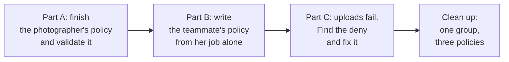
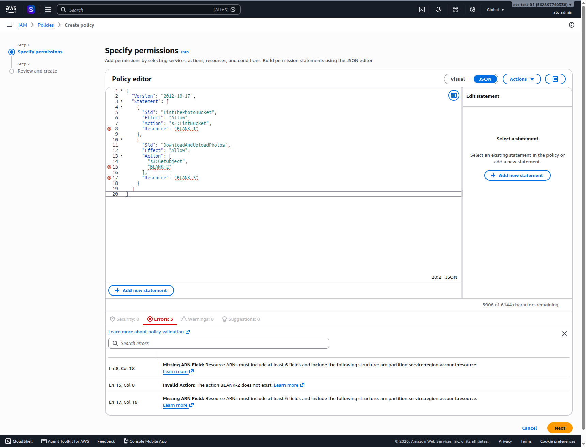
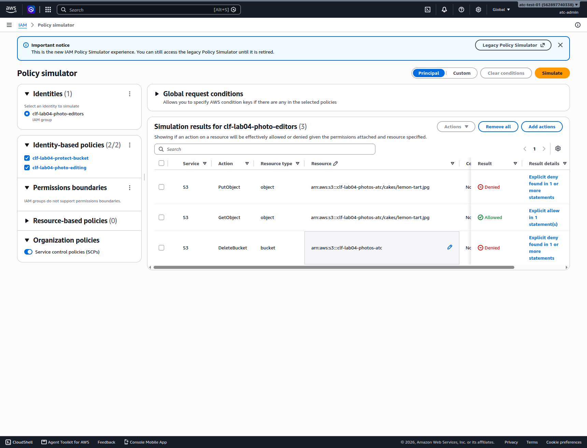

# Optional lab 04: Finish a policy, write one yourself, and find the deny that blocks it

## Before you start: your account, your responsibility

This guide is provided as is, without warranty. We work hard to keep it correct and current, but AWS changes often, and its services, prices, and free offers may differ from what is written here. The labs run in your own AWS account. You are responsible for that account, for its security, and for any charges it incurs, including charges from resources you forget to delete. Automate the Cloud Inc. is not liable for any costs, losses, or security incidents that result from following, or failing to follow, this material. Technical guidance here is general information, not advice about your specific systems.

**This lab is optional.** The exam asks which kind of policy fits and why least privilege matters, not how to write one; do it if you want more practice.

**Who this is for:** you have done [Lab 03](06-lab-03-a-group-and-a-policy.md) and read [04.04 Policies and least privilege](04-policies-and-least-privilege.md). **Time:** about 50 minutes. Each part takes away more of the help.

**Goal:** you finish a half-written policy and let IAM Access Analyzer check it; you write the new teammate's policy from her job description alone; and you find why she can't upload photos. **End state:** your lab log holds three policies, a set of simulator results and a diagnosis, and your account holds nothing from this lab.



*Notice that the help fades: Part A gives you most of the policy, Part B gives you only the requirement, and Part C gives you only a symptom.*

**Long description.** Four stages from left to right. Part A: finish the photographer's policy and validate it. Part B: write the teammate's policy from her job alone. Part C: uploads fail; find the deny and fix it. Clean up: one group and three policies.

**What it creates:** three customer managed policies and one IAM user group with no members, all named `clf-lab04-…`. It creates no bucket: the policies name the bakery's photo bucket, but the policy simulator never sends a real request ([IAM policy testing with the IAM policy simulator](https://docs.aws.amazon.com/IAM/latest/UserGuide/access_policies_testing-policies.html)), so the bucket doesn't need to exist.

**What it costs:** $0. IAM has no extra charge ([IAM FAQs](https://aws.amazon.com/iam/faqs/), checked 2026-10-24), and policy validation has no extra charge either. Don't choose the **Check for new access** option if you see it: AWS charges for each of those checks ([Validate policies with IAM Access Analyzer](https://docs.aws.amazon.com/IAM/latest/UserGuide/access-analyzer-policy-validation.html), checked 2026-10-24). **Worst case on a Paid plan:** $0 if you forget to clean up. **Free plan:** nothing here upgrades your plan.

**Before you start:** the same guardrails as Lab 03: [root MFA](https://github.com/AutomateTheCloud/atc-study-aws_account_guardrails/blob/main/primer/02-secure-the-root-user.md), [an IAM admin user with MFA](https://github.com/AutomateTheCloud/atc-study-aws_account_guardrails/blob/main/primer/03-your-everyday-admin-identity.md), [money alarms](https://github.com/AutomateTheCloud/atc-study-aws_account_guardrails/blob/main/primer/05-money-alarms.md) and [the lab habits](https://github.com/AutomateTheCloud/atc-study-aws_account_guardrails/blob/main/primer/07-habits-for-every-lab.md). Sign in as your IAM admin user.

**Why this matters:** writing a policy for one job, checking it, and testing it before use is [SEC03-BP02 Grant least privilege access](https://docs.aws.amazon.com/wellarchitected/latest/security-pillar/sec_permissions_least_privileges.html) in practice. AWS's IAM best practices also ask you to validate policies with IAM Access Analyzer ([Security best practices in IAM](https://docs.aws.amazon.com/IAM/latest/UserGuide/best-practices.html)). Part C shows the rule from [04.04](04-policies-and-least-privilege.md) that surprises people most: an explicit deny in any policy beats every allow.

> **New sign-up path:** policy validation is listed as available there, but IAM users can't sign in to the console (as of 2026-10-23). We haven't run this lab on that path. Read the steps instead.

**About the screens:** labels in **bold** come from AWS's documentation or our test account (2026-10-23 and 2026-10-24). We ran this lab end to end in our test account on 2026-10-24. If a label differs, look for the option with the same meaning.

## Get ready

1. In your lab log, write the bucket name for this lab: `clf-lab04-photos-` followed by your initials, for example `clf-lab04-photos-ab`. Below it, write its two ARNs: `arn:aws:s3:::clf-lab04-photos-ab` for the bucket and `arn:aws:s3:::clf-lab04-photos-ab/*` for the files in it. You use them in every part.

## Part A: finish the photographer's policy (completion)

The bakery's photographer uploads new cake photos and checks them. She needs to list the photo bucket, download files and upload files. She must never delete anything.

2. In IAM, choose **Policies**, then **Create policy**, then the **JSON** option. Paste this half-written policy as it is, blanks included.

   ```json
   {
     "Version": "2012-10-17",
     "Statement": [
       {
         "Sid": "ListThePhotoBucket",
         "Effect": "Allow",
         "Action": "s3:ListBucket",
         "Resource": "BLANK-1"
       },
       {
         "Sid": "DownloadAndUploadPhotos",
         "Effect": "Allow",
         "Action": ["s3:GetObject", "BLANK-2"],
         "Resource": "BLANK-3"
       }
     ]
   }
   ```

3. Look at the policy validation pane under the editor. It shows a count for each of **Security**, **Errors**, **Warnings** and **Suggestions**.
   **You should see:** on 2026-10-24, **Errors: 3**, one for each blank: two "Missing ARN Field" errors (the resources aren't real ARNs) and "Invalid Action: The action BLANK-2 does not exist". Choose the **Errors** count to list them; each gives the line and column it points at. Write them in your lab log.

   

   *Screenshot: policy validation flagging the three blanks, captured 2026-10-24 in our test account. AWS console screenshots are AWS material used as limited fair use and are not covered by this guide's license.*

4. Fill in the three blanks.
   **You should see:** every count back to 0.
   > **If something went wrong:** a finding that stays usually points at a typo. Action names are written `service:Action`, and every ARN starts `arn:aws:s3:::`.

   <details><summary>Model answer</summary>

   BLANK-1 is the bucket ARN, `arn:aws:s3:::clf-lab04-photos-ab`. BLANK-2 is `s3:PutObject`, the upload action. BLANK-3 is the files ARN, `arn:aws:s3:::clf-lab04-photos-ab/*`. No delete action appears anywhere, so deleting stays denied by default.

   </details>

5. Choose **Next**, name the policy `clf-lab04-photographer`, add the tags `guide` = `clf` and `lab` = `04`, and choose **Create policy**. Before you create it, read the summary: it showed S3 with **Limited: List, Read, Write** (as of 2026-10-24), because uploading is a write.
   **You should see:** the policy in the customer managed list.

## Part B: write the teammate's policy (challenge)

The new teammate keeps the cake photos on the site up to date. **Requirement:** she can list the photo bucket, download photos, upload new ones and delete old ones. She can do nothing else: no other bucket, no changes to the bucket itself, and she can't delete the bucket.

**Constraints:** no more than two statements; no `*` inside an action name; the only resources are your two ARNs.

6. Write the policy in a text editor first.
7. Open the policy simulator from IAM's left menu (**Policy simulator**). On 2026-10-24 it opened inside the IAM console; [Lab 03](06-lab-03-a-group-and-a-policy.md#test-it-in-the-policy-simulator) shows how to add actions and set each row's resource. This time, choose **Custom** at the top instead of **Principal**: it tests a policy you paste in. A pasted policy is simulated on its own and isn't saved to your account. We ran these Custom steps in our test account on 2026-10-24; if a screen differs, look for the option with the same meaning.
8. Choose **Add policy**. Give the draft a name (the dialog says the policy is only used for simulation and isn't created in IAM), paste your JSON into the editor that opens, choose **Save**, then **Back to simulator**. Add your test actions and set each row's resource as in Lab 03. Design at least six tests: three that must be allowed and three that must be denied, including `s3:DeleteBucket` on the bucket ARN. Choose **Simulate** and write the results in your lab log.
   > **Tip:** watch the resource box: when an action has only one resource type, the simulator fills in the type for you and puts `arn:aws:s3:::*` in the **ARN** box. Replace all of it with your ARN, don't add to it. Also clear **Apply to all actions with the same resource type** unless you want every row of that type to get the same ARN.
   **You should see:** every result matching what you predicted.
   > **If something went wrong:** an unexpected "denied" usually means the wrong resource for the action: list actions take the bucket ARN, file actions take the ARN ending in `/*`.
9. When all six match, create the policy in IAM as you did in Part A, named `clf-lab04-photo-editing`.

<details><summary>Model answer</summary>

```json
{
  "Version": "2012-10-17",
  "Statement": [
    {
      "Sid": "ListThePhotoBucket",
      "Effect": "Allow",
      "Action": "s3:ListBucket",
      "Resource": "arn:aws:s3:::clf-lab04-photos-ab"
    },
    {
      "Sid": "ManagePhotos",
      "Effect": "Allow",
      "Action": ["s3:GetObject", "s3:PutObject", "s3:DeleteObject"],
      "Resource": "arn:aws:s3:::clf-lab04-photos-ab/*"
    }
  ]
}
```

Good tests: allowed for `s3:ListBucket` on the bucket, and `s3:GetObject`, `s3:PutObject` and `s3:DeleteObject` on a file such as `cakes/lemon-tart.jpg`. Denied for `s3:DeleteBucket` on the bucket, any action on a different bucket, and `s3:ListAllMyBuckets` on `*`. Compare her policy with the photographer's: they differ by one action. Each person gets exactly what the job needs.

</details>

## Part C: uploads fail (break-fix)

The bakery's previous helper wrote a policy to make sure nobody in the editors' group can ever delete the photo bucket. You put it beside the teammate's policy.

10. Create a third policy, `clf-lab04-protect-bucket`, from this JSON, with your bucket name in both places.

    ```json
    {
      "Version": "2012-10-17",
      "Statement": [
        {
          "Sid": "NeverDeleteThePhotoBucket",
          "Effect": "Deny",
          "Action": ["s3:DeleteBucket", "s3:PutObject"],
          "Resource": [
            "arn:aws:s3:::clf-lab04-photos-ab",
            "arn:aws:s3:::clf-lab04-photos-ab/*"
          ]
        }
      ]
    }
    ```

11. Create a user group named `clf-lab04-photo-editors` with two policies attached: `clf-lab04-photo-editing` and `clf-lab04-protect-bucket`.
    **You should see:** the group with two policies and no users.

**The symptom:** on her first morning, the teammate says she can see and download the photos, but every upload fails with an access error.

12. Use the policy simulator in **Principal** mode, which tests an existing identity (the easiest way in is the **Simulate** button on the group's **Permissions** tab), to find the cause. Test `s3:PutObject` and `s3:GetObject` on a file and `s3:DeleteBucket` on the bucket. Open the result details for the upload. Write in your lab log which policy decides the result, and why the allow in her own policy doesn't help.
    **You should see:** `PutObject` **Denied** with "Explicit deny found in 1 or more statements", and details naming `clf-lab04-protect-bucket` and the lines of its statement (as of 2026-10-24).

    

    *Screenshot: the explicit deny blocking uploads, before the fix, captured 2026-10-24 in our test account. AWS console screenshots are AWS material used as limited fair use and are not covered by this guide's license.*

13. Fix the cause without weakening the protection the helper wanted. Open the policy in IAM, choose **Edit**, change the JSON, and choose **Next**. IAM keeps the old text as an earlier **version** of the policy. Check that **Set this new version as the default.** is selected (it was, by default, on 2026-10-24), then choose **Save changes**.
14. Run the simulation again.
    **You should see:** uploads allowed, and `s3:DeleteBucket` still denied, with the protecting policy named as the reason.

<details><summary>Model answer</summary>

The simulator shows `s3:PutObject` denied by an explicit deny, and the details point at the statement in `clf-lab04-protect-bucket` (the one named `NeverDeleteThePhotoBucket` when you open the policy). Her own policy does allow uploads, but an explicit deny in any policy overrides every allow, so the allow can't win. The helper listed `s3:PutObject` by mistake: the statement's own name says its job is to stop the bucket being deleted. The fix is to remove `"s3:PutObject"` from the action list and the `/*` ARN from the resource list, leaving a deny on `s3:DeleteBucket` for the bucket ARN only.

Why keep a deny at all, when nothing allows deleting the bucket anyway? Because an explicit deny keeps working even if someone later attaches a broader policy to the group. That is what makes it a **guardrail**, a limit that holds whatever else is granted.

There was an early clue. When you created `clf-lab04-protect-bucket`, the summary before **Create policy** listed an explicit deny on S3 with the access level **Limited: Write** (as of 2026-10-24). A policy whose only job is to stop the bucket being deleted shouldn't deny writes in general; uploading is a write. Reading that summary before you create a policy is a cheap check.

</details>

## Check your work

- [ ] Your lab log records which tab Access Analyzer's findings appeared on in Part A, and the filled-in blanks.
- [ ] Your Part B tests all matched your predictions, including `s3:DeleteBucket` denied.
- [ ] Your Part C notes name the policy and statement that caused the deny, and after your fix uploads are allowed while deleting the bucket is still denied.

## Clean up

Delete the group first, because a policy can't be deleted while it is attached.

15. In IAM, choose **IAM user groups**, select `clf-lab04-photo-editors`, choose **Delete**, and confirm.
    > **If something went wrong:** if the console says policies are still attached, remove them on the group's permissions tab and delete it again.
16. Choose **Policies**, filter to customer managed, and delete `clf-lab04-photographer`, `clf-lab04-photo-editing` and `clf-lab04-protect-bucket` one at a time. Deleting `clf-lab04-protect-bucket` removed both of its versions in one step when we ran this lab.
17. **Confirm:** IAM's user groups and customer managed policies show nothing starting `clf-lab04-`. Tick them off in your lab log.

## Recap

You let Access Analyzer catch problems in a policy before it existed, wrote a least-privilege policy from a job description and proved it with tests you designed, and traced a failure to an explicit deny that overrode an allow. Those are the three moves of everyday access work: write, check, diagnose.

> **Reflect:** in Part C, why did the simulator name a policy for the denied upload, when in Lab 03 it named none for a denied upload? Write two sentences.
>
> <details><summary>Model answer</summary>
>
> In Lab 03 nothing allowed uploads, so the request fell to the default implicit deny, which comes from no statement at all. In Part C a statement said "Deny" for that action, an explicit deny, so the simulator could point to it; that is the difference you look for when you troubleshoot.
>
> </details>

**Next:** the [Module 04 mastery check](10-check.md). [Module 04: beyond the exam](11-beyond-the-exam.md) lists the policy types a single account can't show you.

## Where to check the current details

- [Validate policies with IAM Access Analyzer](https://docs.aws.amazon.com/IAM/latest/UserGuide/access-analyzer-policy-validation.html), IAM User Guide (checked 2026-10-24)
- [IAM policy testing with the IAM policy simulator](https://docs.aws.amazon.com/IAM/latest/UserGuide/access_policies_testing-policies.html), IAM User Guide (checked 2026-10-24)
- [Policies and permissions in IAM](https://docs.aws.amazon.com/IAM/latest/UserGuide/access_policies.html), IAM User Guide (checked 2026-10-24)
- [IAM Access Analyzer pricing](https://aws.amazon.com/iam/access-analyzer/pricing/) (checked 2026-10-24)

---

"Optional lab 04: Finish a policy, write one yourself, and find the deny that blocks it" by Automate the Cloud Inc., licensed under CC BY-NC 4.0 with the Additional Permission for Internal Training from Automate the Cloud Inc.
License: https://creativecommons.org/licenses/by-nc/4.0/
Permission: https://automatethe.cloud/licenses/atc-internal-training-permission.txt
