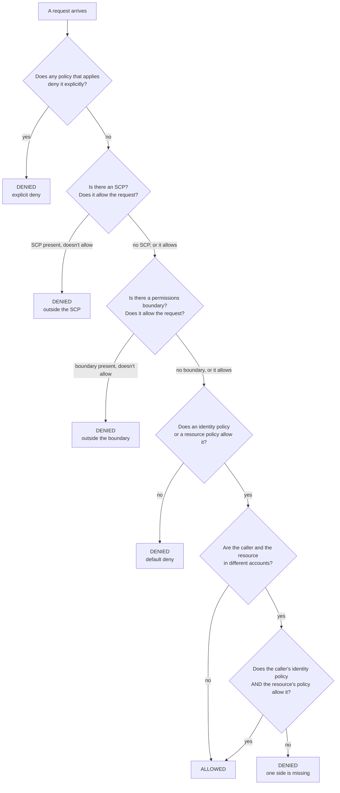

# Simulation S4: Predict allow or deny across accounts, boundaries and organizations

## Before you start: your account, your responsibility

This guide is provided as is, without warranty. We work hard to keep it correct and current, but AWS changes often, and its services, prices, and free offers may differ from what is written here. The labs run in your own AWS account. You are responsible for that account, for its security, and for any charges it incurs, including charges from resources you forget to delete. Automate the Cloud Inc. is not liable for any costs, losses, or security incidents that result from following, or failing to follow, this material. Technical guidance here is general information, not advice about your specific systems.

**Who this is for:** you have read [04.03](03-identities.md), [04.04](04-policies-and-least-privilege.md) and [04.05](05-credentials-and-federation.md). Labs 03 and 04 help but aren't required. **Time:** about 35 minutes. **Cost:** $0; this simulation uses no AWS account.

**Goal:** predict whether each of eight requests is allowed or denied, and name the rule that decides it; then design access for two cases a single account can't show. **End state:** a completed case table and two short designs.

**Why this matters:** organizations, boundaries and access from other accounts are part of task [2.3](https://docs.aws.amazon.com/aws-certification/latest/cloud-practitioner-02/cloud-practitioner-02-domain2.html#cloud-practitioner-02-task2.3), but you can't safely try most of them on the Free plan: creating an organization in AWS Organizations moves a Free plan account to the Paid plan (as of 2026-10-24; see [primer page 03](https://github.com/AutomateTheCloud/atc-study-aws_account_guardrails/blob/main/primer/03-your-everyday-admin-identity.md#why-we-dont-use-iam-identity-center-on-the-free-plan)). The practices behind this page are [SEC03-BP05 Define permission guardrails for your organization](https://docs.aws.amazon.com/wellarchitected/latest/security-pillar/sec_permissions_define_guardrails.html), [SEC03-BP07 Analyze public and cross-account access](https://docs.aws.amazon.com/wellarchitected/latest/security-pillar/sec_permissions_analyze_cross_account.html), and [SEC02-BP04 Rely on a centralized identity provider](https://docs.aws.amazon.com/wellarchitected/latest/security-pillar/sec_identities_identity_provider.html).

## The rules

A **service control policy (SCP)** is set in AWS Organizations and caps what users and roles in a member account can do, including that account's root user. It grants nothing, and it doesn't apply to the organization's management account ([Service control policies](https://docs.aws.amazon.com/organizations/latest/userguide/orgs_manage_policies_scps.html)). A **permissions boundary** caps what an identity's own policies can grant, and grants nothing by itself. AWS evaluates a request roughly like this ([How IAM works](https://docs.aws.amazon.com/IAM/latest/UserGuide/intro-structure.html); [Policies and permissions in IAM](https://docs.aws.amazon.com/IAM/latest/UserGuide/access_policies.html)):



*Notice that there is one way to reach ALLOWED and five ways to be denied; nothing later undoes an earlier "no".*

**Long description.** A top-down flowchart of five checks in order. An explicit deny in any policy: denied. An SCP that doesn't allow the request: denied. A permissions boundary that doesn't allow it: denied. No identity policy or resource policy allows it: denied by default. If something allows it and caller and resource are in the same account: allowed. If they are in different accounts, the caller's identity policy and the resource's policy must both allow it; otherwise denied.

This picture is simplified. AWS's full logic has more policy types (resource control policies, session policies) and exceptions, for example when a resource policy names a user directly and that user has a permissions boundary. The eight cases avoid those exceptions.

## The data

The bakery's account holds the photo bucket. Cases 6 and 7 imagine the bakery grown into a chain, with each shop in its own **member account** of an organization.

| Case | Who asks, for what | Policies in play |
|---|---|---|
| 1 | The teammate downloads a photo | Her group has no policies |
| 2 | The teammate downloads a photo | Her group's policy allows downloading, uploading and deleting files in the photo bucket |
| 3 | The teammate uploads a photo | Case 2's policy, plus a group policy that denies `s3:DeleteBucket` and `s3:PutObject` on the bucket and its files |
| 4 | The photographer, an IAM user in the bakery's account, downloads a photo | No identity policies; the bucket's own policy names her user and allows `s3:GetObject` |
| 5 | A user at the print shop, in the print shop's own AWS account, downloads a photo | The bucket's policy allows the print shop's account; the user's own account gives her no permission for it |
| 6 | A shop's admin, with `AdministratorAccess`, creates an IAM user | The shop's account is a member account; its SCP allows only S3 actions |
| 7 | A new user in a shop's account downloads a photo | The SCP allows every action; the user has no policies |
| 8 | A helper in the bakery's account, with `AdministratorAccess`, creates an IAM user | A permissions boundary on the helper allows only S3 actions |

## Decisions

### Decision 1: predict all eight

For each case, write **allowed** or **denied**, and the box in the flowchart that decides it.

<details><summary>Model answer</summary>


*Figure: the case board. Notice that the deciding cell moves between columns: six denials, from four different rules.*

**Long description.** The figure repeats the answers below as a table, with the cell that decides each case outlined.

1. **Denied, default deny.** Nothing allows it; no policy has to say "Deny".
2. **Allowed.** An identity policy allows it and nothing stops it.
3. **Denied, explicit deny.** An explicit deny in any policy overrides every allow. (This is Lab 04's broken guardrail.)
4. **Allowed.** Within one account, a resource policy that grants access to a principal is enough; no identity policy is needed ([Policies and permissions in IAM](https://docs.aws.amazon.com/IAM/latest/UserGuide/access_policies.html)).
5. **Denied, one side is missing.** Across accounts, the bucket's policy is only half; the print shop's own account must also allow her through an identity policy.
6. **Denied, outside the SCP.** `AdministratorAccess` allows everything, but the SCP caps the account at S3 actions.
7. **Denied, default deny.** An SCP that allows everything still grants nothing. The user needs an identity policy too.
8. **Denied, outside the boundary.** The boundary caps the helper at S3, whatever her policies say.

</details>

### Decision 2: fix case 5

What single change lets the print shop's user download photos, and who makes it?

<details><summary>Model answer</summary>

The print shop's administrator attaches an identity policy to that user (or her group) allowing `s3:GetObject` on the bakery's photo files, `arn:aws:s3:::<photo bucket>/*`. The bakery can't make this change: it controls its bucket's policy, not the print shop's identities.

</details>

### Decision 3: a role instead of a bucket policy

The bakery would rather not edit its bucket policy for every partner. Its alternative is a **cross-account role**: a role in the bakery's account that users from the print shop's account can take on. Name the three pieces needed, and say what kind of credentials the print shop's user gets.

<details><summary>Model answer</summary>

1. In the bakery's account, a role (say `PrintShopPhotoReader`) whose **trust policy** names the print shop's account as allowed to assume it.
2. On that role, a **permissions policy** allowing `s3:GetObject` on the photo files only.
3. In the print shop's account, an identity policy letting its user assume the role:

```json
{
  "Version": "2012-10-17",
  "Statement": [
    {
      "Effect": "Allow",
      "Action": "sts:AssumeRole",
      "Resource": "arn:aws:iam::111122223333:role/PrintShopPhotoReader"
    }
  ]
}
```

(`111122223333` stands for the bakery's 12-digit account ID.) Assuming the role gives **temporary credentials**, so no long-term key is shared between the businesses, and nobody needs an IAM user in both accounts ([IAM tutorial: Delegate access across AWS accounts using IAM roles](https://docs.aws.amazon.com/IAM/latest/UserGuide/tutorial_cross-account-with-roles.html)).

</details>

### Decision 4: does the root user escape?

In case 6, the shop account's **root user** signs in and tries to create an IAM user. Allowed or denied? And would the result change in the organization's management account?

<details><summary>Model answer</summary>

**Denied.** SCPs limit everyone in a member account, the root user included. In the **management account**, SCPs don't apply at all. This also refutes a common mix-up: `AdministratorAccess` doesn't equal root. An admin user can be capped by an SCP or a boundary, and still can't do the tasks that only the root user can do ([04.03](03-identities.md)).

</details>

### Decision 5: thirty staff, twelve accounts

The chain now has twelve shop accounts and thirty staff. Each person needs a different level of access in several accounts. What should the chain use, and why can't you try it in your Free plan lab account?

<details><summary>Model answer</summary>

**IAM Identity Center**, which AWS calls the recommended front door into AWS for a workforce. You define **permission sets** once; Identity Center creates the matching IAM roles in each account you assign. Staff sign in once at the AWS access portal, pick an account and a permission set, and get short-term credentials, with no IAM user per person per account ([What is IAM Identity Center?](https://docs.aws.amazon.com/singlesignon/latest/userguide/what-is.html)). Older material calls it AWS Single Sign-On, its name until 2022-07-26.

To give console access to accounts, Identity Center works with AWS Organizations. On the Free plan, creating that organization upgrades the account to the Paid plan and ends its credits (as of 2026-10-24). That's why our labs use one IAM user with MFA, and why this case is simulated.

</details>

## Recap

A request is allowed only when every check passes: no explicit deny, inside any SCP and boundary, an allow somewhere, and both halves across accounts. When something is denied, find which check said no, as you did in Lab 04. When you design access, prefer temporary credentials through roles and Identity Center to long-term keys.

**Next:** the Module 04 mastery check. Before you take it, retry the practice questions at the end of [04.04](04-policies-and-least-privilege.md) and [04.05](05-credentials-and-federation.md) without looking back.

---

"Simulation S4: Predict allow or deny across accounts, boundaries and organizations" by Automate the Cloud Inc., licensed under CC BY-NC 4.0 with the Additional Permission for Internal Training from Automate the Cloud Inc.
License: https://creativecommons.org/licenses/by-nc/4.0/
Permission: https://automatethe.cloud/licenses/atc-internal-training-permission.txt
