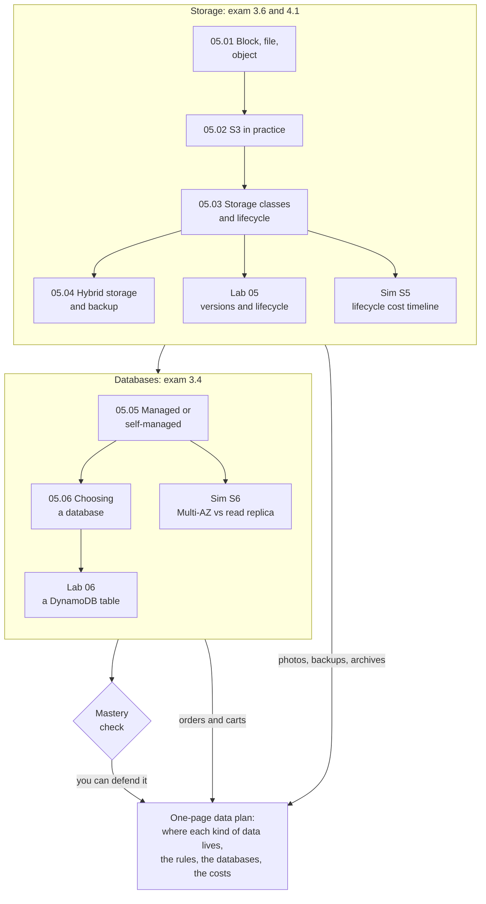

# Module 05: Find the right home for each kind of the bakery's data, and keep it safe and affordable

This module teaches where data lives on AWS: on disks, in shared folders, in object storage and in databases. By the end, you place each kind of the bakery's data, set rules that move old data somewhere cheaper, and pick databases for orders and shopping carts.

**For:** an adult studying alone, possibly new to IT, who wants to understand AWS and use it safely. You have finished Modules [02](../02-why-the-cloud/00-brief.md), [03](../03-aws-around-the-world/00-brief.md) and [04](../04-shared-responsibility-and-access/00-brief.md) and the [guardrails primer](https://github.com/AutomateTheCloud/atc-study-aws_account_guardrails/blob/main/primer/00-read-this-first.md). **Time:** about 4.5 hours, over several sessions.

## The scenario: the bakery's data has outgrown "put it somewhere"

The bakery's site runs on AWS, and the new teammate looks after the cake photos. Now the owner wants a plan for all of the bakery's data.

| The bakery's data | What it is like | Where this module places it |
|---|---|---|
| **Orders** | Written all day; must never be lost | 05.05, 05.06 |
| **Shopping carts** | Read and written many times a minute; thrown away after the visit | 05.06 |
| **Cake photos** | Shown on the site; old ones rarely viewed | 05.01 to 05.03 |
| **Nightly backups** | A copy of the order database and the web server's disk | 05.04 |
| **Tax archives** | Sales records the accountant says to keep seven years; almost never read | 05.03 |

These details are made up; real retention periods come from your accountant or lawyer. At the end you hand the owner a one-page data plan: where each kind of data lives, the rules that move or delete it, the databases, and what each choice costs.

## You'll be able to

Tags: the kind of knowledge (C concept, J judgment) and what you do with it (Un understand, Ap apply).

| Objective | Lesson |
|---|---|
| **05.01a** Choose block, file or object storage for an access pattern [C·Ap] | 05.01 |
| **05.02a** Explain how Block Public Access, versioning and default encryption each protect data in S3 [C·Un] | 05.02 |
| **05.03a** Choose an S3 storage class and a lifecycle rule, avoiding the cost traps [J·Ap] | 05.03 |
| **05.04a** Match a hybrid storage or backup need to an AWS service [C·Ap] | 05.04 |
| **05.05a** Choose between a self-managed and a managed database, and between high availability and read scaling [J·Ap] | 05.05 |
| **05.06a** Pick a database for a shape of data [J·Ap] | 05.06 |

## What this covers on the exam

This module covers task [3.6](https://docs.aws.amazon.com/aws-certification/latest/cloud-practitioner-02/cloud-practitioner-02-domain3.html#cloud-practitioner-02-task3.6), storage services (lessons 05.01 to 05.04), and task [3.4](https://docs.aws.amazon.com/aws-certification/latest/cloud-practitioner-02/cloud-practitioner-02-domain3.html#cloud-practitioner-02-task3.4), database services (05.05 and 05.06), in Domain 3 of the AWS Certified Cloud Practitioner (CLF-C02) exam. It also covers the storage part of task [4.1](https://docs.aws.amazon.com/aws-certification/latest/cloud-practitioner-02/cloud-practitioner-02-domain4.html#cloud-practitioner-02-task4.1), pricing (05.03), and applies task [2.1](https://docs.aws.amazon.com/aws-certification/latest/cloud-practitioner-02/cloud-practitioner-02-domain2.html#cloud-practitioner-02-task2.1), shared responsibility, in each lesson's "your side of the line" section. We checked the exam guide on 2026-10-24. Its "Amazon S3 Glacier" now means the S3 Glacier storage classes; lesson 05.03 explains.

## How the module is laid out

**Lessons** (about 25 minutes each):

1. [Block, file and object storage](01-block-file-object.md)
2. [S3 in practice](02-s3-in-practice.md)
3. [Storage classes and lifecycle](03-storage-classes-and-lifecycle.md)
4. [Hybrid storage and backup](04-hybrid-storage-and-backup.md)
5. [Managed or self-managed databases](05-managed-or-self-managed-databases.md)
6. [Choosing a database](06-choosing-a-database.md)

**Hands-on:**

- [Lab 05: versions and lifecycle](07-lab-05-versions-and-lifecycle.md), ending with the tax archive bucket set up from requirements alone.
- [Lab 06: a DynamoDB table](08-lab-06-a-dynamodb-table.md).
- [Simulation S5: the lifecycle cost timeline](09-sim-lifecycle-cost-timeline.md) and [Simulation S6: Multi-AZ vs read replica](10-sim-multi-az-vs-read-replica.md), on this site, because a real database bills by the hour.

Both labs run in your own AWS account and state their cost on the Free plan and the worst case on a Paid plan.

**Before the labs:** check that you still have [root MFA](https://github.com/AutomateTheCloud/atc-study-aws_account_guardrails/blob/main/primer/02-secure-the-root-user.md), [your IAM admin user with MFA](https://github.com/AutomateTheCloud/atc-study-aws_account_guardrails/blob/main/primer/03-your-everyday-admin-identity.md), [money alarms](https://github.com/AutomateTheCloud/atc-study-aws_account_guardrails/blob/main/primer/05-money-alarms.md) and [Block Public Access for your account](https://github.com/AutomateTheCloud/atc-study-aws_account_guardrails/blob/main/primer/06-safe-defaults.md). The lessons need no AWS account.

**Mastery check:** the module ends with a check; you pass at 80%. Each miss points you to the section to reread, then to a parallel retest.

**Numbers that change:** lesson 05.03 keeps the storage-class figures in one dated table, and every lesson says where to check current prices.

*Notice that the storage half places three kinds of data and the database half the other two.*

**Long description.** A map from top to bottom. The first box, "Storage: exam 3.6 and 4.1", holds lessons 05.01 (block, file, object), 05.02 (S3 in practice), 05.03 (storage classes and lifecycle) and 05.04 (hybrid storage and backup), in that order. Lesson 05.03 leads to Lab 05 (versions and lifecycle) and Simulation S5 (the lifecycle cost timeline). The first box leads to the second, "Databases: exam 3.4", which holds lessons 05.05 (managed or self-managed) and 05.06 (choosing a database). Lesson 05.05 leads to Simulation S6 (Multi-AZ vs read replica); lesson 05.06 leads to Lab 06 (a DynamoDB table). The database box leads to the mastery check. The storage box feeds the one-page data plan with the photos, backups and archives; the database box feeds it with the orders and carts; the check leads to the plan, labeled "you can defend it".

## Coming back

Warm-ups bring back Module 04 (who secures what; bucket policies), Module 03 (Availability Zones; backup vs replication) and Module 02 (durability vs availability; fixed vs variable costs). A mixed practice set on Modules 02 to 05 follows this module.

---

"Module 05: Storing data: storage and databases" by Automate the Cloud Inc., licensed under CC BY-NC 4.0 with the Additional Permission for Internal Training from Automate the Cloud Inc.
License: https://creativecommons.org/licenses/by-nc/4.0/
Permission: https://automatethe.cloud/licenses/atc-internal-training-permission.txt
