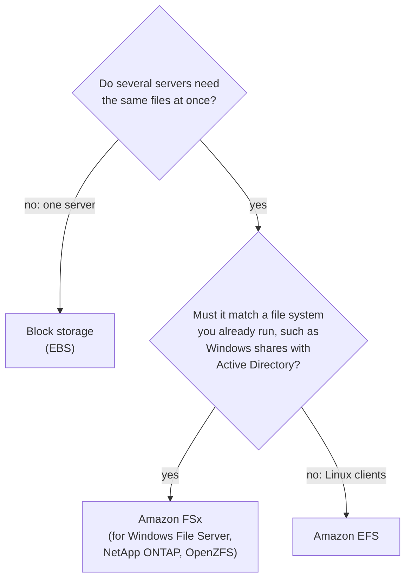
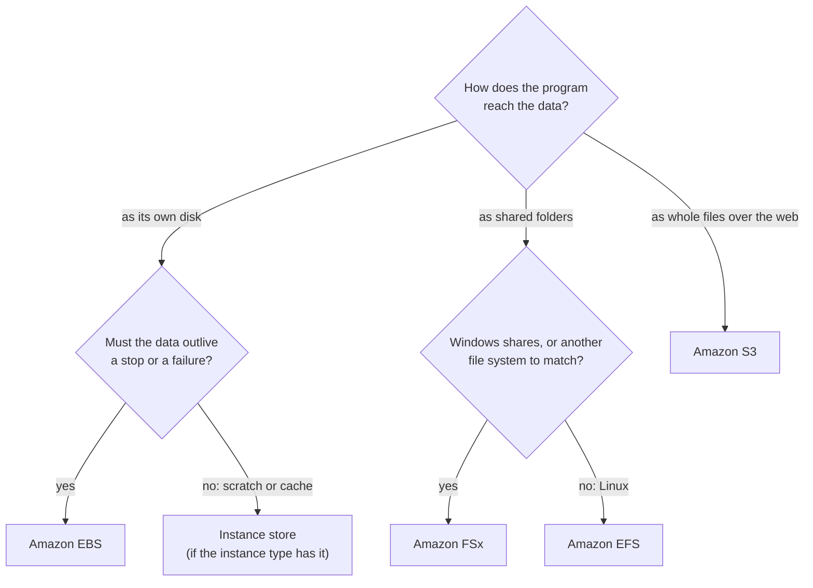

# Block storage is a disk for one server, file storage is a shared folder, and object storage is a bucket you reach over the web

AWS sells storage in three shapes. Each one suits a different way that programs reach their data. Pick the shape first, from how the data is used, and the service follows.

**For:** an adult studying alone, possibly new to IT, who wants to understand AWS and use it safely. **Time:** about 25 minutes. Reading works on a phone.

**Before you start:** this lesson builds on [Telling the benefits apart](../02-why-the-cloud/03-telling-the-benefits-apart.md) (durability and availability), [Regions, Availability Zones and data centers](../03-aws-around-the-world/01-regions-availability-zones-data-centers.md) and [Security of vs in the cloud](../04-shared-responsibility-and-access/01-security-of-vs-in-the-cloud.md). If you skipped them, the key terms below give you enough to follow. The bakery scenario is in the [module brief](00-brief.md).

## Warm-up: what you remember

Answer from memory before you look anything up.

1. The bakery's web server is a virtual server in Amazon EC2. Who installs the security updates for its operating system: AWS or the bakery?
2. What is an Availability Zone (AZ), and how many does a Region have at least?
3. S3 Standard is designed for "eleven nines" of durability and 99.99% availability (as of 2026-10-23). In one sentence each, what does each number promise?

Feedback

1. **The bakery.** On EC2, the guest operating system is on the customer's side of the line (lesson 04.01).
2. An AZ is **one or more separate data centers** with their own power and networking; a Region has **at least three** (lesson 03.01).
3. **Durability:** the data will still exist later. **Availability:** you can reach it right now (lesson 02.03).

## What you'll learn

By the end of this lesson, you can choose block, file or object storage for an access pattern, and name the AWS service for it (objective 05.01a).

Try these before you read on. Guess if you're unsure; the answers are in the lesson.

1. The bakery's web server needs a disk for its operating system. Which kind of storage is that?
2. A server's fastest disk is "instance store". The server is stopped overnight and started in the morning. Is the data on that disk still there?

## The big picture: three shapes of storage

**Storage** keeps data when no program is using it. The three shapes differ in how a program reaches the data, and how many computers can reach it at once.

*Notice who connects in each panel: one server to a block disk, several servers to a file system, and any allowed program, from anywhere, to an object bucket.*

**Long description.** Three panels side by side. Block, "a disk for one server": one server connects to a disk drawn as numbered blocks with no names; the server's operating system formats the disk and keeps its own files on it. Examples: Amazon EBS and EC2 instance store. File, "a shared folder tree": three servers connect to one tree of folders and file names, at the same time, over the network. Examples: Amazon EFS and Amazon FSx. Object, "whole objects in a bucket": an app and a phone reach the bucket over HTTPS; each object has a key such as `cakes/birthday.jpg`, the whole data, and metadata; programs put and get whole objects through an API. Example: Amazon S3.

## Key terms (skip if you know them)

- **Block storage:** a disk that a server sees as its own. The server's operating system formats it and keeps files on it.
- **Volume:** one block storage disk, of a size you choose.
- **File storage:** a shared file system, with folders and file names, that many servers use over the network at the same time.
- **Object storage:** storage for whole files, called **objects**, kept in a container called a **bucket** and reached through a web API. Each object has a **key** (its name in the bucket) and **metadata** (facts about it, such as its type).
- **Persistent:** kept when the server stops or is deleted. The opposite is **temporary**.
- **NFS** and **SMB:** two common ways for computers to share files over a network. Linux usually uses NFS; Windows usually uses SMB.

"Object" is an everyday word with a narrow meaning here. In S3, an object is one stored file plus its key and metadata, nothing more.

## Block storage: a disk attached to one server

Block storage is the cloud version of a laptop's drive. AWS offers two kinds for EC2 servers; what differs most is what happens to the data when the server changes state.

**Amazon Elastic Block Store (Amazon EBS)** provides volumes that you attach to an EC2 instance (a virtual server) and use like a local drive, for the operating system, a database or files ([What is Amazon EBS?](https://docs.aws.amazon.com/ebs/latest/userguide/what-is-ebs.html)). Three facts to hold on to:

- **It lives in one AZ.** A volume and its instance must be in the same Availability Zone. AWS copies the volume's data across several servers inside that AZ.
- **It is persistent.** EBS data survives a stop and a start, because the volume exists apart from the instance ([Amazon EBS FAQs](https://aws.amazon.com/ebs/faqs/)).
- **Snapshots back it up.** An **EBS snapshot** is a point-in-time copy of a volume. It persists on its own, and you can create a new volume from it, in the same AZ or elsewhere. Lesson 05.04 shows how to schedule them.

**EC2 instance store** is temporary block storage on disks physically attached to the computer that runs your instance ([Instance store](https://docs.aws.amazon.com/AWSEC2/latest/UserGuide/InstanceStorage.html)). Not every instance type has it. It suits caches and scratch data, where losing it is fine.

*Notice that a reboot is the only event instance store survives. A stop, which feels harmless, erases it.*

| Server event | Data on an EBS volume | Data on instance store |
|---|---|---|
| Reboot | Kept | Kept |
| Stop | Kept | Lost: every block is erased |
| Hibernate | Kept | Lost |
| Terminate (delete the server) | Kept only if the volume's **Delete on termination** setting is No | Lost |

Sources: [Data persistence for instance store volumes](https://docs.aws.amazon.com/AWSEC2/latest/UserGuide/instance-store-lifetime.html); [Amazon EBS FAQs](https://aws.amazon.com/ebs/faqs/), both checked 2026-10-24.

So deleting an EC2 instance can delete its operating-system volume too. Module 06's lab shows it.

### "Instance store survives a stop" is wrong

You may have read that instance store data is still there after you stop and start the server. That's not right. AWS says it persists through a reboot, but a stop, hibernation or termination erases every block.

It's tempting because a reboot keeps the data, and "stop" sounds like a longer reboot. It isn't: instance store disks belong to the physical computer, and a stop releases them. Copy anything you need to keep to EBS, S3 or EFS.

> **Your turn:** The bakery's nephew wants to keep the only copy of the order database on instance store, "because it's the fastest disk". Give him two reasons in two sentences why that's a bad idea, and say which block storage to use instead.

Model answer

Instance store data is lost whenever the server is stopped, hibernated or terminated, and if the underlying disk fails; orders must never be lost. Use an EBS volume, which persists apart from the server and can be backed up with snapshots (or, better, a managed database, lesson 05.05).

## File storage: one folder tree that many servers share

File storage gives many computers the same folders and files at once, like a shared office drive. AWS's two families differ in the file system you get.

**Amazon Elastic File System (Amazon EFS)** is AWS's own file system for Linux ([What is Amazon EFS?](https://docs.aws.amazon.com/efs/latest/ug/whatisefs.html)):

- It uses **NFS**, and from one to thousands of EC2 instances can connect at once, along with containers, Lambda functions and on-premises servers.
- It is **elastic**: it grows and shrinks as you add and remove files, with nothing to size in advance.
- A **Regional** file system stores data across several AZs and keeps working if one AZ is unavailable. A **One Zone** file system keeps data in a single AZ, and that data can be lost with the AZ.
- AWS states that using EFS with Windows-based EC2 instances isn't supported ([Amazon EFS FAQ](https://aws.amazon.com/efs/faq/)).

**Amazon FSx** runs well-known third-party file systems for you, fully managed ([When to choose Amazon FSx](https://aws.amazon.com/fsx/when-to-choose-fsx/)). You choose the one that matches what you use today, so your applications move without changes:

- **FSx for Windows File Server:** Windows file shares over **SMB**, joined to Microsoft Active Directory ([What is FSx for Windows File Server?](https://docs.aws.amazon.com/fsx/latest/WindowsGuide/what-is.html)). This is the usual answer for "Windows" plus "shared files".
- **FSx for NetApp ONTAP** and **FSx for OpenZFS:** for teams already using those storage systems.
- **FSx for Lustre:** a high-speed file system for supercomputing and machine learning. The CLF-C02 exam guide lists it as out of scope, so just recognize the name.

| | Amazon EFS | Amazon FSx |
|---|---|---|
| File system | AWS's own, using NFS | A familiar third-party one: Windows File Server, NetApp ONTAP, OpenZFS or Lustre |
| Typical clients | Linux servers, containers, Lambda functions | Windows (SMB and Active Directory), or whatever the chosen system serves |
| Choose it when | Linux workloads need the same files, with no capacity planning | You are moving an existing file system to AWS and want it to work the same |

*Notice that the second question is about what you already have: FSx keeps something familiar.*

**Long description.** A decision flowchart. First question: do several servers need the same files at once? If no, use block storage, EBS. If yes, the second question: must it match a file system you already run, such as Windows shares with Active Directory? If yes, Amazon FSx, for Windows File Server, NetApp ONTAP or OpenZFS. If no, with Linux clients, Amazon EFS.

> **Check:** The bakery's shop has three Windows PCs that share a folder of recipes and price lists on an old server in the back room. The owner wants that folder moved to AWS, and the PCs should keep using it the way they do now. Which service fits?
>
> A. Amazon EFS
> B. Amazon FSx for Windows File Server
> C. Amazon EBS
> D. EC2 instance store

Feedback

**B is right.** Windows PCs sharing a folder use SMB, and FSx for Windows File Server provides SMB shares with Windows features.

- **A is wrong.** EFS uses NFS and AWS doesn't support it with Windows-based EC2 instances.
- **C is wrong.** An EBS volume attaches to one server; it isn't a share the three PCs can open.
- **D is wrong.** Instance store is temporary and belongs to one instance.

## Object storage: whole objects in a bucket, reached over the web

Object storage keeps whole files and hands them to any program that asks through a web API and has permission. **Amazon Simple Storage Service (Amazon S3)** is AWS's object storage ([What is Amazon S3?](https://docs.aws.amazon.com/AmazonS3/latest/userguide/Welcome.html)).

You create a **bucket** in a Region and upload **objects** to it. Each object is a file plus its metadata, identified by its **key**, such as `cakes/birthday.jpg`. A program stores an object with one request and reads the whole object back with another. There is no disk to attach and no folder to mount.

What makes S3 different:

- **No capacity to plan.** The total amount of data and the number of objects are unlimited ([Amazon S3 FAQs](https://aws.amazon.com/s3/faqs/)).
- **Reach from anywhere allowed.** Web servers, Lambda functions, phones and other AWS services all use the same API, subject to your permissions (lesson 05.02).
- **It stays where you put it.** Objects stay in their bucket's Region unless you copy or replicate them elsewhere, which helps with data-residency rules (lesson 03.02).

Task [3.6](https://docs.aws.amazon.com/aws-certification/latest/cloud-practitioner-02/cloud-practitioner-02-domain3.html#cloud-practitioner-02-task3.6) asks what object storage is used for. AWS lists backup and restore, archives, media, website files, mobile apps and **data lakes** (large collections of raw data for analysis): whole files, rarely changed, read by many programs.

### "The largest S3 object is 5 TB" is out of date

You may have read that a single S3 object can be at most 5 TB. That figure is old. The S3 FAQ, checked on 2026-10-23, says an object can be anything from 0 bytes to **50 TB**. It's tempting because older courses and practice questions still say 5 TB. Don't memorize either number; check the FAQ when the limit matters.

> **Your turn:** For each item, say whether S3 is a good fit, and why in one phrase: (a) the cake photos shown on the website; (b) the web server's operating system; (c) last year's sales spreadsheets the accountant may ask for.

Model answer

(a) **Good fit:** whole files, written once, read by many visitors' browsers through the site. (b) **Not a fit:** an operating system needs a disk the server boots from, which is block storage (EBS). (c) **Good fit:** whole files kept for a long time and rarely read; lesson 05.03 shows how to keep them cheaply.

## Where the copies live decides what a failure can take

Every AWS storage service copies your data, but not to the same places. That decides which failures it survives on its own: the blast radius from [lesson 03.03](../03-aws-around-the-world/03-surviving-failure.md).

*Notice that only the last two bars reach past one AZ. If that AZ were destroyed, the other four would need a copy kept somewhere else.*

**Long description.** Three dashed columns stand for Availability Zones a, b and c in one Region. EC2 instance store covers one physical host, a short bar inside AZ a. An Amazon EBS volume, EFS One Zone and S3 One Zone-IA each cover AZ a only: copies within one AZ. EFS Regional covers all three columns: across multiple AZs. S3 Standard covers all three: across at least three AZs. A note says that whatever is in one AZ or on one host needs a copy elsewhere, such as a snapshot or a backup.

The durability numbers reflect this (as of 2026-10-23):

| Storage | Where the copies live | Designed durability |
|---|---|---|
| EC2 instance store | One physical host | Not stated: treat it as temporary |
| Amazon EBS volume | Several servers in one AZ | 99.8% to 99.9% for most volume types; 99.999% for io2 Block Express |
| Amazon S3 (most storage classes) | At least three AZs | 99.999999999% ("eleven nines") |

Sources: [Amazon EBS FAQs](https://aws.amazon.com/ebs/faqs/); [S3 storage classes](https://docs.aws.amazon.com/AmazonS3/latest/userguide/storage-class-intro.html).

Remember lesson 02.03: durability protects against failing hardware, not against you. Lesson 05.02 adds protection against mistakes.

> **Check:** Which statement about an EBS volume is true?
>
> A. It is automatically copied to every AZ in the Region.
> B. It can be attached to an instance in any AZ of the Region.
> C. It keeps its data when the instance is stopped.
> D. Its data is erased when the instance is rebooted.

Feedback

**C is right.** EBS volumes persist apart from the instance, so a stop doesn't touch them.

- **A is wrong.** A volume's data is copied within one AZ. To get a copy elsewhere, take a snapshot.
- **B is wrong.** The volume and the instance must be in the same AZ.
- **D is wrong.** A reboot keeps data even on instance store, and EBS keeps it through a stop as well.

## Block, file and object side by side

| | Block (EBS, instance store) | File (EFS, FSx) | Object (S3) |
|---|---|---|---|
| What a program sees | A disk | Folders and files | Whole objects, by key |
| How many computers | One (a few, in special cases) | Many at once | Any allowed program, anywhere |
| How it's reached | Attached to the server | Mounted over the network (NFS or SMB) | Web API requests (HTTPS) |
| Choose it for | Boot disks, a database on one server, scratch space | Shared content and home folders; moving an existing file server | Photos, media, backups, archives, data lakes, website files |

What's the same: AWS runs the hardware for all three. What differs: who can reach the data, and how. **The principle:** decide how the data is used; the shape follows, then the service.

## Worked example: placing the bakery's data

The owner's data plan starts here. An expert asks three questions of each kind of data, in order: *How does the program reach it: as a disk, a folder or a web request? How many computers need it at once? Must it outlive the server?*

*Notice that the first question splits the problem in three; the second question only refines the choice inside one shape.*

**Long description.** A decision flowchart. First question: how does the program reach the data? As its own disk: then, must the data outlive a stop or a failure? Yes: Amazon EBS. No, it is scratch or a cache: instance store, if the instance type has it. As shared folders: then, Windows shares, or another file system to match? Yes: Amazon FSx. No, Linux: Amazon EFS. As whole files over the web: Amazon S3.

1. **The web server's operating system and website software.** Reached as its own disk; must survive a stop. **EBS.**
2. **The cake photos.** Whole files, read by visitors' browsers through the site and written by the teammate. **S3**, in the bucket from Module 04.
3. **The shop's shared recipe folder.** Shared folders on Windows PCs. **FSx for Windows File Server.**
4. **The tax archives.** Whole files, kept for years, rarely read. **S3**, in a cheap storage class (lesson 05.03).

The expert never started from a service name.

> **Your turn:** As lesson 03.01 suggested, the site runs on two Linux web servers in two AZs, so it survives an AZ failure. Both must show the same menu files, which the owner edits every week. Which storage shape and service fit, and why not EBS?

Model answer

**File storage, Amazon EFS (Regional)**, because both Linux web servers need the same files at once, and a Regional file system stores data across AZs, so it keeps working if one AZ fails. Not EBS: a volume attaches to one server in one AZ, so the second server couldn't share it. (Reading the menus from S3 would also work; that is a design choice.)

## What you pay for

Each shape bills differently (checked 2026-10-23; prices vary by Region, so check the pricing pages).

- **EBS:** you pay for what you **provision**, the size of the volume (and any extra performance you reserve), whether you fill it or not.
- **Instance store:** included in the instance's price.
- **EFS:** you pay for what you **use**, with no minimum; the colder storage classes inside EFS cost less for files rarely read.
- **FSx:** you pay for the resources you use, with no upfront costs.
- **S3:** you pay for what you **use**: storage per GB per month, requests, and data transferred out. Transfer between S3 and EC2 in the same Region is free. Lesson 05.03 adds the storage classes.

So an EBS volume behaves like a small fixed cost (lesson 02.02), while S3 and EFS follow your usage.

## Your side of the line

Lesson 04.01 drew the line for EC2 and S3. Storage follows the same rule: AWS runs the disks, the copying and the buildings; your data and its settings are yours.

| Task | AWS | You |
|---|---|---|
| Replace failed disks; copy EBS data within the AZ; copy S3 data across AZs | ✔ | |
| Turn on encryption for EBS volumes (a setting per Region; you turned it on for `us-east-1` on [primer page 06](https://github.com/AutomateTheCloud/atc-study-aws_account_guardrails/blob/main/primer/06-safe-defaults.md)) | | ✔ |
| Take snapshots or backups of EBS, and copy instance store data somewhere persistent | | ✔ |
| Decide who can reach an EFS file system (IAM, security groups, file permissions) | | ✔ |
| Decide who can reach an S3 bucket, and keep it private (lesson 05.02) | | ✔ |

In the new account we created on 2026-10-23, EBS encryption by default was **off** until we turned it on. A safe setting you don't turn on doesn't protect you.

## In real work: start from the access pattern

Engineers choose storage the way you just did. The **performance efficiency** pillar calls it [PERF03-BP01 Use a purpose-built data store that best supports your data access and storage requirements](https://docs.aws.amazon.com/wellarchitected/latest/performance-efficiency-pillar/perf_data_use_purpose_built_data_store.html). The **reliability** pillar's [REL09-BP01 Identify and back up all data that needs to be backed up, or reproduce the data from sources](https://docs.aws.amazon.com/wellarchitected/latest/reliability-pillar/rel_backing_up_data_identified_backups_data.html) is why the expert asked "must it outlive the server?" every time.

## Summary

- **Three shapes:** block storage is a disk for one server; file storage is a folder tree many servers share; object storage keeps whole objects in a bucket, reached through a web API.
- **Block:** EBS volumes persist apart from the instance, live in one AZ, and are backed up by snapshots. Instance store is temporary: it survives a reboot, but not a stop, hibernation or termination.
- **File:** EFS is AWS's elastic NFS file system for Linux, Regional or One Zone. FSx runs a familiar file system for you; FSx for Windows File Server is the Windows and SMB answer.
- **Object:** S3 has no capacity to plan, takes objects up to 50 TB (as of 2026-10-23), and suits photos, backups, archives and data lakes.
- **Where the copies live** decides which failures data survives: one host, one AZ, or several AZs.
- **Start from the access pattern;** the shape, then the service, follows.

## Practice

1. **A video-editing company runs a group of Linux servers that must all read and write the same project files at the same time. Which service fits best?**

   A. Amazon EBS
   B. Amazon EFS
   C. EC2 instance store
   D. Amazon S3 Glacier Deep Archive

   

Feedback

   **B is right.** Many Linux servers sharing the same files at once is file storage over NFS, which is EFS.

   - **A is wrong.** An EBS volume attaches to one instance.
   - **C is wrong.** Instance store is temporary and belongs to one instance.
   - **D is wrong.** Deep Archive is for data read less than once a year, with hours to get it back.

   

2. **An EC2 instance uses instance store for a cache. An administrator stops the instance to save money and starts it the next morning. What happened to the cache?**

   

Feedback

   **It's gone.** Instance store data doesn't persist through a stop; AWS erases every block. That's acceptable for a cache, which the application rebuilds, and never acceptable for the only copy of anything.

   

3. **A company is moving its Windows file server, which uses Active Directory for permissions, to AWS. It wants users to notice no difference. Which service, and why not EFS?**

   

Feedback

   **Amazon FSx for Windows File Server.** It provides Windows file shares over SMB and joins Microsoft Active Directory, so users and permissions work as before. EFS uses NFS, and AWS doesn't support it with Windows-based EC2 instances.

   

4. **(From lesson 03.03.) The bakery keeps the order database's data on one EBS volume and takes no snapshots. The volume's AZ is destroyed. What is lost, and what would have prevented it?**

   

Feedback

   **The data, because every copy of an EBS volume lives in one AZ.** A snapshot, or another backup kept outside that AZ, would have let the bakery restore the data elsewhere. High availability for a database is the subject of lesson 05.05.

   

5. **(From lesson 04.01.) Who is responsible for turning on encryption for a new EBS volume, and who replaces the volume's failed disks?**

   

Feedback

   **The customer** chooses encryption; it's a setting, and settings are on the customer's side of the line. **AWS** replaces failed hardware, on every service.

   

**Next:** [S3 in practice](02-s3-in-practice.md), where you protect the photo bucket.

## Where to check the current details

- [Amazon EFS FAQ](https://aws.amazon.com/efs/faq/), including "When should I use Amazon EFS vs. Amazon EBS vs. Amazon S3?" (checked 2026-10-24)
- [What is Amazon EBS?](https://docs.aws.amazon.com/ebs/latest/userguide/what-is-ebs.html) and [Amazon EBS FAQs](https://aws.amazon.com/ebs/faqs/) (checked 2026-10-24)
- [Instance store temporary block storage](https://docs.aws.amazon.com/AWSEC2/latest/UserGuide/InstanceStorage.html) and [Data persistence for instance store volumes](https://docs.aws.amazon.com/AWSEC2/latest/UserGuide/instance-store-lifetime.html), Amazon EC2 User Guide (checked 2026-10-24)
- [What is Amazon EFS?](https://docs.aws.amazon.com/efs/latest/ug/whatisefs.html) (checked 2026-10-24)
- [When to choose Amazon FSx](https://aws.amazon.com/fsx/when-to-choose-fsx/) and [What is FSx for Windows File Server?](https://docs.aws.amazon.com/fsx/latest/WindowsGuide/what-is.html) (checked 2026-10-24)
- [What is Amazon S3?](https://docs.aws.amazon.com/AmazonS3/latest/userguide/Welcome.html), [Amazon S3 FAQs](https://aws.amazon.com/s3/faqs/) and [Understanding and managing Amazon S3 storage classes](https://docs.aws.amazon.com/AmazonS3/latest/userguide/storage-class-intro.html) (checked 2026-10-23)
- Prices: [Amazon EBS pricing](https://aws.amazon.com/ebs/pricing/) and [Amazon S3 pricing](https://aws.amazon.com/s3/pricing/); for EFS and FSx, the pricing links on the [Amazon EFS](https://aws.amazon.com/efs/) and [Amazon FSx](https://aws.amazon.com/fsx/) pages
- [AWS Certified Cloud Practitioner (CLF-C02) exam guide](https://docs.aws.amazon.com/aws-certification/latest/cloud-practitioner-02/cloud-practitioner-02.html) (checked 2026-10-24)

---

"Block, file and object storage" by Automate the Cloud Inc., licensed under CC BY-NC 4.0 with the Additional Permission for Internal Training from Automate the Cloud Inc.
License: https://creativecommons.org/licenses/by-nc/4.0/
Permission: https://automatethe.cloud/licenses/atc-internal-training-permission.txt
