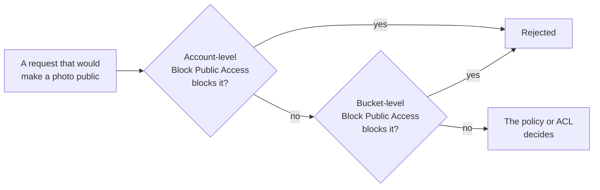

# S3 starts every bucket private and encrypted; versioning, which you turn on, lets you undo mistakes

A new S3 bucket already blocks public access and encrypts everything you upload. What it doesn't do on its own is protect you from your own overwrites and deletes. That takes versioning, which you switch on, and a copy kept somewhere else. In this lesson you learn what each protection does, and set them up for the bakery's photo bucket.

**For:** an adult studying alone, possibly new to IT, who wants to understand AWS and use it safely. **Time:** about 25 minutes. Reading works on a phone.

**Before you start:** this lesson builds on [Block, file and object storage](01-block-file-object.md), [Security of vs in the cloud](../04-shared-responsibility-and-access/01-security-of-vs-in-the-cloud.md), [Policies and least privilege](../04-shared-responsibility-and-access/04-policies-and-least-privilege.md) and [Surviving failure](../03-aws-around-the-world/03-surviving-failure.md). If you skipped them, the key terms below give you enough to follow. The photo bucket, `bakery-cake-photos`, is the one the new teammate looks after in Module 04.

## Warm-up: what you remember

1. A bucket policy is attached to the bucket, not to a person. Is it an identity-based or a resource-based policy?
2. The bakery's order database has a standby copy in a second AZ that receives every change within moments. Someone deletes last week's orders. Does the standby still have them?
3. On primer page 06 you turned on one S3 setting for your whole account. Which one?

Feedback

1. **Resource-based.** It sits on the resource and says who may use it (lesson 04.04).
2. **No.** Replication copies the deletion too; only a point-in-time backup undoes it (lesson 03.03). S3 has the same problem, and this lesson shows its answer.
3. **Block Public Access**, all four settings, for the account. This lesson explains what it does.

## What you'll learn

By the end of this lesson, you can explain how Block Public Access, default encryption and versioning each protect data in S3, and what each one doesn't protect against (objective 05.02a).

Try these before you read on. Guess if you're unsure; the answers are in the lesson.

1. The teammate deletes the birthday-cake photo by mistake. The bucket has its default settings. Can AWS get it back?
2. Do you need to turn on encryption for new photos uploaded to S3?

## The big picture: five layers, three of them already on

*Notice that the three layers that start on all stop the wrong people. The two that start off protect you from accidents, including your own.*

**Long description.** Five numbered rows. Row 1, Block Public Access: protects against someone making the bucket or its objects public by mistake; on for a new bucket, blocking all public access. Row 2, policies (IAM and the bucket policy): protect against the wrong person reading, changing or deleting data; on, the bucket is private and open only where a policy allows. Row 3, encryption at rest: protects against someone reading the stored bytes without permission; on, SSE-S3 for every new object. Row 4, versioning: protects against an overwrite or a delete you didn't mean; off until you turn it on. Row 5, a copy somewhere else: protects against losing the bucket, the Region or the account; off, replication or backups that you set up. Rows 1 to 3 are solid boxes; rows 4 and 5 are dashed. Durability, AWS's side of the line, sits under all five.

## Key terms (skip if you know them)

- **Block Public Access:** S3 settings that override any policy or permission that would make data public.
- **Access control list (ACL):** an older way to grant access to a bucket or object. New buckets have ACLs disabled; AWS recommends policies instead.
- **Encryption at rest:** stored data is scrambled so that only someone with the key can read it. **Encryption in transit:** data is scrambled while it travels over the network, for example by HTTPS.
- **SSE-S3:** server-side encryption with keys that S3 manages. **SSE-KMS:** server-side encryption with keys in AWS Key Management Service (AWS KMS), which you can control (Module 09).
- **Versioning:** S3 keeps every version of an object under the same key. The **current version** is the one people see; older ones are **noncurrent versions**.
- **Delete marker:** a placeholder S3 puts on top when you delete an object in a versioned bucket. The object looks gone; its versions are still there.
- **S3 Object Lock:** stops object versions being deleted or overwritten for a set time. This is called **WORM**, write once, read many.

"Delete" is an everyday word that changes meaning here. In an unversioned bucket, delete means gone for good. In a versioned bucket, a plain delete only adds a marker.

## Private by default, and Block Public Access keeps it that way

A new bucket and its objects don't allow public access ([Blocking public access to your Amazon S3 storage](https://docs.aws.amazon.com/AmazonS3/latest/userguide/access-control-block-public-access.html)). Someone can still open them to the world later, by writing a bucket policy or an ACL that grants public access. **Block Public Access** stops that: it overrides those policies and permissions.

How it works:

- **Four settings**, which together block public access granted through ACLs and through policies, both new and existing. AWS recommends turning on all four.
- **Several levels:** the account, each bucket (and S3 access points), and a whole AWS Organizations organization. Where levels differ, S3 applies the **most restrictive** combination. A bucket with its own setting turned off is still protected if the account setting is on.
- **On by default for new buckets** created since April 28, 2023 ([ACCT.08](https://docs.aws.amazon.com/prescriptive-guidance/latest/aws-startup-security-baseline/acct-08.html)). In our Lab 01 run on 2026-10-24, the new bucket had all of its Block Public Access boxes ticked.
- **Not on by default for the account.** In the new account we created on 2026-10-23, the account-level settings were all off. That's why the primer had you turn them on.

*Notice that either level can say no on its own. That's what "most restrictive wins" means.*

**Long description.** A request that would make a photo public is checked first against the account-level Block Public Access settings; if they block it, it is rejected. If not, it is checked against the bucket-level settings; if they block it, it is rejected. Only if neither blocks it does the policy or ACL decide.

How does the bakery's site show the photos if the bucket isn't public? The web server reads them with its own permissions and sends them to visitors. The bucket never needs to be open to everyone.

> **Your turn:** The teammate wants to "just make the bucket public for a day" so a customer can see a draft photo. With account-level Block Public Access on, what happens if she edits the bucket policy to allow everyone? What would you tell her instead?

Model answer

S3 rejects the public policy, because the account-level setting blocks it whatever the bucket's own setting says. Tell her that a public bucket exposes every photo in it, not one, and that the bakery decided to keep its data private; she can send the customer the draft directly, and the owner decides whether public sharing is ever needed.

## Encryption at rest is automatic; you choose who holds the keys

Since January 5, 2023, S3 encrypts every new object as it's written, at no extra cost and with no change to how you read it ([Default encryption FAQ](https://docs.aws.amazon.com/AmazonS3/latest/userguide/default-encryption-faq.html)). The default is **SSE-S3**, which uses keys S3 manages. You can't turn encryption off for new uploads. Objects uploaded before that date in an old bucket weren't encrypted automatically.

You can choose a different kind ([Protecting data with encryption](https://docs.aws.amazon.com/AmazonS3/latest/userguide/UsingEncryption.html)):

- **SSE-KMS:** S3 encrypts with a key in AWS KMS. You control who may use the key. Choose it when you must show who can decrypt the data.
- **SSE-C:** you supply the key with each request. Since April 2026, new buckets have SSE-C turned off until you deliberately enable it ([Security best practices for Amazon S3](https://docs.aws.amazon.com/AmazonS3/latest/userguide/security-best-practices.html)); our Lab 01 run showed it listed as blocked.
- **Client-side encryption:** you encrypt before uploading and manage the keys and tools yourself.

For data on the move, S3 supports encryption in transit with TLS, the protection behind HTTPS.

### "Encrypted means safe from everyone" is wrong

You may think that because S3 encrypts everything, nobody can read your data. That's not right. Encryption at rest protects the stored bytes, for example on a disk that leaves a data center. Anyone your policies allow to read an object gets it decrypted automatically. If the bucket were public, the whole world would get readable photos.

It's tempting because "encrypted" sounds like "locked". Encryption and access control answer different questions: *Can the stored bytes be read without the key?* and *Who is allowed to ask?* You need both.

> **Check:** The bakery's photos are encrypted with SSE-S3. An attacker steals the access key of an IAM user who is allowed to read the bucket. What does encryption at rest do to stop the attacker reading the photos?
>
> A. Nothing: S3 decrypts the photos for any caller its policies allow.\
> B. It blocks the attacker, because only the bucket owner holds the key.\
> C. It blocks the attacker unless they also have the root user's password.\
> D. It forces the attacker to download the photos over HTTPS.

Feedback

**A is right.** S3 decrypts objects for any request that its permissions allow, and the stolen key is allowed. Protection here comes from not having long-lived access keys and from least privilege (lessons 04.04 and 04.05).

- **B is wrong.** With SSE-S3, S3 manages the key and uses it for every allowed request.
- **C is wrong.** Reading objects doesn't involve the root user.
- **D is wrong.** HTTPS protects data in transit; it doesn't decide who may read it.

## Versioning lets you undo an overwrite or a delete

Versioning keeps every version of every object in the bucket, so you can recover from accidental overwrites and deletes ([Retaining multiple versions of objects with S3 Versioning](https://docs.aws.amazon.com/AmazonS3/latest/userguide/Versioning.html)). It is **off** by default, and you turn it on per bucket.

*Notice that in panel 3 nothing was removed. The delete added something: a marker.*

**Long description.** Four panels, left to right, for one key, `cakes/birthday.jpg`; the top of each stack is what people see. 1, upload: one version, v1, the current one. 2, overwrite: v2 is current, and v1 is kept underneath as a noncurrent version. 3, delete: a delete marker goes on top and is current; the photo looks gone, but v1 and v2 are still stored. 4, restore: delete the marker, and v2 is current again, with v1 underneath. Every version is a whole copy, and S3 bills each one.

What to know:

- **Overwrite** creates a new current version; the old one stays, with its own **version ID**.
- **Delete** (without naming a version) inserts a delete marker. Remove the marker, or copy an older version back, and the object returns.
- **Each version is a whole object**, billed in full. Three versions of a photo are three photos on your bill. Lesson 05.03 shows how a lifecycle rule deletes old versions after a time you choose.
- **No way back to "off".** Once enabled, a bucket can only be **suspended**, which stops new versions; existing versions stay.
- **Permanent deletes are still possible.** Someone with permission can delete a specific version, and that is final. **MFA Delete** makes that require a code from the account's MFA device; only the root user can turn it on ([Tasks that require root user credentials](https://docs.aws.amazon.com/IAM/latest/UserGuide/root-user-tasks.html)), and not in the console ([Enabling versioning on buckets](https://docs.aws.amazon.com/AmazonS3/latest/userguide/manage-versioning-examples.html)). **S3 Object Lock** goes further: it blocks deletes and overwrites of a version until a date you set. In its compliance mode, nobody can remove the protection early, not even the root user ([Amazon S3 FAQs](https://aws.amazon.com/s3/faqs/)).

### "S3 is so durable that AWS can always get my file back" is wrong

You may think eleven nines of durability means a deleted photo can be recovered. That's not right. The S3 FAQ says plainly that durability doesn't protect against accidental or malicious deletes: when you tell S3 to delete data, it is deleted at once and AWS can't recover it. Recovering from your own mistakes is your side of the line.

It's tempting because "durable" sounds like "can't be lost". Durability means the hardware won't lose your data; it faithfully does what you ask, including deleting. That's the first prequestion's answer: with default settings, the photo is gone. With versioning on, it comes back.

> **Your turn:** In two sentences, explain to the owner why versioning is like the point-in-time backups of lesson 03.03, and one way it isn't.

Model answer

Like a backup, versioning keeps the object as it was before a change, so a mistaken overwrite or delete can be undone. Unlike a backup kept elsewhere, the old versions live in the same bucket, account and Region, so losing the bucket, the account's control or the Region takes them too; for that you need a copy somewhere else.

## A copy somewhere else: replication and backups

The fifth layer protects against losing the whole bucket, for example to a deleted bucket, a compromised account or a Regional disaster. Two tools provide it:

- **S3 Replication** copies new objects automatically to another bucket, in another Region (**Cross-Region Replication**) or the same one (**Same-Region Replication**), in the same account or another ([Amazon S3 FAQs](https://aws.amazon.com/s3/faqs/)). It's the S3 version of the second copy in lesson 03.03.
- **Backups:** AWS Backup can back up S3 buckets on a schedule, with the rest of your data. Lesson 05.04 covers it.

The FAQ lists versioning, replication and Object Lock as optional protections on top of the durability S3 provides. Choose them by the question from lesson 03.03: what failure, and how much data can you lose?

## Your side of the line for S3

Lesson 04.01 put S3's data, encryption options and permissions on your side. Here is what that means in practice.

| Task | AWS | You |
|---|---|---|
| Store copies across AZs; repair damaged data; run the hardware | ✔ | |
| Encrypt every new object (SSE-S3) | ✔ (by default) | Choose SSE-KMS where you must control the key |
| Provide Block Public Access, on for new buckets | ✔ | Keep it on, and turn it on for the account |
| Write IAM and bucket policies with least privilege | | ✔ |
| Turn on versioning; decide how long old versions stay | | ✔ |
| Decide whether to replicate or back up, and where | | ✔ |
| Decide which data is sensitive | | ✔ |

AWS made the defaults safe. Every row marked "You" is a decision, and a default only helps until someone changes it.

## Worked example: protecting two buckets

The owner asks you to set up protection for the photo bucket and a new tax archive bucket. Here is the reasoning, layer by layer.

**The photo bucket, `bakery-cake-photos`.**

1. *Public access?* The site shows photos through the web server, so nobody needs public access. Keep Block Public Access on, at the account and the bucket.
2. *Who?* The teammate's PhotoTeam group may list, read and upload; the web server may read. Nothing else (lesson 04.04).
3. *Encryption?* Photos aren't secret, and SSE-S3 is already on. No change.
4. *Mistakes?* The teammate replaces photos weekly; an overwrite could lose a good one. **Turn on versioning**, and add a lifecycle rule that deletes noncurrent versions after, say, 30 days, so old versions don't pile up on the bill (lesson 05.03).
5. *Losing the bucket?* The photographer keeps the originals, so the photos can be recreated. A second copy is optional.

**The tax archive bucket.**

1. *Public access?* Never. Block Public Access on.
2. *Who?* Only the owner and the accountant may read; nobody may delete.
3. *Encryption?* These are financial records. The accountant asks to control who can decrypt them, so choose **SSE-KMS**.
4. *Mistakes?* Records must survive seven years. **Versioning on**, and consider **S3 Object Lock** with a seven-year retention so that nobody, by accident or on purpose, deletes them early.
5. *Losing the bucket?* There's no other copy of these records. Replicate to a second Region, or back them up with AWS Backup (lesson 05.04).

The expert asked the same five questions twice and got different answers, because the data differs. Lab 05 has you set up versioning and lifecycle yourself.

> **Your turn:** Which layer, if any, would have saved the photo in each case? (a) The teammate uploads a blurry photo over the good one. (b) A colleague with read access copies all the photos to a personal laptop. (c) The whole bucket is deleted.

Model answer

(a) **Versioning:** the good photo is a noncurrent version; restore it. (b) **None of the five:** the colleague was allowed to read; least privilege (only those who need access get it) is the control that matters. (c) **A copy somewhere else:** replication or a backup. Versions live inside the bucket, so they go with it.

## What you pay for

As of 2026-10-23 ([Amazon S3 pricing](https://aws.amazon.com/s3/pricing/)):

- **Storage**, per GB per month, for every version you keep.
- **Requests**, such as uploads and reads, per thousand.
- **Data transfer out** to the internet, after a free monthly allowance; data in from the internet is free.
- **SSE-S3** costs nothing extra. **SSE-KMS** adds AWS KMS request charges.
- **Replication** adds the second copy's storage and, across Regions, transfer charges.

Check the pricing page for current prices in your Region.

## In real work: make the safe setting the only setting

Security teams turn on account-level Block Public Access and check it doesn't drift; AWS recommends all four settings for every account ([Blocking public access](https://docs.aws.amazon.com/AmazonS3/latest/userguide/access-control-block-public-access.html)). That is the security design principle "[Keep people away from data](https://docs.aws.amazon.com/wellarchitected/latest/framework/sec-design.html)", and [SEC08-BP04 Enforce access control](https://docs.aws.amazon.com/wellarchitected/latest/security-pillar/sec_protect_data_rest_access_control.html). Encryption by default meets [SEC08-BP02 Enforce encryption at rest](https://docs.aws.amazon.com/wellarchitected/latest/security-pillar/sec_protect_data_rest_encrypt.html) with no work. Versioning, replication and backups belong to the **reliability** pillar: [REL09-BP01 Identify and back up all data that needs to be backed up, or reproduce the data from sources](https://docs.aws.amazon.com/wellarchitected/latest/reliability-pillar/rel_backing_up_data_identified_backups_data.html).

## Summary

- **Five layers** protect data in S3. Block Public Access, private-by-default policies and encryption at rest start on; versioning and a copy elsewhere start off.
- **Block Public Access** overrides any policy or ACL that would make data public; the most restrictive level wins. It's on for new buckets, but in a new account it starts off at the account level.
- **Encryption at rest** is automatic (SSE-S3) for every new object since 2023-01-05. It protects stored bytes, not against callers your policies allow.
- **Versioning** keeps every version; a delete adds a marker; each version is billed. It can be suspended but not turned off.
- **Durability doesn't undo deletes.** AWS can't recover what you delete; recovering from mistakes is your job.

## Practice

1. **What does S3 Block Public Access do?**

   A. Encrypts objects so the public can't read them\
   B. Overrides bucket policies and ACLs that would grant public access\
   C. Deletes objects that have been made public\
   D. Hides the bucket's name from other AWS accounts

   

Feedback

   **B is right.** It overrides policies and permissions that would make data public.

   - **A is wrong.** That's encryption, a separate layer.
   - **C is wrong.** It blocks the grant; it doesn't delete anything.
   - **D is wrong.** Bucket names aren't hidden by it.

   

2. **Versioning is on. A user deletes `menu.pdf` without naming a version. What happens?**

   

Feedback

   **S3 inserts a delete marker, which becomes the current version.** The file looks gone, but its earlier versions are still stored (and billed). Removing the marker brings the file back.

   

3. **A company must keep audit records unchanged for five years, and even administrators must not be able to delete them early. Which S3 feature meets this?**

   A. Versioning\
   B. Default encryption\
   C. S3 Object Lock in compliance mode\
   D. Same-Region Replication

   

Feedback

   **C is right.** Object Lock blocks deletes and overwrites until the retention date; in compliance mode nobody, including the root user, can remove the protection early.

   - **A is wrong.** Versioning keeps old versions, but someone with permission can still delete a version permanently.
   - **B is wrong.** Encryption protects the stored bytes, not against deletion.
   - **D is wrong.** Replication copies objects; it doesn't stop deletes.

   

4. **A colleague says, "S3 has eleven nines of durability, so we don't need versioning or backups." Explain in two sentences why that's wrong.**

   

Feedback

   **Model answer:** Durability protects against hardware losing data, but S3 carries out deletes and overwrites exactly as asked, and AWS says it can't recover deleted data. Versioning, Object Lock and backups protect against mistakes and attacks, and turning them on is the customer's job.

   

5. **(From lesson 04.04.) The teammate's group policy allows `s3:PutObject` on the photo bucket. The bucket's Block Public Access is on. Can she still upload photos?**

   

Feedback

   **Yes.** Block Public Access stops *public* access: grants to everyone. Her access comes from an identity-based policy for a named group, which it doesn't affect.

   

**Next:** [Storage classes and lifecycle](03-storage-classes-and-lifecycle.md). To practice versioning, do [Lab 05: versions and lifecycle](07-lab-05-versions-and-lifecycle.md).

## Where to check the current details

- [Blocking public access to your Amazon S3 storage](https://docs.aws.amazon.com/AmazonS3/latest/userguide/access-control-block-public-access.html), Amazon S3 User Guide (checked 2026-10-24)
- [ACCT.08 Prevent public access to private Amazon S3 buckets](https://docs.aws.amazon.com/prescriptive-guidance/latest/aws-startup-security-baseline/acct-08.html), AWS Startup Security Baseline (checked 2026-10-24)
- [Protecting data with encryption](https://docs.aws.amazon.com/AmazonS3/latest/userguide/UsingEncryption.html) and [Default encryption FAQ](https://docs.aws.amazon.com/AmazonS3/latest/userguide/default-encryption-faq.html) (checked 2026-10-24)
- [Security best practices for Amazon S3](https://docs.aws.amazon.com/AmazonS3/latest/userguide/security-best-practices.html) (checked 2026-10-24)
- [Retaining multiple versions of objects with S3 Versioning](https://docs.aws.amazon.com/AmazonS3/latest/userguide/Versioning.html) and [Enabling versioning on buckets](https://docs.aws.amazon.com/AmazonS3/latest/userguide/manage-versioning-examples.html) (checked 2026-10-24)
- [Amazon S3 FAQs](https://aws.amazon.com/s3/faqs/): durability and deletes, Object Lock, Replication (checked 2026-10-23)
- [Amazon S3 pricing](https://aws.amazon.com/s3/pricing/)

---

"S3 in practice" by Automate the Cloud Inc., licensed under CC BY-NC 4.0 with the Additional Permission for Internal Training from Automate the Cloud Inc.
License: https://creativecommons.org/licenses/by-nc/4.0/
Permission: https://automatethe.cloud/licenses/atc-internal-training-permission.txt
