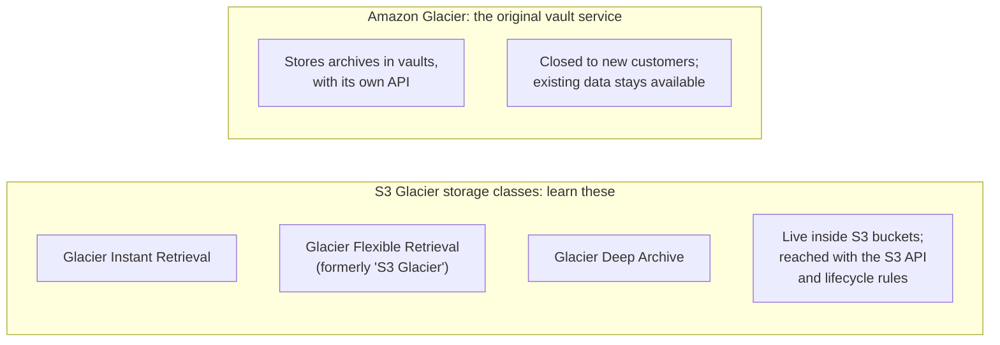
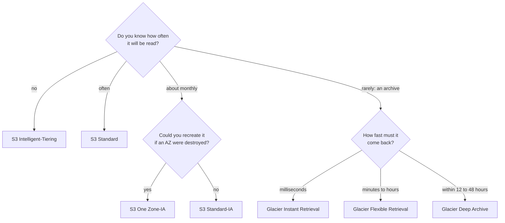

# Choose an S3 storage class by how often you read the data and how fast you need it back, then let lifecycle rules move it as it cools

S3's colder storage classes cost less to store but more to read, and charge you if you leave early. A lifecycle rule moves each object to a colder class as it ages, and deletes it when you no longer need it. In this lesson you choose classes and rules for the bakery, and learn three cost traps.

**For:** an adult studying alone, possibly new to IT, who wants to understand AWS and use it safely. **Time:** about 25 minutes. Reading works on a phone.

**Before you start:** this lesson builds on [Block, file and object storage](01-block-file-object.md), [S3 in practice](02-s3-in-practice.md) and [Before and after: the demand curve](../02-why-the-cloud/02-before-and-after-the-demand-curve.md). If you skipped them, the key terms below give you enough to follow. The bakery scenario is in the [module brief](00-brief.md).

## Warm-up: what you remember

1. In lesson 03.01, S3 kept copies across at least three Availability Zones "in most storage classes". Which cheaper class was named as the exception?
2. Is the bakery's S3 bill a fixed cost or a variable cost? Why?
3. Who decides how long the bakery keeps old versions of its photos: AWS or the bakery?

Feedback

1. **S3 One Zone-IA**, which keeps data in one AZ. This lesson explains when that's acceptable.
2. **Variable.** S3 bills for what you store and use each month, with no minimum charge (lessons 02.02 and 05.01).
3. **The bakery.** How long data is kept is a customer decision (lesson 05.02); a lifecycle rule is how you carry it out.

## What you'll learn

By the end of this lesson, you can choose an S3 storage class and a lifecycle rule for a kind of data, and avoid the cost traps of minimum stays, minimum sizes and retrieval fees (objective 05.03a).

Try these before you read on. Guess if you're unsure; the answers are in the lesson.

1. The accountant's records are read perhaps once a year and must be kept seven years. Which class is cheapest to store them in?
2. You put a file in the cheapest class and delete it a month later. How many days of storage do you pay for?

## The big picture: from hot to cold

"Hot" data is read often; "cold" data is read rarely. S3's classes run from hot to cold.

*Notice that the minimum stay grows as you go down, and first-byte time jumps from milliseconds to hours at Glacier Flexible Retrieval. Storage gets cheaper in the same direction.*

**Long description.** Seven rows from hot at the top to cold at the bottom. S3 Standard: no minimum stay; first byte in milliseconds; no retrieval fee; 3 or more AZs. S3 Intelligent-Tiering: no minimum stay; milliseconds, with optional archive tiers that take longer; no retrieval fee but a small monitoring fee per object; 3 or more AZs. S3 Standard-IA: 30 days; milliseconds; a fee per GB read; 3 or more AZs. S3 One Zone-IA: 30 days; milliseconds; a fee per GB read; 1 AZ. S3 Glacier Instant Retrieval: 90 days; milliseconds; a fee per GB read; 3 or more AZs. S3 Glacier Flexible Retrieval: 90 days; minutes to 12 hours, after a restore; a fee per GB read, with free bulk restores; 3 or more AZs. S3 Glacier Deep Archive: 180 days; 12 to 48 hours, after a restore; a fee per GB read; 3 or more AZs. A note: deleting, overwriting or moving an object out early is billed for the rest of the minimum stay, and three classes bill objects under 128 KB as 128 KB.

## Key terms (skip if you know them)

- **Storage class:** a setting on each S3 object that decides how it's stored, how fast you get it back, and how it's billed. New objects go to **S3 Standard** unless you choose otherwise.
- **Retrieval fee:** a charge per GB each time you read data from some classes.
- **Minimum storage duration:** the shortest stay a class bills for. Leave early, and you pay for the rest.
- **Minimum billable object size:** the smallest size a class bills for. Smaller objects are billed as that size.
- **Restore:** for the two coldest classes, a request to make a temporary readable copy before you can read an object.
- **S3 Lifecycle:** rules on a bucket that **transition** objects to another class, or **expire** (delete) them, after a number of days.

## Three questions pick a class: how often, how fast, how replaceable

Ask three questions about the data: *How often is it read? How fast must it come back? Could you recreate it if an AZ were destroyed?* The answers place it on the chart ([Understanding and managing Amazon S3 storage classes](https://docs.aws.amazon.com/AmazonS3/latest/userguide/storage-class-intro.html)).

- **S3 Standard:** data read often, more than about once a month. No minimum stay, no retrieval fee. The default.
- **S3 Intelligent-Tiering:** data whose access pattern is unknown or changes. S3 watches each object and moves it to a cheaper tier after 30 days without a read, and cheaper again after 90; a read moves it back. No retrieval fees, but a small monthly monitoring fee per object. Objects under 128 KB are never moved.
- **S3 Standard-IA** (IA: infrequent access): data read about once a month that must still come back in milliseconds.
- **S3 One Zone-IA:** the same pattern, at lower cost, but stored in **one AZ**: the data can be lost if that AZ is destroyed. Use it only for data you can recreate.

The three "infrequent" options are easy to confuse:

| | Standard-IA | One Zone-IA | Intelligent-Tiering |
|---|---|---|---|
| Same | Millisecond reads, cheaper storage than Standard for rarely read data | | |
| Access pattern | Known: about monthly | Known: about monthly | Unknown or changing |
| AZs | 3 or more | 1 | 3 or more |
| Designed availability | 99.9% | 99.5% | 99.9% |
| Reading costs | Fee per GB | Fee per GB | No retrieval fee; monitoring fee per object |
| Choose when | You know it cools, and it must survive an AZ loss | You know it cools, and you can recreate it | You can't predict how it will be used |

Availability is AWS's design target, as of 2026-10-23; minimum stays are in the dated table below.

### "Standard-IA is as available as Standard" is wrong

You may have read that Standard-IA has the same availability as S3 Standard and only costs less. That's not right. AWS designs S3 Standard for 99.99% availability and Standard-IA for 99.9%. Their *durability* is the same eleven nines, which is where the confusion comes from. One Zone-IA is lower again, 99.5%.

It's tempting because both classes keep copies in at least three AZs and answer in milliseconds. Remember lesson 02.03: durability and availability are different promises.

> **Check:** The bakery makes thumbnail images of its photos, which it can regenerate from the originals at any time. They're read about once a month. Which class is cheapest without risking data the bakery can't replace?
>
> A. S3 Standard\
> B. S3 Standard-IA\
> C. S3 One Zone-IA\
> D. S3 Glacier Deep Archive

Feedback

**C is right.** One Zone-IA costs less than Standard-IA and suits monthly reads; losing it with an AZ is acceptable because the thumbnails can be recreated.

- **A is wrong.** It works, but costs more to store for data read only monthly.
- **B is wrong.** It works, but pays for multi-AZ resilience the bakery doesn't need here.
- **D is wrong.** Thumbnails shown on a site can't wait hours for a restore.

## Three Glacier classes: archive by how fast you need it back

The S3 Glacier storage classes are for archives: data you must keep but rarely read. All three are normal S3 classes, in normal buckets ([Amazon S3 Glacier storage classes](https://aws.amazon.com/s3/storage-classes/glacier/)).

| | Glacier Instant Retrieval | Glacier Flexible Retrieval | Glacier Deep Archive |
|---|---|---|---|
| Read about | Once a quarter | Once or twice a year | Less than once a year |
| Getting data back | Milliseconds, like Standard-IA | Restore first: about 1–5 minutes (expedited), 3–5 hours (standard), 5–12 hours (bulk, free) | Restore first: 12 to 48 hours, depending on the option; standard is within 12 hours |
| Typical use | Medical images, news media | Backups, disaster recovery | Records kept 7–10 years for compliance; a replacement for tape |

Times as of 2026-10-23. Deep Archive is S3's lowest-cost class. Flexible Retrieval and Deep Archive add about 40 KB of billed metadata to each object, so archiving many tiny files costs more than it seems.

### "Glacier vaults are the S3 Glacier classes" is wrong

The CLF-C02 exam guide lists "Amazon S3 Glacier", and older courses teach "vaults" and "archives". That mixes up two things:

*Notice that the old service sits in its own box: different containers, a different API, and no new customers.*

**Long description.** Two panels. Left, "S3 Glacier storage classes: learn these": Glacier Instant Retrieval; Glacier Flexible Retrieval, formerly named "S3 Glacier"; Glacier Deep Archive; they live inside S3 buckets and are reached with the S3 API and lifecycle rules. Right, "Amazon Glacier: the original vault service": stores archives in vaults with its own API; closed to new customers, while existing data stays available.

The original standalone service, now called **Amazon Glacier**, is no longer accepting new customers; AWS recommends the S3 Glacier storage classes for new archives ([What is Amazon Glacier?](https://docs.aws.amazon.com/amazonglacier/latest/dev/introduction.html), checked 2026-10-23). It's tempting to treat them as one because of the shared word, and because Glacier Flexible Retrieval used to be named "S3 Glacier". When a question says "S3 Glacier", think of the three classes and pick by retrieval time.

> **Your turn:** Match each of the bakery's needs to a Glacier class, and give the deciding fact: (a) the tax archives, read almost never, kept seven years; (b) last quarter's photo originals, which the marketing team occasionally needs instantly; (c) monthly copies of the order data, kept a year in case of a disaster, where a few hours' wait is fine.

Model answer

(a) **Deep Archive:** read less than once a year, cheapest, and a 12–48 hour wait is fine. (b) **Instant Retrieval:** rarely read but needed in milliseconds. (c) **Flexible Retrieval:** backup and disaster recovery, read once or twice a year, minutes to hours is acceptable.

## The numbers in one place

These figures change, so they live in one dated table ([S3 storage class comparison](https://docs.aws.amazon.com/AmazonS3/latest/userguide/storage-class-intro.html)). Learn the patterns, not the digits.

> **Dated: checked 2026-10-25. Check the S3 pages for current values.**
>
> | Class | Designed availability | AZs | Minimum storage duration | Minimum billed size | Retrieval fee |
> |---|---|---|---|---|---|
> | S3 Standard | 99.99% | 3 or more | None | None | None |
> | S3 Intelligent-Tiering | 99.9% | 3 or more | None | None (under 128 KB: never moved to cheaper tiers) | None; monitoring fee |
> | S3 Standard-IA | 99.9% | 3 or more | 30 days | 128 KB | Per GB |
> | S3 One Zone-IA | 99.5% | 1 | 30 days | 128 KB | Per GB |
> | S3 Glacier Instant Retrieval | 99.9% | 3 or more | 90 days | 128 KB | Per GB |
> | S3 Glacier Flexible Retrieval | 99.99% after restore | 3 or more | 90 days | 40 KB metadata added per object | Per GB; bulk free |
> | S3 Glacier Deep Archive | 99.99% after restore | 3 or more | 180 days | 40 KB metadata added per object | Per GB |
>
> Every class above is designed for 99.999999999% durability. Two others exist: **S3 Express One Zone**, for single-digit-millisecond reads in one AZ you choose, and **Reduced Redundancy Storage**, which AWS doesn't recommend.

## Lifecycle rules move and delete objects for you

An **S3 Lifecycle** configuration is a set of rules on a bucket ([Managing the lifecycle of objects](https://docs.aws.amazon.com/AmazonS3/latest/userguide/object-lifecycle-mgmt.html)). Each rule has one or both kinds of action:

- **Transition actions** move objects to another class a number of days after they were created, for example to Standard-IA at 30 days and Glacier Flexible Retrieval at one year.
- **Expiration actions** delete objects when they expire, for example at the end of a retention period.

A rule can cover the whole bucket, or only objects with a given name prefix or tag. In a versioned bucket, rules can also act on **noncurrent versions**, counting days from when a version stopped being current: that's how the photo bucket from lesson 05.02 clears out old versions ([Setting an S3 Lifecycle configuration](https://docs.aws.amazon.com/AmazonS3/latest/userguide/how-to-set-lifecycle-configuration-intro.html)). Rules apply to existing objects as well as new ones, and a bucket policy can't stop them.

*Notice that every step is decided in advance by the record's age. Intelligent-Tiering, below, decides by each photo's reads instead.*

**Long description.** A time line of one sales record's age, not to scale. Day 0: uploaded to S3 Standard. Day 30: a transition action moves it to S3 Standard-IA. Day 365: a transition action moves it to S3 Glacier Deep Archive. Day 2,557, about seven years: an expiration action, and S3 deletes it. The segments get darker as the data gets colder, and each is labeled with its class. Below, for comparison: the cake photos in S3 Intelligent-Tiering need no rule; S3 watches each photo; not read for 30 days, it moves to a cheaper tier; not read for 90 days, cheaper again; read it, and it moves back; no retrieval fees.

Use **lifecycle rules** when you know how the data cools, as with the records. Use **Intelligent-Tiering** when you don't, as with photos: a cake might be popular for years or forgotten next week.

> **Your turn:** The bakery's web server writes a log file every day. The nephew reads logs for a week when something breaks; nobody needs them after 90 days. Write a lifecycle rule in one sentence, and say why you might not bother with a transition at all.

Model answer

"Expire objects with the prefix `logs/` 90 days after creation." A transition to Standard-IA at day 30 might save a little, but small log files are billed as 128 KB there and each transition is a billed request, so the expiration alone may be cheapest.

## Three cost traps

**1. The minimum stay.** Delete, overwrite or transition an object to another class before its class's minimum storage duration ends, and you're billed for the rest of that minimum, pro rata, so you pay for the full minimum in all. A lifecycle rule can spring this trap on its own.

*Notice case A: a rule that looked thrifty pays for 60 days nobody used. Check that the expiration comes after the last transition plus that class's minimum stay.*

**Long description.** Paired horizontal bars on a scale of 0 to 360 days. Case A, a rule that moves objects to Glacier Flexible Retrieval at day 30 and expires them at day 60: 30 days in the class, 90 billed. Case B, an object uploaded straight to Glacier Deep Archive and deleted at day 60: 60 days, 180 billed. Case C, a rule that moves objects to Standard-IA at day 30 and expires them at day 365: 335 days, 335 billed, because the stay passed the 30-day minimum.

| Case | Days in the class | Minimum stay | Days billed |
|---|---|---|---|
| A. Glacier Flexible Retrieval at day 30, expire at day 60 | 30 | 90 | 90 |
| B. Glacier Deep Archive from upload, delete at day 60 | 60 | 180 | 180 |
| C. Standard-IA at day 30, expire at day 365 | 335 | 30 | 335 |

**2. The minimum size.** Standard-IA, One Zone-IA and Glacier Instant Retrieval bill any object under 128 KB as 128 KB. A 20 KB thumbnail there is billed more than six times its size.

**3. Reading costs.** Every class from Standard-IA down charges per GB read, and the two coldest also make you wait for a restore. Moving data that is read every day into an IA class can cost more than leaving it in Standard. Transitions themselves are billed per request, though S3 charges no retrieval fee for them.

> **Check:** A rule moves objects to Glacier Deep Archive at day 1 and expires them at day 90. What happens to the bill?
>
> A. Nothing unusual: 89 days in Deep Archive are billed.\
> B. Each object is billed for 180 days in Deep Archive, because it left after 89.\
> C. The rule is rejected, because Deep Archive can't be expired.\
> D. S3 waits until day 181 to expire the objects.

Feedback

**B is right.** Deep Archive's minimum stay is 180 days; an object deleted earlier is billed for the remainder, so 89 days used are billed as 180.

- **A is wrong.** That ignores the minimum stay.
- **C is wrong.** Expiring objects in any class is allowed; it's just billed.
- **D is wrong.** S3 follows the rule; it doesn't postpone the deletion.

## Worked example: the bakery's storage plan

The owner's data plan needs a class and a rule for the photos and for the monthly sales records that become the tax archive. Here is the expert's reasoning, using the three questions and the traps.

*Notice that "how often" comes first, and only the archive branch asks about speed.*

**Long description.** A decision flowchart. First question: do you know how often the data will be read? No: S3 Intelligent-Tiering. Often: S3 Standard. About monthly: could you recreate it if an AZ were destroyed? Yes: S3 One Zone-IA; no: S3 Standard-IA. Rarely, an archive: how fast must it come back? Milliseconds: Glacier Instant Retrieval; minutes to hours: Glacier Flexible Retrieval; within 12 to 48 hours: Glacier Deep Archive.

**The cake photos (`bakery-cake-photos`).**

1. *How often?* Unknown: new cakes are viewed constantly, old ones unpredictably. **Intelligent-Tiering**, so no rule guesses wrong. It has no minimum stay; small thumbnails simply stay in the frequent tier.
2. *Rule?* Versioning is on (lesson 05.02), so: **expire noncurrent versions 30 days after they stop being current.**

**The monthly sales records (a new bucket).**

1. *How often?* The accountant works with this year's records now and then during the year, then almost never. *How fast?* After the first year, waiting a day is fine. *Recreate?* No.
2. *Classes:* Standard for the first month, Standard-IA for the rest of the first year, then **Glacier Deep Archive**.
3. *Rule:* transition to Standard-IA at day 30 and to Deep Archive at day 365; **expire at day 2,557**, about seven years. The timeline above shows it.
4. *Traps?* 335 days in Standard-IA (minimum 30) and about six years in Deep Archive (minimum 180); the monthly record files are well over 128 KB. No traps.

The expert checked every stay against its minimum *before* saving the rule, not after the first bill. In [Lab 05](07-lab-05-versions-and-lifecycle.md), the owner gives you stricter requirements for the tax archive, and you build its bucket from them alone.

> **Your turn:** The accountant changes her mind: records must be kept ten years, and once a year she needs one old record within a few minutes. What do you change, and what does it cost you?

Model answer

Change the expiration to about ten years (3,652 days), and use **Glacier Flexible Retrieval** instead of Deep Archive after the first year, because its expedited restores take minutes while Deep Archive takes up to 12 hours or more. Storage costs more per GB than Deep Archive, and each expedited restore adds a retrieval fee; that is the price of getting records back fast.

## What you pay for

S3 bills each class for storage per GB per month, requests, and data transfer out; the colder classes add retrieval fees, minimum stays and minimum sizes, and Intelligent-Tiering adds a monitoring fee ([Amazon S3 pricing](https://aws.amazon.com/s3/pricing/)). Prices vary by Region and change. Here is one dated snapshot of the storage price alone, from AWS's published price list for US East (N. Virginia) ([Amazon S3 pricing](https://aws.amazon.com/s3/pricing/), as of 2026-10-24):

| Class | Storage, per GB per month | 1,000 GB for one month |
|---|---|---|
| S3 Standard (first 50 TB) | $0.023 | $23.00 |
| S3 Standard-IA | $0.0125 | $12.50 |
| S3 One Zone-IA | $0.01 | $10.00 |
| S3 Glacier Instant Retrieval | $0.004 | $4.00 |
| S3 Glacier Flexible Retrieval | $0.0036 | $3.60 |
| S3 Glacier Deep Archive | $0.00099 | $0.99 |

Notice the spread: keeping the same data in Deep Archive costs about one twenty-third of keeping it in Standard. The table leaves out what the colder classes add back: retrieval fees, minimum stays and minimum sizes, which the cost traps above showed. AWS also states its own comparisons (checked 2026-10-23):

| AWS says | Compared with |
|---|---|
| One Zone-IA costs 20% less | Standard-IA |
| Glacier Instant Retrieval: up to 68% lower storage cost, for data read once a quarter | Standard-IA |
| Glacier Flexible Retrieval: up to 10% lower | Glacier Instant Retrieval |
| Glacier Deep Archive: up to 75% lower | Glacier Flexible Retrieval |
| Intelligent-Tiering's tiers save up to 40%, 68% and, in its optional deep archive tier, 95% | Its own frequent tier |

"Up to" means the best case. Use the AWS Pricing Calculator (Module 11) with your own sizes and reads before you decide. [Simulation S5](09-sim-lifecycle-cost-timeline.md) lets you watch a lifecycle rule change a bill month by month.

## Your side of the line

Choosing classes and rules is entirely yours. AWS stores each class as designed and carries out your rules; it doesn't decide what you keep, where, or for how long. The retention period itself comes from your business, your accountant or your regulator, never from AWS. If you use S3 Object Lock (lesson 05.02), its protection stays in force as lifecycle rules move an object between classes ([Amazon S3 FAQs](https://aws.amazon.com/s3/faqs/)).

## In real work: write the retention rule down, then automate it

Teams agree how long each kind of data is kept, then put it in lifecycle rules so nobody has to remember. That is [COST04-BP05 Enforce data retention policies](https://docs.aws.amazon.com/wellarchitected/latest/cost-optimization-pillar/cost_decomissioning_resources_data_retention.html) in the **cost optimization** pillar, and [SUS04-BP03 Use policies to manage the lifecycle of your datasets](https://docs.aws.amazon.com/wellarchitected/latest/sustainability-pillar/sus_sus_data_a4.html) in the **sustainability** pillar: data you delete on time uses no storage hardware at all.

## Summary

- **Three questions** pick a class: how often the data is read, how fast it must come back, and whether you could recreate it after losing an AZ.
- **Standard, Intelligent-Tiering, Standard-IA, One Zone-IA:** frequent, unknown, monthly, and monthly-and-replaceable. Standard-IA is designed for 99.9% availability, not Standard's 99.99%.
- **Glacier Instant, Flexible and Deep Archive:** archives by retrieval time, from milliseconds to 48 hours. They are S3 classes; the vault service Amazon Glacier is closed to new customers.
- **Lifecycle rules** transition objects to colder classes and expire them, by age, prefix or tag, and can clear out old versions.
- **Three cost traps:** minimum stays (30, 90, 180 days), the 128 KB minimum size, and reading costs.

## Practice

1. **A company keeps scanned contracts that are read about once a quarter, but a lawyer may need any one of them in milliseconds. Which class fits best?**

   A. S3 Standard\
   B. S3 Glacier Instant Retrieval\
   C. S3 Glacier Flexible Retrieval\
   D. S3 Glacier Deep Archive

   

Feedback

   **B is right.** Instant Retrieval is for data read about once a quarter that must come back in milliseconds.

   - **A is wrong.** It works but costs more to store for data read so rarely.
   - **C is wrong.** It needs a restore first: minutes at best.
   - **D is wrong.** Restores take up to 12 hours or more.

   

2. **Which statement about S3 One Zone-IA is true?**

   A. It is designed for the same availability as S3 Standard.\
   B. It stores data in one Availability Zone, so data can be lost if that AZ is destroyed.\
   C. It has no minimum storage duration.\
   D. It is the same as the Amazon Glacier vault service.

   

Feedback

   **B is right.** One Zone-IA keeps data in a single AZ; use it for data you can recreate.

   - **A is wrong.** It's designed for 99.5%; Standard for 99.99%.
   - **C is wrong.** Its minimum stay is 30 days.
   - **D is wrong.** It's an S3 class; Amazon Glacier is a separate, older vault service.

   

3. **A lifecycle rule moves objects to Glacier Flexible Retrieval at day 30 and expires them at day 60. Explain the cost problem and fix the rule.**

   

Feedback

   **Model answer:** Each object spends 30 days in Flexible Retrieval but is billed for its 90-day minimum. Either expire at day 120 or later (30 + 90) if the archive copy is needed, or drop the transition and simply expire at day 60 from Standard or Standard-IA.

   

4. **(From lesson 05.02.) The photo bucket has versioning on. The teammate overwrites photos weekly. Without a lifecycle rule, what happens to the bill, and which kind of action fixes it?**

   

Feedback

   **The bill grows every week**, because every noncurrent version is a whole object, billed in full. An **expiration action for noncurrent versions** (for example, 30 days after they stop being current) keeps a safety window and then deletes them.

   

5. **(From lesson 03.02.) The German shop's records must stay in the EU. Does choosing Glacier Deep Archive for them change which Region the data is in?**

   

Feedback

   **No.** The storage class doesn't move data between Regions; objects stay in their bucket's Region unless you copy or replicate them. Put the bucket in an EU Region, and every class within it keeps the data there.

   

**Next:** [Hybrid storage and backup](04-hybrid-storage-and-backup.md). To practice, do [Lab 05: versions and lifecycle](07-lab-05-versions-and-lifecycle.md) and [Simulation S5: the lifecycle cost timeline](09-sim-lifecycle-cost-timeline.md).

## Where to check the current details

- [Understanding and managing Amazon S3 storage classes](https://docs.aws.amazon.com/AmazonS3/latest/userguide/storage-class-intro.html), Amazon S3 User Guide: the comparison table (checked 2026-10-23)
- [Amazon S3 storage classes](https://aws.amazon.com/s3/storage-classes/) and [Amazon S3 Glacier storage classes](https://aws.amazon.com/s3/storage-classes/glacier/) (checked 2026-10-23)
- [What is Amazon Glacier?](https://docs.aws.amazon.com/amazonglacier/latest/dev/introduction.html), the vault service's status (checked 2026-10-23)
- [Managing the lifecycle of objects](https://docs.aws.amazon.com/AmazonS3/latest/userguide/object-lifecycle-mgmt.html) and [Setting an S3 Lifecycle configuration on a bucket](https://docs.aws.amazon.com/AmazonS3/latest/userguide/how-to-set-lifecycle-configuration-intro.html) (checked 2026-10-23)
- [Amazon S3 FAQs](https://aws.amazon.com/s3/faqs/) (checked 2026-10-23)
- [Amazon S3 pricing](https://aws.amazon.com/s3/pricing/): current prices by Region and class
- [AWS Certified Cloud Practitioner (CLF-C02) exam guide](https://docs.aws.amazon.com/aws-certification/latest/cloud-practitioner-02/cloud-practitioner-02.html) (checked 2026-10-24)

---

"Storage classes and lifecycle" by Automate the Cloud Inc., licensed under CC BY-NC 4.0 with the Additional Permission for Internal Training from Automate the Cloud Inc.
License: https://creativecommons.org/licenses/by-nc/4.0/
Permission: https://automatethe.cloud/licenses/atc-internal-training-permission.txt
