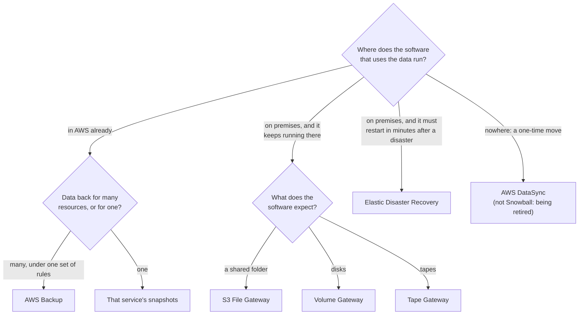

# Hybrid storage lets the shop keep working while its data lives in AWS; backups bring data back, disaster recovery brings servers back

Some of the bakery's data still starts in the shop, and some already lives in AWS. AWS Storage Gateway connects the shop's existing software to AWS storage, AWS Backup runs backups of AWS resources from one set of rules, and AWS Elastic Disaster Recovery keeps whole servers ready to launch. In this lesson you learn which need each one meets, and how they differ from a plain snapshot.

**For:** an adult studying alone, possibly new to IT, who wants to understand AWS and use it safely. **Time:** about 25 minutes. Reading works on a phone.

**Before you start:** this lesson builds on [Block, file and object storage](01-block-file-object.md) (EBS volumes and S3 objects), [Storage classes and lifecycle](03-storage-classes-and-lifecycle.md) (the S3 Glacier classes) and [Surviving failure](../03-aws-around-the-world/03-surviving-failure.md) (RTO, RPO and backup vs replication). If you skipped them, the key terms below give you enough to follow. The bakery scenario is in the [module brief](00-brief.md).

## Warm-up: what you remember

Answer from memory before you look anything up.

1. From lesson 04.01: the bakery's order database runs on Amazon RDS. Who takes its database backups, AWS or the bakery? And who decides how long they are kept?
2. From lesson 03.03: the order database has a standby copy in a second Availability Zone that receives every change within moments. Why isn't that a backup?
3. From lesson 02.01: the bakery runs its website at AWS and keeps its till system on a computer in the shop, with orders flowing between them. Which deployment model is that?

Feedback

1. **AWS takes them.** The RDS comparison table puts database backups on AWS. But the bakery chooses the settings, such as how many days to keep them, and decides whether that is enough.
2. **It copies mistakes too.** A deletion reaches the standby within moments. Only a copy that stopped changing before the mistake, a point-in-time backup, can undo it.
3. **Hybrid.** Some parts run at AWS and some on premises, connected. This lesson is about storage for exactly that kind of setup.

## What you'll learn

By the end of this lesson, you can:

- say what AWS Storage Gateway does, and tell its S3 File, Volume and Tape types apart;
- explain what AWS Backup adds to the snapshots that individual services already take;
- explain how AWS Elastic Disaster Recovery differs from a backup;
- match a hybrid storage or backup need to the right service, and reject the services that look similar (objective 05.04a).

Try these before you read on. Guess if you're unsure; the answers are in the lesson.

1. Staff in the shop save invoices to a shared folder. The owner wants the files kept in AWS, without staff changing how they work. What kind of service could do that?
2. The till server in the shop must be running again within 15 minutes if its hardware dies. Is a nightly backup enough?

## The big picture: four ways to connect and protect the bakery's data

The bakery's data sits in two places: the shop and AWS. Three services connect the shop to AWS. A fourth protects what already runs in AWS.

![Three columns: in the shop, what connects them, and in AWS. Back-office computers send files over SMB or NFS to S3 File Gateway, a virtual machine in the shop with a local cache, which stores them as objects in an S3 bucket. Backup software writes virtual tapes to Tape Gateway; the tapes are stored in S3 and archived to the S3 Glacier classes. The till server is copied continuously by Elastic Disaster Recovery to a staging area in AWS, from which recovery servers launch in minutes. A fourth row, already in AWS: the order database and the web server's disk are backed up nightly by an AWS Backup plan into a backup vault, with a copy in a second Region.](../../images/05-04-hybrid-map.svg)

*Notice the middle column. Each connecting service lets something in the shop keep working exactly as before, while the copy, or the data itself, ends up in AWS.*

**Long description.** Three columns: in the shop (on premises), what connects them, and in AWS. Row 1: back-office computers, where staff save invoices in a shared folder, send files over SMB or NFS to S3 File Gateway, a virtual machine in the shop that keeps recent files in a local cache; it stores each file as an object in an Amazon S3 bucket. Row 2: backup software that writes the accounts' weekly backups to tape writes virtual tapes to Tape Gateway, which looks like a tape library; the tapes are stored in S3 and archived to the S3 Glacier classes. Row 3: the till server is copied continuously, change by change, by AWS Elastic Disaster Recovery to a staging area in AWS with cheap storage, from which recovery servers launch in minutes. A dashed outline marks the shop. Row 4, already in AWS: the order database and the web server's disk (Amazon RDS and Amazon EBS, chosen by tag) are backed up every night by an AWS Backup plan into a backup vault, with a copy in a second Region. The bakery's setup is made up for teaching.

## Key terms (skip if you know them)

- **Hybrid storage:** storage for a setup where some systems run on premises and some in the cloud.
- **Protocol:** the agreed language software uses to talk to storage. **NFS** (Linux) and **SMB** (Windows) are for shared folders of files; **iSCSI** is for disks, read and written as blocks over a network.
- **Cache:** a nearby copy of recently used data, kept so that reading it is fast.
- **Snapshot:** a point-in-time copy of one disk or one database, which you restore to get a new one as it was then.
- **Backup plan, backup vault, recovery point:** in AWS Backup, the rules (what, when, how long), the container backups are kept in, and one saved backup.
- **Drill:** a practice recovery that doesn't disturb the real system. **Failback:** moving work back to the original site once it is fixed.

"Vault" means two things in AWS. A **backup vault** belongs to AWS Backup and is current. A **Glacier vault** belongs to the older Amazon Glacier service, closed to new customers (lesson 05.03). They are unrelated.

## Storage Gateway lets on-premises software use AWS storage without changing

**AWS Storage Gateway** is a hybrid storage service: software in your building keeps talking to storage the way it always has, while the data is stored in AWS. You run the gateway on premises, usually as a virtual machine on your own servers. It keeps frequently used data in a local **cache**, so reads are fast, and sends only changed data to AWS ([AWS Storage Gateway FAQs](https://aws.amazon.com/storagegateway/faqs/)). That cache is why the exam guide gives Storage Gateway as its example of a "cached file system" (task [3.6](https://docs.aws.amazon.com/aws-certification/latest/cloud-practitioner-02/cloud-practitioner-02-domain3.html#cloud-practitioner-02-task3.6)).

There are three types to learn. Each speaks a different protocol to the software in the shop.

![Three flows side by side. S3 File Gateway: file-sharing apps send files over NFS or SMB to the gateway, which caches recently used files and stores them as objects in an S3 bucket. Volume Gateway: servers that need disks use iSCSI; in cached mode the data itself lives in S3 and frequently used data is cached locally; in stored mode the whole dataset stays local and AWS holds point-in-time copies as EBS snapshots. Tape Gateway: backup software writes virtual tapes over iSCSI; tapes are stored in S3 and archived to S3 Glacier Flexible Retrieval or Deep Archive.](../../images/05-04-gateway-types.svg)

*Notice that the top box is the same kind of thing in every column: software that doesn't change. Only the protocol and where the data lands differ.*

**Long description.** Three columns, each a flow from top to bottom. S3 File Gateway: file-sharing apps and users in the shop send files over NFS or SMB to the gateway on premises, which keeps recently used files in a local cache and stores the files over the network as objects in an S3 bucket, readable with normal S3 tools; typical need: keep a shared folder and store the files in S3. Volume Gateway: servers that need disks use iSCSI; in cached mode the gateway keeps frequently used data and the data itself lives in S3; in stored mode the gateway keeps the whole dataset and AWS holds point-in-time copies as EBS snapshots; typical need: cloud-backed disks, or off-site copies of local disks. Tape Gateway: existing backup software writes virtual tapes over iSCSI; the gateway caches recently used tapes; tapes are stored in S3 and archived to S3 Glacier Flexible Retrieval or S3 Glacier Deep Archive; typical need: replace physical tapes without changing the backup jobs. A note says Amazon FSx File Gateway has been closed to new customers since 2024-10-28.

- **Amazon S3 File Gateway** looks like a shared folder and stores each file as an object in S3.
- **Volume Gateway** looks like disks. Its two modes are a confused pair: **cached** mode keeps the full data in AWS and only the busy part in the shop; **stored** mode keeps the full data in the shop and sends point-in-time copies to AWS. Ask: *where does the full dataset live?*
- **Tape Gateway** looks like a tape library to existing backup software and archives the tapes to the S3 Glacier classes.

A fourth type, **Amazon FSx File Gateway**, has been closed to new customers since 2024-10-28 ([What is Amazon FSx File Gateway?](https://docs.aws.amazon.com/filegateway/latest/filefsxw/what-is-file-fsxw.html), checked 2026-10-23).

> **Your turn:** Answer the first prequestion. Staff save invoices to a shared folder on a Windows computer in the shop. The owner wants the files in AWS, and staff must keep using the folder as they do today. Which gateway type fits, and which protocol will the staff computers use?

Model answer

**S3 File Gateway.** It presents the shared folder over **SMB**, the protocol Windows uses, keeps recent files in its cache, and stores each file as an object in an S3 bucket. Volume Gateway would present a disk, not a folder, and Tape Gateway serves backup software, not people saving files.

## Snapshots are point-in-time copies of one disk or one database

Before AWS Backup, look at the copies services already make. A **snapshot** copies a single resource at one moment. You restore it to create a new resource as it was then.

- **Amazon EBS snapshots** copy one EBS volume, the virtual disk from lesson 05.01. A snapshot outlives its volume, and you can restore new volumes from it or copy it to another AZ, Region or account ([What is Amazon EBS?](https://docs.aws.amazon.com/ebs/latest/userguide/what-is-ebs.html)).
- **Amazon RDS automated backups** take a daily snapshot plus a log of every change, so you can restore to any second within the retention period: 7 days by default, up to 35 ([Amazon RDS FAQs](https://aws.amazon.com/rds/faqs/), checked 2026-10-23). They are deleted when you delete the database.
- **Amazon RDS manual snapshots** are taken when you ask and kept until you delete them, which is why RDS offers a final snapshot when you delete a database.

S3 has its own point-in-time protection, versioning, from lesson [05.02](02-s3-in-practice.md). Snapshots answer lesson 03.03's warning, because a snapshot stops changing. Their limit is scope: each service has its own snapshots, schedule and settings, and keeping them all right across many resources becomes a job of its own.

> **Check:** On Monday the owner's nephew deletes a test copy of the order database. It had automated backups kept for 7 days, and no manual snapshots. On Wednesday he wants it back. What happens?
>
> A. He restores it from its automated backups, which last 7 days
> B. Nothing can be restored: automated backups are deleted with the database
> C. He restores it from its Multi-AZ standby

Feedback

**B is right.** RDS deletes automated backups with the database; only manual snapshots, such as a final snapshot, are kept.

- **A is wrong.** The 7 days apply while the database exists.
- **C is wrong.** A standby is part of the database and goes with it; it copies changes rather than keeping old versions.

## AWS Backup runs backups for many services from one set of rules

**AWS Backup** puts backups for many AWS services, and some on-premises systems, under one set of rules in one place ([What is AWS Backup?](https://docs.aws.amazon.com/aws-backup/latest/devguide/whatisbackup.html)). Instead of setting schedules service by service, you write a **backup plan**: how often to back up, how long to keep each backup, and where to copy it. Then you assign resources to it, for example every resource tagged `backup=nightly`.

What it adds to plain snapshots:

- **One plan across services and accounts.** Supported resources include EC2, EBS, S3, EFS, FSx, RDS, Aurora, DynamoDB, DocumentDB, Neptune, Redshift, Storage Gateway volumes and on-premises VMware virtual machines.
- **Copies to another Region or account,** which is how lesson 03.03's backup-and-restore plan gets its backups out of the Region.
- **Protected vaults.** Backups are encrypted and can't be changed. With **Vault Lock**, no one, not even an administrator, can delete them before their retention ends: protection against mistakes and ransomware.
- **Cold storage** for older backups of supported resources, and **audit reports** that show the backups really happen.

Its limit: AWS Backup governs only backups it manages, not snapshots someone takes by hand ([AWS Backup FAQs](https://aws.amazon.com/backup/faqs/)). And it is not a storage class or a place for files; it manages backups of resources you already run.

> **Your turn:** The order database (RDS) and the web server's disk (EBS) both support snapshots already. Give the owner two reasons to use AWS Backup anyway.

Model answer

One plan, assigned by tag, gives both the same schedule and retention and copies every backup to a second Region, so nobody keeps two setups in step. And its vault with Vault Lock stops anyone, even an attacker inside the account, from deleting the backups early, while its reports prove the backups happen.

## Elastic Disaster Recovery keeps whole servers ready to launch

**AWS Elastic Disaster Recovery** (AWS DRS) protects whole servers, not just their data. An agent on each server copies every change to its disks, continuously, into a **staging area** in the AWS Region you choose: cheap storage and very little compute. After a disaster you launch recovery servers in AWS within minutes, from the latest state or an earlier point in time. AWS says it supports recovery points of seconds and recovery times of minutes ([AWS Elastic Disaster Recovery](https://aws.amazon.com/disaster-recovery/); [What is Elastic Disaster Recovery?](https://docs.aws.amazon.com/drs/latest/userguide/what-is-drs.html), checked 2026-10-23).

It protects physical servers, VMware and Hyper-V virtual machines, other clouds, and EC2 instances. You can run **drills** without disturbing the source, and **fail back** once the original site is fixed. In lesson 03.03's terms it is a **pilot light**: data copied continuously, servers off until needed. Instead of an idle second data center, you pay for cheap storage, and for full servers only during drills or a recovery ([AWS Elastic Disaster Recovery FAQs](https://aws.amazon.com/disaster-recovery/faqs/)).

### "Elastic Disaster Recovery is a backup service" is wrong

You may have read that Elastic Disaster Recovery and AWS Backup do the same job. That's not right. AWS's FAQ draws the line: a backup is an extra copy of your **data**; disaster recovery quickly restores access to your **applications and servers**. After an AWS Backup restore, someone still rebuilds or relaunches the servers; Elastic Disaster Recovery gives back running servers in minutes.

It's tempting because both keep copies in AWS, and both can go back to an earlier point. But they answer different questions, and AWS designs them to be used together.

> **Your turn:** Answer the second prequestion. The till server must run again within 15 minutes if its hardware dies, losing at most a minute of sales. A nightly backup to AWS exists. Is it enough? If not, what closes the gap?

Model answer

**No.** A nightly backup can lose up to a day of sales, and restoring it onto a new server takes far longer than 15 minutes. **Elastic Disaster Recovery** copies every change continuously and launches the server in AWS within minutes. Keep the nightly backup too: it is the copy to go back to if a mistake or an attack damages the data.

## A snapshot, AWS Backup and Elastic Disaster Recovery side by side

These three are a confused set on the exam. Each keeps a copy of something in AWS; they differ in what they copy, how often, and what you get back.

![Three columns compared. A snapshot goes back to how one disk or database was: it copies one EBS volume or one RDS database, when you take one or on a schedule, and gives back a new volume or database as it was. AWS Backup runs backups for many services by one set of rules: many resources across services and accounts, on the plan's schedule, giving back recovery points of your data, also copied to other Regions or accounts. Elastic Disaster Recovery gets whole servers running again fast: whole servers, copied continuously, giving back running recovery servers; AWS says seconds of data lost and running again in minutes.](../../images/05-04-backup-dr-snapshot.svg)

*Notice the last row. Only Elastic Disaster Recovery gives you running servers; the other two give you data to restore.*

**Long description.** Three columns compared on five rows. The job: a snapshot goes back to how one disk or database was; AWS Backup runs backups for many services by one set of rules; Elastic Disaster Recovery gets whole servers running again, fast. Copies: one EBS volume or one RDS database; many resources across services and accounts, chosen by tag; whole servers with disks, operating system and applications. How often: when you take one or on a schedule; on the plan's schedule, kept for the plan's retention; continuously, change by change. What you get back: a new volume or database as it was at that moment; recovery points of your data, also copied to other Regions or accounts; running recovery servers in AWS, from the latest state or an earlier point. How fast: as long as a restore takes; as long as a restore takes, and servers still need relaunching; AWS says seconds of data lost and running again in minutes.

**The principle:** start from what you must get back, and how fast. One resource's data: a snapshot. Data across many resources, under rules you can prove: AWS Backup. Whole servers within minutes: Elastic Disaster Recovery.

> **Check:** A company has 200 EBS volumes and 30 RDS databases in three accounts. Its auditor wants proof that each is backed up daily, kept 90 days and copied to a second Region. Which service fits best?
>
> A. Snapshots taken by each team
> B. AWS Backup
> C. AWS Elastic Disaster Recovery
> D. AWS Storage Gateway

Feedback

**B is right.** One plan covers both services across the accounts, copies to another Region, and its reports give the auditor proof.

- **A is wrong.** It could work, but nothing enforces or proves the schedule; that is the gap AWS Backup fills.
- **C is wrong.** It keeps servers ready for failover; it isn't built for 90-day retention across services.
- **D is wrong.** It connects on-premises software to AWS storage; these resources are already in AWS.

## Moving data once is a different job, and Snowball is being retired

Storage Gateway is a **lasting** link that the shop uses every day. Moving a large amount of data **once** is a different job. **AWS DataSync** does it over the network, between on-premises storage, other clouds and AWS storage such as S3, EFS and FSx ([What is AWS DataSync?](https://docs.aws.amazon.com/datasync/latest/userguide/what-is-datasync.html)). It isn't in the exam guide's service list, but AWS now names it for online transfers.

### "Snowball is the answer for moving lots of data" is wrong

You may have learned that AWS Snowball, a rugged storage device AWS ships to you, is how you move terabytes into AWS. That's out of date. Snowball Edge stopped taking new customers on 2025-11-07, and AWS ends support for Snowball devices in its commercial Regions on 2026-12-31 ([AWS Snowball](https://aws.amazon.com/snowball/), checked 2026-10-23). For new customers AWS points to DataSync online, AWS Data Transfer Terminal (sites where you bring your own drives and upload at high speed), or AWS Partners. The 2026 exam guide no longer lists the Snow Family, so treat Snowball as a wrong answer.

It's tempting because Snowball was the textbook answer for years, and older courses still use it.

> **Your turn:** A colleague's old notes say, "To move 80 TB of files from our office into S3, order a Snowball." Correct the notes in two sentences.

Model answer

Snowball is closed to new customers and its support ends on 2026-12-31, so it isn't an option for a new move. Use AWS DataSync over the network or, if the network is too slow, AWS Data Transfer Terminal or a Partner.

## Your side of the line

Lesson [04.01](../04-shared-responsibility-and-access/01-security-of-vs-in-the-cloud.md) drew the line between AWS's work and yours. AWS's disaster recovery whitepaper applies it to backups: AWS is responsible for resiliency **of** the cloud, and you for resiliency **in** it, which for data stores such as S3 and DynamoDB includes backups, versioning and replication ([Disaster Recovery of Workloads on AWS](https://docs.aws.amazon.com/pdfs/whitepapers/latest/disaster-recovery-workloads-on-aws/disaster-recovery-workloads-on-aws.pdf)).

- **AWS** runs Storage Gateway, AWS Backup and Elastic Disaster Recovery, keeps backups durable and encrypted, and copies them where you say.
- **You** decide what is backed up, how often and for how long; who may delete backups, and whether to use Vault Lock; which Regions copies go to, within your data rules (lesson 03.02); and you run the drills and test restores.
- **Also yours:** the gateway's virtual machine runs on your servers in your building. And a snapshot can be shared publicly by mistake: in the account we created on 2026-10-23, Block Public Access for EBS snapshots started off, which is why [primer page 06](https://github.com/AutomateTheCloud/atc-study-aws_account_guardrails/blob/main/primer/06-safe-defaults.md) had you turn it on.

## What you pay for

None of these services has a minimum fee; each charges for what it stores and moves, and prices vary by Region (checked 2026-10-23).

- **Storage Gateway:** storage in AWS, requests, and data transferred ([FAQs](https://aws.amazon.com/storagegateway/faqs/)).
- **AWS Backup:** backup storage per GB-month, copies between Regions, restores and restore tests. Backups in cold storage must be kept 90 days, or you pay for the rest ([AWS Backup pricing](https://aws.amazon.com/backup/pricing/)).
- **Elastic Disaster Recovery:** cheap staging storage, plus full servers only during drills and recoveries.
- **Snapshots:** EBS snapshots are billed on their own and outlive the volume ([primer page 07](https://github.com/AutomateTheCloud/atc-study-aws_account_guardrails/blob/main/primer/07-habits-for-every-lab.md)). RDS backup storage is free up to your databases' provisioned storage in the Region; manual snapshots cost until you delete them ([Amazon RDS FAQs](https://aws.amazon.com/rds/faqs/)).

## Worked example: matching the bakery's needs to services

The owner sends a list. "One: back up the order database and the web server's disk every night, keep each backup 35 days, and keep a copy in a second Region. Two: staff keep saving invoices to the shop's shared folder, but I want the files in AWS. Three: our German partner's accounting software writes weekly backups to tapes someone carries home; stop that. Four: if the till server dies, it must run again in minutes. Five: my nephew says to order a Snowball for ten years of photos on his laptop."

Here is how someone who knows the services works through it. The flowchart is the method.

*Notice that the first question is about where the software runs, not about the data. It splits the services into those for AWS resources, those for software that stays on premises, and those for a one-time move.*

**Long description.** A decision flowchart. First question: where does the software that uses the data run? In AWS already: if you need data back for many resources under one set of rules, AWS Backup; for one resource, that service's snapshots. On premises, and it keeps running there: ask what the software expects; a shared folder means S3 File Gateway, disks mean Volume Gateway, tapes mean Tape Gateway. On premises, and it must restart in minutes after a disaster: Elastic Disaster Recovery. Nowhere, because this is a one-time move: AWS DataSync, not Snowball, which is being retired.

1. **Nightly backups.** In AWS, two services, one set of rules. *So:* **AWS Backup**: a plan that runs nightly, keeps 35 days and copies to US East (Ohio), the recovery Region from lesson 03.03. Tag both resources.
2. **The shared folder.** Software stays in the shop and expects a folder. *So:* **S3 File Gateway** over SMB.
3. **The tapes.** Software stays and expects tapes. *So:* **Tape Gateway**, sending the German data to Europe (Frankfurt), not the US.
4. **The till server.** Must restart in minutes. *So:* **Elastic Disaster Recovery**, and a drill to prove the minutes.
5. **The photos.** A one-time move of a few GB. *So:* not Snowball, and not a gateway; upload them straight to S3. For a large file server, DataSync.

The expert never started from a service name: each answer came from where the software runs, what it expects, and what must come back.

> **Your turn:** The German shop keeps product images on a Linux file server. The partner wants every image also stored in S3, and staff must keep using the shared folder. Which service, which protocol, and where should the data land?

Model answer

**S3 File Gateway** over **NFS**, the Linux protocol, storing each image as an object in an S3 bucket in an EU Region such as Europe (Frankfurt), because the German shop's data stays in the EU.

## In real work: back up by policy, and prove you can restore

At work, backups are a policy question first: what must be backed up, for how long, and how fast it must come back. The Well-Architected **reliability** pillar spells it out:

- [REL09-BP01 Identify and back up all data that needs to be backed up, or reproduce the data from sources](https://docs.aws.amazon.com/wellarchitected/latest/reliability-pillar/rel_backing_up_data_identified_backups_data.html)
- [REL09-BP02 Secure and encrypt backups](https://docs.aws.amazon.com/wellarchitected/latest/reliability-pillar/rel_backing_up_data_secured_backups_data.html), which a vault with Vault Lock supports.
- [REL09-BP03 Perform data backup automatically](https://docs.aws.amazon.com/wellarchitected/latest/reliability-pillar/rel_backing_up_data_automated_backups_data.html), the job of a backup plan.
- [REL09-BP04 Perform periodic recovery of the data to verify backup integrity and processes](https://docs.aws.amazon.com/wellarchitected/latest/reliability-pillar/rel_backing_up_data_periodic_recovery_testing_data.html), which drills and restore tests serve.

The reliability design principle "[Test recovery procedures](https://docs.aws.amazon.com/wellarchitected/latest/framework/rel-dp.html)" is the habit behind the last one: an untested backup is a hope. And the **cost optimization** pillar reminds you that every copy kept, and every day it is kept, is paid for: retention should come from a real requirement, not "forever, just in case".

## Summary

- **Storage Gateway lets on-premises software keep working while the data lives in AWS.** S3 File Gateway presents a shared folder and stores objects in S3; Volume Gateway presents disks (cached: main copy in AWS; stored: main copy on premises); Tape Gateway presents a tape library and archives tapes to the S3 Glacier classes. FSx File Gateway is closed to new customers.
- **Snapshots are point-in-time copies of one disk or one database.** RDS automated backups allow restore to any second in the retention period but are deleted with the database; manual snapshots stay until you delete them.
- **AWS Backup runs backups for many services and accounts from one plan,** copies them to other Regions or accounts, protects them in vaults with Vault Lock, and reports on them.
- **Elastic Disaster Recovery keeps whole servers copied continuously and launches them in minutes;** backups bring back data, disaster recovery brings back servers.
- **Moving data once is a different job:** DataSync online; Snowball is being retired.

**For the bakery's data plan:** you can now place the nightly backups (AWS Backup, copied to Ohio), and you have answers for the shop's folder, the partner's tapes and the till server.

## Practice

1. **Which AWS service lets an on-premises backup application keep writing to "tapes" while the data is stored in AWS?**

   A. AWS Backup
   B. Tape Gateway, a type of AWS Storage Gateway
   C. AWS DataSync
   D. S3 Glacier Deep Archive

   

Feedback

   **B is right.** Tape Gateway looks like a tape library to the backup software and stores the virtual tapes in S3, archiving them to the S3 Glacier classes.

   - **A is wrong.** AWS Backup manages backups of resources; it doesn't pose as a tape library for existing software.
   - **C is wrong.** DataSync moves files and objects over the network; it isn't a tape interface.
   - **D is wrong.** Deep Archive is a storage class where archived tapes can end up, but the software can't write to it as tapes without the gateway.

   

2. **In Volume Gateway, what is the difference between cached mode and stored mode?**

   

Feedback

   **Model answer:** In cached mode, the full data lives in AWS (in S3) and the gateway keeps only frequently used data locally. In stored mode, the full data stays on premises and AWS receives point-in-time copies as EBS snapshots. Ask where the full dataset lives.

   

3. **A company wants on-premises servers to restart in AWS within minutes after a site failure, losing only seconds of data, and wants to test this without disturbing production. Which service fits?**

   A. AWS Backup
   B. AWS Elastic Disaster Recovery
   C. Amazon EBS snapshots
   D. AWS Snowball

   

Feedback

   **B is right.** Elastic Disaster Recovery copies servers continuously, launches them within minutes, and supports drills that don't disturb the source.

   - **A is wrong.** AWS Backup restores data from scheduled backups; servers must still be rebuilt, and data since the last backup is lost.
   - **C is wrong.** EBS snapshots copy volumes already in AWS, at points in time; they don't launch servers.
   - **D is wrong.** Snowball moved data on a device and is being retired; it has no role in failover.

   

4. **Explain in two sentences why a company that already turned on RDS automated backups might still use AWS Backup.**

   

Feedback

   **Model answer:** RDS automated backups cover one service, last at most 35 days, and are deleted with the database. AWS Backup applies one plan across many services and accounts, keeps backups as long as the plan says, copies them to other Regions or accounts, and can lock them so no one deletes them early.

   

5. **(From lesson 03.03.) The bakery's disaster recovery strategy for a Region-wide disaster is backup and restore. Which service in this lesson produces the backups in the recovery Region, and which Well-Architected pillar does the choice of strategy balance against cost?**

   

Feedback

   **AWS Backup**, with a plan that copies each backup to the recovery Region. The strategy balances **reliability** against **cost optimization**: backup and restore is the cheapest strategy, with recovery in hours.

   

6. **(From lesson 04.01.) Who is responsible for deciding who may delete the bakery's backups: AWS or the bakery? Why?**

   

Feedback

   **The bakery.** Who can reach and change your data, backups included, is always on the customer's side of the line; AWS provides the tools, such as IAM permissions and Vault Lock.

   

**Next:** [Managed or self-managed databases](05-managed-or-self-managed-databases.md).

## Where to check the current details

- [AWS Storage Gateway FAQs](https://aws.amazon.com/storagegateway/faqs/) and [Storage Gateway documentation](https://docs.aws.amazon.com/storagegateway/latest/userguide/WhatIsStorageGateway.html) (checked 2026-10-23)
- [What is Amazon FSx File Gateway?](https://docs.aws.amazon.com/filegateway/latest/filefsxw/what-is-file-fsxw.html), for its closure to new customers (checked 2026-10-23)
- [What is AWS Backup?](https://docs.aws.amazon.com/aws-backup/latest/devguide/whatisbackup.html), [AWS Backup FAQs](https://aws.amazon.com/backup/faqs/) and [AWS Backup pricing](https://aws.amazon.com/backup/pricing/) (checked 2026-10-23)
- [What is Elastic Disaster Recovery?](https://docs.aws.amazon.com/drs/latest/userguide/what-is-drs.html), [product page](https://aws.amazon.com/disaster-recovery/) and [FAQs](https://aws.amazon.com/disaster-recovery/faqs/) (checked 2026-10-23)
- [What is Amazon EBS?](https://docs.aws.amazon.com/ebs/latest/userguide/what-is-ebs.html) and [Amazon RDS FAQs](https://aws.amazon.com/rds/faqs/), for snapshots and automated backups (checked 2026-10-23)
- [What is AWS DataSync?](https://docs.aws.amazon.com/datasync/latest/userguide/what-is-datasync.html) and [AWS Snowball](https://aws.amazon.com/snowball/), for Snowball's end of support (checked 2026-10-23)
- [Disaster Recovery of Workloads on AWS](https://docs.aws.amazon.com/pdfs/whitepapers/latest/disaster-recovery-workloads-on-aws/disaster-recovery-workloads-on-aws.pdf), AWS whitepaper, 2021 (checked 2026-10-24)
- [AWS Certified Cloud Practitioner (CLF-C02) exam guide](https://docs.aws.amazon.com/aws-certification/latest/cloud-practitioner-02/cloud-practitioner-02.html), task [3.6](https://docs.aws.amazon.com/aws-certification/latest/cloud-practitioner-02/cloud-practitioner-02-domain3.html#cloud-practitioner-02-task3.6) (checked 2026-10-24)

---

"Hybrid storage and backup" by Automate the Cloud Inc., licensed under CC BY-NC 4.0 with the Additional Permission for Internal Training from Automate the Cloud Inc.
License: https://creativecommons.org/licenses/by-nc/4.0/
Permission: https://automatethe.cloud/licenses/atc-internal-training-permission.txt
