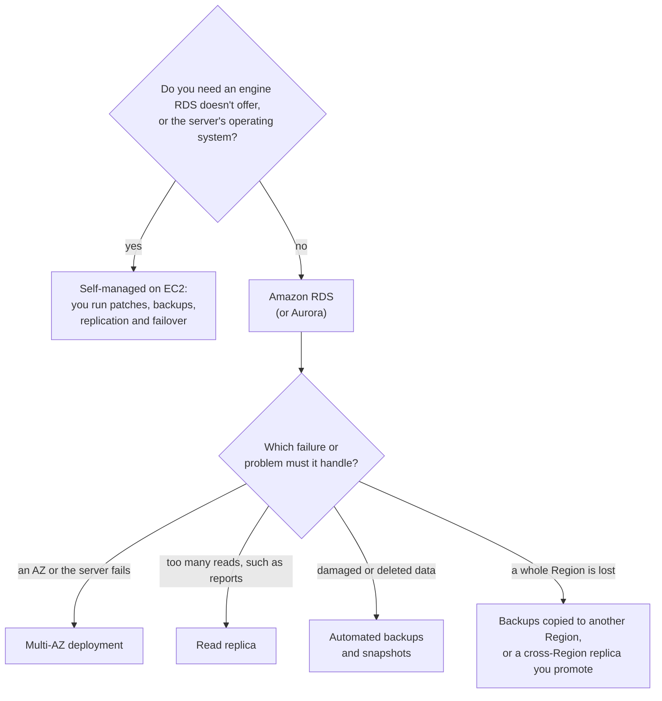

# Let AWS run the database unless you have a reason not to, then choose a standby for availability and a replica for reads

You can run a database yourself on an EC2 server, or let Amazon RDS run it for you; AWS recommends RDS for most relational databases. Once it runs on RDS, three kinds of copy do three different jobs: a Multi-AZ standby keeps it running, a read replica takes extra reads, and backups take you back in time. In this lesson you learn to pick the hosting and the right copy for a need.

**For:** an adult studying alone, possibly new to IT, who wants to understand AWS and use it safely. **Time:** about 25 minutes. Reading works on a phone.

**Before you start:** this lesson builds on [Security of vs in the cloud](../04-shared-responsibility-and-access/01-security-of-vs-in-the-cloud.md) (who does what on EC2 and RDS), [Regions, Availability Zones and data centers](../03-aws-around-the-world/01-regions-availability-zones-data-centers.md), [Surviving failure](../03-aws-around-the-world/03-surviving-failure.md) and [Hybrid storage and backup](04-hybrid-storage-and-backup.md) (snapshots and AWS Backup). If you skipped them, the key terms below give you enough to follow. The bakery scenario is in the [module brief](00-brief.md).

## Warm-up: what you remember

Answer from memory before you look anything up.

1. From lesson 04.01: the bakery moves a database from an EC2 server to Amazon RDS. Name two tasks that move from the bakery to AWS, and one that stays with the bakery.
2. From lesson 03.03: in Module 03 you gave the bakery's order database a standby copy in a second Availability Zone. What does that protect against, and what doesn't it protect against?
3. From lesson 05.04: RDS automated backups let you restore to any second within the retention period. What happens to them when you delete the database?

Feedback

1. **To AWS:** installing and patching the operating system and the database software, backups, scaling and high availability. **Stays with the bakery:** tuning its queries, and deciding who can reach the data.
2. **It protects against** losing a server, a data center or a whole AZ, because the standby takes over. **It doesn't protect against** losing the Region, or a mistake such as deleted orders, which it copies at once.
3. **They are deleted with it.** Only manual snapshots, such as a final snapshot taken at deletion, stay.

## What you'll learn

By the end of this lesson, you can:

- explain why AWS recommends a managed database, and what you still do yourself;
- explain what a Multi-AZ deployment, a read replica and an automated backup each do, and what each can't do;
- say what Amazon Aurora adds to the RDS family;
- choose between a self-managed and a managed database, and between high availability and read scaling, for a need (objective 05.05a).

Try these before you read on. Guess if you're unsure; the answers are in the lesson.

1. The bakery's German partner runs large sales reports every night, and the website slows down while they run. Would a Multi-AZ standby fix that?
2. Can a read replica take over automatically if the main database fails?

## The big picture: one database, three kinds of copy

A database on RDS can have three kinds of copy. They hold the same data, but each one exists for a different job.

![A Region with three Availability Zones. In AZ A, the primary takes every read and write from the website. In AZ B, the Multi-AZ standby gets every write at once (sync), serves nothing, and takes over if the primary fails. In AZ C, a read replica gets changes a little later (async, can lag) and answers read-only queries such as reports. Below, for the whole Region, automated backups and snapshots stored in Amazon S3. A key: standby, high availability; read replica, read scaling; backups and snapshots, point-in-time recovery.](../../images/05-05-big-picture.svg)

*Notice the two arrows leaving the primary. The standby gets every write at once and serves nobody; the replica gets changes a little later and serves reads. That difference decides which job each can do.*

**Long description.** A Region, US East (N. Virginia), holding three Availability Zones side by side. In AZ A, the primary takes every read and write from the website. In AZ B, the Multi-AZ standby takes no traffic and waits to take over if the primary fails; an arrow labeled "sync" shows it gets every write at once. In AZ C, a read replica answers read-only queries such as reports; an arrow labeled "async: can lag behind" shows changes arrive a little later. Below the AZs, for the whole Region: automated backups and snapshots stored in Amazon S3, a daily snapshot plus a log of every change, restorable to any second in the retention period (7 days by default, up to 35) or to a snapshot you took. A key lists each copy's job: the standby keeps the database running if its AZ fails (high availability); the read replica takes read-only work off the primary (read scaling); backups and snapshots go back to before a mistake (point-in-time recovery). The bakery's setup is made up for teaching.

## Key terms (skip if you know them)

- **Database:** software that stores data in an organized way and answers questions about it. A **relational database** keeps data in tables of rows and columns that link to each other, and you query it in SQL. Lesson 05.06 covers the other kinds.
- **Database engine:** the database software itself, such as MySQL, PostgreSQL or Microsoft SQL Server.
- **DB instance:** RDS's name for one running database server.
- **Self-managed database:** one you install and run yourself, for example on an EC2 server. **Managed database:** one a provider runs for you, such as RDS.
- **Primary:** the copy that takes writes. **Standby:** a copy that waits to take over.
- **Synchronous replication:** each change is written to the copy at the same time as to the primary. **Asynchronous replication:** each change is sent to the copy just after; the delay is called **replication lag**.
- **Promote:** turn a read replica into a separate, writable database.

"Replica" is an everyday word for an exact copy, like a replica of a painting. A read replica isn't always exact: it can be seconds or more behind the primary.

## AWS recommends a managed database unless you have a reason not to

You have two ways to run a relational database on AWS. You can install the engine yourself on an EC2 server, a **self-managed** database. Or you can use **Amazon Relational Database Service (Amazon RDS)**, which runs it for you. RDS offers six engines: IBM Db2, MariaDB, Microsoft SQL Server, MySQL, Oracle Database and PostgreSQL, plus Amazon Aurora ([What is Amazon RDS?](https://docs.aws.amazon.com/AmazonRDS/latest/UserGuide/Welcome.html), checked 2026-10-23).

Lesson [04.01](../04-shared-responsibility-and-access/01-security-of-vs-in-the-cloud.md) already showed AWS's comparison table. On EC2, AWS runs the hardware, and you install and patch the operating system and the database, take backups, and build high availability and scaling. On RDS, AWS does all of that; you keep the application and its queries.

AWS's own advice is direct: the RDS User Guide recommends RDS as the default choice for most relational databases. It names the risk of the alternative, too: when you update the operating system or database software by hand, you are more prone to mistakes, and a slip can take your application down ([What is Amazon RDS?](https://docs.aws.amazon.com/AmazonRDS/latest/UserGuide/Welcome.html)).

When would you still run your own? AWS's guide doesn't list reasons, so here is our reasoning. If you need a database engine that RDS doesn't offer, RDS can't run it. And if your software needs access to the database server's operating system, a managed service won't give it to you, because AWS runs that layer. Outside cases like these, running your own buys you work, not control you need.

> **Your turn:** The owner's nephew wants to run MySQL on an EC2 server "to save money". His weekly chores would be: apply operating system patches, apply MySQL patches, check the nightly backup script, tune slow queries, and decide who gets a database login. Which chores disappear if the bakery uses RDS for MySQL instead, and which stay?

Model answer

**Disappear:** operating system patches, MySQL patches and the backup script, because AWS handles them on RDS (the bakery still chooses settings such as how long to keep backups). **Stay:** tuning slow queries, and deciding who can log in and reach the database. Those are on the bakery's side of the line on every service.

## A Multi-AZ deployment keeps the database running when an Availability Zone fails

With a **Multi-AZ deployment**, RDS keeps a **standby** copy of your database in a different Availability Zone of the same Region. Every change is copied to it **synchronously**, at the same moment as to the primary, so the standby is always up to date. You don't use the standby yourself: in a Multi-AZ DB instance deployment it serves no reads and no writes ([Amazon RDS FAQs](https://aws.amazon.com/rds/faqs/), checked 2026-10-23).

If the primary's AZ goes down, or the primary loses its network, compute or storage, RDS **fails over** automatically. It points the database's name at the standby, which becomes the new primary. Your application keeps using the same name and reconnects. AWS says a failover typically completes in one to two minutes.

*Notice that the website never changes the name it uses. RDS moves the name; that is why no one has to act.*

**Long description.** Three frames side by side. Frame 1, before, normal running: the website uses the database name orders-db, which points at the primary in AZ A; every write reaches the standby in AZ B synchronously. Frame 2, the failure: AZ A fails and the primary is marked failed; RDS detects the failure and promotes the standby, with no one having to act; the name is being moved. Frame 3, after, typically one to two minutes later: the old primary in AZ A is still failed, the former standby in AZ B is now the primary, and the website reconnects to the same name, which now points at AZ B. A note says RDS doesn't fail over for slow queries or corrupted data.

Two more benefits come with it. Backups are taken from the standby, so the primary doesn't pause for them. And RDS applies some maintenance, such as operating system patches, to the standby first and then fails over, so the database is unavailable only for the failover. The cost: you pay Multi-AZ prices, and writes can be slightly slower, because each one waits for both copies ([Amazon RDS FAQs](https://aws.amazon.com/rds/faqs/)).

What Multi-AZ doesn't do matters as much. It doesn't fail over because of slow queries or corrupted data. And because every change reaches the standby at once, a mistaken delete reaches it too. Multi-AZ is high availability, not a backup (lesson 03.03).

AWS also offers a **Multi-AZ DB cluster**, with two standbys in three AZs that can also serve reads ([Configuring and managing a Multi-AZ deployment](https://docs.aws.amazon.com/AmazonRDS/latest/UserGuide/Concepts.MultiAZ.html)). The exam's classic "Multi-AZ" is the one-standby version described above.

> **Check:** Answer the first prequestion. The German partner's nightly reports slow down the website. Would turning on Multi-AZ fix it?
>
> A. Yes: the reports would run on the standby
> B. No: in a Multi-AZ DB instance deployment the standby serves no queries, so the reports still run on the primary
> C. Yes: Multi-AZ doubles the database's capacity

Feedback

**B is right.** The standby exists to take over, not to share work. Reports need a copy that serves reads: a read replica, next.

- **A is wrong.** The standby can't be queried in a Multi-AZ DB instance deployment.
- **C is wrong.** Only one copy serves traffic at a time; the second one waits.

## A read replica takes read-only work off the primary

A **read replica** is a read-only copy of the database that your application can query. RDS copies changes to it **asynchronously**, using the engine's own replication, so it can lag behind the primary, and the lag can vary a lot ([Working with DB instance read replicas](https://docs.aws.amazon.com/AmazonRDS/latest/UserGuide/USER_ReadRepl.html), checked 2026-10-23). You send reports and other read-heavy work to it, and the primary is left free for the website.

- **How many:** up to 15 per database for RDS for MySQL, MariaDB and PostgreSQL; up to 5 for Oracle and SQL Server ([Amazon RDS FAQs](https://aws.amazon.com/rds/faqs/), checked 2026-10-23).
- **Where:** in the same AZ, another AZ, or, for most engines, another Region.
- **Cost:** each replica is billed as a database of its own. Copying data to a replica in the same Region costs nothing extra.
- **By hand:** you create replicas yourself; RDS doesn't add or remove them as demand changes.

You can also **promote** a read replica into a separate, writable database. AWS lists that as a disaster recovery option, for example with a replica in another Region.

### "A read replica gives you high availability" is wrong

You may have read that adding a read replica makes a database highly available. For the RDS engines above, that's not right. A read replica doesn't take over automatically: if the primary fails, someone has to promote the replica, and the application has to be pointed at its new address. And because the copy is asynchronous, the last changes before the failure may never have reached it. For high availability, AWS's FAQ recommends Multi-AZ, whose standby is always in step and fails over by itself.

It's tempting because a replica is a second running copy, often in another AZ, and it can be promoted. It's also partly true in one place: in **Amazon Aurora**, a replica can be the automatic failover target. For the other RDS engines, keep the jobs apart: standby for availability, replica for reads.

> **Your turn:** Answer the second prequestion in two sentences: can a read replica take over automatically if the main database fails, and why does the answer matter for the bakery's orders?

Model answer

Not for RDS for MySQL or PostgreSQL: someone must promote it and repoint the site, and orders written just before the failure may be missing because the copy lags. A Multi-AZ standby fails over automatically and has every committed order, which is what the bakery needs for availability. (In Aurora, a replica can be the automatic failover target.)

## Backups and snapshots take you back in time

The third kind of copy, from lesson [05.04](04-hybrid-storage-and-backup.md), is the only one that stops changing. RDS **automated backups** take a daily snapshot plus a log of every change, so you can restore to any second within the retention period: 7 days by default, up to 35. **Manual snapshots** last until you delete them. Every restore creates a **new** database ([Amazon RDS FAQs](https://aws.amazon.com/rds/faqs/), checked 2026-10-23).

That makes backups the answer when the data itself is damaged: a deleted table, a bad update, an attack. Neither the standby nor a replica can help there, because both copy the damage.

Here are the three side by side.

![Three columns compared. Multi-AZ standby: every write copied synchronously to another AZ; answers no queries; takes over automatically, typically in one to two minutes; doesn't save you from a mistaken delete; job, high availability. Read replica: changes copied asynchronously and can lag; answers read-only queries; doesn't take over by itself but can be promoted by hand, losing any lag; doesn't save you from a mistaken delete; job, read scaling and a disaster recovery option. Automated backups and snapshots: a daily snapshot plus a log of every change; answer no queries until restored; restore is a new database; do save you from a mistaken delete; job, going back in time.](../../images/05-05-three-copies.svg)

*Notice the row "Saves you from a mistaken delete?" Only the backup column says yes. And only the standby says yes to "Takes over by itself?"*

**Long description.** Three columns compared on five rows. How it's copied: the Multi-AZ standby gets every write synchronously, in another AZ; the read replica gets changes asynchronously and can lag behind; backups are a daily snapshot plus a log of every change, and snapshots are taken when you take them. Answers queries: standby no; read replica yes, read-only; backups no, you restore to a new database first. Takes over by itself: standby yes, by automatic failover, typically one to two minutes; read replica no, you can promote it by hand and lose any lag; backups no, a restore is a new database you switch to. Saves you from a mistaken delete: standby no, the delete reaches it at once; read replica no, it reaches it soon after; backups yes, restore to a moment before the mistake. The job: high availability; read scaling and a disaster recovery option; going back in time. A note says this is for RDS engines other than Aurora; in Aurora a read replica can also be the failover target.

**What's the same:** all three hold the bakery's orders. **What differs:** when they receive changes, whether anyone can query them, and whether they take over. **The principle:** name the failure first. A broken AZ needs a standby; too many reads need a replica; damaged data needs a backup. Production databases often use all three, because they answer different failures. To practice telling them apart, try [Simulation S6: Multi-AZ vs read replica](10-sim-multi-az-vs-read-replica.md).

> **Check:** A web application runs on EC2 instances in two AZs behind a load balancer. Its RDS database must keep working, with no data lost, if one AZ fails. Which option meets this?
>
> A. Add a read replica in the same AZ as the primary
> B. Take a snapshot every night
> C. Turn on a Multi-AZ deployment
> D. Add a read replica in another Region

Feedback

**C is right.** The synchronous standby in another AZ has every change and takes over automatically.

- **A is wrong.** A replica in the same AZ is lost along with the primary, and it doesn't take over by itself.
- **B is wrong.** A nightly snapshot loses up to a day of data, and restoring it takes time and creates a new database.
- **D is wrong.** A replica in another Region helps with disaster recovery, but it must be promoted by hand and may lag, so recent data can be lost.

## Amazon Aurora is AWS's own relational engine in the RDS family

**Amazon Aurora** is a relational database engine AWS built for the cloud. It is compatible with MySQL and PostgreSQL, so software written for those works with it, and it is part of RDS: you create and manage it through RDS ([What is Amazon Aurora?](https://docs.aws.amazon.com/AmazonRDS/latest/AuroraUserGuide/CHAP_AuroraOverview.html), checked 2026-10-23). The exam lists RDS and Aurora together as its examples of relational databases.

What sets it apart:

- **Storage across three AZs.** Aurora's storage grows by itself, up to 256 TiB, and copies your data across three Availability Zones; you pay for one copy ([Amazon Aurora FAQ](https://docs.aws.amazon.com/rds/latest/auroraextendedcontent/aurora-faq.html)).
- **Up to 15 low-latency replicas,** which can also be the automatic failover target.
- **Higher throughput.** AWS says Aurora delivers up to six times the throughput of standard MySQL or PostgreSQL on similar hardware (as of 2026-10-23). Older material quotes other multipliers; remember "faster", not the number.
- **A serverless option** that scales capacity with demand.

Choose Aurora when you want MySQL or PostgreSQL compatibility with more performance and availability built in. Choose another RDS engine when your software needs Oracle, SQL Server, Db2, MariaDB or plain MySQL or PostgreSQL as they are.

## Your side of the line

The line for RDS is in lesson [04.01](../04-shared-responsibility-and-access/01-security-of-vs-in-the-cloud.md): AWS installs and patches the operating system and the database software, and runs backups, failover and the hardware. This lesson adds the choices that stay yours even then:

- **Which protections to turn on.** AWS runs Multi-AZ, replicas and backups, but you decide whether the database has them, and how many days of backups to keep.
- **Who can reach the database.** You control access with IAM and with security groups, and you place the database inside your network (Module 07).
- **Query tuning.** AWS's guide names it as yours.
- **Testing a restore.** RDS keeps the backups; only you can check that a restored database works for your application.

On a self-managed database on EC2, add everything AWS does on RDS: the operating system, the database software, backups, replication and failover are all yours.

## What you pay for

RDS charges for what you use, with no minimum fee ([Amazon RDS FAQs](https://aws.amazon.com/rds/faqs/); [Amazon RDS pricing](https://aws.amazon.com/rds/pricing/), both checked 2026-10-23). The main charges are:

- **Instance hours**, by size, billed per second with a 10-minute minimum. A Multi-AZ deployment is billed at Multi-AZ prices, and each read replica is billed as a database of its own.
- **Storage** per GB-month, plus provisioned IOPS where you choose them.
- **Backup storage** beyond the free amount, which equals your databases' provisioned storage in the Region.
- **Data transfer** in and out of the database.

Two traps for learners. A **stopped** database still pays for storage and backups, and RDS **starts it again by itself after seven days** ([Stopping an Amazon RDS DB instance](https://docs.aws.amazon.com/AmazonRDS/latest/UserGuide/USER_StopInstance.html)). And because RDS bills every hour it runs, this guide has you practice Multi-AZ and read replicas in [Simulation S6](10-sim-multi-az-vs-read-replica.md) rather than a real lab. As of 2026-03-25, AWS also offers Aurora PostgreSQL in a serverless configuration on the Free plan ([AWS announcement](https://aws.amazon.com/about-aws/whats-new/2026/03/amazon-aurora-postgresql-aws-free-tier/)); usage comes out of your credits.

For steady, long-running databases, Reserved Instances (one or three years) and Database Savings Plans (up to 35% off for a one-year commitment, per the RDS FAQ on 2026-10-23) lower the hourly price. Module 11 compares them.

## Worked example: setting up the bakery's order database

The owner writes: "Orders are the business. If a data center fails in December, the site must keep taking orders and lose none. Our German partner runs big sales reports every night and the site crawls. Last month a mistake deleted an afternoon of orders and we couldn't get them back. And my nephew says running our own database on a server would be cheaper."

Here is how someone who knows the options works through it. The flowchart is the method.

*Notice that the second question is asked once per problem. A real database often ends with three or four answers, not one.*

**Long description.** A decision flowchart. First question: do you need an engine RDS doesn't offer, or the server's operating system? If yes: self-managed on EC2, where you run patches, backups, replication and failover. If no: Amazon RDS or Aurora. Then, for each problem: an AZ or the server fails, use a Multi-AZ deployment; too many reads such as reports, use a read replica; damaged or deleted data, use automated backups and snapshots; a whole Region is lost, use backups copied to another Region, or a cross-Region replica you promote.

1. **Hosting.** The bakery needs plain MySQL or PostgreSQL and no access to the operating system. *So:* **RDS**, as AWS recommends. The nephew's server would add patching, backups and failover to his weekly chores, and a mistake there could stop the site; the instance hours he saves are small next to that risk.
2. **"Keep taking orders, lose none."** That is an AZ failure with no data lost. *So:* **Multi-AZ**: a synchronous standby that fails over by itself in about one to two minutes.
3. **"Reports make the site crawl."** Too many reads on the primary. *So:* **a read replica** for the partner's reports. A few seconds of lag doesn't matter for last night's sales.
4. **"We couldn't get the orders back."** Damaged data. *So:* check that **automated backups** are on, with a retention long enough to notice a mistake (the owner picks 14 days), and add AWS Backup copies to the recovery Region, as in lesson 05.04. Then **test a restore**.
5. **Region loss** was already settled in lesson 03.03: backup and restore into US East (Ohio).

The expert didn't ask "which feature is best?" but "which failure are we guarding against?", once per failure.

> **Your turn:** A year later the reports run on the replica, but the partner now wants the replica in Europe (Frankfurt) so German staff get faster reports. The owner asks whether that replica could also serve as the bakery's disaster recovery copy. In two or three sentences, say whether it can, and what the limits are.

Model answer

Yes, with limits. A cross-Region read replica can be promoted to a separate, writable database if US East (N. Virginia) is lost, so it can be part of the disaster recovery plan. But someone must promote it and repoint the site, any changes it hadn't received yet are lost, and it copies mistakes, so the backups are still needed. One more check: copying US customers' orders into the EU must be allowed by the bakery's data rules.

## In real work: managed by default, and one protection per failure

At work, teams start from a managed database and add protections for named failures. The Well-Architected Framework backs both habits:

- The **cost optimization** design principle "[Stop spending money on undifferentiated heavy lifting](https://docs.aws.amazon.com/wellarchitected/latest/framework/cost-dp.html)": patching and backing up a database server is work AWS can do for you.
- [REL10-BP01 Deploy the workload to multiple locations](https://docs.aws.amazon.com/wellarchitected/latest/reliability-pillar/rel_fault_isolation_multiaz_region_system.html) and [REL11-BP02 Fail over to healthy resources](https://docs.aws.amazon.com/wellarchitected/latest/reliability-pillar/rel_withstand_component_failures_failover2good.html), which Multi-AZ does for the database.
- [REL09-BP03 Perform data backup automatically](https://docs.aws.amazon.com/wellarchitected/latest/reliability-pillar/rel_backing_up_data_automated_backups_data.html), which automated backups do.
- In **performance efficiency**, [PERF03-BP02 Evaluate available configuration options for data store](https://docs.aws.amazon.com/wellarchitected/latest/performance-efficiency-pillar/perf_data_evaluate_configuration_options_data_store.html): read replicas are one such option.

## Summary

- **AWS recommends a managed database, RDS, for most relational databases.** Run your own on EC2 only for a real reason, such as an engine RDS doesn't offer; then the operating system, patches, backups and failover are yours.
- **A Multi-AZ deployment keeps the database running when an AZ fails:** a synchronous standby that serves no queries and fails over automatically, typically in one to two minutes.
- **A read replica takes read-only work off the primary.** It copies asynchronously, can lag, and doesn't take over by itself; it is not high availability (except as Aurora's failover target).
- **Automated backups and snapshots take you back in time,** the only copy that saves you from damaged or deleted data.
- **Aurora is AWS's MySQL- and PostgreSQL-compatible engine in the RDS family,** with storage copied across three AZs and up to 15 replicas.

**For the bakery's data plan:** the order database runs on RDS with Multi-AZ, a read replica for reports, and automated backups plus AWS Backup copies. Lesson 05.06 checks that a relational database is the right shape for orders, and picks one for carts.

## Practice

1. **Which RDS feature provides high availability by keeping a synchronous standby in another Availability Zone, with automatic failover?**

   A. Read replicas
   B. Multi-AZ deployment
   C. Automated backups
   D. Manual snapshots

   

Feedback

   **B is right.** Multi-AZ keeps a synchronous standby in another AZ and fails over automatically.

   - **A is wrong.** Read replicas copy asynchronously and scale reads; they don't fail over by themselves (outside Aurora).
   - **C is wrong.** Automated backups let you restore to a point in time; a restore creates a new database and takes time.
   - **D is wrong.** Snapshots are point-in-time copies kept until you delete them, not a running standby.

   

2. **A company's RDS for PostgreSQL database is slowed by read-heavy analytics queries during the day. What is the simplest RDS feature to relieve the primary?**

   

Feedback

   **Model answer:** Add one or more **read replicas** and send the analytics queries to them. The primary keeps handling writes and the application's normal reads. Multi-AZ wouldn't help, because its standby serves no queries.

   

3. **Which task does a customer keep when moving a database from EC2 to Amazon RDS?**

   A. Applying operating system patches
   B. Installing the database software
   C. Tuning the application's queries
   D. Building failover to a standby

   

Feedback

   **C is right.** AWS's RDS guide names query tuning as the customer's.

   - **A and B are wrong.** RDS installs and patches the operating system and the database software.
   - **D is wrong.** RDS provides failover with Multi-AZ; the customer only turns it on.

   

4. **A colleague says, "We have Multi-AZ and two read replicas, so we don't need backups." Explain in two sentences why that's wrong.**

   

Feedback

   **Model answer:** The standby and the replicas copy every change, so a deleted table or a bad update reaches them within moments. Only automated backups or snapshots, copies that stopped changing before the mistake, can bring the data back.

   

5. **(From lesson 03.01.) Why does AWS place a Multi-AZ standby in a different Availability Zone rather than in the same one?**

   

Feedback

   **Because AZs are built to fail independently.** Each AZ has its own power, cooling and networking, so an event that takes out the primary's AZ is very unlikely to take out the standby's.

   

6. **(From lesson 02.05.) Running Multi-AZ costs more every hour than a single database. Which two Well-Architected pillars does that decision trade against each other?**

   

Feedback

   **Reliability** (the database keeps working when an AZ fails) against **cost optimization** (paying for a standby that usually sits idle). The business's tolerance for downtime decides.

   

**Next:** [Choosing a database](06-choosing-a-database.md). To practice the three copies, try [Simulation S6: Multi-AZ vs read replica](10-sim-multi-az-vs-read-replica.md).

## Where to check the current details

- [What is Amazon RDS?](https://docs.aws.amazon.com/AmazonRDS/latest/UserGuide/Welcome.html), Amazon RDS User Guide: engines, the comparison with EC2, and Multi-AZ (checked 2026-10-23)
- [Amazon RDS FAQs](https://aws.amazon.com/rds/faqs/): Multi-AZ, read replicas, backups and billing (checked 2026-10-23)
- [Configuring and managing a Multi-AZ deployment](https://docs.aws.amazon.com/AmazonRDS/latest/UserGuide/Concepts.MultiAZ.html) and [Working with DB instance read replicas](https://docs.aws.amazon.com/AmazonRDS/latest/UserGuide/USER_ReadRepl.html) (checked 2026-10-23)
- [Stopping an Amazon RDS DB instance](https://docs.aws.amazon.com/AmazonRDS/latest/UserGuide/USER_StopInstance.html) and [Amazon RDS pricing](https://aws.amazon.com/rds/pricing/) (checked 2026-10-23)
- [What is Amazon Aurora?](https://docs.aws.amazon.com/AmazonRDS/latest/AuroraUserGuide/CHAP_AuroraOverview.html) and the [Amazon Aurora FAQ](https://docs.aws.amazon.com/rds/latest/auroraextendedcontent/aurora-faq.html) (checked 2026-10-23)
- [AWS Certified Cloud Practitioner (CLF-C02) exam guide](https://docs.aws.amazon.com/aws-certification/latest/cloud-practitioner-02/cloud-practitioner-02.html), task [3.4](https://docs.aws.amazon.com/aws-certification/latest/cloud-practitioner-02/cloud-practitioner-02-domain3.html#cloud-practitioner-02-task3.4) (checked 2026-10-24)

---

"Managed or self-managed databases" by Automate the Cloud Inc., licensed under CC BY-NC 4.0 with the Additional Permission for Internal Training from Automate the Cloud Inc.
License: https://creativecommons.org/licenses/by-nc/4.0/
Permission: https://automatethe.cloud/licenses/atc-internal-training-permission.txt
