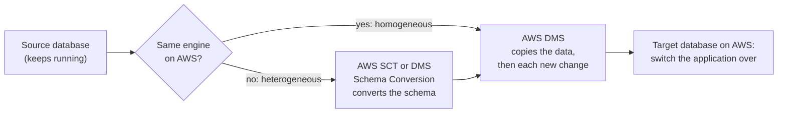
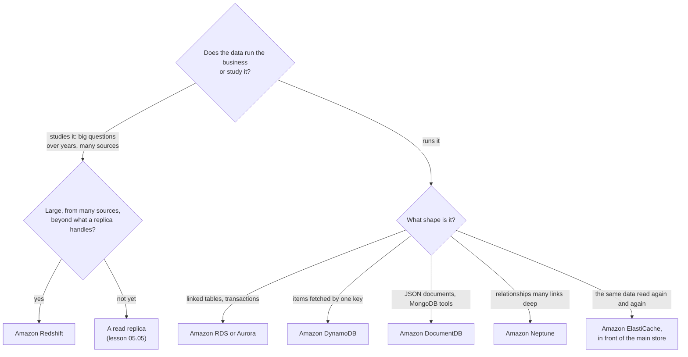

# Choose the database by the shape of your data and how you use it, not by which one sounds best

AWS offers several databases because data comes in different shapes: tables that link together, items looked up by a key, documents, relationships, hot data kept in memory, and years of history for analysis. Match the shape and the way you use the data, and the choice usually makes itself. In this lesson you pick a database for each kind of the bakery's data, and learn the two tools for moving a database into AWS.

**For:** an adult studying alone, possibly new to IT, who wants to understand AWS and use it safely. **Time:** about 25 minutes. Reading works on a phone.

**Before you start:** this lesson builds on [Managed or self-managed databases](05-managed-or-self-managed-databases.md) (RDS, Aurora and read replicas), [Security of vs in the cloud](../04-shared-responsibility-and-access/01-security-of-vs-in-the-cloud.md) and [Before and after the demand curve](../02-why-the-cloud/02-before-and-after-the-demand-curve.md) (fixed vs variable costs). If you skipped them, the key terms below give you enough to follow. The bakery scenario is in the [module brief](00-brief.md).

## Warm-up: what you remember

Answer from memory before you look anything up.

1. From lesson 04.01: Amazon S3 is what AWS calls an abstracted service. Which three things does AWS's shared responsibility page leave to the customer on such a service?
2. From lesson 02.02: paying for a server every hour whether it is busy or not, or paying for each request the site actually serves: which is a fixed cost and which is variable?
3. From lesson 05.05: the German partner's nightly reports slow down the order database. Which kind of copy fixes that, and why not a Multi-AZ standby?

Feedback

1. **Your data (including which encryption options to use), classifying it, and IAM permissions** saying who can do what. AWS runs the infrastructure, operating system and platform.
2. **The hourly server is fixed** for as long as it runs; **paying per request is variable**, because it rises and falls with use. One of this lesson's databases bills exactly that way.
3. **A read replica**, which serves read-only queries. A Multi-AZ standby serves nothing; it only waits to take over.

## What you'll learn

By the end of this lesson, you can:

- name the shape of data each of AWS's main databases is built for;
- explain why a data warehouse isn't the database that runs a website;
- tell AWS DMS and AWS SCT apart;
- pick a database for a shape of data, and say why not the likely alternatives (objective 05.06a).

Try these before you read on. Guess if you're unsure; the answers are in the lesson.

1. The bakery's shopping carts are read and written many times a minute, always looked up by cart ID, and thrown away after the visit. Should they go in the same relational database as the orders?
2. Is Amazon Redshift a good database for the ordering website itself?

## The big picture: six shapes of data

A **data model** is the shape a database gives your data. Each AWS database is built for one shape and one way of using it.

![Six cards. Relational: tables with rows and columns, linked to each other; orders, customers and order lines; Amazon RDS, Amazon Aurora. Key-value: look up one item by its key, fast, at any scale; shopping carts by cart ID; Amazon DynamoDB. Document: records stored as JSON documents whose fields can vary; a product catalog; Amazon DocumentDB, and DynamoDB also stores documents. In-memory: copies of hot data held in memory, answered in microseconds; best sellers and sign-in sessions; Amazon ElastiCache. Graph: things and the relationships between them; customers who bought this also bought; Amazon Neptune. Data warehouse: years of data from many sources, for analysis; sales by month, product and shop; Amazon Redshift.](../../images/05-06-data-shapes.svg)

*Notice that the bakery has data of almost every shape. A real business rarely fits one database; the skill is matching each kind of data to its shape.*

**Long description.** Six cards in two rows of three, each with a small drawing of the shape. Relational: tables with rows and columns, linked to each other; bakery example, orders, customers and order lines; Amazon RDS and Amazon Aurora. Key-value: look up one item by its key, fast, at any scale; shopping carts by cart ID; Amazon DynamoDB. Document: records stored as JSON documents whose fields can vary; a product catalog where each cake has different options; Amazon DocumentDB, and DynamoDB also stores documents. In-memory: copies of hot data held in memory, answered in microseconds; the home page's best sellers and sign-in sessions; Amazon ElastiCache. Graph: things and the relationships between them; customers who bought this cake also bought; Amazon Neptune. Data warehouse: years of data from many sources, for analysis; sales by month, product and shop over three years; Amazon Redshift, for analytics, not the shop's daily work.

## Key terms (skip if you know them)

- **Schema:** the fixed layout a relational database expects: which tables, which columns, which types.
- **SQL:** the standard language for querying relational databases. **NoSQL** means databases that use another model, such as key-value or documents.
- **Key-value:** each **item** is stored under a unique key, and you fetch it by that key.
- **Document:** each record is a self-contained document, usually **JSON** (text with named fields and nested lists), and different documents can have different fields.
- **Graph:** data stored as things (nodes) and the connections between them (edges).
- **Cache:** a fast copy of data that is read often, kept in front of a slower store.
- **Data warehouse:** a database built to analyze large amounts of historical data gathered from many sources.
- **Transactional** work runs the business, many small reads and writes; **analytics** work studies it, fewer and much larger queries.

"Warehouse" here has nothing to do with storing boxes. It is a store of data organized for analysis.

## Relational databases fit structured data that links together

When data has a fixed structure and its parts relate to each other, a relational database fits. The bakery's orders are the classic case: a customer places an order, the order has lines, each line names a product. A relational database keeps these in linked tables and changes several of them together in one **transaction**, which all succeeds or all fails, so an order is never half-saved.

On AWS that means **Amazon RDS** or **Amazon Aurora**, from lesson [05.05](05-managed-or-self-managed-databases.md). The exam names both as its relational examples (task [3.4](https://docs.aws.amazon.com/aws-certification/latest/cloud-practitioner-02/cloud-practitioner-02-domain3.html#cloud-practitioner-02-task3.4)).

## DynamoDB stores items by key, at any scale, with no servers to run

**Amazon DynamoDB** is AWS's main NoSQL database. AWS describes it as serverless and fully managed, with single-digit millisecond responses at any scale, and it supports both the key-value and the document models ([What is Amazon DynamoDB?](https://docs.aws.amazon.com/amazondynamodb/latest/developerguide/Introduction.html), checked 2026-10-23). There are no servers to size or patch, no versions to upgrade, and no maintenance windows.

You create a **table** and store **items** in it; each item has a key you fetch it by. What you give up is the joining of tables that relational databases do: AWS recommends shaping the data around the way it will be read. What you get is speed that stays the same as traffic grows. AWS's own examples include shopping carts and game platforms' player data and sessions, and by default it copies your data across three Availability Zones.

Features worth recognizing:

- **On-demand capacity:** pay per request, with no capacity to plan; it scales up for a spike and back down. **Provisioned capacity:** you set reads and writes per second and pay for them by the hour, which can cost less for steady, predictable traffic.
- **Global tables:** one table copied across several Regions, for users around the world and for surviving a Region's loss.
- **DynamoDB Accelerator (DAX):** an in-memory cache built for DynamoDB, which turns millisecond reads into microsecond reads.
- **Backups:** point-in-time recovery and on-demand backups, which AWS Backup can also manage (lesson 05.04).

The chart shows what on-demand billing means, using AWS's own pricing example.

*Notice that day 11 is 250 times busier than day 1, and nothing was changed to handle it. The bill simply counts the requests: the whole month costs about three dollars.*

| Days | Requests per day (reads + writes) | What it costs |
|---|---|---|
| 1 to 10 | 20,000 | Writes at $0.625 per million, reads at $0.125 per million |
| 11 | 5,000,000 | Same rates; nothing to set up |
| 12 to 30 | 100,000 | Same rates |
| Month | 7.1 million requests; 27 GB stored on average | **$3.16**: $2.22 writes, $0.44 reads, $0.50 for the 2 GB above the free 25 GB |

AWS's example on the [DynamoDB on-demand pricing page](https://aws.amazon.com/dynamodb/pricing/on-demand/), for a new table in US East (N. Virginia), retrieved 2026-10-23. Prices change and vary by Region; check the page before you rely on them.

> **Your turn:** Answer the first prequestion. Should the bakery's shopping carts live in the same relational database as the orders, or in DynamoDB? Give two reasons from the description: carts are read and written many times a minute, always fetched by cart ID, and thrown away after the visit.

Model answer

**DynamoDB.** Carts are always fetched by one key, the cart ID, which is exactly the key-value shape, so the joins a relational database offers aren't needed. And the many reads and writes would add load to the order database at the busiest times, while DynamoDB keeps fast responses as traffic grows and, on demand, charges only for the requests made. The orders stay relational: they link customers, orders and lines and must be saved whole.

## ElastiCache answers from memory in microseconds

**Amazon ElastiCache** keeps data in memory rather than on disk, so it answers in microseconds. It is usually a **cache**: a copy of data that is read often, placed in front of a slower database, so repeated questions don't reach the database at all ([What is Amazon ElastiCache?](https://docs.aws.amazon.com/AmazonElastiCache/latest/dg/WhatIs.html), checked 2026-10-23). It also stores short-lived data that must be fast, such as sign-in sessions and leaderboards.

ElastiCache works with three engines: **Valkey, Memcached and Redis OSS**. Older material names only Redis and Memcached. You can run it **serverless**, with no capacity to plan, or on nodes you choose; either way AWS replaces failed nodes and applies software patches.

The exam calls ElastiCache a "memory-based" database. A related service, Amazon MemoryDB (the exam guide's "Amazon MemoryDB for Redis OSS"), is out of scope for the exam; treat it as a distractor.

> **Check:** The bakery's home page shows the same ten best-selling cakes to every visitor, and in December those reads overload the order database. Which change fits best?
>
> A. Move the orders to Amazon Redshift
> B. Put Amazon ElastiCache in front of the database to serve the best-seller list from memory
> C. Turn on Multi-AZ for the order database
> D. Move the orders to Amazon Neptune

Feedback

**B is right.** The same data is read again and again; a cache answers those reads from memory in microseconds, and the database stops seeing them.

- **A is wrong.** Redshift is a warehouse for analysis, not a store for running the website.
- **C is wrong.** A Multi-AZ standby serves no reads; it adds availability, not capacity.
- **D is wrong.** Neptune is for relationship-heavy data; a list of ten cakes isn't that.

## DocumentDB fits documents; Neptune fits relationships

Two more shapes have their own AWS databases.

**Amazon DocumentDB (with MongoDB compatibility)** is a managed **document** database. It works with MongoDB's drivers and tools, so applications written for MongoDB can use it ([What is Amazon DocumentDB?](https://docs.aws.amazon.com/documentdb/latest/developerguide/what-is.html), checked 2026-10-23). Choose it for data that is naturally a document, such as a product catalog where each cake has different options, and especially when the team already uses MongoDB. DynamoDB also stores documents; the MongoDB link is what points to DocumentDB.

**Amazon Neptune** is a managed **graph** database, for data where the connections matter most. AWS lists uses such as recommendation engines, fraud detection, knowledge graphs and network security ([What is Amazon Neptune?](https://docs.aws.amazon.com/neptune/latest/userguide/intro.html), checked 2026-10-23). "Customers who bought this cake also bought..." is a question about relationships, and so is "which accounts share a card and an address?"

> **Check:** A bank wants to find rings of accounts that share phone numbers, addresses and devices, several links apart. Which database fits the shape of this data?
>
> A. Amazon Neptune
> B. Amazon DocumentDB
> C. Amazon ElastiCache
> D. Amazon RDS

Feedback

**A is right.** The question is about relationships, several links deep: a graph, which is Neptune's shape. Fraud detection is one of AWS's own examples for it.

- **B is wrong.** DocumentDB stores self-contained documents; following chains of links between them isn't its strength.
- **C is wrong.** ElastiCache speeds up reads of data stored elsewhere; it isn't a model for relationships.
- **D is wrong.** A relational database can store the links, but queries that follow many links grow complex and slow; a graph database is built for them.

## Redshift studies the business; it doesn't run the shop

**Amazon Redshift** is a fully managed **data warehouse** that holds up to petabytes of data and runs SQL analysis over it ([What is Amazon Redshift?](https://docs.aws.amazon.com/redshift/latest/mgmt/welcome.html), checked 2026-10-23). It gathers data from many sources and answers large questions across it. The exam guide places Redshift in its analytics category, which Module 10 covers; here it matters as the database you don't pick for the shop's daily work.

![Two columns. Running the shop, transactional, Amazon RDS or Amazon Aurora: a typical request is save order 1042; each request touches a few rows at a time, in milliseconds; many small reads and writes all day from the website; the website's own data, kept up to date. Studying the business, analytics, Amazon Redshift: a typical request is total sales by month and product for three years; each request touches large amounts of data; fewer, larger queries from analysts and reports; data copied in from many sources.](../../images/05-06-oltp-vs-analytics.svg)

*Notice that both columns use SQL. The difference is the work, not the language: many small requests that change data, or a few big ones that read most of it.*

**Long description.** Two columns. Running the shop, transactional, Amazon RDS or Amazon Aurora: a typical request is "save order 1042" or "change this customer's address"; each request touches a few rows at a time, in milliseconds; the workload is many small reads and writes all day from the website; the data is the ordering website's own, kept up to date. Studying the business, analytics, Amazon Redshift: a typical request is "total sales by month and product, for three years"; each request touches large amounts of data in one query; the workload is fewer, larger queries from analysts and reports; the data is copied in from many sources such as orders, the till and the website.

Redshift can run on clusters you size, or **serverless**, which AWS says costs nothing while the warehouse is idle.

> **Your turn:** Answer the second prequestion. Someone suggests running the ordering website on Redshift "because it's fast and uses SQL". In two sentences, explain why it's the wrong choice and what the site should use.

Model answer

Redshift is built for big analytical queries over data gathered from many sources, not for the stream of small reads and writes a website makes when it saves orders and updates carts. The site should keep its orders in a transactional database such as RDS or Aurora (and carts in DynamoDB); Redshift could later receive copies of that data for analysis.

## The database services side by side

These services form a confused set on the exam. Read the "Not this, because" column: it is where wrong answers get rejected.

| Shape and need | Choose | Not this, because |
|---|---|---|
| Structured data that links together; transactions | **Amazon RDS** (six engines) or **Amazon Aurora** (MySQL- and PostgreSQL-compatible) | DynamoDB doesn't join tables; Redshift is for analysis |
| Items by key; any scale; single-digit milliseconds; no servers | **Amazon DynamoDB** | RDS needs a server sized for the peak; ElastiCache is a cache, not the main store |
| Repeated reads or sessions in microseconds, from memory | **Amazon ElastiCache** | DynamoDB answers in milliseconds from durable storage (DAX adds a cache for DynamoDB only) |
| JSON documents, especially with MongoDB tools | **Amazon DocumentDB** | DynamoDB also stores documents, but without MongoDB compatibility |
| Relationships many links deep | **Amazon Neptune** | Relational joins get complex for long chains of links |
| Analysis over years of data from many sources | **Amazon Redshift** (Analytics) | RDS and Aurora run the business; a read replica suits only smaller reports |
| Full control, or an engine RDS doesn't offer | **A database on EC2** | You then patch, back up and fail over yourself (lesson 05.05) |

Sources: each service's "What is" page, checked 2026-10-23.

## Moving a database in: DMS moves the data, SCT converts the schema

Many databases arrive on AWS from somewhere else. The exam names two tools for that (task [3.4](https://docs.aws.amazon.com/aws-certification/latest/cloud-practitioner-02/cloud-practitioner-02-domain3.html#cloud-practitioner-02-task3.4)), and they do different jobs.

**AWS Database Migration Service (AWS DMS)** moves the **data**. It copies a database into AWS, or between any mix of on-premises and cloud databases, while the source database keeps running, which keeps downtime short. It can do a one-time copy, then keep copying every new change, called **change data capture**, until you switch over, or keep the two in step for as long as you like ([AWS DMS FAQs](https://aws.amazon.com/dms/faqs/), checked 2026-10-23). That ongoing copy is the "database replication" migration strategy in task [1.3](https://docs.aws.amazon.com/aws-certification/latest/cloud-practitioner-02/cloud-practitioner-02-domain1.html#cloud-practitioner-02-task1.3).

**AWS Schema Conversion Tool (AWS SCT)** converts the **schema**: the tables, views, stored procedures and functions that define the database. You need it when the engine changes, for example from Oracle to Aurora PostgreSQL; it converts what it can and lists what you must convert by hand ([What is the AWS Schema Conversion Tool?](https://docs.aws.amazon.com/SchemaConversionTool/latest/userguide/CHAP_Welcome.html)). SCT is a program you download; **DMS Schema Conversion** does the same job inside the DMS console.

- A **homogeneous** migration keeps the same engine, such as SQL Server to RDS for SQL Server. The schema fits as it is, so DMS alone can move the data.
- A **heterogeneous** migration changes the engine. Convert the schema first, with SCT or DMS Schema Conversion, then move the data with DMS.

*Notice that SCT appears only on the "no" path, and that DMS appears on both. DMS does the moving every time; SCT only translates the structure when the engine changes.*

**Long description.** A flow from left to right. The source database keeps running. Question: is it the same engine on AWS? If yes, a homogeneous migration: AWS DMS copies the data, then each new change. If no, a heterogeneous migration: AWS SCT or DMS Schema Conversion first converts the schema, then AWS DMS copies the data and each new change. Both paths end at the target database on AWS, where the application is switched over.

> **Your turn:** The German partner's old order system runs on Oracle in its office. The partner wants it on Aurora PostgreSQL, with the shop taking orders throughout the move. Name the tools in the order you would use them, and say what each does.

Model answer

First **AWS SCT** (or DMS Schema Conversion), to convert the Oracle schema and code to PostgreSQL, because the engine changes. Then **AWS DMS**, to copy the data while the Oracle system keeps running and to keep copying new orders until the switch-over. This is a heterogeneous migration; SCT alone wouldn't move any data, and DMS alone couldn't change the engine.

## Your side of the line

AWS's [Shared Responsibility Model](https://aws.amazon.com/compliance/shared-responsibility-model/) names DynamoDB, with S3, as an abstracted service: AWS runs the infrastructure, the operating system and the platform, so there is nothing for you to patch. What stays yours is what lesson [04.01](../04-shared-responsibility-and-access/01-security-of-vs-in-the-cloud.md) gave you on S3: your data and its encryption options, deciding which data is sensitive, and the IAM permissions that say who can read and write each table. ElastiCache, DocumentDB, Neptune and Redshift are managed too; you still choose who can reach them, where in your network they sit, and which protections, such as backups, to turn on.

## What you pay for

Each service bills differently, and the difference follows the shape of the work (all checked 2026-10-23; prices vary by Region):

- **DynamoDB:** on demand, per read and write request plus storage per GB-month, as in the chart; or provisioned, per hour for the capacity you set. A free tier includes 25 GB of storage per Region each month ([DynamoDB pricing](https://aws.amazon.com/dynamodb/pricing/on-demand/)).
- **ElastiCache:** serverless, by data stored and compute used; or per node-hour for the nodes you choose.
- **DocumentDB:** instance hours, I/O requests, backup storage and data transfer, much like RDS. **Neptune:** on demand or serverless.
- **Redshift:** per hour for a provisioned cluster, or per second of use for serverless, with nothing charged while idle.
- **DMS:** the replication capacity it runs on, while you use it. DMS Schema Conversion is free apart from storage ([AWS DMS FAQs](https://aws.amazon.com/dms/faqs/)).

DynamoDB's on-demand mode is lesson 02.02's variable cost in its purest form: with no requests, you pay only for the data stored. A **Database Savings Plan** can lower the price across several of these services in return for a one-year commitment; Module 11 explains commitments.

## Worked example: the bakery's databases

The owner's data plan needs a home for each kind of data. "Orders, of course. Shopping carts, which hammer the site in December. The best-seller list on the home page. My nephew wants a 'customers also bought' box. Our accountant wants three years of sales by month and product. And the German partner's Oracle order system has to come over."

Here is how someone who knows the services works it out. The flowchart is the method.

*Notice the first question: running the business or studying it. Only after that does the shape decide, and a cache is always added in front of a main store, never instead of one.*

**Long description.** A decision flowchart. First question: does the data run the business or study it? If it studies it, with big questions over years from many sources, ask whether it is large and from many sources, beyond what a replica handles: if yes, Amazon Redshift; if not yet, a read replica from lesson 05.05. If it runs the business, ask what shape it is: linked tables and transactions, Amazon RDS or Aurora; items fetched by one key, Amazon DynamoDB; JSON documents with MongoDB tools, Amazon DocumentDB; relationships many links deep, Amazon Neptune; the same data read again and again, Amazon ElastiCache, in front of the main store.

1. **Orders.** Runs the business; linked tables saved whole. *So:* stay on **RDS**, set up in lesson 05.05.
2. **Carts.** Runs the business; fetched by cart ID; huge swings in traffic. *So:* **DynamoDB**, on demand, so a December spike needs no planning. Lab 06 builds a table like it.
3. **Best sellers.** The same data read again and again. *So:* **ElastiCache**, in front of the order database, if those reads really overload it. If they don't, add nothing yet.
4. **"Customers also bought."** A relationship question. *So:* **Neptune** would fit the shape, but for a bakery with a few dozen cakes, a simple query on the order database may do. The expert names the fitting service and also asks whether the scale justifies it.
5. **Three years of sales.** Studies the business. *So:* today, the **read replica** from lesson 05.05 is enough. **Redshift** becomes the answer when the analysis gathers data from many sources, such as the till, the website and both shops, at a size the replica can't handle.
6. **The Oracle system.** A heterogeneous migration. *So:* **SCT**, then **DMS**, as in the Your turn above.

The expert matched each kind of data to its shape, then asked whether the bakery's size justified a new service. Purpose-built doesn't mean "one database per question".

> **Your turn:** Two years later the bakery runs a loyalty app. Members' profiles each hold different fields (some have allergies listed, some have favorite shops, some have neither), and the developer team already writes MongoDB code. Which database do you suggest, and what is the closest alternative you rejected?

Model answer

**Amazon DocumentDB.** The profiles are documents whose fields vary, and the team's MongoDB code and tools work with it. The closest alternative is **DynamoDB**, which also stores documents and needs no servers; it would be a fine choice for a new team, but the existing MongoDB code points to DocumentDB.

## In real work: purpose-built, but no more than you need

At work, choosing a database is a performance and cost decision as much as a technical one. The Well-Architected **performance efficiency** pillar names it directly: [PERF03-BP01 Use a purpose-built data store that best supports your data access and storage requirements](https://docs.aws.amazon.com/wellarchitected/latest/performance-efficiency-pillar/perf_data_use_purpose_built_data_store.html). Its neighbor [PERF03-BP05 Implement data access patterns that utilize caching](https://docs.aws.amazon.com/wellarchitected/latest/performance-efficiency-pillar/perf_data_access_patterns_caching.html) is the ElastiCache decision. The **cost optimization** pillar pulls the other way: every extra database is another thing to pay for, secure and back up. The worked example kept both in view.

## Summary

- **Choose by the shape of the data and how it's used.** Linked tables and transactions: RDS or Aurora. Items by key at any scale: DynamoDB. Repeated reads from memory: ElastiCache. Documents with MongoDB tools: DocumentDB. Relationships: Neptune.
- **DynamoDB is serverless NoSQL** with single-digit millisecond responses at any scale; on-demand mode bills per request, a purely variable cost.
- **ElastiCache is a cache in memory,** answering in microseconds in front of a main store; its engines are Valkey, Memcached and Redis OSS.
- **Redshift is a data warehouse for analysis,** not the database that runs a website.
- **DMS moves data and can keep replicating it; SCT converts the schema** when the engine changes. A heterogeneous migration uses both, schema first.

**For the bakery's data plan:** orders on RDS, carts on DynamoDB, a cache only if the home page needs it, and reports on the read replica until the bakery outgrows it. Together with lessons 05.01 to 05.04, you can now hand the owner the whole plan.

## Practice

1. **Which AWS database is serverless, uses key-value and document models, and gives single-digit millisecond responses at any scale?**

   A. Amazon RDS
   B. Amazon DynamoDB
   C. Amazon Redshift
   D. Amazon ElastiCache

   

Feedback

   **B is right.** That is AWS's own description of DynamoDB.

   - **A is wrong.** RDS is relational and runs on DB instances you size.
   - **C is wrong.** Redshift is a data warehouse for analysis.
   - **D is wrong.** ElastiCache is in-memory, answering in microseconds, and is usually a cache rather than the main store.

   

2. **A company is moving its SQL Server database to Amazon Aurora PostgreSQL. Which two AWS tools does it need, and in what order?**

   

Feedback

   **Model answer:** First **AWS SCT** (or DMS Schema Conversion) to convert the schema and code from SQL Server to PostgreSQL, because the engine changes. Then **AWS DMS** to move the data, with the source still running, and keep copying changes until the switch-over.

   

3. **A gaming company needs a leaderboard that thousands of players read every second, with responses in microseconds. Which service fits?**

   A. Amazon ElastiCache
   B. Amazon Neptune
   C. Amazon Redshift
   D. AWS DMS

   

Feedback

   **A is right.** ElastiCache serves data from memory in microseconds; leaderboards are one of its common uses.

   - **B is wrong.** Neptune is for relationship-heavy data.
   - **C is wrong.** Redshift runs large analytical queries, not microsecond reads.
   - **D is wrong.** DMS migrates databases; it doesn't serve data.

   

4. **A retailer's analysts want to query five years of sales, inventory and web data from several systems with complex SQL. Which service fits best, and why not Amazon RDS?**

   

Feedback

   **Amazon Redshift**, a data warehouse built to analyze large volumes of data gathered from many sources. RDS is built for transactional work, many small reads and writes; running big analytical queries on it would slow the systems that run the business.

   

5. **(From lesson 05.05.) The cart table in DynamoDB has no servers. The order database on RDS has a primary and a Multi-AZ standby. Which of the two does the bakery need to size and protect against an AZ failure by choosing an option, and why?**

   

Feedback

   **The RDS order database.** On RDS you choose the instance size and turn on Multi-AZ yourself. DynamoDB is serverless: AWS handles capacity and, by default, copies the data across three Availability Zones, so there are no servers for the bakery to place; backups and access are still the bakery's choices.

   

6. **(From lesson 03.02.) The German shop's customer profiles must stay in the EU. If the bakery uses DynamoDB for them, what single choice keeps that rule?**

   

Feedback

   **Create the table in an EU Region,** such as Europe (Frankfurt). Data stays in the Region you choose unless you copy it out, so a global table that adds a US Region would break the rule.

   

**Next:** try [Lab 06: a DynamoDB table](08-lab-06-a-dynamodb-table.md) to create a table, put and get items, and delete it.

## Where to check the current details

- [What is Amazon DynamoDB?](https://docs.aws.amazon.com/amazondynamodb/latest/developerguide/Introduction.html), [DynamoDB FAQs](https://aws.amazon.com/dynamodb/faqs/) and [DynamoDB on-demand pricing](https://aws.amazon.com/dynamodb/pricing/on-demand/) (checked 2026-10-23)
- [What is Amazon ElastiCache?](https://docs.aws.amazon.com/AmazonElastiCache/latest/dg/WhatIs.html) and the [ElastiCache product page](https://aws.amazon.com/elasticache/) (checked 2026-10-23)
- [What is Amazon DocumentDB?](https://docs.aws.amazon.com/documentdb/latest/developerguide/what-is.html) and [What is Amazon Neptune?](https://docs.aws.amazon.com/neptune/latest/userguide/intro.html) (checked 2026-10-23)
- [What is Amazon Redshift?](https://docs.aws.amazon.com/redshift/latest/mgmt/welcome.html) and [Redshift FAQs](https://aws.amazon.com/redshift/faqs/) (checked 2026-10-23)
- [What is AWS DMS?](https://docs.aws.amazon.com/dms/latest/userguide/Welcome.html), [AWS DMS FAQs](https://aws.amazon.com/dms/faqs/) and [What is the AWS Schema Conversion Tool?](https://docs.aws.amazon.com/SchemaConversionTool/latest/userguide/CHAP_Welcome.html) (checked 2026-10-23)
- [Shared Responsibility Model](https://aws.amazon.com/compliance/shared-responsibility-model/), AWS (checked 2026-10-24)
- [AWS Certified Cloud Practitioner (CLF-C02) exam guide](https://docs.aws.amazon.com/aws-certification/latest/cloud-practitioner-02/cloud-practitioner-02.html), tasks [3.4](https://docs.aws.amazon.com/aws-certification/latest/cloud-practitioner-02/cloud-practitioner-02-domain3.html#cloud-practitioner-02-task3.4) and [1.3](https://docs.aws.amazon.com/aws-certification/latest/cloud-practitioner-02/cloud-practitioner-02-domain1.html#cloud-practitioner-02-task1.3) (checked 2026-10-24)

---

"Choosing a database" by Automate the Cloud Inc., licensed under CC BY-NC 4.0 with the Additional Permission for Internal Training from Automate the Cloud Inc.
License: https://creativecommons.org/licenses/by-nc/4.0/
Permission: https://automatethe.cloud/licenses/atc-internal-training-permission.txt
