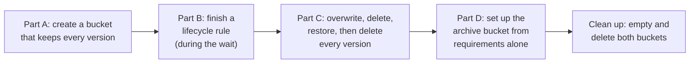

# Lab 05: Keep every version, add a lifecycle rule, and set up an archive bucket

## Before you start: your account, your responsibility

This guide is provided as is, without warranty. We work hard to keep it correct and current, but AWS changes often, and its services, prices, and free offers may differ from what is written here. The labs run in your own AWS account. You are responsible for that account, for its security, and for any charges it incurs, including charges from resources you forget to delete. Automate the Cloud Inc. is not liable for any costs, losses, or security incidents that result from following, or failing to follow, this material. Technical guidance here is general information, not advice about your specific systems.

**Who this is for:** you have done [Lab 01](../02-why-the-cloud/06-lab-01-first-resource.md) and read lessons [05.02](02-s3-in-practice.md) and [05.03](03-storage-classes-and-lifecycle.md). **Time:** about 60 minutes, including a 15-minute wait, plus 5 minutes the next day. Part B gives you part of the answer; Part D, only the requirements.

**Goal:** turn on versioning, write a lifecycle rule for the bakery's order exports, overwrite, delete and bring back a file, then set up the bucket for the seven-year tax archives from the owner's requirements alone. **End state:** your lab log holds both configurations, and your account holds nothing from this lab.

*Notice that Part B comes before any upload: AWS asks you to wait 15 minutes after turning on versioning, and a rule needs no files.*

**Long description.** Five stages, left to right: Part A, a bucket that keeps every version; Part B, a lifecycle rule, during the wait; Part C, overwrite, delete, restore, then delete every version; Part D, the archive bucket from requirements alone; clean up both buckets.

**What it creates**, in US East (N. Virginia), `us-east-1`, tagged `guide` = `clf` and `lab` = `05`:

- an S3 bucket with versioning and a lifecycle rule, holding one small text file for a few minutes;
- an empty archive bucket with versioning and a lifecycle rule.

You delete both, with every version.

**What it costs:** S3 charges for storage and for requests, with no minimum charge ([Amazon S3 FAQs](https://aws.amazon.com/s3/faqs/)). In US East (N. Virginia), as of 2026-10-24, uploads and other PUT, COPY, POST and LIST requests cost $0.005 per 1,000, reads cost $0.0004 per 1,000, and S3 Standard storage costs $0.023 per GB-month ([Amazon S3 pricing](https://aws.amazon.com/s3/pricing/)). This lab makes a few dozen requests and stores a few kilobytes for under an hour: even 200 of the dearer requests would cost $0.001, a tenth of a cent. **Free plan:** nothing is billed; it comes out of your credits, and nothing here upgrades your plan. **Worst case on a Paid plan** if you forget to clean up: a few kilobytes at $0.023 per GB-month, under a hundredth of a cent a month.

**Before you start:** the guardrails from the primer: [root MFA](https://github.com/AutomateTheCloud/atc-study-aws_account_guardrails/blob/main/primer/02-secure-the-root-user.md), [an IAM admin user with MFA](https://github.com/AutomateTheCloud/atc-study-aws_account_guardrails/blob/main/primer/03-your-everyday-admin-identity.md), which you use here, [money alarms](https://github.com/AutomateTheCloud/atc-study-aws_account_guardrails/blob/main/primer/05-money-alarms.md) and [the lab habits](https://github.com/AutomateTheCloud/atc-study-aws_account_guardrails/blob/main/primer/07-habits-for-every-lab.md), including your lab log.

**Why this matters:** a mistake reaches every live copy of your data (Module 03); versioning keeps the earlier copies. For S3, AWS puts backup, versioning and replication of your data on your side of the line ([04.01](../04-shared-responsibility-and-access/01-security-of-vs-in-the-cloud.md)): [REL09-BP01 Identify and back up all data that needs to be backed up, or reproduce the data from sources](https://docs.aws.amazon.com/wellarchitected/latest/reliability-pillar/rel_backing_up_data_identified_backups_data.html). Lifecycle rules keep only what you need, in the cheapest class that fits: [COST04-BP05 Enforce data retention policies](https://docs.aws.amazon.com/wellarchitected/latest/cost-optimization-pillar/cost_decomissioning_resources_data_retention.html).

> **New sign-up path:** S3 is supported there, but IAM users can't sign in to the console and your Region is fixed (as of 2026-10-23). Use your assigned Region instead of `us-east-1`, and sign in the way that path gives you. We haven't run this lab on that path.

**About the screens:** labels in **bold** are what we saw when we ran this lab end to end in our test account on 2026-10-25. AWS changes its console often. If a label differs, look for the option with the same meaning.

## Get ready

1. In your lab log, write the date, the Region `us-east-1`, the tags `guide` = `clf` and `lab` = `05`, and two bucket names: `clf-lab05-` and `clf-lab05-archive-`, each followed by your initials, the date and four random digits, for example `clf-lab05-ab-20261024-4817`.
2. On your computer, create a plain text file named `order-note.txt` holding one line: `Order 1001: one lemon tart`. Save it where you can find it.
3. Sign in to the console as your **IAM admin user** and check that the Region selector shows N. Virginia.

## Part A: create a bucket that keeps every version (follow-along)

4. Create the first bucket as in [Lab 01, steps 5 to 11](../02-why-the-cloud/06-lab-01-first-resource.md#create-the-bucket-and-time-it), with your `clf-lab05-` name and the tags `guide` = `clf` and `lab` = `05`. Make one change from Lab 01: under **Bucket Versioning**, choose **Enable**. Leave every other setting at its default.
   **You should see:** your new bucket's page. On its **Properties** tab, **Bucket Versioning** shows as enabled.
5. Write the time in your lab log. AWS recommends waiting 15 minutes after first turning on versioning before you upload or delete files; until then, reading a new file can fail ([Enabling versioning on buckets](https://docs.aws.amazon.com/AmazonS3/latest/userguide/manage-versioning-examples.html), checked 2026-10-23). Do Part B meanwhile.

## Part B: finish a lifecycle rule (completion)

**The requirement:** the bakery's nightly order exports go under the **prefix** `exports/` (the start of their names, like a folder). They're used for 30 days, then rarely, but must open at once when needed. Keep each for a year, then delete it. An overwritten export must stay recoverable for 30 days, and no longer.

6. In your bucket, choose the **Management** tab, then **Create lifecycle rule**.
7. In **Lifecycle rule name**, type `clf-lab05-exports`. Under **Choose a rule scope**, choose **Limit the scope of this rule using one or more filters**, and type `exports/` as the **Prefix**.
8. Under **Lifecycle rule actions**, tick three actions:
   - **Transition current versions of objects between storage classes**;
   - **Expire current versions of objects**;
   - **Permanently delete noncurrent versions of objects**.
9. For the transition, keep **Standard-IA** (the page starts with it) and type `30` in **Days after object creation**. Read the note that each transition is charged as a request, then tick **I acknowledge that this lifecycle rule will incur a transition cost per request.**
   The page also says that, by default, objects smaller than 128 KB never change storage class: moving them would cost more than it saves. Your text file is far smaller, so this rule would never move it; the bakery's real exports are larger.
10. From the requirement, fill in the days after creation to expire current versions, and the days after objects become noncurrent to delete them. Leave the number of newer versions to retain empty.
11. Read the summary of the rule's actions, then choose **Create rule**.
    **You should see:** the rule listed on the **Management** tab under **Lifecycle rules**.
    > **If something went wrong:** if the rule won't save, read the message; usually a number is in the wrong box.

Model answer

Expire current versions after `365` days; permanently delete noncurrent versions after `30` days. Standard-IA fits "rarely, but at once": millisecond reads, cheaper storage than S3 Standard, and a fee per gigabyte read.

People forget the third action. In a versioned bucket, expiring the current version only adds a **delete marker**; the old versions stay, each billed as a whole file ([S3 Versioning](https://docs.aws.amazon.com/AmazonS3/latest/userguide/Versioning.html)), unless a rule removes them.

## Part C: overwrite, delete and restore (follow-along)

Start this part once 15 minutes have passed since step 5.

*Notice that the delete in step 15 removes nothing; it adds a marker. Only step 19, deleting versions by ID, frees the space.*

**Long description.** Six frames, newest on top. 1, upload: version 1 current. 2, overwrite: version 2 current, version 1 kept. 3, delete: a delete marker is current, so the file looks gone; versions 2 and 1 remain. 4, delete the marker: version 2 current again. 5, re-upload version 1's text: version 3 current. 6, delete every version: nothing left, not even a marker.

12. On the bucket's **Objects** tab, choose **Upload**, then **Add files**, pick `order-note.txt`, and choose **Upload**.
    **You should see:** a success message. Close the page; the file is in the list.
13. On your computer, change the line to `Order 1001: two lemon tarts`, save, and upload the file again with the same name.
14. Turn on **Show versions**, next to the search box.
    **You should see:** two rows for `order-note.txt`, each with its own **version ID**. The newest is the **current version**; the older is a **noncurrent version**.
15. Turn **Show versions** off. Select `order-note.txt` and choose **Delete**. The page says that deleting "adds delete markers"; type `delete` and choose **Delete objects**.
    **You should see:** the file gone from the list.
16. Turn **Show versions** on.
    **You should see:** three rows: a delete marker on top, then both versions. Nothing was removed.
17. Select only the delete marker and choose **Delete**. Deleting by version ID is permanent, so the page asks for a stronger confirmation: type `permanently delete` and choose **Delete objects**.
    **You should see:** with **Show versions** off, the file is back, saying "two lemon tarts".
18. Bring back the first text. With **Show versions** on, select the older version (the earlier **Last modified** time), choose **Download**, and upload the downloaded file to the bucket under the name `order-note.txt`.
    **You should see:** three versions; the current one says "one lemon tart".
    > **If something went wrong:** if your browser saved it as `order-note(1).txt` or similar, rename it to `order-note.txt` first. A different name makes a different file, not a new version.
19. Delete for good: with **Show versions** on, select all three versions of `order-note.txt`, choose **Delete**, and confirm.
    **You should see:** nothing left, with **Show versions** on or off: no versions and no delete marker.

## Part D: set up the archive bucket from requirements alone (challenge)

**The owner's requirements for the tax archives:**

- Private and encrypted.
- Written once a year and almost never read. When the tax office asks, a wait of up to two days is fine.
- The cheapest storage that meets that.
- Each file is deleted automatically seven years after upload.
- A file deleted or overwritten by mistake stays recoverable for at least 90 days.

**Constraints:** your `clf-lab05-archive-` name and the lab tags; only settings from Parts A and B; no uploads.

20. Create and configure the bucket. In your lab log, write each setting next to the requirement it meets. (A rule for the whole bucket asks you to tick an extra acknowledgement that it applies to all objects.)

Model answer

| Requirement | Setting |
|---|---|
| Private and encrypted | The defaults: Block Public Access on, SSE-S3 encryption |
| Mistakes recoverable | Versioning enabled |
| Cheapest; two days is fine | One lifecycle rule for the whole bucket: current versions to **S3 Glacier Deep Archive** after 1 day |
| Deleted after seven years | Same rule: expire current versions after `2557` days (7 × 365 + 2 leap days) |
| Recoverable for 90 days | Same rule: permanently delete noncurrent versions after `180` days |

Deep Archive is S3's lowest-cost class; retrieval takes 12 to 48 hours, which fits "two days", and its 180-day minimum duration is no trap for seven-year files ([S3 storage classes](https://docs.aws.amazon.com/AmazonS3/latest/userguide/storage-class-intro.html), checked 2026-10-23). Why 180 days for old versions, when 90 meets the requirement? A version in Deep Archive is billed for at least 180 days anyway.

## Check your work

- [ ] The first bucket has versioning enabled and the rule `clf-lab05-exports` with 30, 365 and 30 days.
- [ ] Your lab log records the delete marker from step 16 and the text you read in steps 17 and 18.
- [ ] The archive bucket's settings match the model answer, or you can say why yours differ.

## Clean up

21. In **S3**, choose **General purpose buckets**, select your `clf-lab05-` bucket, and choose **Empty**. Type the confirmation the page asks for and choose **Empty**. In a versioned bucket this deletes every version and delete marker ([Emptying a general purpose bucket](https://docs.aws.amazon.com/AmazonS3/latest/userguide/empty-bucket.html), checked 2026-10-23). (task card: [Empty a versioned S3 bucket, then delete it](../98-how-to/04-empty-and-delete-a-versioned-bucket.md))
    **You should see:** a status page that reports the bucket emptied. If step 19 already removed everything, the page says it found no objects; that's fine, go on.
22. Delete that bucket as in [Lab 01, steps 20 and 21](../02-why-the-cloud/06-lab-01-first-resource.md#clean-up).
23. Delete the archive bucket the same way (empty it first if S3 says it isn't empty).
24. **Confirm:** in the S3 bucket list, search for `clf-lab05`; nothing should be found. In Tag Editor, search all Regions for the tag `lab` = `05` ([Lab 01, steps 13 to 16](../02-why-the-cloud/06-lab-01-first-resource.md#find-it-by-its-tags)); expect no S3 results. Tick both buckets off in your lab log.
25. **The next day:** check that your **Credits** balance hasn't fallen because of S3 ([primer page 07](https://github.com/AutomateTheCloud/atc-study-aws_account_guardrails/blob/main/primer/07-habits-for-every-lab.md), habit 4). (task card: [Read this month's bill by service and Region](../98-how-to/08-read-this-months-bill.md))

## Recap

With versioning, a delete adds a marker and an overwrite adds a version, so mistakes can be undone, and you pay for every version kept. A lifecycle rule is the other half: it cools data as it ages and removes old versions on schedule.

> **Reflect:** a teammate says "versioning is free insurance, turn it on everywhere and forget it". Write two sentences in reply.
>
> 

Model answer

>
> It's good insurance, but not free: every version is a whole stored file, so a file overwritten nightly keeps every old copy. Turn it on where losing data matters, with a rule that deletes noncurrent versions after the recovery window you need.
>
> 

**Next:** [Simulation S5](09-sim-lifecycle-cost-timeline.md) runs lifecycle plans forward a year, with the cost traps a one-hour lab can't show.

## Where to check the current details

Amazon S3 User Guide pages, checked 2026-10-23:

- [Retaining multiple versions of objects with S3 Versioning](https://docs.aws.amazon.com/AmazonS3/latest/userguide/Versioning.html)
- [Enabling versioning on buckets](https://docs.aws.amazon.com/AmazonS3/latest/userguide/manage-versioning-examples.html)
- [Setting an S3 Lifecycle configuration on a bucket](https://docs.aws.amazon.com/AmazonS3/latest/userguide/how-to-set-lifecycle-configuration-intro.html)
- [Understanding and managing Amazon S3 storage classes](https://docs.aws.amazon.com/AmazonS3/latest/userguide/storage-class-intro.html)
- [Emptying a general purpose bucket](https://docs.aws.amazon.com/AmazonS3/latest/userguide/empty-bucket.html)

Prices: [Amazon S3 pricing](https://aws.amazon.com/s3/pricing/) (figures above as of 2026-10-24).

---

"Lab 05: Keep every version, add a lifecycle rule, and set up an archive bucket" by Automate the Cloud Inc., licensed under CC BY-NC 4.0 with the Additional Permission for Internal Training from Automate the Cloud Inc.
License: https://creativecommons.org/licenses/by-nc/4.0/
Permission: https://automatethe.cloud/licenses/atc-internal-training-permission.txt
