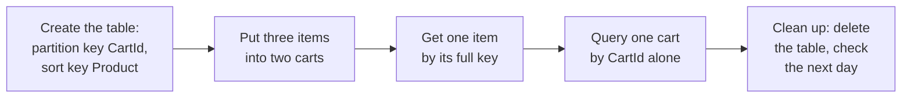

# Optional lab 06: Create a DynamoDB table for shopping carts, put and get items, and delete it

## Before you start: your account, your responsibility

This guide is provided as is, without warranty. We work hard to keep it correct and current, but AWS changes often, and its services, prices, and free offers may differ from what is written here. The labs run in your own AWS account. You are responsible for that account, for its security, and for any charges it incurs, including charges from resources you forget to delete. Automate the Cloud Inc. is not liable for any costs, losses, or security incidents that result from following, or failing to follow, this material. Technical guidance here is general information, not advice about your specific systems.

**This lab is optional.** The exam asks which database fits, not how to build one; do it if you want to see DynamoDB for yourself.

**Who this is for:** you have done [Lab 01](../02-why-the-cloud/06-lab-01-first-resource.md) and read [05.05 Managed databases and choosing one](05-managed-or-self-managed-databases.md). **Time:** about 30 minutes, plus 5 minutes the next day.

**Goal:** the bakery wants its online shopping carts in Amazon DynamoDB, AWS's serverless NoSQL database. You create a cart table, put three items in it, read one item back by its key and a whole cart with a query, then delete the table. **End state:** your lab log holds what you saw, and your account holds nothing from this lab.

*Notice that there are no servers, database engine versions or connections anywhere in the lab: you create a table and use it.*

**Long description.** Five stages from left to right. Create the table with partition key CartId and sort key Product. Put three items into two carts. Get one item by its full key. Query one cart by CartId alone. Clean up: delete the table and check the next day.

**What it creates:** one DynamoDB **table**, `clf-lab06-carts`, in US East (N. Virginia), `us-east-1`, tagged `guide` = `clf` and `lab` = `06`, holding three small **items** (records). You delete it at the end.

**What it costs:** the table uses **on-demand capacity mode**, which charges for each read and write request and has nothing to provision. AWS's US East (N. Virginia) example prices on-demand writes at $0.625 and reads at $0.125 per million requests, and DynamoDB's always-free tier includes 25 GB of storage per Region ([Amazon DynamoDB pricing](https://aws.amazon.com/dynamodb/pricing/on-demand/), checked 2026-10-23). This lab makes a few dozen requests, so it costs far less than one cent. **Free plan:** nothing is billed; the usage comes out of your credits, and nothing here upgrades your plan. **Worst case on a Paid plan** if you forget to delete the table: $0 a month while nobody uses it, because an idle on-demand table makes no requests and its few kilobytes fit in the free 25 GB.

**Before you start, you need these guardrails in place:** [root MFA](https://github.com/AutomateTheCloud/atc-study-aws_account_guardrails/blob/main/primer/02-secure-the-root-user.md) (primer page 02), [an IAM admin user with MFA](https://github.com/AutomateTheCloud/atc-study-aws_account_guardrails/blob/main/primer/03-your-everyday-admin-identity.md), which you use for this lab (page 03), [budgets and billing alerts](https://github.com/AutomateTheCloud/atc-study-aws_account_guardrails/blob/main/primer/05-money-alarms.md) (page 05), and [the habits for every lab](https://github.com/AutomateTheCloud/atc-study-aws_account_guardrails/blob/main/primer/07-habits-for-every-lab.md), including your lab log (page 07).

**Why this matters:** a cart is looked up by one key, changes often, and has no fixed shape; that is the key-value shape lesson 05.05 matched to DynamoDB. Picking the store that fits the data, instead of putting everything in one database, is [PERF03-BP01 Use a purpose-built data store that best supports your data access and storage requirements](https://docs.aws.amazon.com/wellarchitected/latest/performance-efficiency-pillar/perf_data_use_purpose_built_data_store.html). Paying per request for a small, uneven workload is cost optimization in practice.

> **New sign-up path:** DynamoDB is on that experience's list of supported services, but IAM users can't sign in to the console and your Region is fixed (as of 2026-10-23). Use your assigned Region wherever this lab says `us-east-1`, and sign in the way that path gives you. We haven't run this lab on that path.

**About the screens:** labels in **bold** are what we saw when we ran this lab end to end in our test account on 2026-10-25. AWS changes its console often. If a label differs, look for the option with the same meaning.

## Steps

### Get ready

1. In your lab log, write today's date, the Region `us-east-1`, the tags `guide` = `clf` and `lab` = `06`, and the table name `clf-lab06-carts`.
2. Sign in to the console as your **IAM admin user** and check that the Region selector shows N. Virginia.

### Create the table

3. In the console search bar, type `DynamoDB` and open it. In the left menu, choose **Tables**, then **Create table**.
4. Under **Table details**, fill in:
   - **Table name:** `clf-lab06-carts`
   - **Partition key:** `CartId`, type **String**
   - **Sort key:** `Product`, type **String**

   The **partition key** picks which group an item belongs to; the **sort key** tells the items in one group apart. Together they make each item's full key, so two items can't share both values.
5. Under **Table settings**, keep **Default settings**. Read the summary of those defaults and find the capacity mode.
   **You should see:** **On-demand**. If it shows **Provisioned** instead, choose **Customize settings** and select the on-demand option, so you pay only for requests.
6. If the page has a **Tags** section, add the tags `guide` = `clf` and `lab` = `06`. If it doesn't, add them after step 7, from the table's settings (look for **Tags**).
7. Choose **Create table**.
   **You should see:** your table in the list, with a status that changes from creating to **Active** after a short wait.
   AWS's guide recommends turning on point-in-time recovery for real tables. Skip it here: it bills for the table's size until you turn it off ([Amazon DynamoDB pricing](https://aws.amazon.com/dynamodb/pricing/on-demand/)).

### Put three items into two carts

8. Choose your table, then **Explore items**. Choose **Create item**. The page opens in **Form** view, with rows for `CartId` and `Product`.
9. Type `cart-1001` for **CartId** and `lemon-tart` for **Product**. Choose **Add new attribute**, then **Number**, and fill in the new row: name `Quantity`, value `2`. Choose **Create item**.
   **You should see:** the item in the list of items.
   > **If something went wrong:** if you picked String instead of Number for `Quantity`, open the item, remove that attribute, add it again as a Number, and save.
10. Create a second item: `cart-1001`, `rye-loaf`, `Quantity` `1`. Before you save it, add one more attribute of type **String**, named `GiftNote`, with the value `Happy birthday!`.
11. Create a third item: `cart-1002`, `croissant`, `Quantity` `6`.
    **You should see:** three items. Only `rye-loaf` has a `GiftNote`: items in one table don't need the same attributes.

*Notice that each cart is one group, found by its partition key. A relational database would usually need a fixed GiftNote column for every row; here only the item that needs it has one.*

**Long description.** Columns CartId (partition key), Product (sort key), Quantity and GiftNote (attributes). Group cart-1001: lemon-tart, 2, no gift note, outlined as the item a get finds; rye-loaf, 1, "Happy birthday!". Group cart-1002: croissant, 6, no gift note. A get uses CartId and Product together to find one item; a query for CartId cart-1001 finds both items in that group.

### Get one item, then query one cart

12. Above the items list, the panel offers **Scan**, **Query** and **Search**; choose **Query**. Type `cart-1001` for **CartId**. For the sort key, choose the condition **Equal to** and type `lemon-tart`. Choose **Run**. Below the results, a line reports the items returned and the read capacity used.
    **You should see:** one item, `lemon-tart`, quantity 2. Giving both parts of the key works as a get: it finds exactly one item.
13. Clear the sort key value and run the query again.
    **You should see:** two items, `lemon-tart` and `rye-loaf`, the whole of cart 1001 and nothing from cart 1002. A **query** finds every item that shares a partition key, which is how the bakery's site would load one customer's cart.
    > **If something went wrong:** no results usually means a typo or different capitals: keys are matched exactly, so `Cart-1001` isn't `cart-1001`. Check the items list and run it again.
14. Write in your lab log how many items each query returned.

## Check your work

- [ ] The table `clf-lab06-carts` has partition key `CartId`, sort key `Product`, on-demand capacity and the two lab tags.
- [ ] It holds three items, and only `rye-loaf` has a `GiftNote`.
- [ ] Your lab log shows one item for step 12 and two for step 13.

## Clean up

15. In **Tables**, select `clf-lab06-carts` and choose **Delete**. The dialog offers to create an on-demand backup first: leave that cleared (it was, for us), because a backup is a new resource that keeps costing until you delete it. Leave **Delete all CloudWatch alarms** ticked, type `confirm`, and choose **Delete**.
    **You should see:** the table's status change to deleting, then the table gone from the list.
    > **If something went wrong:** if DynamoDB says deletion protection is on, open the table's settings, turn deletion protection off, and repeat this step.
16. **Confirm:** the **Tables** list shows nothing starting `clf-lab06`. In Tag Editor, search all Regions for the tag `lab` = `06` ([Lab 01, steps 13 to 16](../02-why-the-cloud/06-lab-01-first-resource.md#find-it-by-its-tags), with the resource type set to all supported types or to `AWS::DynamoDB::Table`); expect no results. Tick the table off in your lab log.
17. **The next day:** check that your **Credits** balance hasn't fallen because of DynamoDB ([primer page 07](https://github.com/AutomateTheCloud/atc-study-aws_account_guardrails/blob/main/primer/07-habits-for-every-lab.md), habit 4). (task card: [Read this month's bill by service and Region](../98-how-to/08-read-this-months-bill.md))

## Recap

You built a database without choosing a server, an engine version or a size, stored items that don't all share the same attributes, and found them by key. That is what "serverless, key-value" means in practice. DynamoDB has no joins between tables, so it suits data you fetch by a known key ([What is Amazon DynamoDB?](https://docs.aws.amazon.com/amazondynamodb/latest/developerguide/Introduction.html)).

> **Reflect:** the bakery keeps its orders in Amazon RDS and its carts in DynamoDB. Write two sentences on why it doesn't put both in one place.
>
> 

Model answer

>
> Orders are relational: an order links a customer, several products and a payment, and the accounts need queries across all of them, which a relational database such as RDS does well. A cart is fetched and changed often, always by one key, and has no fixed shape, which fits DynamoDB's key-value model, with no server to run and a charge only for the requests made.
>
> 

**Next:** [Simulation S6](10-sim-multi-az-vs-read-replica.md) looks after the order database, which you can't run cheaply in a lab: RDS bills for every second a database instance runs, with a 10-minute minimum ([Amazon RDS FAQs](https://aws.amazon.com/rds/faqs/)).

## Where to check the current details

- [Step 1: Create a table in DynamoDB](https://docs.aws.amazon.com/amazondynamodb/latest/developerguide/getting-started-step-1.html), Amazon DynamoDB Developer Guide (checked 2026-10-23)
- [What is Amazon DynamoDB?](https://docs.aws.amazon.com/amazondynamodb/latest/developerguide/Introduction.html), Amazon DynamoDB Developer Guide (checked 2026-10-23)
- [Amazon DynamoDB pricing](https://aws.amazon.com/dynamodb/pricing/on-demand/) (checked 2026-10-23)
- [Amazon DynamoDB FAQs](https://aws.amazon.com/dynamodb/faqs/) (checked 2026-10-23)

---

"Optional lab 06: Create a DynamoDB table for carts, put and get items, then delete it" by Automate the Cloud Inc., licensed under CC BY-NC 4.0 with the Additional Permission for Internal Training from Automate the Cloud Inc.
License: https://creativecommons.org/licenses/by-nc/4.0/
Permission: https://automatethe.cloud/licenses/atc-internal-training-permission.txt
